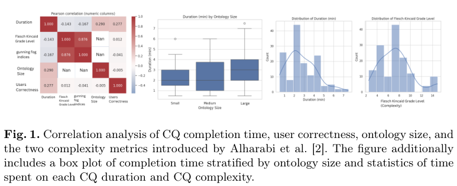
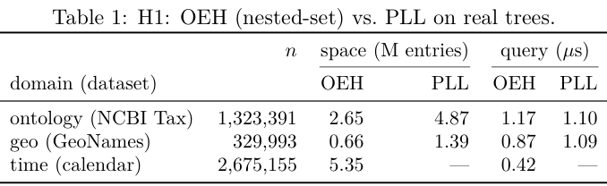
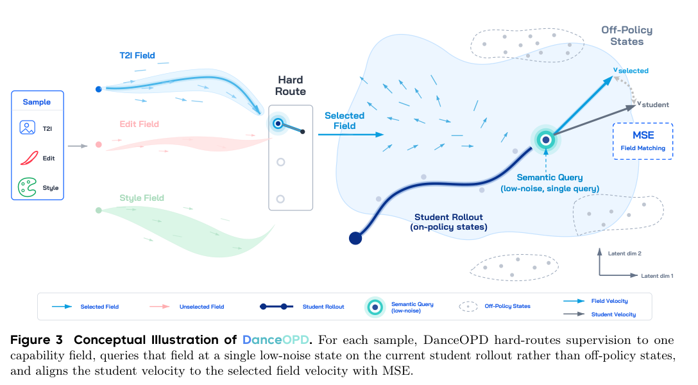
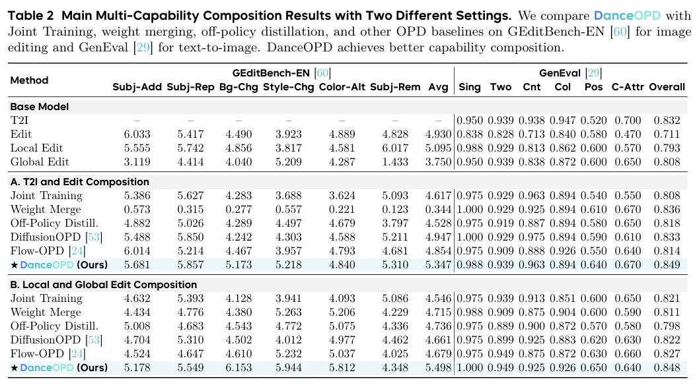
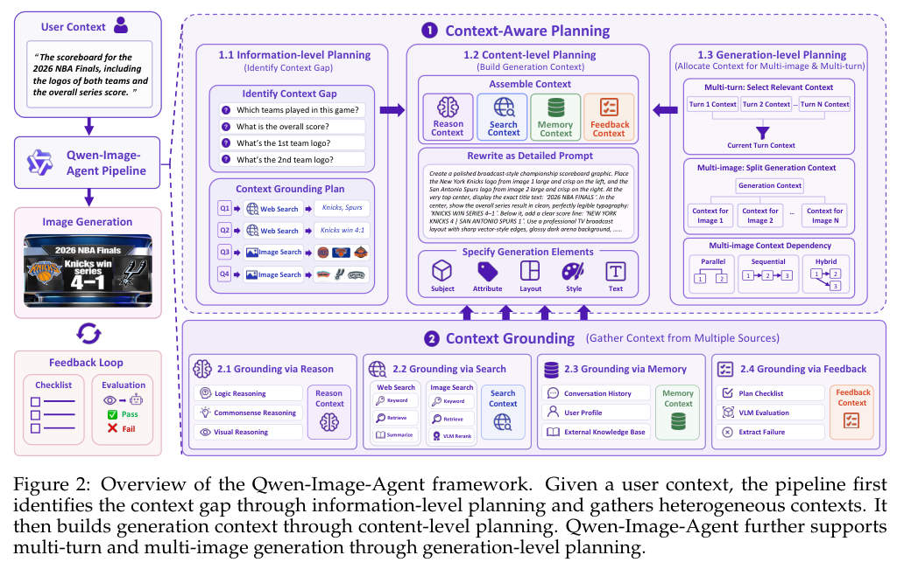
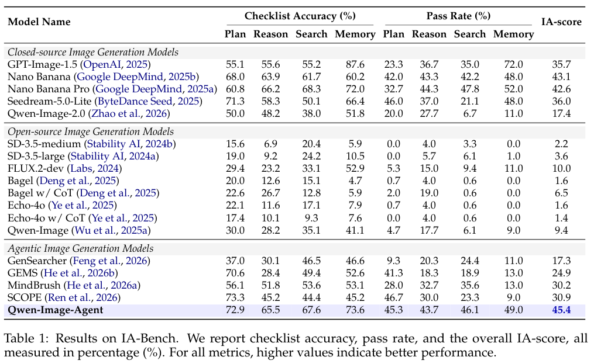
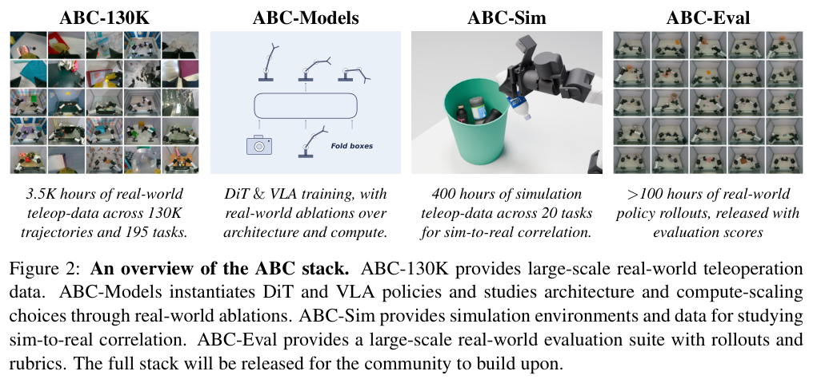
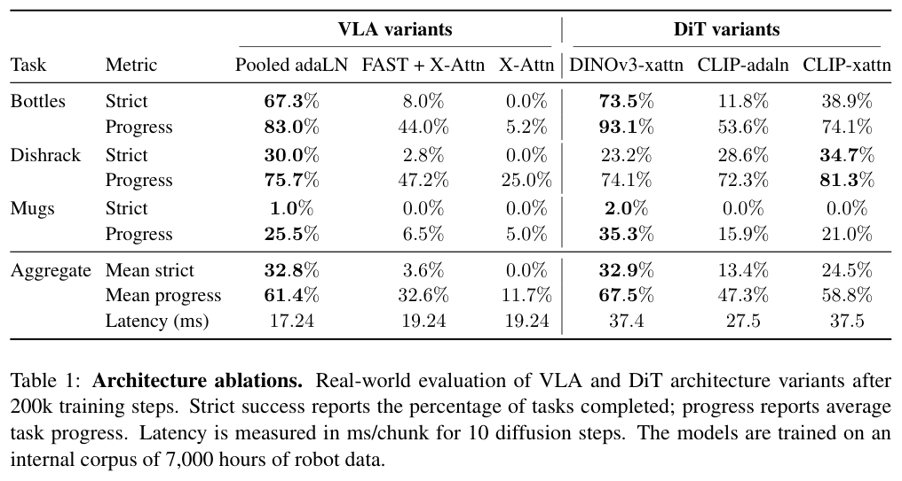

本期九项研究介绍可生成的 SPARQL 模板、本体问题与层级索引、生成能力组合、图像 Agent、扩散语言模型、技能自蒸馏、开放行为克隆和推荐实验工作流。

## 1. Generative SPARQL：为模型调用与递归查询定义语义

[On the Semantics of Generative SPARQL](https://arxiv.org/abs/2606.23875v1) · v1 提交 2026-06-22 · [全文](https://arxiv.org/html/2606.23875v1) · [PDF](https://arxiv.org/pdf/2606.23875v1)

让 SPARQL 调用语言模型，首先要回答生成值是否成为 RDF 事实。本文保持被查数据集固定，让 GenOp 根据已有绑定填充提示词、调用指定模型、解析有限输出，并给新值标记生成来源；这些值只进入解映射，不写回图谱。兼容判断可以采用确定性词面化和相似阈值，并不构成自动补全事实的正确性宣称。

两个 GenOp 相互依赖时，常规从左到右执行不够。论文按依赖图讨论无环、分层及循环片段，以映射集合上的不动点定义递归，并研究保留语义的改写和可执行评估。在确定性、有界生成、有限候选覆盖与精确性等假设下，定理 7 给出的数据复杂度为 PTIME 范围、组合复杂度为 PSPACE-complete；不能把这一复杂度结论翻译成模型调用没有额外延迟或费用。

原文没有多数据集准确率或性能实验。我的判断是，这是一套给未来系统使用的语义契约：结果何时可终止、查询何时可重排、生成与原始值如何区分。部署仍需核查候选覆盖是否成立，固定模型与解码配置，记录来源并设置超时和费用上限；相似阈值也可能误合并实体。

原文：Ratan Bahadur Thapa、Steffen Staab，arXiv:2606.23875v1，示例 1 查询片段（非编号图），PDF 第 2 页。[原始来源](https://arxiv.org/pdf/2606.23875v1#page=2) · [CC BY 4.0](https://creativecommons.org/licenses/by/4.0/)。裁剪自原文。

## 2. CQ 验证：读起来难不等于本体更大

这项研究重新分析十九名参与者使用 OE-Assist 完成二十项 competency question 验证的记录，比较判定正确性、主观难度、完成时间、本体大小与文本可读性。定性反馈进一步检查歧义词、复杂问题与自然语言到形式查询的偏差。

*图｜Lippolis, Anna Sofia 等，[Figure 1（PDF 第 3 页）](https://arxiv.org/pdf/2606.24619v1#page=3)，[CC BY-SA 4.0](http://creativecommons.org/licenses/by-sa/4.0/)。裁剪自原文。*

唯一显著的变量关联是完成时间与主观难度：Spearman ρ=0.42、Kendall τ=0.34，均 p<0.001。其他变量对未发现显著关联，因此不能仅按本体规模或可读性公式判断一个 CQ 是否困难。小样本观察支持在发布问题前澄清歧义，但没有证明某个自动改写工具已提升用户正确率。

[When CQs Go Wrong: Challenges in CQ Verification with OE-Assist](https://arxiv.org/abs/2606.24619v1) · v1。

## 3. OEH：用层级结构选择包含与汇总索引

OEH 将时间、地域和本体层级视为偏序：树用 nested-set 编码，低宽度 DAG 用链分解，在同一结构中处理包含判断和可组合的层级汇总。廉价结构探测先判断哪条路线适用，而不是为所有图强行使用同一种索引。

*图｜Mandarapu, Madhulatha 等，[Table 1（PDF 第 3 页）](https://arxiv.org/pdf/2606.24677v1#page=3)，[CC BY 4.0](http://creativecommons.org/licenses/by/4.0/)。裁剪自原文。*

NCBI 的约 132 万节点树中，OEH 用 265 万索引项，PLL 用 487 万；查询为 1.17 与 1.10 微秒。GeoNames 为 0.87 对 1.09 微秒。这里的纯 Python、特定机器测量说明接近查询时延下的空间权衡；高宽度 DAG 会拒绝链索引，2-hop 更有优势，树上的结果不能直接推广到任意知识图谱。

[One Index for Subsumption and Roll-up across Time, Geography, and Ontology](https://arxiv.org/abs/2606.24677v1) · v1。

## 4. DanceOPD：在学生访问的状态上组合生成能力

DanceOPD 将文生图、局部编辑和全局编辑专家视为共享 flow 状态空间中的速度场。每个样本路由到一个能力场，在学生自己 rollout 的低噪声状态查询教师，并用速度 MSE 蒸馏，减少不同能力直接混合训练时的冲突。

*图｜Zhou, Wei 等，[Figure 3（PDF 第 7 页）](https://arxiv.org/pdf/2606.27377v1#page=7)，[CC BY-SA 4.0](http://creativecommons.org/licenses/by-sa/4.0/)。裁剪自原文。*

文生图与编辑组合实验中，GEditBench-EN 平均分为 5.347，Joint Training 为 4.617；GenEval Overall 为 0.849 对 0.808。局部、全局编辑组合的另一配置又得到 5.498，不能与前一组增益叠加。不同子能力仍有权衡，专家构造、查询时刻和 rollout 计算都属于这套训练方案的投入。

*图｜Zhou, Wei 等，[Table 2（PDF 第 13 页）](https://arxiv.org/pdf/2606.27377v1#page=13)，[CC BY-SA 4.0](http://creativecommons.org/licenses/by-sa/4.0/)。裁剪自原文。*

[DanceOPD: On-Policy Generative Field Distillation](https://arxiv.org/abs/2606.27377v1) · v1。

## 5. Qwen-Image-Agent：先补足上下文，再生成图片

Qwen-Image-Agent 将用户描述视为部分上下文，规划缺失条件，再利用推理、网页与图片搜索、记忆和反馈补足生成所需信息。它将画面生成器与控制者分开，使多轮请求、近期知识和隐含需求进入可操作的工作流。

*图｜Zhang, Zekai 等，[Figure 2（PDF 第 4 页）](https://arxiv.org/pdf/2606.26907v2#page=4)，[CC BY 4.0](http://creativecommons.org/licenses/by/4.0/)。裁剪自原文。*

IA-Bench 的 730 个实例覆盖四项能力、十七类子任务。相同 Qwen-Image-2.0 生成骨干的直接调用 IA-score 为 17.4，Agent 为 45.4；Agent 额外使用 GPT-5.5-0424、搜索及最多三次反馈。Memory 通过率为 49.0%，仍低于 GPT-Image-1.5 的 72.0%。整体改善体现额外上下文和计算的作用，不能当作单个图像模型权重的提升。

*图｜Zhang, Zekai 等，[Table 1（PDF 第 8 页）](https://arxiv.org/pdf/2606.26907v2#page=8)，[CC BY 4.0](http://creativecommons.org/licenses/by/4.0/)。裁剪自原文。*

[Qwen-Image-Agent: Bridging the Context Gap in Real-World Image Generation](https://arxiv.org/abs/2606.26907v2) · v2。

## 6. iLLaDA：从零扩展双向扩散语言模型

iLLaDA 保持 masked diffusion 目标与全双向注意力，从零预训练 8B 模型到 12T token，再以 25B-token 指令语料训练十二轮。推理采用可变长度生成，多选题还引入基于置信度的评分规则。

Instruct 的 MATH 为 56.7，LLaDA 为 42.2；HumanEval 为 65.9 对 49.4。但 Qwen2.5-7B Instruct 的两项为 75.5、84.8，仍更高。iLLaDA 与 LLaDA 的预训练量为 12T 对 2.3T，数据规模、训练与评估方式同时变化，结果支持扩散路线的扩展潜力，而非对架构在等预算下优劣的单独证明。

[Improved Large Language Diffusion Models](https://arxiv.org/abs/2606.25331v1) · v1。

[Figure 1（原文）](https://arxiv.org/pdf/2606.25331v1#page=6)。

## 7. OPID：从刚完成的轨迹中提取训练技能

OPID 在完成的 on-policy 轨迹中提取全局工作流和关键步骤技能，优先使用局部决策知识，缺少关键节点时回退到整体经验。旧策略在原始与技能增强上下文下重新评分，把 logprob 差异作为密集自蒸馏优势，与结果奖励一起训练。

Qwen2.5-3B 的 ALFWorld 平均成功率为 84.3%，GRPO 为 75.0%，但略低于 SDAR 的 84.4%；WebShop 成功率为 74.2%，高于两者的 63.3% 和 68.0%。推理时不再调用技能分析器或检索特权上下文，训练时仍需额外提取与重评分。不同任务的成功率和搜索 QA 准确率应分别看，不能合成一个统一收益。

[OPID: On-Policy Skill Distillation for Agentic Reinforcement Learning](https://arxiv.org/abs/2606.26790v1) · v1。

[Figure 1（原文）](https://arxiv.org/pdf/2606.26790v1#page=2)。

## 8. ABC：开放行为克隆的数据、硬件与评测栈

ABC 提供 3,500 小时、十三万多条轨迹、195 项任务的 ABC-130K，以及四百小时仿真遥操作数据、硬件方案和训练工具。作者用关联的仿真与实机评价研究架构、数据与优化选择，让昂贵实机验证之前有较可重复的筛选路径。

*图｜Allshire, Arthur 等，[Figure 2（PDF 第 2 页）](https://arxiv.org/pdf/2606.27375v1#page=2)，[CC BY 4.0](http://creativecommons.org/licenses/by/4.0/)。裁剪自原文。*

架构消融使用的是内部七千小时开发语料，而不是最终公开的 ABC-130K。二十万步后，Pooled-adaLN VLA 的严格成功率均值为 32.8%，DINOv3 cross-attention DiT 为 32.9%；每动作块时延为 17.24 对 37.4 毫秒，任务进度又为 61.4% 对 67.5%。三项实机任务仍很难，公开数据规模与开发消融结果必须分开，进度也不能当作完整成功率。

*图｜Allshire, Arthur 等，[Table 1（PDF 第 4 页）](https://arxiv.org/pdf/2606.27375v1#page=4)，[CC BY 4.0](http://creativecommons.org/licenses/by/4.0/)。裁剪自原文。*

[Scalable Behavior Cloning with Open Data, Training, and Evaluation](https://arxiv.org/abs/2606.27375v1) · v1。

## 9. AgentX：把推荐实验做成可积累的执行闭环

AgentX 将历史实验检索、方案生成、仓库实现、上线验证与 A/B 评价连接起来，再用执行轨迹改进 harness。人类保留方案审核和决策，系统将成功与失败沉淀成后续提案和实现可使用的知识。

快手两个业务场景的三周部署中，三个 worker 生成 374 个提案，106 个通过审核，100 个进入实验，10 个成为可推广结果，端到端转化约 2.67%。单提案转化仍低于工程师对照的 5.1%，系统用更多并发换取产出。这是有人工审核和既有生产基础设施的观察案例，不能据此断言吞吐会在任何组织线性扩展，或将收益全部归因于自演化机制。

[AgentX: Towards Agent-Driven Self-Iteration of Industrial Recommender Systems](https://arxiv.org/abs/2606.26859v2) · v2。

[Figure 1（原文）](https://arxiv.org/pdf/2606.26859v2#page=5)。
