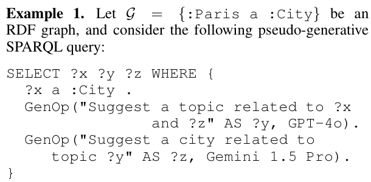

## 重点阅读

[On the Semantics of Generative SPARQL](https://arxiv.org/abs/2606.23875v1) · v1 提交 2026-06-22 · [全文](https://arxiv.org/html/2606.23875v1) · [PDF](https://arxiv.org/pdf/2606.23875v1)

让 SPARQL 调用语言模型，首先要回答生成值是否成为 RDF 事实。本文保持被查数据集固定，让 GenOp 根据已有绑定填充提示词、调用指定模型、解析有限输出，并给新值标记生成来源；这些值只进入解映射，不写回图谱。兼容判断可以采用确定性词面化和相似阈值，并不构成自动补全事实的正确性宣称。

两个 GenOp 相互依赖时，常规从左到右执行不够。论文按依赖图讨论无环、分层及循环片段，以映射集合上的不动点定义递归，并研究保留语义的改写和可执行评估。在确定性、有界生成、有限候选覆盖与精确性等假设下，定理 7 给出的数据复杂度为 PTIME 范围、组合复杂度为 PSPACE-complete；不能把这一复杂度结论翻译成模型调用没有额外延迟或费用。

原文没有多数据集准确率或性能实验。我的判断是，这是一套给未来系统使用的语义契约：结果何时可终止、查询何时可重排、生成与原始值如何区分。部署仍需核查候选覆盖是否成立，固定模型与解码配置，记录来源并设置超时和费用上限；相似阈值也可能误合并实体。下方是示例 1 的查询片段，不是实验图。

原文：Ratan Bahadur Thapa、Steffen Staab，arXiv:2606.23875v1，示例 1 查询片段（非编号图），PDF 第 2 页。[原始来源](https://arxiv.org/pdf/2606.23875v1#page=2) · [CC BY 4.0](https://creativecommons.org/licenses/by/4.0/)。裁剪自原文。

## 同期其他论文入口

- [When CQs Go Wrong: Challenges in CQ Verification with OE-Assist](https://arxiv.org/abs/2606.24619v1) · 2606.24619v1，该版本提交 2026-06-23。
- [One Index for Subsumption and Roll-up across Time, Geography, and Ontology](https://arxiv.org/abs/2606.24677v1) · 2606.24677v1，该版本提交 2026-06-23。
- [DanceOPD: On-Policy Generative Field Distillation](https://arxiv.org/abs/2606.27377v1) · 2606.27377v1，该版本提交 2026-06-25。
- [Qwen-Image-Agent: Bridging the Context Gap in Real-World Image Generation](https://arxiv.org/abs/2606.26907v2) · 2606.26907v2，该版本提交 2026-06-26。
- [Improved Large Language Diffusion Models](https://arxiv.org/abs/2606.25331v1) · 2606.25331v1，该版本提交 2026-06-24。
- [OPID: On-Policy Skill Distillation for Agentic Reinforcement Learning](https://arxiv.org/abs/2606.26790v1) · 2606.26790v1，该版本提交 2026-06-25。
- [Scalable Behavior Cloning with Open Data, Training, and Evaluation](https://arxiv.org/abs/2606.27375v1) · 2606.27375v1，该版本提交 2026-06-25。
- [AgentX: Towards Agent-Driven Self-Iteration of Industrial Recommender Systems](https://arxiv.org/abs/2606.26859v2) · 2606.26859v2，该版本提交 2026-06-26。
