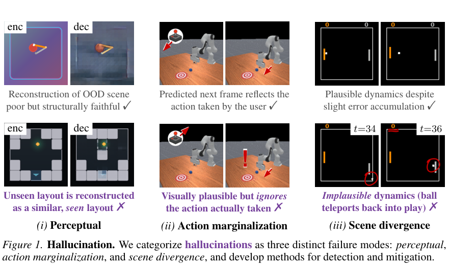
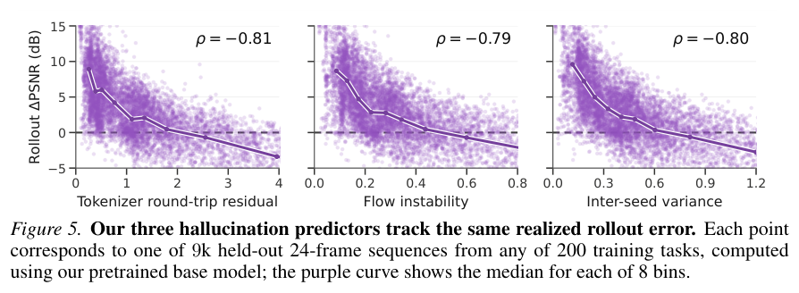
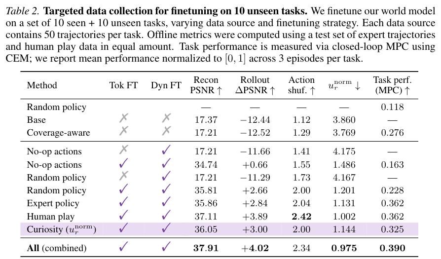
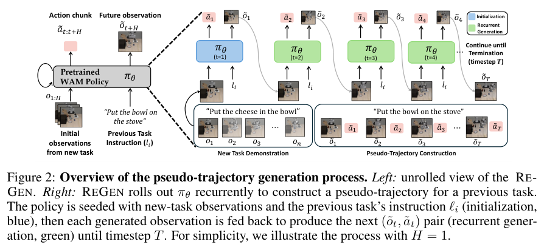
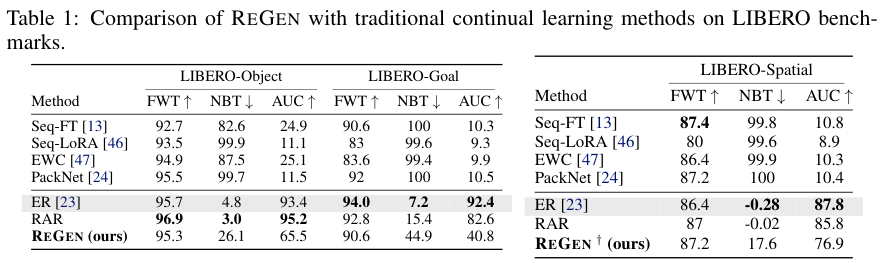
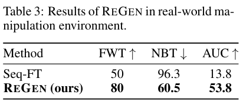

本期八项研究介绍同源图谱问答、建筑热控制、世界模型幻觉、语言动作预训练、视觉离散表示、执行分数强化学习、三维力学和生成式回放。

## 1. All Relations Lead to Rome：用同源资料比较图与文本检索

[All Relations Lead to Rome: Automated Knowledge Graph Creation and Question Generation](https://arxiv.org/abs/2606.22645v1) · v1 提交 2026-06-21 · [全文](https://arxiv.org/html/2606.22645v1) · [PDF](https://arxiv.org/pdf/2606.22645v1)

图检索与向量检索常用不同资料，难以公平比较。All Relations Lead to Rome 将同一罗马史文档切块，使用轻量本体抽实体和关系，并为文本块、实体生成向量；问答则从可追溯事实和支撑文本生成，再改写为不同人物口吻。符号结构、文本证据和向量索引因此可以在同源材料上比较。

数据包含 19,374 个实体、16,069 个文本块、25,304 条关系和 8,400 组问答。尤其要区分：6,000 组落在知识库中，另 2,400 组涉及库中没有的实体或事实，用于检验无答案情形的错误召回。这些是数据规模，不是模型准确率。原文尚未提供多个 RAG 系统的同条件性能排名，后续比较是计划中的研究。

自动抽取仍可能漏实体、错连关系；同题可能存在多个合理支撑事实，严格单答案评分也会误判。我的判断是，这份历史领域材料适合检验图过滤、向量搜索与混合召回，但使用前应人工抽查实体—关系—支撑块链条，并选择允许多答案、面向召回的指标。要宣称混合检索更好，仍需补真实对照，不能以图谱规模代替效果证据。

**原图入口：**[Figure 1，PDF 第 1 页](https://arxiv.org/pdf/2606.22645v1#page=1)。

## 2. ThermoLLM：让空调控制读懂区域之间的热耦合

ThermoLLM 在五区域 EnergyPlus 仿真中，将 Brick 风格的建筑语义、区域邻接和热耦合关系组织为空间知识图谱，与近期温度、占用、天气和历史动作一起交给控制器。图谱提供空间连接，历史提供短期热响应，帮助模型处理控制动作的延迟影响。

冬季仿真中，ThermoLLM 的 PMV 舒适度违规率为 4.95%，用能 271.75 kWh；仅用历史的 LLM 为 16.41% 和 255.09 kWh，PPO 为 12.50% 和 342.49 kWh。它改善舒适度但并非能耗最低，结论受单栋五区域建筑、季节和仿真设定限制，不能直接等同于实楼节能率。

[ThermoLLM: Thermodynamics-Aware HVAC Control with Spatial-Semantic Knowledge Graph](https://arxiv.org/abs/2606.22911v1) · v1。

[Figure 1（原文）](https://arxiv.org/pdf/2606.22911v1#page=4)。

## 3. 世界模型幻觉：用覆盖信号寻找容易漂移的状态

这项工作把世界模型错误拆成感知失真、忽略动作与场景偏离，在含 210 项任务、427 小时数据的 MMBench2 上训练 350M 模型。编码解码残差、流不稳定性与多随机种子方差作为廉价预测信号，再用任务均衡采样和针对性探索补充覆盖薄弱区域。

*图｜Hansen, Nicklas 等，[Figure 1（PDF 第 2 页）](https://arxiv.org/pdf/2606.27326v1#page=2)，[CC BY-SA 4.0](http://creativecommons.org/licenses/by-sa/4.0/)。裁剪自原文。*

九千段留出序列中，三种信号与 rollout ΔPSNR 的 Spearman 相关分别约为 −0.81、−0.79 和 −0.80。十项未见任务中，每任务五十条轨迹、同时微调 tokenizer 与动力学模型后，人类数据和专家数据的归一化 MPC 得分均为 0.362，混合数据为 0.390；只调整动力学模型明显不足。相关信号有助定位风险，但不构成任意环境下消除幻觉的保证。

*图｜Hansen, Nicklas 等，[Figure 5（PDF 第 7 页）](https://arxiv.org/pdf/2606.27326v1#page=7)，[CC BY-SA 4.0](http://creativecommons.org/licenses/by-sa/4.0/)。裁剪自原文。*

*图｜Hansen, Nicklas 等，[Table 2（PDF 第 8 页）](https://arxiv.org/pdf/2606.27326v1#page=8)，[CC BY-SA 4.0](http://creativecommons.org/licenses/by-sa/4.0/)。裁剪自原文。*

[Hallucination in World Models is Predictable and Preventable](https://arxiv.org/abs/2606.27326v1) · v1。

## 4. LA4VLA：先在没有视觉输入时学语言与动作的对应

LA4VLA 将已有机器人演示拆成原子动作片段，并配上低层语言描述，形成 33K 条语言—动作样本。模型先在无视觉条件下学习可复用动作先验，再单独或混合加入视觉—语言—动作训练，减少只按画面而忽略指令的捷径。

LA4VLA-1B 在 MetaWorld 上，无预训练平均成功率为 69.73%，混合预训练为 87.53%；LIBERO 的最佳顺序预训练为 96.28%，无预训练为 92.85%。三个 xArm6 实机任务、每任务每策略二十次测试中，混合预训练均值为 83.3%，无预训练为 38.3%。这些差值分别是 17.80、3.43 与 45.0 个百分点，任务与基线不同，不能合并成统一增益。

[LA4VLA: Learning to Act without Seeing via Language-Action Pretraining](https://arxiv.org/abs/2606.27295v2) · v2。

[Figure 1（原文）](https://arxiv.org/pdf/2606.27295v2#page=2)。

## 5. ViQ：把任意分辨率图像变成可复用的离散码

ViQ 先用文本对齐训练增强视觉特征的语义，再通过渐进压紧特征空间和位置感知的分头量化，兼顾理解与重建。多模态训练可以提前计算图像离散码，将视觉编码器的计算移出每个训练迭代。

在单节点 Qwen2.5 系列、4k 与 16k 序列设置中，作者分别报告完整迭代超过 20% 和 40% 的加速，并计入离线提码时间。ImageNet-256 重建的 PSNR 为 22.73、rFID 为 0.62，而 UniTok 对照为 25.32、0.37，重建并非全面领先。约 96 倍存储压缩比较的是原始 RGB 字节，不是对通常已压缩图片的同等倍数节省。

[ViQ: Text-Aligned Visual Quantized Representations at Any Resolution](https://arxiv.org/abs/2606.27313v1) · v1。

[Figure 1（原文）](https://arxiv.org/pdf/2606.27313v1#page=2)。

## 6. RiVER：没有最优解，也能用执行分数训练代码模型

RiVER 使用十二项 AtCoder 启发式优化任务，不要求参考最优程序或正确输出。它在同一隐藏实例内比较候选程序的执行分数，将无效解、最优候选和其余有效解分开赋奖，抑制不同任务分数量纲及重复次优解对 GRPO 的干扰。

Qwen3-8B 的 ALE rating 从 845 到 987；LiveCodeBench v5、v6 的总体 Pass@1 从 56.1、49.2 到 58.3、51.4，USACO 从 40.4 到 43.3。对应三项精确解评测的平均提升约 2.4 个百分点。训练虽不需最优解标签，仍依赖可执行约束、官方评分器和隐藏实例；不能推广为没有监督或任何开放任务都能这样训练。

[Reinforcement Learning without Ground-Truth Solutions can Improve LLMs](https://arxiv.org/abs/2606.27369v1) · v1。

[Figure 1（原文）](https://arxiv.org/pdf/2606.27369v1#page=2)。

## 7. PhysiFormer：直接在世界坐标里生成物体运动

PhysiFormer 不从视频像素逐帧预测，而以初始网格顶点位置、速度与材料类型为条件，用扩散 Transformer 一次生成未来顶点轨迹。空间、时间与对象注意力分解支持多物体和刚体、弹性或混合材料，网格连接关系在输出时用于恢复表面。

同一万条刚体数据训练、250 个测试样本中，49 帧预测的顶点 MSE 为 9.55×10⁻³，TIE 半径 1.0 对照为 14.8×10⁻³；刚性损失为 0.185×10⁻⁴ 对 20.6×10⁻⁴。十帧时动量漂移比却为 4.45，对照 2.06 更接近理想值 1。长时轨迹和刚性改善不代表每个物理指标均最佳，模拟分布之外的稳定性仍需验证。

[PhysiFormer: Learning to Simulate Mechanics in World Space](https://arxiv.org/abs/2606.27364v1) · v1。

[Figure 1（原文）](https://arxiv.org/pdf/2606.27364v1#page=2)。

## 8. REGEN：用世界动作模型生成旧任务的练习轨迹

REGEN 让世界动作模型从当前观测与旧任务指令出发，反复生成下一观测和动作，构造旧任务伪轨迹，再与新任务演示共同做行为克隆。旧任务原始演示不进入回放缓冲区，但模型仍保留预训练权重和任务指令。

*图｜Govind, Manish Kumar 等，[Figure 2（PDF 第 4 页）](https://arxiv.org/pdf/2606.27374v1#page=4)，[CC BY 4.0](http://creativecommons.org/licenses/by/4.0/)。裁剪自原文。*

LIBERO-Object 上，遗忘指标 NBT 从顺序微调的 82.6 降到 26.1，AUC 从 24.9 到 65.5；可存真实演示的 ER 仍达到 NBT 4.8、AUC 93.4。三个实机任务中 NBT 为 60.5，对照 96.3，每策略十次随机测试。生成回放明显缓解遗忘，但仍落后于真实回放；缺少旧任务物体、长时视觉退化与动作观测不一致会限制效果。

*图｜Govind, Manish Kumar 等，[Table 1（PDF 第 6 页）](https://arxiv.org/pdf/2606.27374v1#page=6)，[CC BY 4.0](http://creativecommons.org/licenses/by/4.0/)。裁剪自原文。*

*图｜Govind, Manish Kumar 等，[Table 3（PDF 第 7 页）](https://arxiv.org/pdf/2606.27374v1#page=7)，[CC BY 4.0](http://creativecommons.org/licenses/by/4.0/)。裁剪自原文。*

[World Action Models Enable Continual Imitation Learning with Recurrent Generative Replays](https://arxiv.org/abs/2606.27374v1) · v1。
