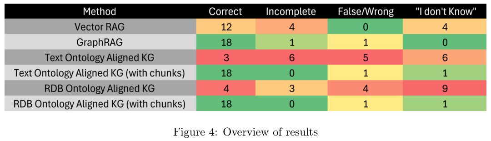

本文补录 **2026-06-30 的推荐日报清单**，于 2026-10-29 核对公开来源。推荐日期不等于论文发表日期；采用下方指定历史版本，不混入后续修订。实验数据为作者报告，本站未独立复现。理论论文不补造实验指标。

## 重点阅读

[Ontology Learning and Knowledge Graph Construction: A Comparison of Approaches and Their Impact on RAG Performance](https://arxiv.org/abs/2511.05991v1) · v1 提交 2025-11-08 · [全文](https://arxiv.org/html/2511.05991v1) · [PDF](https://arxiv.org/pdf/2511.05991v1)

图里只留实体和关系，可能失去回答需要的原文语境。论文比较向量 RAG、GraphRAG，以及从关系数据库结构或文本学习本体后构建的图；后两类再分别测试有无文本块，共六种配置。它关心本体来源与证据保留方式，而不是证明图总胜向量。

语料是一份翻译并轻度匿名化的葡萄牙资助申请，人工编写 20 个问题，再将答案人工分类。图 4 显示 GraphRAG 与两种带块本体图均答对 18/20（90%），向量 RAG 为 12/20（60%）；不带块的文本本体图仅 3/20，数据库本体图为 4/20。图中 GraphRAG 的剩余分类为 1 个不完整、1 个错误、0 个不知道，正文却概括为 1 个错误和 1 个不知道；本篇保留这一差异，不将正文概括套用全部配置。

我的判断是，应把是否带回原文证据作为独立变量，保留逐题错误类型，再扩大语料与盲评。单一企业文档、20 题及人工分类不足以支持跨语言和行业的一般优越性；两类带块本体图同为 18/20，也没有严格成本测量来支持具体节省比例。这篇 v1 在 2025 年 11 月已提交，推荐日期不是首发日期。

原文：Tiago da Cruz、Bernardo Tavares、Francisco Belo，arXiv:2511.05991v1，Figure 4 结果表，PDF 第 8 页。[原始来源](https://arxiv.org/pdf/2511.05991v1#page=8) · [CC BY 4.0](https://creativecommons.org/licenses/by/4.0/)。裁剪自原文。

## 同期其他论文入口

以下只核对题名、标识符和指定历史版本，不代表逐篇全文深读。

- [FreqOrtho-SR: Frequency-Guided Orthogonal Expert Learning for Real-World Image Super-Resolution](https://arxiv.org/abs/2606.28745v1) · 2606.28745v1，该版本提交 2026-06-27。
- [Qwen-Image-2.0-RL Technical Report](https://arxiv.org/abs/2606.27608v1) · 2606.27608v1，该版本提交 2026-06-25。
- [PhysisForcing: Physics Reinforced World Simulator for Robotic Manipulation](https://arxiv.org/abs/2606.28128v1) · 2606.28128v1，该版本提交 2026-06-26。
- [Ask, Don't Judge: Binary Questions for Interpretable LLM Evaluation and Self-Improvement](https://arxiv.org/abs/2606.27226v1) · 2606.27226v1，该版本提交 2026-06-25。
- [PerceptionRubrics: Calibrating Multimodal Evaluation to Human Perception](https://arxiv.org/abs/2606.28322v2) · 2606.28322v2，该版本提交 2026-06-30。
- [SOLAR: AI-Powered Speed-of-Light Performance Analysis](https://arxiv.org/abs/2606.26383v1) · 2606.26383v1，该版本提交 2026-06-24。
- [Red-Teaming the Agentic Red-Team](https://arxiv.org/abs/2606.24496v1) · 2606.24496v1，该版本提交 2026-06-23。

**覆盖说明：** 本期保留 8 篇已核验公开论文入口，详读 1 篇，其余仅列目录。
