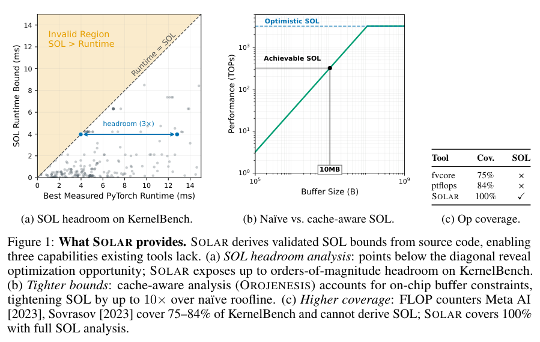
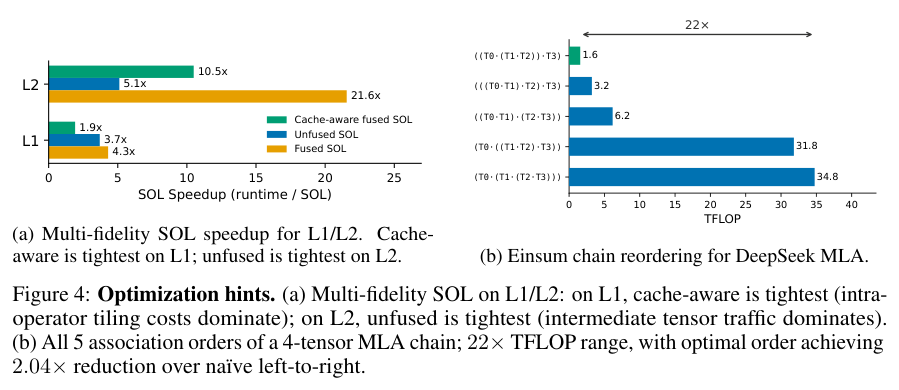
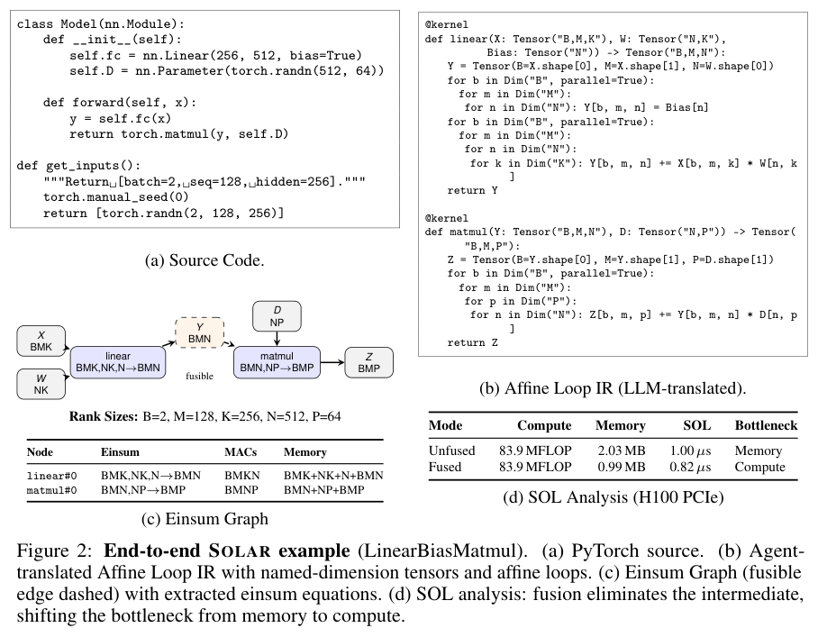

本期八项研究介绍本体图检索、超分辨率、图像后训练、物理视频、原子评价、视觉 rubric、性能下界与 Agent 自身安全。

## 1. 本体与 Graph RAG：图结构仍需保留文本证据

[Ontology Learning and Knowledge Graph Construction: A Comparison of Approaches and Their Impact on RAG Performance](https://arxiv.org/abs/2511.05991v1) · v1 提交 2025-11-08 · [全文](https://arxiv.org/html/2511.05991v1) · [PDF](https://arxiv.org/pdf/2511.05991v1)

图里只留实体和关系，可能失去回答需要的原文语境。论文比较向量 RAG、GraphRAG，以及从关系数据库结构或文本学习本体后构建的图；后两类再分别测试有无文本块，共六种配置。它关心本体来源与证据保留方式，而不是证明图总胜向量。

语料是一份翻译并轻度匿名化的葡萄牙资助申请，人工编写 20 个问题，再将答案人工分类。图 4 显示 GraphRAG 与两种带块本体图均答对 18/20（90%），向量 RAG 为 12/20（60%）；不带块的文本本体图仅 3/20，数据库本体图为 4/20。图中 GraphRAG 的剩余分类为 1 个不完整、1 个错误、0 个不知道，正文却概括为 1 个错误和 1 个不知道；两处分类不一致。

我的判断是，应把是否带回原文证据作为独立变量，保留逐题错误类型，再扩大语料与盲评。单一企业文档、20 题及人工分类不足以支持跨语言和行业的一般优越性；两类带块本体图同为 18/20，也没有严格成本测量来支持具体节省比例。

原文：Tiago da Cruz、Bernardo Tavares、Francisco Belo，arXiv:2511.05991v1，Figure 4 结果表，PDF 第 8 页。[原始来源](https://arxiv.org/pdf/2511.05991v1#page=8) · [CC BY 4.0](https://creativecommons.org/licenses/by/4.0/)。裁剪自原文。

## 2. FreqOrtho-SR：让退化专家与语义优化保持互补

FreqOrtho-SR 用 FFT 退化特征为输入选择 LoRA 专家，再从专家权重变化的 SVD 提取像素保真子空间，将语义梯度投影到其零空间。它分别处理不同退化与像素—感知目标的相互干扰，采用单步扩散超分辨率。

RealSR 上 LPIPS 为 0.2537，TVT 为 0.2587，PSNR 却为 26.27 对 SinSR 的 26.30 dB；DRealSR 的 PSNR 为 29.08，但 FID 为 130.85，略差于 PiSA-SR 的 130.61。不同质量指标体现取舍，参数更新方向正交也不等于所有输入上的输出误差完全独立。

[FreqOrtho-SR: Frequency-Guided Orthogonal Expert Learning for Real-World Image Super-Resolution](https://arxiv.org/abs/2606.28745v1) · v1。

[Figure 1（原文）](https://arxiv.org/pdf/2606.28745v1#page=2)。

## 3. Qwen-Image-2.0-RL：以专用奖励训练，再合并生成与编辑策略

这条后训练流水线为对齐、美学、肖像、编辑指令与身份保持训练组合奖励，采用 GRPO、混合 CFG 与分类型权重校准。最后通过轨迹速度匹配的 on-policy 蒸馏，将文生图和编辑专家合为一个学生。

Qwen-Image-Bench 总分由基础模型的 55.23 到 57.84，增加 2.61 分；作者还报告文生图和编辑 Arena 的 Elo 分别增加 78、93。Elo 取决于比较池和采样，不能与百分制总分直接换算；奖励设计与多教师蒸馏一起变化，也不能将全部收益归于某一步。

[Qwen-Image-2.0-RL Technical Report](https://arxiv.org/abs/2606.27608v1) · v1。

[Figure 1（原文）](https://arxiv.org/pdf/2606.27608v1#page=2)。

## 4. PhysisForcing：在接触与运动区域强化物理监督

PhysisForcing 在视频模型中联合优化点轨迹对齐与区域关系对齐：前者约束像素级运动，后者借冻结视频理解编码器表达物体之间的时空关系，重点改善移动物体变形和接触不连贯。

WorldArena 动作规划协议下，闭环成功率由 16.0% 到 24.0%；R-Bench 上不同主干也有提升，但相对基础模型与相对普通微调的增幅不同。这里八个百分点的任务收益与视频物理评分是两类证据，不能将视觉更稳定直接解释成所有机器人任务更可靠。

[PhysisForcing: Physics Reinforced World Simulator for Robotic Manipulation](https://arxiv.org/abs/2606.28128v1) · v1。

[Figure 1（原文）](https://arxiv.org/pdf/2606.28128v1#page=2)。

## 5. BINEVAL：把整体打分拆成可检查的二元问题

BINEVAL 根据任务生成原子评价问题，分别判断输出是否满足每项条件，再聚合为多维分数。问题级反馈既可诊断答案缺陷，也能用于迭代改写评价提示或生成提示，使改进方向有具体依据。

SummEval、Topical-Chat 与 QAGS 的比较显示，与人工评分的相关性达到或超过所比强基线，尤其改善事实一致性和分数上限饱和；IFBench 上的问题反馈还支持提示优化。相关性不是逐项裁决准确率，原子问题若遗漏要求或自带偏差，透明分解仍会传播错误。

[Ask, Don't Judge: Binary Questions for Interpretable LLM Evaluation and Self-Improvement](https://arxiv.org/abs/2606.27226v1) · v1。

[Figure 1（原文）](https://arxiv.org/pdf/2606.27226v1#page=6)。

## 6. PerceptionRubrics：关键视觉事实错误应影响整体分数

PerceptionRubrics 为 1,038 张信息密集图像组织一万二千余条实例级要求，经循环同行审查式流程形成标准描述，再拆成 Must-Right 必要事实与 Easy-Wrong 细节。门控计分让关键事实失败受到明显惩罚，避免大量小项正确掩盖关键错误。

v1 的评测发现，模型常能识别分散元素，却难同时满足一组视觉约束；门控指标与人工判断的一致性优于传统宽泛评分。标准描述与原子要求仍由构造流程决定，严格分数也不直接等于下游任务安全性；不同领域的误差、开闭源模型差异需要按具体配置看。

[PerceptionRubrics: Calibrating Multimodal Evaluation to Human Perception](https://arxiv.org/abs/2606.28322v1) · v1。

[Figure 1（原文）](https://arxiv.org/pdf/2606.28322v1#page=1)。

## 7. SOLAR：从程序推导硬件性能下界

SOLAR 先由 LLM 将 PyTorch 或 JAX 程序转换为可执行仿射循环 IR，通过输出比较检查翻译，再确定性提取 einsum 图。分析端分别计算未融合、融合与考虑有限缓存的 Speed-of-Light 界，定位计算与数据传输瓶颈。

*图｜Huang, Qijing 等，[Figure 1（PDF 第 2 页）](https://arxiv.org/pdf/2606.26383v1#page=2)，[CC BY 4.0](http://creativecommons.org/licenses/by/4.0/)。裁剪自原文。*

KernelBench、JAX/Flax 与机器人负载的实验未观察到 SOL 界被实测运行时间违反，并显示融合和缓存假设会显著改变可优化空间。它给出理论最低时间，不是承诺程序能达到的延迟；当前主要根据 tensor 形状分析，数据依赖控制流和硬件执行细节仍限制界的紧致性。

*图｜Huang, Qijing 等，[Figure 4（PDF 第 8 页）](https://arxiv.org/pdf/2606.26383v1#page=8)，[CC BY 4.0](http://creativecommons.org/licenses/by/4.0/)。裁剪自原文。*

*图｜Huang, Qijing 等，[Figure 2（PDF 第 5 页）](https://arxiv.org/pdf/2606.26383v1#page=5)，[CC BY 4.0](http://creativecommons.org/licenses/by/4.0/)。裁剪自原文。*

[SOLAR: AI-Powered Speed-of-Light Performance Analysis](https://arxiv.org/abs/2606.26383v1) · v1。

## 8. 红队 Agent 的自身边界：工具权限和宿主隔离也要检查

这项审计把用于进攻安全工作的 Agent 当成被研究系统，分析不可信输入如何影响具有工具权限的执行链。论文沿模型操纵、权限使用与宿主边界检查多个系统，并给出将敏感能力从 Agent 可修改范围分离的架构原则。

所审计多个系统存在可导致敏感信息泄露、持久化或宿主受影响的设计缺陷，容器化本身没有消除所有路径。结论依赖具体版本、宿主权限和攻击者控制面，不能视为所有当前产品的共同结果；对防御更有用的是分别验收工具权限、状态持久化、秘密隔离和运行边界。

[Red-Teaming the Agentic Red-Team](https://arxiv.org/abs/2606.24496v1) · v1。

[Figure 1（原文）](https://arxiv.org/pdf/2606.24496v1#page=2)。
