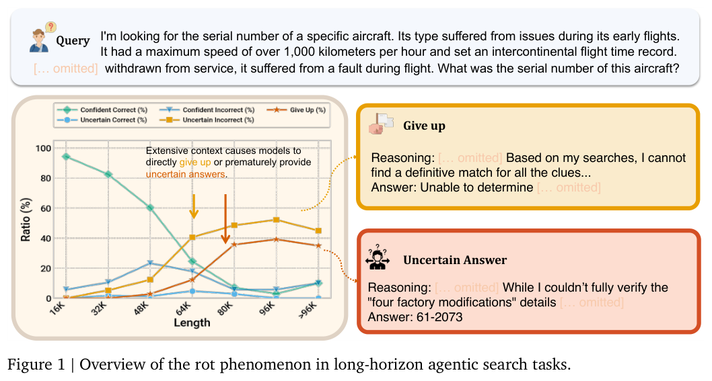
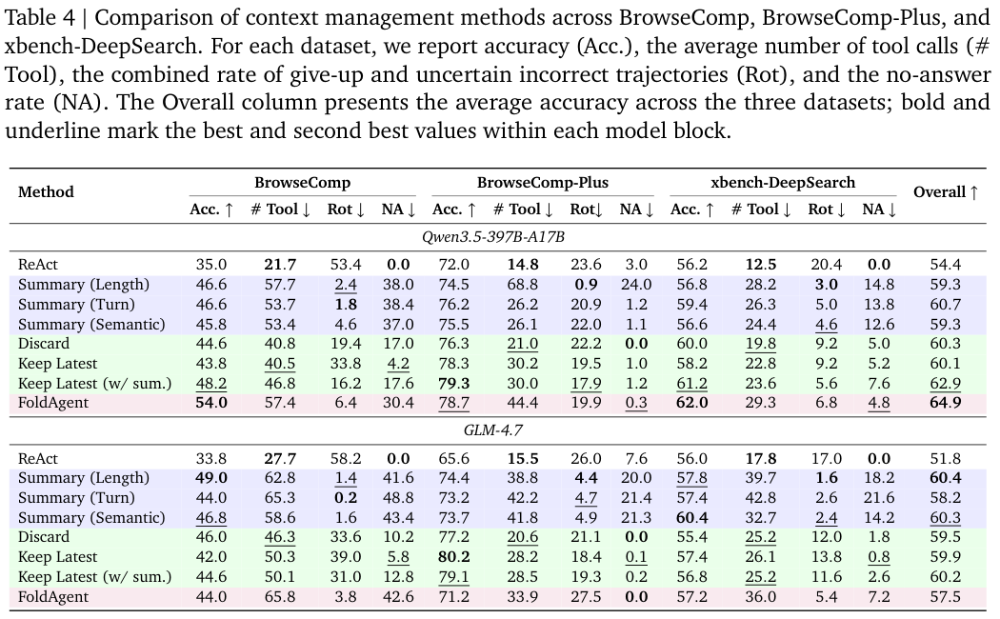

本期八项研究介绍本体查询抽象、类型约束检索、统一世界表示、长程 Agent、上下文退化、电脑工作流评测、持久系统安全与异构推理。

## 1. OBDA 查询抽象：源端服务能否在本体层准确表达

[Abstractions of Queries in Ontology-Based Data Access](https://arxiv.org/abs/2606.24618v1) · v1 提交 2026-06-23 · [全文](https://arxiv.org/html/2606.24618v1) · [PDF](https://arxiv.org/pdf/2606.24618v1)

OBDA 通常从本体查询生成数据库查询，反方向则问：一个已有源端服务能否在本体语言中表达相同含义？若两个源表都映射到同一本体概念，区分表来源的信息可能已经丢失；只选择其中一表的查询就未必能完美翻译。

论文采用存在规则与 certain-answer 语义，区分完备但可能多答、可靠但可能漏答，以及答案恰好一致的完美抽象。UCQ 增加受限不等式和常量标记 C 后，可以表达最小完备抽象，完美抽象若存在也可表达；C 标记来自数据源的常量，不是任意关闭开放世界假设。在相应 GLAV 映射设定中，候选完美 mapping-abstraction 的验证仍为 Π₂ᴾ-complete。论文没有训练、GPU、准确率或延迟实验，复杂度结论不代表生产系统更快。

我的判断是，mapping 评审除了查生成查询是否正确，还应查哪些重要源端服务不能被语义层准确描述。这是 KR 2025 论文的扩展报告，侧重已有服务的语义覆盖诊断。

**原图入口：**[Table 1，PDF 第 2 页](https://arxiv.org/pdf/2606.24618v1#page=2)。

## 2. OPI：从答案类型反向约束图谱路径

OPI 把关系的头尾类型组织为关系中心本体图，先预测答案类型，再从问题实体向前展开、从兼容的末跳关系向后匹配。候选路径经过问题语义排序和迭代答案细化，避免仅从主题实体扩张时产生大量类型混杂的路径。

WebQSP 上，Llama-2-7B 配 GPT-4o 的 Hit@1/F1 为 91.3/76.8，配 DeepSeek-v3 为 92.3/74.9；CWQ 则分别为 72.3/62.7 与 76.5/59.6。最高 Hit@1 和最高 F1 来自不同配置。纯检索 OPI-BR 的 WebQSP Hit@1 达 95.39，但 F1 只有 39.09，说明把正确答案留在候选中与输出精确答案集仍是不同问题。

[Ontology-Guided Evidence Path Inference for Multi-hop Knowledge Graph Question Answering](https://arxiv.org/abs/2606.28076v1) · v1。

[Figure 1（原文）](https://arxiv.org/pdf/2606.28076v1#page=2)。

## 3. Orca：让多模态任务共享状态转移表示

Orca 用连续视频学习密集状态变化，再用语言事件和视觉问答学习稀疏、有意义的转移，构建统一世界潜在空间。预训练语料含 125K 小时视频与 160M 事件标注；下游冻结骨干，分别训练文本、图像和动作读出模块。

四项理解基准的平均分中，Orca-4B 为 51.8，Qwen3.5-4B 为 46.7；但 MVBench 单项为 65.3 对 67.1，仍较低。PRICE-V0.1 的图像预测由四个模型评价，Orca 4B+2B 配置均分 59.8，FLUX.2 klein 的 4B+4B 为 56.1。读出模块、评价模型和数据构造共同影响结果，潜在状态理解分数不能直接当成真实控制成功率。

[Orca: The World is in Your Mind](https://arxiv.org/abs/2606.30534v1) · v1。

[Figure 1（原文）](https://arxiv.org/pdf/2606.30534v1#page=1)。

## 4. Agents-A1：用长轨迹与多教师蒸馏扩展任务跨度

Agents-A1 从 Qwen3.5-35B-A3B 出发，先用约十万条、平均 45K token 的轨迹做全领域监督微调，再训练领域教师，最后用领域路由的 on-policy 蒸馏合并六类能力，并对重要词汇对齐。外部知识、执行动作、观察与验证反馈连接为长程训练基础。

相对原骨干，BrowseComp 从 61.0 到 75.5，SEAL-0 从 41.4 到 56.4，SciCode 从 37.1 到 44.3；HLE 带工具仅从 47.4 到 47.6。XBench-DS 的最终 86.0 又低于 SFT 阶段的 88.0。结果支持多领域的长程能力收益，却不表示每个指标持续上升；与万亿参数模型的比较也没有匹配全部训练与推理预算。

[Scaling the Horizon, Not the Parameters: Reaching Trillion-Parameter Performance with a 35B Agent](https://arxiv.org/abs/2606.30616v1) · v1。

[Figure 1（原文）](https://arxiv.org/pdf/2606.30616v1#page=1)。

## 5. Context Rot：长搜索为何会提前放弃

研究把搜索终止状态区分为正确、自信错误、不确定错误、放弃与无答案，通过删除工具结果、推理片段或历史上下文追查累积信息的影响，再比较七种压缩、裁剪和隔离策略，以及事后拒绝采样。它关注的不只是答案准不准，也包括多花了多少工具调用。

*图｜Xia, Shijie 等，[Figure 1（PDF 第 2 页）](https://arxiv.org/pdf/2606.29718v1#page=2)，[CC BY 4.0](http://creativecommons.org/licenses/by/4.0/)。裁剪自原文。*

三项搜索基准中，Qwen3.5-397B-A17B 的 ReAct 平均准确率为 54.4，FoldAgent 为 64.9；GLM-4.7 却从 51.8 到 57.5，低于长度摘要的 60.4。BrowseComp 上，Qwen 的长度摘要将放弃与不确定错误率从 53.4 降到 2.4，但无答案率从 0 到 38.0，工具调用由 21.7 到 57.7。减少一种失败可能增加另一种失败，应同时看准确率、完成率和计算成本。

*图｜Xia, Shijie 等，[Table 4（PDF 第 9 页）](https://arxiv.org/pdf/2606.29718v1#page=9)，[CC BY 4.0](http://creativecommons.org/licenses/by/4.0/)。裁剪自原文。*

[Diagnosing and Mitigating Context Rot in Long-horizon Search](https://arxiv.org/abs/2606.29718v1) · v1。

## 6. OSWorld 2.0：把电脑操作评测拉长到完整工作流

OSWorld 2.0 提供 108 项跨应用、带状态的真实风格任务，人类操作时间中位数约 1.6 小时。任务包含跨源推理、隐含状态恢复、动态信息和视觉精度，并分别评估完整完成与部分进展，而非只检查一次点击或一个文件。

五百步预算、最高思考和批量工具设置中，Claude Opus 4.8 的完整完成率为 20.6%，部分得分 54.8%；GPT-5.5 为 13.0% 和 49.5%，平均输出约 37.1K token，前者约 224K。能力与成本排名不同。模型的工具接口、思考设置和批量条件也不同，部分得分不能解读为完整任务成功率。

[OSWorld2.0: Benchmarking Computer Use Agents on Long-Horizon Real-World Tasks](https://arxiv.org/abs/2606.29537v1) · v1。

[Figure 1（原文）](https://arxiv.org/pdf/2606.29537v1#page=1)。

## 7. SafeClawArena：从系统边界检查持久 Agent

SafeClawArena 将常驻 Agent 看作由运行时、技能、插件、持久状态与外部通道组成的系统，在容器副本中设置 406 项对抗任务。带标记的测试凭据和确定性追踪检查供应链、持久状态、跨边界数据流与间接提示注入，避免只按最终回答判断。

十五组平台—模型配置中，GPT-5.4 在 OpenClaw 的攻击成功率为 69.7%，SeClaw 为 21.9%；但 G-Pro 从 50.2% 到 49.8%，收益很小。SeClaw 的一部分优势来自取消插件加载路径和限制配置能力，包含功能与安全的取舍。这些是特定版本、威胁模型和合成任务的结果，不能用作全部当前产品的统一漏洞率。

[Understanding and Evaluating Claw-like Agent Security Through a Computer-Systems Lens](https://arxiv.org/abs/2606.30755v1) · v1。

[Figure 1（原文）](https://arxiv.org/pdf/2606.30755v1#page=2)。

## 8. 异构推理：把计算位置、KV 表示与所有权一起设计

这项系统研究将 prefill/decode 分离的选择拆为加速器、精度、互连与 KV 驻留位置，再追踪三个边界问题：计算放哪里、传输的缓存格式是否兼容、交接前后谁负责保留与释放内存。低比特格式对两阶段的作用不同，传输字节正确也不代表张量语义匹配。

单节点 Hopper、Qwen3-32B、SGLang、4K 输入与 512 输出的受控测试中，4P4D 的 BF16 KV 在延迟约束下可承受请求率为 0.1/s，FP8 KV 为 1.0/s。另一组固定负载测试里，AWQ 的 p99 每 token 时间为 10.24ms、BF16 为 21.02ms，但 p99 首 token 时间由 32.61s 增至 36.55s。吞吐、生成延迟与首 token 延迟存在不同取舍，生产观察不等于跨厂商的统一加速保证。

[Demystifying the Design Space and Best Practices for Heterogeneous LLM Inference and Serving](https://arxiv.org/abs/2606.29708v1) · v1。

[Figure 1（原文）](https://arxiv.org/pdf/2606.29708v1#page=3)。
