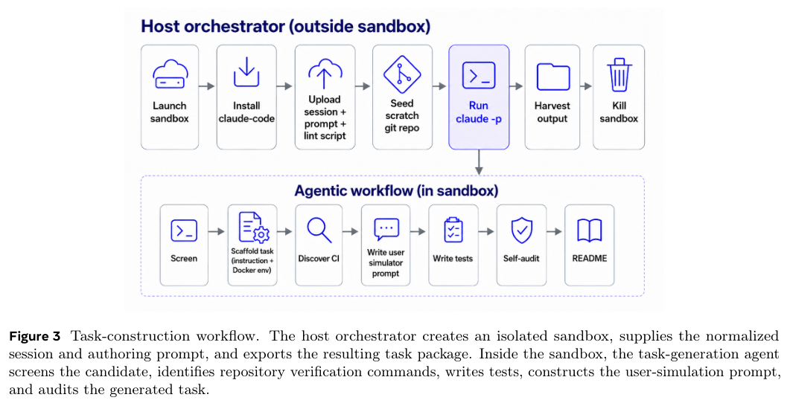
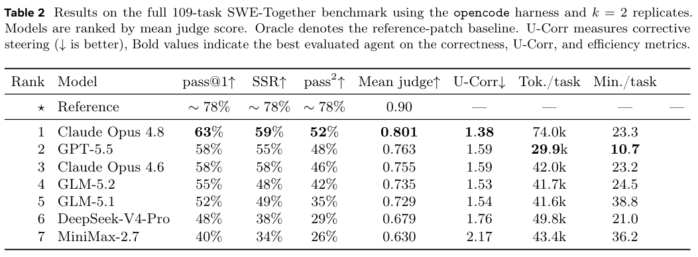
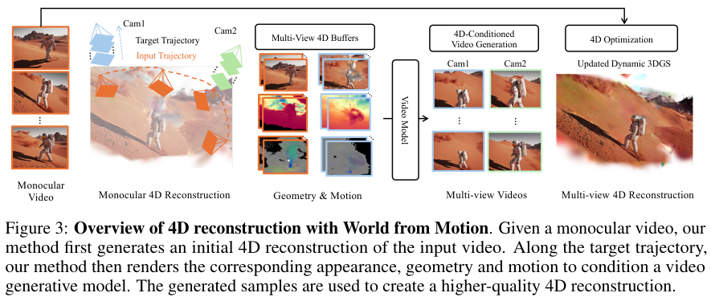
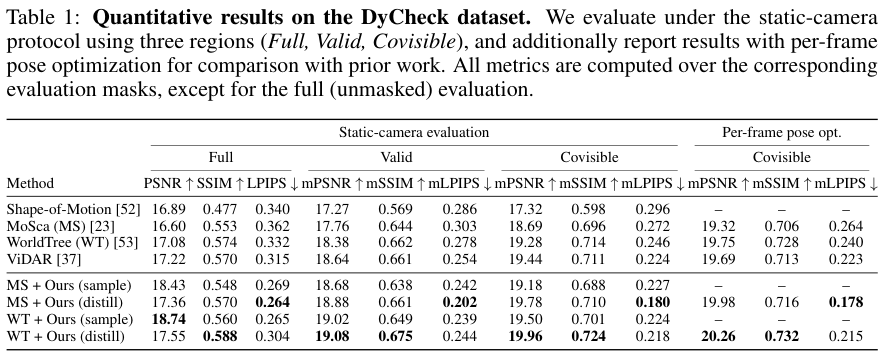
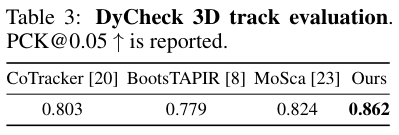

本期七项研究介绍分子风险证据、工程因果规范、移动世界动作模型、真机 GUI 学习、交互式编程、单层强化学习和动态三维重建。

## 1. MolSafeEval：用结构与图谱证据检查生成分子

[MolSafeEval: A Benchmark for Uncovering Safety Risks in AI-Generated Molecules](https://arxiv.org/abs/2607.00464v1) · v1 提交 2026-07-01 · [全文](https://arxiv.org/html/2607.00464v1) · [PDF](https://arxiv.org/pdf/2607.00464v1)

MolSafeEval 将分散的毒理和危害信息组织为 MolSafeKG，结合结构解析、证据检索和模型判断，覆盖无条件生成、性质优化、靶蛋白条件设计与文本条件生成。

作者在 11 项安全任务、五种 LLM 上验证框架。按分子骨架切成五个不重叠子集，每轮四份建立临时知识图谱、一份测试，汇总五轮。表 2 呼吸毒性准确率中，直接使用 DeepSeek-V3 为 0.562，加入框架后为 0.847；这是特定数据划分和任务的结果，不是任意新化合物的可靠性承诺。危险等级另用 Jaccard，相似度与准确率不能混算。

我的判断是，证据来源和判断理由值得与结果一起验收。图谱覆盖、相似性检索与模型推理仍可能出错；计算预测只能形成待复核线索，不能替代专业验证。

**原图入口：**[Table 2，PDF 第 6 页](https://arxiv.org/pdf/2607.00464v1#page=6)。

## 2. 因果规范：从统一工程图谱生成说明与规则

这项框架用模块化本体统一装置结构、工况、故障、症状、原因与缓解动作，再以 SPARQL 构造因果矩阵行。受词汇约束的 gpt-4o-mini 把已有结构转成操作说明和 SWRL 规则，不负责凭空补阈值、设备或新因果关系。

模块化混合与装瓶装置案例中，图谱得到十五行因果规范，覆盖八种故障、八个诊断对象和六类缓解动作；生成规则全部语法有效、实体落在给定图谱内，未检出动作冲突。这验证了该已建模案例中的转换一致性，缺少更大装置的盲评或人工时间对照，不能把百分之百语法与实体合规当作整个控制系统安全可靠。

[Automating Cause-Effect Specification with Knowledge Graphs and Large Language Models](https://arxiv.org/abs/2606.31614v1) · v1。

[Figure 1（原文）](https://arxiv.org/pdf/2606.31614v1#page=3)。

## 3. ABot-M0.5：对齐移动操作的时间与动作结构

ABot-M0.5 在视频潜变量与可执行控制之间加入帧级潜在动作，用双层 Mixture-of-Transformers 分开模态、移动底盘与机械臂动作。Dream-Forcing 逐步让逆动力学读取模型预测的视频，减少训练只看真实未来、推理却看生成未来的分布差距。

RoboCasa365 预训练评价中，基础 ABot 平均成功率为 40.4%，Qwen-RobotManip 为 35.9%；但未见复合任务仅为 2.7%，对照为 14.9%。加入压缩记忆的扩展为 46.6%，属于另一配置。目标数据完整微调后，ABot 均值为 54.2%，Lingbot-VA 为 45.1%。平均领先并不代表未见组合已解决，预训练与目标微调结果也应分别比较。

[ABot-M0.5: Unified Mobility-and-Manipulation World Action Model](https://arxiv.org/abs/2607.00678v1) · v1。

[Figure 1（原文）](https://arxiv.org/pdf/2607.00678v1#page=3)。

## 4. Xiaomi-GUI-0：用真机失败形成纠错训练闭环

Xiaomi-GUI-0 以真实手机为主要执行环境，将多源监督微调、步骤级强化学习和完整 Agent 强化学习串起来。失败轨迹转成纠正动作、反思解释与恢复示范；奖励先检查可解析与可执行性，再审查能力表达和推理、动作之间的一致性。

四次运行均值中，30B-A3B 模型在 RealMobile 的完整成功率为 72.0%，子目标进度为 85.8%；AndroidWorld 成功率为 78.9%，UI-Venus-1.5-30B-A3B 为 77.6%。RealMobile 上 Gemini 3.1 Pro 仍达 85.0%。真机闭环的收益需要按账户状态、权限弹窗与场景分布看，子目标进度不能替代完整任务成功率。

[Xiaomi-GUI-0 Technical Report](https://arxiv.org/abs/2606.31410v1) · v1。

[Figure 1（原文）](https://arxiv.org/pdf/2606.31410v1#page=5)。

## 5. SWE-Together：把用户补充需求纳入编程评测

SWE-Together 从 11,260 次真实交互记录筛出 109 项仓库任务，恢复可验证的代码状态与用户目标，再由反应式用户模拟器按 Agent 进展提供反馈。评价同时看最终仓库正确性和用户需要纠正多少次，检验多轮协作而非单次完整提示。

*图｜Wu, Yifan 等，[Figure 3（PDF 第 4 页）](https://arxiv.org/pdf/2606.29957v1#page=4)，[CC BY 4.0](http://creativecommons.org/licenses/by/4.0/)。裁剪自原文。*

统一 opencode 框架、每任务两次运行中，Claude Opus 4.8 的 Pass@1 为 63%，平均纠正次数 1.38；GPT-5.5 为 58% 和 1.59，平均用时 10.7 分钟，前者 23.3 分钟。参考补丁通过率也只有约 78%，说明任务恢复与判分存在边界。模拟用户和有限样本不能完全替代真实用户体验，但能显式暴露需要反复纠正的协作成本。

*图｜Wu, Yifan 等，[Table 2（PDF 第 9 页）](https://arxiv.org/pdf/2606.29957v1#page=9)，[CC BY 4.0](http://creativecommons.org/licenses/by/4.0/)。裁剪自原文。*

[SWE-Together: Evaluating Coding Agents in Interactive User Sessions](https://arxiv.org/abs/2606.29957v1) · v1。

## 6. 单层强化学习：模型内部的适应并不均匀

研究固定训练步骤和主要超参数，先为全参数基线调学习率，再逐层单独做强化学习，定义每层恢复了多少全量训练增益。七个 Qwen 系列模型、三种算法与数学和 Agent 任务显示，较高贡献常集中于中间层，输入输出附近的层不一定同样有效。

Qwen3-8B Base 的数学均分为 58.0，全参数训练为 66.5，只训练第十六层为 67.1；但只训练第零层降至 53.7。第十六层的跨类别总体均分为 56.5，全参数为 54.9。有效层选择依赖扫描与评估，训练参数减少也不等于整次 rollout 和反向传播成本同比消失，不能预先认定任意模型只训一层就够。

[Is One Layer Enough? Training A Single Transformer Layer Can Match Full-Parameter RL Training](https://arxiv.org/abs/2607.01232v1) · v1。

[Figure 1（原文）](https://arxiv.org/pdf/2607.01232v1#page=2)。

## 7. World from Motion：把生成补全重新蒸馏回动态三维

该方法从单目动态 3DGS 初始重建出发，将外观、几何与三维运动渲染成输入和目标视角的条件信号，让视频模型修复伪影、补足不可见区域。多个生成视角再蒸馏回同一动态三维表示，使新内容与原有几何、运动尽量一致。

*图｜Zhu, Liyuan 等，[Figure 3（PDF 第 5 页）](https://arxiv.org/pdf/2607.01202v1#page=5)，[CC BY 4.0](http://creativecommons.org/licenses/by/4.0/)。裁剪自原文。*

DyCheck 固定相机的共视区域中，WorldTree 的 mPSNR 为 19.28、mLPIPS 为 0.246，蒸馏后为 19.96 和 0.218；三维轨迹 PCK 在 0.05 阈值下从 MoSca 的 0.824 到 0.862。蒸馏与单独视频采样的 PSNR、SSIM、LPIPS 各有取舍，逐帧姿态优化又属于另一协议，应在相同掩膜和相机设定下比较。

*图｜Zhu, Liyuan 等，[Table 1（PDF 第 8 页）](https://arxiv.org/pdf/2607.01202v1#page=8)，[CC BY 4.0](http://creativecommons.org/licenses/by/4.0/)。裁剪自原文。*

*图｜Zhu, Liyuan 等，[Table 3（PDF 第 8 页）](https://arxiv.org/pdf/2607.01202v1#page=8)，[CC BY 4.0](http://creativecommons.org/licenses/by/4.0/)。裁剪自原文。*

[World from Motion: Generative Dynamic Gaussian Reconstruction from Monocular Video](https://arxiv.org/abs/2607.01202v1) · v1。
