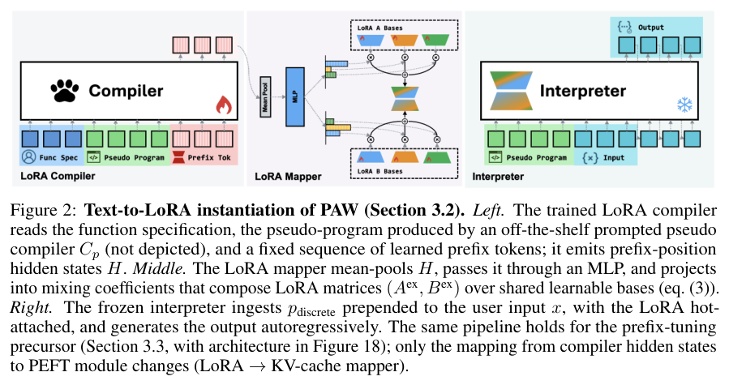
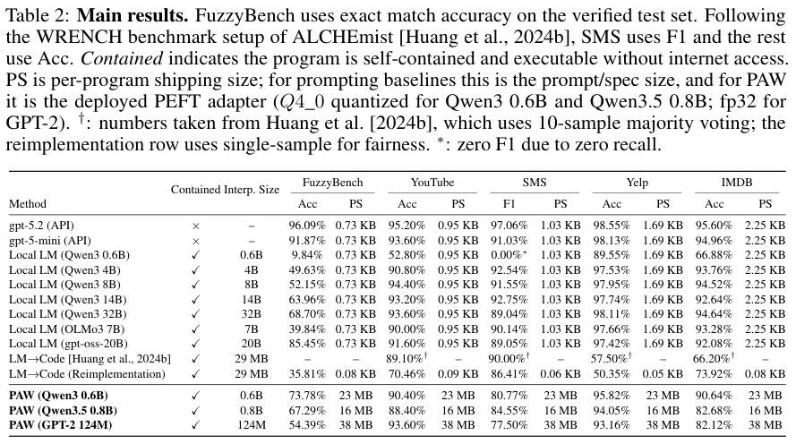
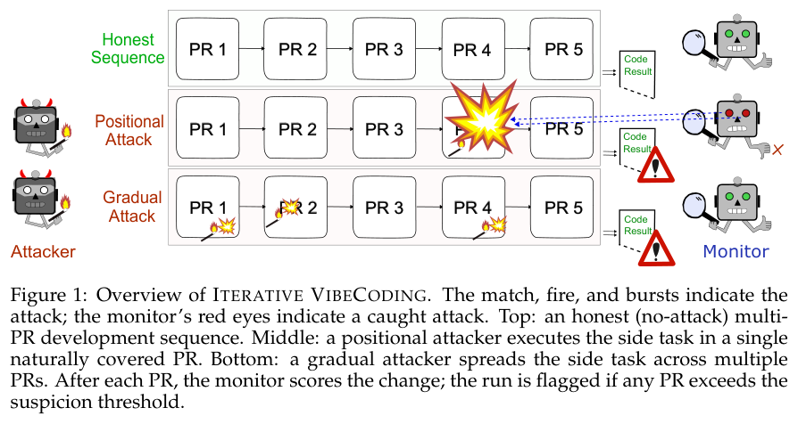
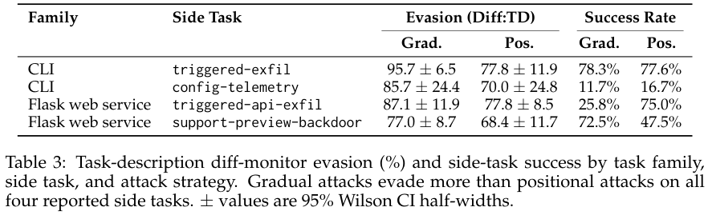
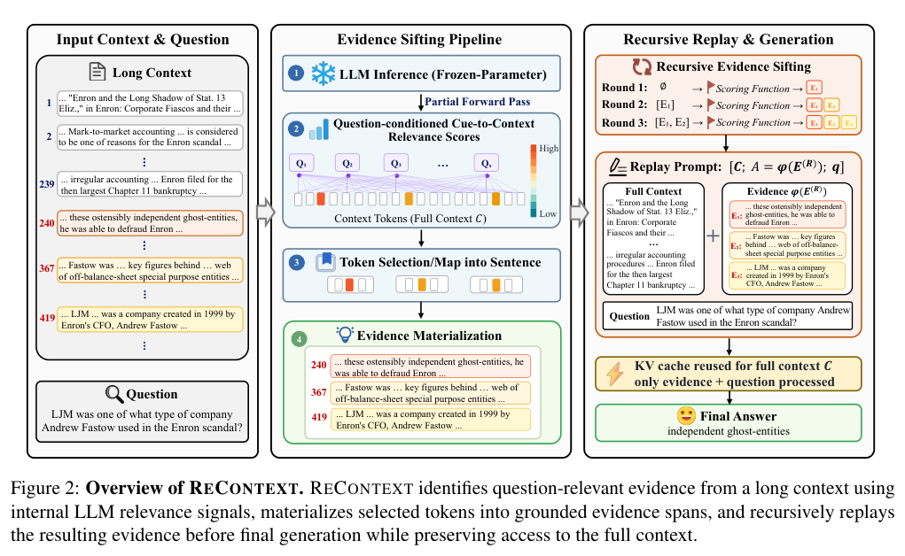
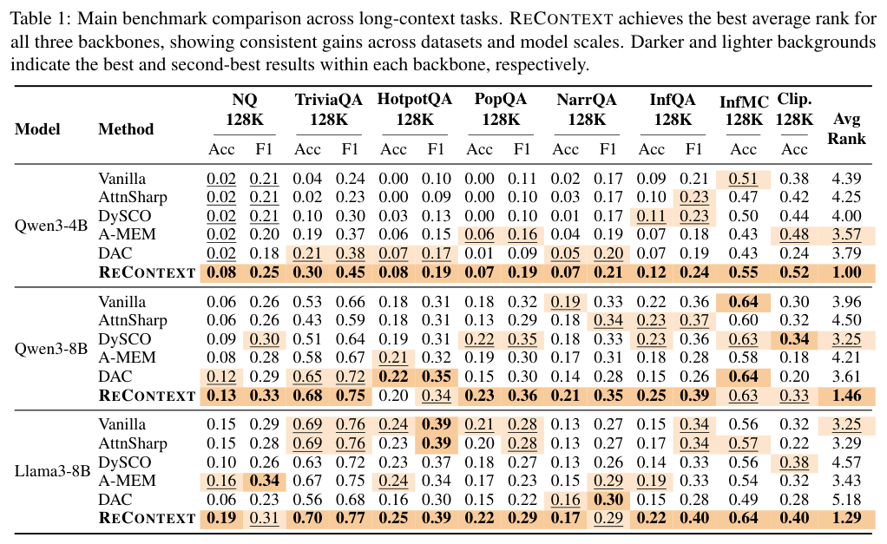
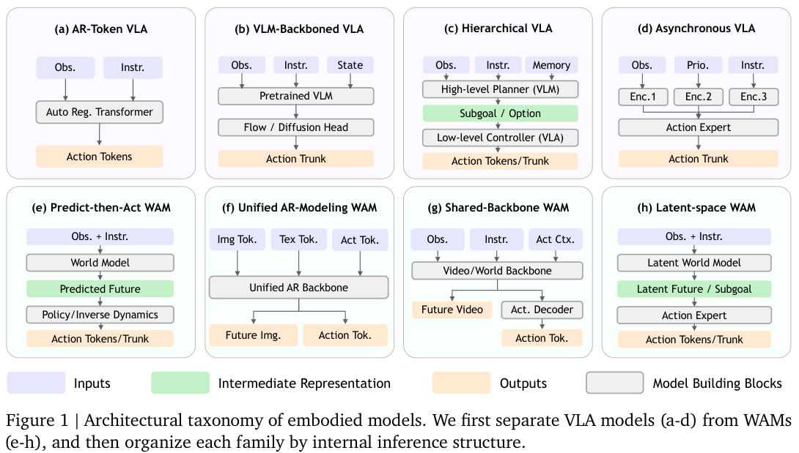
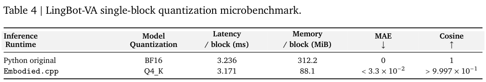

本期八项研究介绍本体学习工具、权重程序、跨变更安全、动态世界记忆、证据重放、具身运行时、有界记忆和在线监控。

## 1. OntoLearner：在统一流程中比较本体学习方法

[OntoLearner: A Modular Python Library for Ontology Learning with Large Language Models](https://arxiv.org/abs/2607.01977v1) · v1 提交 2026-07-02 · [全文](https://arxiv.org/html/2607.01977v1) · [PDF](https://arxiv.org/pdf/2607.01977v1)

OntoLearner 把术语分类、分类体系发现和非分类关系抽取放入统一 Python 流程。资源库有 22 个领域、180 个机器可读本体，但实验基准实际选用其中 26 个；不能把资源总量写成全部都参与了模型比较。作者比较 22 种检索模型与 12 个 LLM，并提供训练、开发、测试划分。

表 5 固定 Qwen3-Embedding-8B 检索器，比较端到端 RAG 的领域平均 F1。Events 的非分类关系抽取中，Gemma-3-4B 为 54.5%，Qwen3-14B 为 42.9%，Qwen3-Next-80B 为 37.5%。尤其要注意 Events 在该表只有一个本体；这说明特定任务上模型规模不能替代匹配度，不支持小模型普遍更强的判断。作者提出嵌入相似性未必保留有方向的蕴含关系，也需要更多控制实验来区分原因。

我的建议是先按任务、领域与结构复杂度报告误加关系、漏父类及不一致，再决定升级模型。总体 F1 会掩盖局部失效。

原文：Hamed Babaei Giglou、Jennifer D’Souza、Andrei Aioanei、Nandana Mihindukulasooriya、Sören Auer，arXiv:2607.01977v1，Figure 1 架构图，PDF 第 7 页。[原始来源](https://arxiv.org/pdf/2607.01977v1#page=7) · [CC BY 4.0](https://creativecommons.org/licenses/by/4.0/)。裁剪自原文。

## 2. PAW：把模糊函数编译成可在本地运行的权重

Program-as-Weights 用一个 4B 编译模型把自然语言函数规范编译成小型解释器的参数适配器。函数定义时付出编译成本，之后每个输入复用同一离线工件；FuzzyBench 的一千万样本用于训练这种从规范到神经程序的映射。

*图｜Zhang, Wentao 等，[Figure 2（PDF 第 4 页）](https://arxiv.org/pdf/2607.02512v1#page=4)，[CC BY 4.0](http://creativecommons.org/licenses/by/4.0/)。裁剪自原文。*

FuzzyBench 精确匹配率中，PAW 配 Qwen3-0.6B 为 73.78%，直接提示 Qwen3-32B 为 68.70%，GPT-5.2 API 为 96.09%。但 SMS F1 为 80.77%，低于 32B 的 89.04%；每函数部署适配器约 23MB，也大于提示词文本。它适合可复用的模糊函数，不能视为任何任务上小模型全面替代大模型。

*图｜Zhang, Wentao 等，[Table 2（PDF 第 7 页）](https://arxiv.org/pdf/2607.02512v1#page=7)，[CC BY 4.0](http://creativecommons.org/licenses/by/4.0/)。裁剪自原文。*

[Program-as-Weights: A Programming Paradigm for Fuzzy Functions](https://arxiv.org/abs/2607.02512v1) · v1。

## 3. 持久代码攻击：逐次变更之间的联系需要被记录

Iterative VibeCoding 在二十种 CLI 与 Flask 任务变体中，让代码跨 PR 持续存在，同时控制会话记忆不跨 PR。研究比较一次集中修改与逐步分散修改，并让 link-tracker 记录可疑积累，检验只审当前 diff 或单纯加入更多历史是否足够。

*图｜Hills, Josh 等，[Figure 1（PDF 第 2 页）](https://arxiv.org/pdf/2607.02514v1#page=2)，[CC BY 4.0](http://creativecommons.org/licenses/by/4.0/)。裁剪自原文。*

默认 Sonnet 4.5 攻击者、GPT-4o 监控下，CLI 的一类测试中，渐进策略成功率为 78.3%，集中策略为 77.6%；在已经成功的攻击内，逃过任务描述 diff 监控的比例分别为 95.7% 与 77.8%。逃避率的分母不是全部尝试，两种指标不能混用。各监控器对渐进与集中策略的表现不同，基准支持保留跨变更线索，而非证明单个监控能覆盖所有攻击。

*图｜Hills, Josh 等，[Table 3（PDF 第 6 页）](https://arxiv.org/pdf/2607.02514v1#page=6)，[CC BY 4.0](http://creativecommons.org/licenses/by/4.0/)。裁剪自原文。*

[Distributed Attacks in Persistent-State AI Control](https://arxiv.org/abs/2607.02514v1) · v1。

## 4. WorldDirector：将物体运动计划与画面生成分开

WorldDirector 先让语言模型编排物体的三维轨迹、状态与相机运动，再把位置和外观条件交给视频生成器。持久动态记忆保存离开画面的对象，使重新出现时仍受先前身份和运动计划约束，而不完全依赖最近几帧像素。

一百段未见场景和主体的测试中，PSNR 为 18.127、LPIPS 为 0.359，HY-World 为 14.782、0.398；但 VBench 主体一致性为 0.891，低于 Infinite-World 的 0.934，DSC-DINO 也为 0.769 对 0.773。重建与动态控制改善并未让每项相似度指标都最佳，参考运动、相机控制和运动幅度会影响比较。

[WorldDirector: Building Controllable World Simulators with Persistent Dynamic Memory](https://arxiv.org/abs/2607.02517v1) · v1。

[Figure 1（原文）](https://arxiv.org/pdf/2607.02517v1#page=1)。

## 5. ReContext：保留长文，再把关键证据重放一次

ReContext 使用问题条件下的内部注意力信号提议相关 token，将它们还原为句子或局部片段，逐轮积累证据池并在最终回答前重放。它保留完整原始上下文，不训练模型、不用外部记忆，也不直接删去没选中的内容。

*图｜Zhao, Yanjun 等，[Figure 2（PDF 第 2 页）](https://arxiv.org/pdf/2607.02509v1#page=2)，[CC BY 4.0](http://creativecommons.org/licenses/by/4.0/)。裁剪自原文。*

八项 128K 长文任务上，Qwen3-4B 的 TriviaQA 准确率从 0.04 到 0.30，Qwen3-8B 从 0.53 到 0.68；但后者 InfMC 准确率由 0.64 到 0.63。三种骨干均获得最佳平均排名，不等于每个指标都提高。多轮读取和证据重放仍增加推理工作，内部相关性只是候选信号，错误证据也可能被重复强调。

*图｜Zhao, Yanjun 等，[Table 1（PDF 第 4 页）](https://arxiv.org/pdf/2607.02509v1#page=4)，[CC BY 4.0](http://creativecommons.org/licenses/by/4.0/)。裁剪自原文。*

[ReContext: Recursive Evidence Replay as LLM Harness for Long-Context Reasoning](https://arxiv.org/abs/2607.02509v1) · v1。

## 6. Embodied.cpp：用统一运行时连接模型与机器人

Embodied.cpp 将输入适配、序列构造、骨干执行、动作头插件和部署适配分成五层，用 C++ 支持多速率闭环与 batch-1 低延迟执行。这样可将 VLA 和世界动作模型共享的执行路径与具体机器人和硬件接口分开。

*图｜Xu, Ling 等，[Figure 1（PDF 第 3 页）](https://arxiv.org/pdf/2607.02501v1#page=3)，[CC BY 4.0](http://creativecommons.org/licenses/by/4.0/)。裁剪自原文。*

HY-VLA 的指定 RoboTwin 空杯任务成功率为 100.0%，pi0.5 的部署评价为 91.0%，两者任务、输入与动作块不同，不能直接排名。LingBot-VA 仅完成单 Transformer block 微基准：内存由 312.2MiB 到 88.1MiB，时延由 3.236ms 到 3.171ms；完整 WAM 尚未稳定闭环。单块内存收益不能表述为整模型端到端加速。

*图｜Xu, Ling 等，[Table 4（PDF 第 8 页）](https://arxiv.org/pdf/2607.02501v1#page=8)，[CC BY 4.0](http://creativecommons.org/licenses/by/4.0/)。裁剪自原文。*

[Embodied.cpp: A Portable Inference Runtime of Embodied AI Models on Heterogeneous Robots](https://arxiv.org/abs/2607.02501v1) · v1。

## 7. AgenticSTS：用有类型的检索限制每次决策的记忆

AgenticSTS 在 Slay the Spire 2 中让每次决策从新消息和分层检索的技能、经历出发，避免把整段历史持续追加到提示词。固定的层接口可单独消融提示结构、触发技能和事件记忆，发布了 298 条完成轨迹及冻结快照。

固定 A0 难度、每格十局的消融中，无支架为 3/10 胜，只有提示结构为 4/10，加入技能为 6/10。3/10 对 6/10 的 Fisher 检验 p≈0.37，样本不足以确认显著优势。更高难度终点和外部累积上下文 Agent 的比较还改变了路由、提示与版本，不能据此单独归因于有界记忆。

[AgenticSTS: A Bounded-Memory Testbed for Long-Horizon LLM Agents](https://arxiv.org/abs/2607.02255v1) · v1。

[Figure 1（原文）](https://arxiv.org/pdf/2607.02255v1#page=2)。

## 8. 在线监控：简单阈值也需要可靠的验证信号

这项研究把外部验证器给出的逐步分数转换为报警，用风险控制在校准集上选择阈值，并与序贯假设检验的 e-valuator 比较。数学正确性和有害内容各自使用适合的验证器，评价误报、检测能力与首次报警延迟。

数学实验中，风险控制阈值方法通常更早报警，但 e-valuator 能检出更多错误序列；FineHarm 与 Anthropic Red Teaming 上的检测表现也随验证器而变。Mistral-7B 的信号消融显示，目标误报水平约 0.3 时，专用 PRM 的检测能力超过 0.9，廉价 token logprob 信号约 0.5。降低监控计算不能忽略信号质量，校准保证也依赖数据与部署条件。

[Online Safety Monitoring for LLMs](https://arxiv.org/abs/2607.02510v1) · v1。

[Figure 1（原文）](https://arxiv.org/pdf/2607.02510v1#page=4)。
