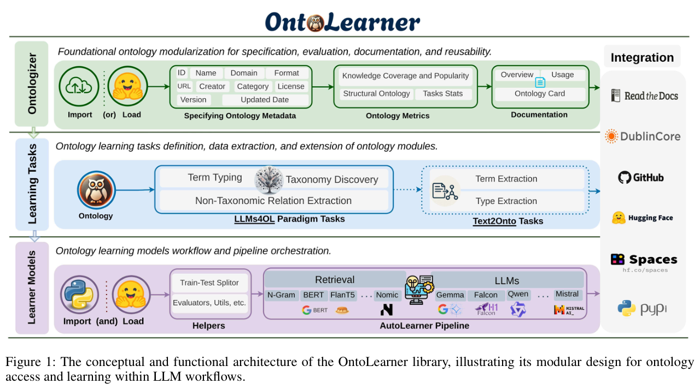

## 重点阅读

[OntoLearner: A Modular Python Library for Ontology Learning with Large Language Models](https://arxiv.org/abs/2607.01977v1) · v1 提交 2026-07-02 · [全文](https://arxiv.org/html/2607.01977v1) · [PDF](https://arxiv.org/pdf/2607.01977v1)

OntoLearner 把术语分类、分类体系发现和非分类关系抽取放入统一 Python 流程。资源库有 22 个领域、180 个机器可读本体，但实验基准实际选用其中 26 个；不能把资源总量写成全部都参与了模型比较。作者比较 22 种检索模型与 12 个 LLM，并提供训练、开发、测试划分。

表 5 固定 Qwen3-Embedding-8B 检索器，比较端到端 RAG 的领域平均 F1。Events 的非分类关系抽取中，Gemma-3-4B 为 54.5%，Qwen3-14B 为 42.9%，Qwen3-Next-80B 为 37.5%。尤其要注意 Events 在该表只有一个本体；这说明特定任务上模型规模不能替代匹配度，不支持小模型普遍更强的判断。作者提出嵌入相似性未必保留有方向的蕴含关系，也需要更多控制实验来区分原因。

我的建议是先按任务、领域与结构复杂度报告误加关系、漏父类及不一致，再决定升级模型。总体 F1 会掩盖局部失效。工具 MIT 许可与论文图表 CC BY 4.0 分别处理；下图仅展示库架构，不能当成性能结果图。

原文：Hamed Babaei Giglou、Jennifer D’Souza、Andrei Aioanei、Nandana Mihindukulasooriya、Sören Auer，arXiv:2607.01977v1，Figure 1 架构图，PDF 第 7 页。[原始来源](https://arxiv.org/pdf/2607.01977v1#page=7) · [CC BY 4.0](https://creativecommons.org/licenses/by/4.0/)。裁剪自原文。

## 同期其他论文入口

- [Program-as-Weights: A Programming Paradigm for Fuzzy Functions](https://arxiv.org/abs/2607.02512v1) · 2607.02512v1，该版本提交 2026-07-02。
- [Distributed Attacks in Persistent-State AI Control](https://arxiv.org/abs/2607.02514v1) · 2607.02514v1，该版本提交 2026-07-02。
- [WorldDirector: Building Controllable World Simulators with Persistent Dynamic Memory](https://arxiv.org/abs/2607.02517v1) · 2607.02517v1，该版本提交 2026-07-02。
- [ReContext: Recursive Evidence Replay as LLM Harness for Long-Context Reasoning](https://arxiv.org/abs/2607.02509v1) · 2607.02509v1，该版本提交 2026-07-02。
- [Embodied.cpp: A Portable Inference Runtime of Embodied AI Models on Heterogeneous Robots](https://arxiv.org/abs/2607.02501v1) · 2607.02501v1，该版本提交 2026-07-02。
- [AgenticSTS: A Bounded-Memory Testbed for Long-Horizon LLM Agents](https://arxiv.org/abs/2607.02255v1) · 2607.02255v1，该版本提交 2026-07-02。
- [Online Safety Monitoring for LLMs](https://arxiv.org/abs/2607.02510v1) · 2607.02510v1，该版本提交 2026-07-02。
