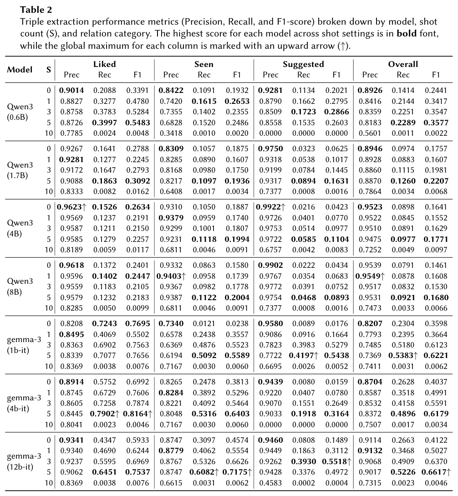
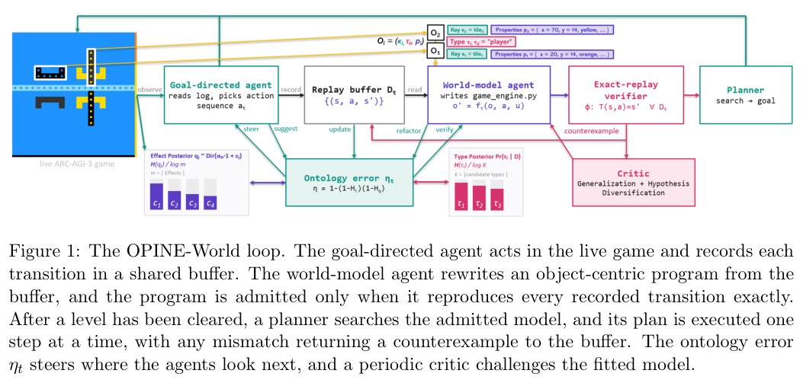
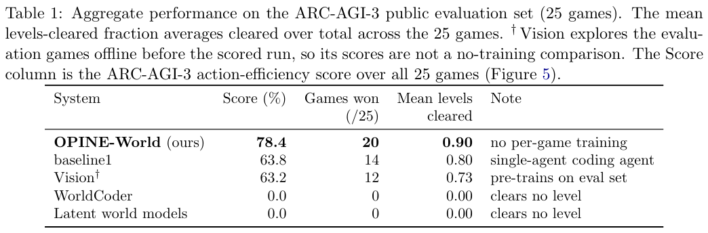
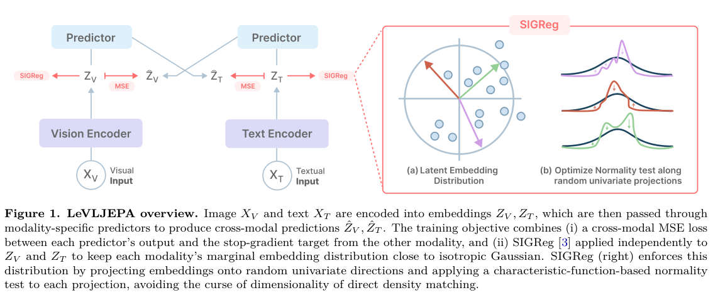
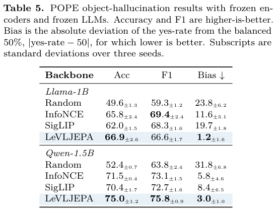
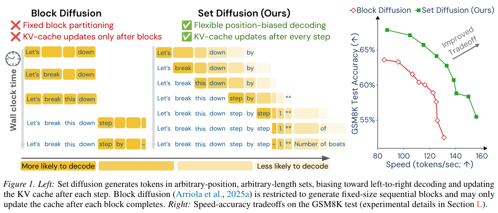
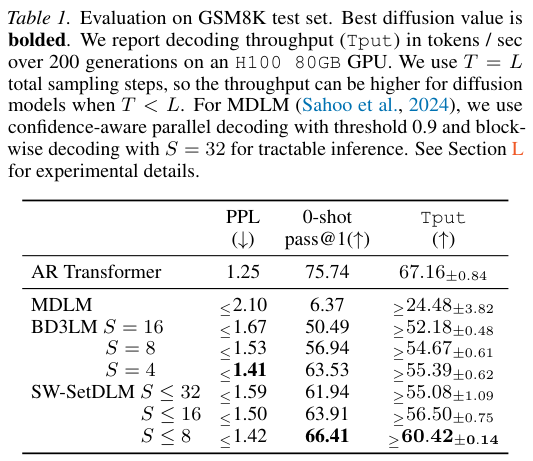
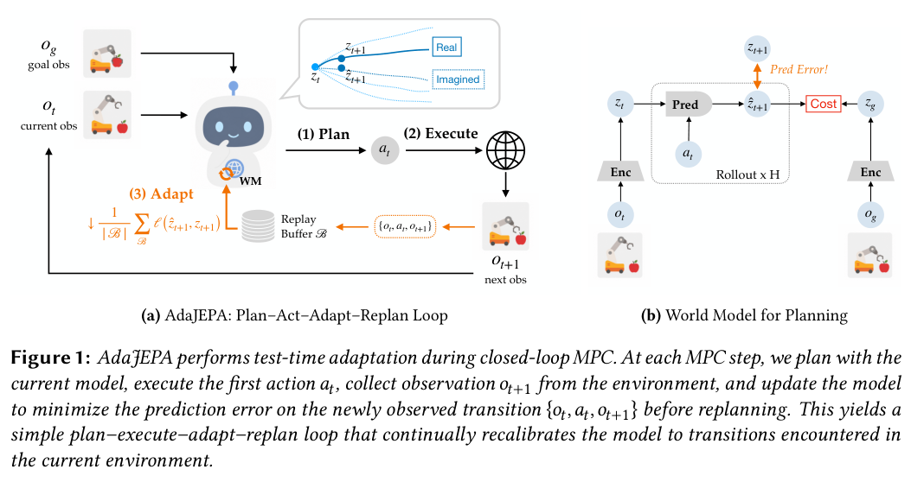
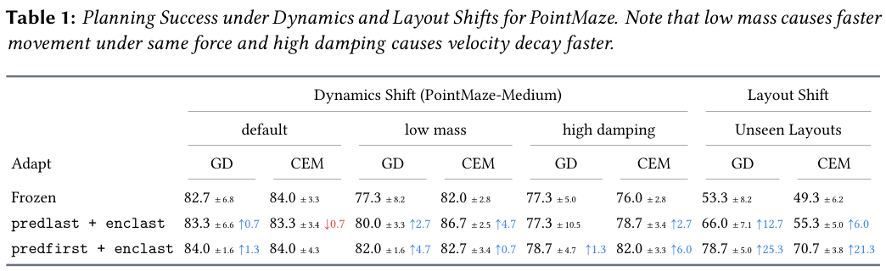

本期九项研究介绍对话三元组、证据驱动本体扩展、程序世界模型、视觉语言预训练、集合扩散、记忆技能、在线强化学习系统、动作变速与测试时适应。

## 1. 个人图谱：抽得准还要抽得全

这项研究从电影推荐对话抽取用户偏好、观看与推荐关系，将电影对齐到 Wikidata，再用这些 RDF 三元组构建个人知识图谱。评价把三元组精确率、召回率与下游推荐用途分开，检查较小模型能否从分散对话保留可用偏好。

*图｜Dasgupta, Abhirup 等，[Table 2（PDF 第 10 页）](https://arxiv.org/pdf/2607.00003v1#page=10)，[CC BY 4.0](http://creativecommons.org/licenses/by/4.0/)。裁剪自原文。*

五样例提示下，Gemma-3-12B 的总体三元组 F1 为 0.6617，Gemma-3-1B 为 0.6221；Qwen3-8B 虽精确率高达 0.9531，召回率仅 0.0921，F1 为 0.1680。十样例时多个模型的召回明显下降，更多示例并非必然有利。喜欢关系通常比谁曾推荐哪部电影更易抽取，不能用高精确率代替偏好信息已完整保存。

[From "Strings" to "Things" for Personal Knowledge Graphs: Evaluating LLM Triple Extraction for Recommendation Systems](https://arxiv.org/abs/2607.00003v1) · v1。

## 2. FCA 知识扩展：用证据与反例检查属性蕴含

[Verifiable Knowledge Expansion through Retrieval-Grounded Formal Concept Analysis](https://arxiv.org/abs/2607.01773v1) · v1 提交 2026-07-02 · [全文](https://arxiv.org/html/2607.01773v1) · [PDF](https://arxiv.org/pdf/2607.01773v1)

本体扩展的难点不是列出更多概念，而是决定哪些结构可以承诺。本文把形式概念分析 FCA 与检索增强小模型放入闭环：有限受控属性集合给出种子，FCA 提出属性蕴含，模型依据检索文本确认或返回破坏蕴含的反例，再记录对象—属性关系、冲突与修正。这是局部、可检查的构建过程，不是自由生成完整本体。

Orphadata 罕见共济失调实验保留 122 个疾病、160 个证据可触及 HPO 属性和 1,398 条正关系。这里的“10-seed”指十个初始属性，不是十个随机种子重复。20 轮、温度 0、EmbeddingGemma-300M 检索下，Llama3.2:3B 的关系 F1 为 0.52、闭包蕴含 F1 为 0.24；Qwen2.5:1.5B 分别为 0.46、0.30。属性层面的证据可访问过滤，不保证每条人工金标准关系都显式出现在疾病文本中。

我的判断是，把候选、证据与反例送入人工审核，比只保留一个结论更有用。但关系与蕴含分数差距说明局部判断错误会传导，当前结果不支持自动替代专家，也不构成疾病诊断能力验证。

原文：Yujin Yang、Heejung Lee，arXiv:2607.01773v1，Figure 1 验证回路，PDF 第 3 页。[原始来源](https://arxiv.org/pdf/2607.01773v1#page=3) · [CC BY 4.0](https://creativecommons.org/licenses/by/4.0/)。裁剪自原文。

## 3. OPINE-World：用交互检验对象类别与程序世界模型

OPINE-World 让行动 Agent 和代码建模 Agent 共同从画面假设对象、状态与规则，再用历史转移回放验证和模型规划修正。探索优先寻找可能推翻对象类型假设的交互，将本体错误作为信息价值信号，而不预设完整对象词汇。

*图｜Courtis, David 等，[Figure 1（PDF 第 4 页）](https://arxiv.org/pdf/2607.01531v1#page=4)，[CC BY 4.0](http://creativecommons.org/licenses/by/4.0/)。裁剪自原文。*

ARC-AGI-3 的二十五个公开游戏中，系统解出二十个，动作效率得分为 78.4；单 Agent 编程对照解出十四个、得分 63.8。但两者分别使用 Claude Opus 4.8 和 GPT-5.5，不能把差距单独归给双 Agent 或本体探索。无逐游戏预训练仍包括计分运行中的在线试探，得分 78.4 也不等于游戏通关百分比。

*图｜Courtis, David 等，[Table 1（PDF 第 8 页）](https://arxiv.org/pdf/2607.01531v1#page=8)，[CC BY 4.0](http://creativecommons.org/licenses/by/4.0/)。裁剪自原文。*

[OPINE-World: Programmatic World Modeling with Ontology-error-Prioritized Interactive Exploration](https://arxiv.org/abs/2607.01531v1) · v1。

## 4. LeVLJEPA：不用负样本学习密集视觉语义

LeVLJEPA 通过跨模态预测、停止梯度目标和每模态分布正则训练视觉语言编码器，不使用负样本、温度或动量教师。它区分全局图像向量的分类能力与 patch token 的空间语义，后者更直接影响视觉问答和分割。

*图｜Kuhn, Lukas 等，[Figure 1（PDF 第 2 页）](https://arxiv.org/pdf/2607.00784v1#page=2)，[CC BY 4.0](http://creativecommons.org/licenses/by/4.0/)。裁剪自原文。*

Datacomp-L、相同 ViT-B/16 下，ImageNet 零样本准确率为 42.45%，SigLIP 为 50.78%；冻结视觉与 Qwen-1.5B、只训练连接层时，POPE 准确率又为 75.0%，SigLIP 为 70.4%。Llama-1B 配置中准确率提高但 F1 低于对比方法。不同读出协议衡量的表示属性不同，不能把问答改善泛化成零样本分类全面领先。

*图｜Kuhn, Lukas 等，[Table 5（PDF 第 7 页）](https://arxiv.org/pdf/2607.00784v1#page=7)，[CC BY 4.0](http://creativecommons.org/licenses/by/4.0/)。裁剪自原文。*

[LeVLJEPA: End-to-End Vision-Language Pretraining Without Negatives](https://arxiv.org/abs/2607.00784v1) · v1。

## 5. Set Diffusion：让 token 集合兼顾并行与缓存

Set Diffusion 将生成次序分解为位置、长度均可变的 token 集合，用集合因果架构在每次接受 token 后更新 KV 缓存。滑动窗口集合允许跨越固定块边界，在自回归与全双向扩散之间调整次序和并行度；训练时让所有 token 都贡献条件项。

*图｜Arriola, Marianne 等，[Figure 1（PDF 第 2 页）](https://arxiv.org/pdf/2607.01775v1#page=2)，[CC BY 4.0](http://creativecommons.org/licenses/by/4.0/)。裁剪自原文。*

GSM8K、H100 80GB、采样步数等于长度的设置中，最大窗口八的 SW-SetDLM Pass@1 为 66.41%，吞吐下界约 60.42 token/s；块大小四的 BD3LM 为 63.53%、约 55.39 token/s，自回归为 75.74%、67.16 token/s。它改善所比扩散模型的速度质量权衡，尚未在该设置超过自回归；更少采样步的曲线又属于另一推理预算。

*图｜Arriola, Marianne 等，[Table 1（PDF 第 7 页）](https://arxiv.org/pdf/2607.01775v1#page=7)，[CC BY 4.0](http://creativecommons.org/licenses/by/4.0/)。裁剪自原文。*

[Set Diffusion: Interpolating Token Orderings Between Autoregression and Diffusion for Fast and Flexible Decoding](https://arxiv.org/abs/2607.01775v1) · v1。

## 6. AutoMem：把记忆管理作为单独可学的技能

AutoMem 将文件读写、编码、检索与组织提升为记忆动作。第一层循环让强模型阅读完整游戏轨迹，修改记忆提示、文件结构和动作词汇；第二层再筛选较好的记忆决策，训练专用记忆模型，保留任务行动模型的分工。

Qwen2.5-32B 的 Crafter 进度从初始文件记忆的 25.00 到结构优化后的 47.27，再到记忆训练后的 51.36；MiniHack 为 7.50、27.50、30.00，NetHack 为 0.42、1.57、1.85。它们是不同的游戏进度指标，NetHack 仍很低。结构优化依赖外部强模型分析，部分前沿对照取自榜单，不能将收益解释成不付额外训练与审核成本的自发改进。

[AutoMem: Automated Learning of Memory as a Cognitive Skill](https://arxiv.org/abs/2607.01224v1) · v1。

[Figure 1（原文）](https://arxiv.org/pdf/2607.01224v1#page=1)。

## 7. AReaL2.0：把线上 Agent 经验接到强化学习系统

这篇系统观点提出三层基础：可携带逐步骤奖励与决策上下文的轨迹协议、把生产交互转成受治理训练材料的数据代理，以及决定何时更新权重或执行框架的演化控制面。AReaL2.0 原型以网关、会话路由、数据代理和计算 worker 接入既有 Agent。

Hermes 集成案例展示了既有规划、工具、沙箱和记忆流程如何通过替换推理后端接入轨迹收集与在线权重更新。原型只实现整体设想中的权重更新分支，没有给出可以概括为跨任务准确率或生产收益的完整评测。记忆、技能、框架修改的自动选择、回放验收、隐私与回滚仍属待完成的系统议程。

[Next-Generation Agentic Reinforcement Learning Systems Enable Self-Evolving Agents](https://arxiv.org/abs/2607.01120v1) · v1。

[Figure 1（原文）](https://arxiv.org/pdf/2607.01120v1#page=9)。

## 8. AutoSpeed：按阶段选择动作速度与预测跨度

AutoSpeed 不要求阶段或速度标注，而将不同速度的未来轨迹作为候选监督，用预测误差与时间跨度的组合成本选择训练目标。DCT 支持平滑的非整数变速，使容易阶段走得快、精细接触阶段减速，并改变固定长度动作块覆盖的时间。

LIBERO-10 上，BAKU-Flow 的成功率由 47% 到 52%，平均轨迹长度由 287 到 171；Meta-World 为 57% 到 65%、82 到 71。但 ALOHA 传方块中，普通 ACT 加 AutoSpeed 从 72% 降到 64%，换高增益控制器后为 78%。速度策略与底层控制器相互影响，缩短轨迹并不自动提高每项任务的成功率。

[AutoSpeed: Annotation-Free Stage-Adaptive Motion Speed Learning for Robot Manipulation](https://arxiv.org/abs/2607.01051v1) · v1。

[Figure 1（原文）](https://arxiv.org/pdf/2607.01051v1#page=1)。

## 9. AdaJEPA：执行一次，再用新观察修正世界模型

AdaJEPA 在模型预测控制闭环中加入测试时自监督更新：规划并执行首个动作块，用实际下一状态校准潜在转移，再重新规划。它研究直接更新编码器、预测器的部分层和 LoRA 等位置，让模型适应质量、阻尼、视觉与布局变化。

*图｜Wang, Ying 等，[Figure 1（PDF 第 2 页）](https://arxiv.org/pdf/2606.32026v1#page=2)，[CC BY 4.0](http://creativecommons.org/licenses/by/4.0/)。裁剪自原文。*

PointMaze 未见布局中，梯度规划的冻结模型成功率为 53.3±8.2%，调整预测器首层与编码器末层后为 78.7±5.0%；CEM 规划从 49.3±6.2% 到 70.7±3.8%。默认动力学下同配置却只有约 1.3 个百分点或零增益。适应目标依环境而变，收益还要计入闭环更新的额外计算与真实交互。

*图｜Wang, Ying 等，[Table 1（PDF 第 8 页）](https://arxiv.org/pdf/2606.32026v1#page=8)，[CC BY 4.0](http://creativecommons.org/licenses/by/4.0/)。裁剪自原文。*

[AdaJEPA: An Adaptive Latent World Model](https://arxiv.org/abs/2606.32026v1) · v1。
