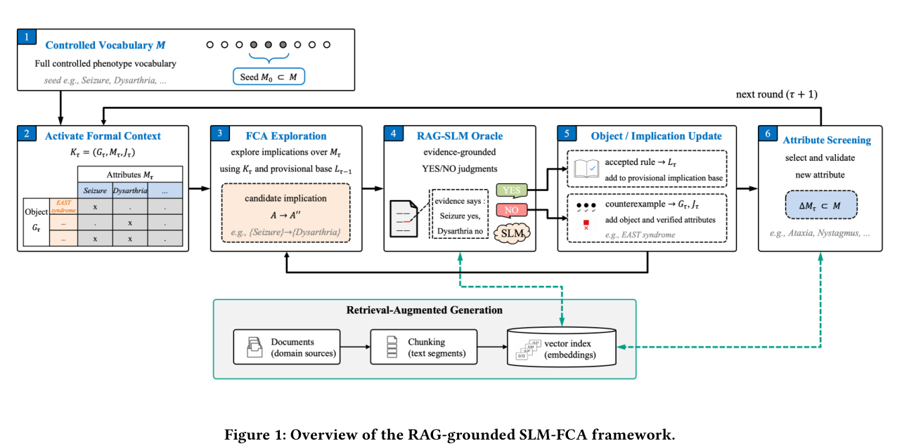

## 重点阅读

[Verifiable Knowledge Expansion through Retrieval-Grounded Formal Concept Analysis](https://arxiv.org/abs/2607.01773v1) · v1 提交 2026-07-02 · [全文](https://arxiv.org/html/2607.01773v1) · [PDF](https://arxiv.org/pdf/2607.01773v1)

本体扩展的难点不是列出更多概念，而是决定哪些结构可以承诺。本文把形式概念分析 FCA 与检索增强小模型放入闭环：有限受控属性集合给出种子，FCA 提出属性蕴含，模型依据检索文本确认或返回破坏蕴含的反例，再记录对象—属性关系、冲突与修正。这是局部、可检查的构建过程，不是自由生成完整本体。

Orphadata 罕见共济失调实验保留 122 个疾病、160 个证据可触及 HPO 属性和 1,398 条正关系。这里的“10-seed”指十个初始属性，不是十个随机种子重复。20 轮、温度 0、EmbeddingGemma-300M 检索下，Llama3.2:3B 的关系 F1 为 0.52、闭包蕴含 F1 为 0.24；Qwen2.5:1.5B 分别为 0.46、0.30。属性层面的证据可访问过滤，不保证每条人工金标准关系都显式出现在疾病文本中。

我的判断是，把候选、证据与反例送入人工审核，比只保留一个结论更有用。但关系与蕴含分数差距说明局部判断错误会传导，当前结果不支持自动替代专家，也不构成疾病诊断能力验证。

原文：Yujin Yang、Heejung Lee，arXiv:2607.01773v1，Figure 1 验证回路，PDF 第 3 页。[原始来源](https://arxiv.org/pdf/2607.01773v1#page=3) · [CC BY 4.0](https://creativecommons.org/licenses/by/4.0/)。裁剪自原文。

## 同期其他论文入口

- [From "Strings" to "Things" for Personal Knowledge Graphs: Evaluating LLM Triple Extraction for Recommendation Systems](https://arxiv.org/abs/2607.00003v1) · 2607.00003v1，该版本提交 2026-04-18。
- [OPINE-World: Programmatic World Modeling with Ontology-error-Prioritized Interactive Exploration](https://arxiv.org/abs/2607.01531v1) · 2607.01531v1，该版本提交 2026-07-01。
- [LeVLJEPA: End-to-End Vision-Language Pretraining Without Negatives](https://arxiv.org/abs/2607.00784v1) · 2607.00784v1，该版本提交 2026-07-01。
- [Set Diffusion: Interpolating Token Orderings Between Autoregression and Diffusion for Fast and Flexible Decoding](https://arxiv.org/abs/2607.01775v1) · 2607.01775v1，该版本提交 2026-07-02。
- [AutoMem: Automated Learning of Memory as a Cognitive Skill](https://arxiv.org/abs/2607.01224v1) · 2607.01224v1，该版本提交 2026-07-01。
- [Next-Generation Agentic Reinforcement Learning Systems Enable Self-Evolving Agents](https://arxiv.org/abs/2607.01120v1) · 2607.01120v1，该版本提交 2026-07-01。
- [AutoSpeed: Annotation-Free Stage-Adaptive Motion Speed Learning for Robot Manipulation](https://arxiv.org/abs/2607.01051v1) · 2607.01051v1，该版本提交 2026-07-01。
- [AdaJEPA: An Adaptive Latent World Model](https://arxiv.org/abs/2606.32026v1) · 2606.32026v1，该版本提交 2026-06-30。
