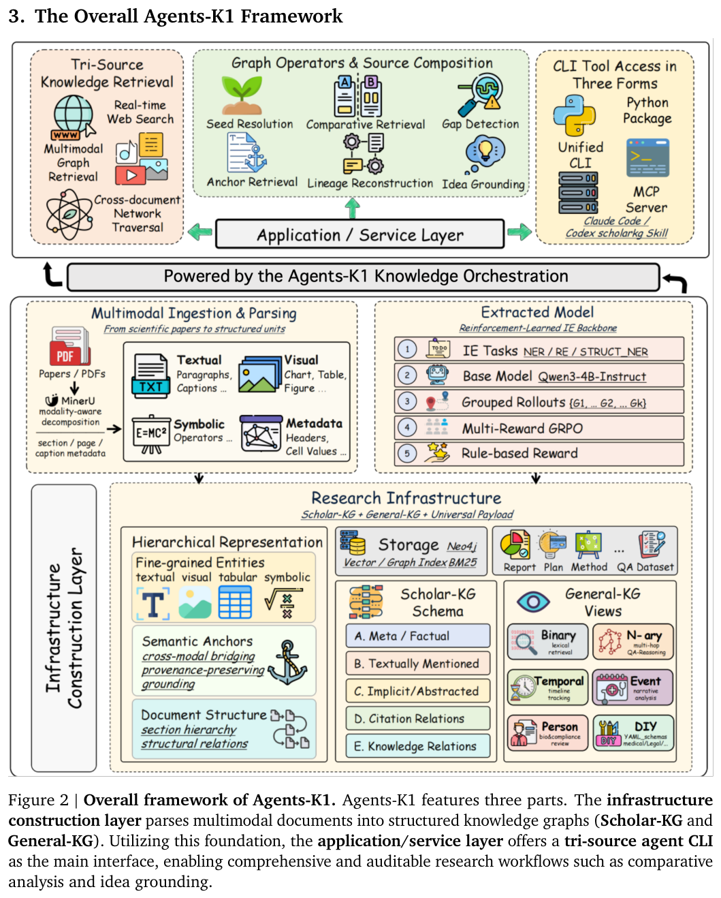
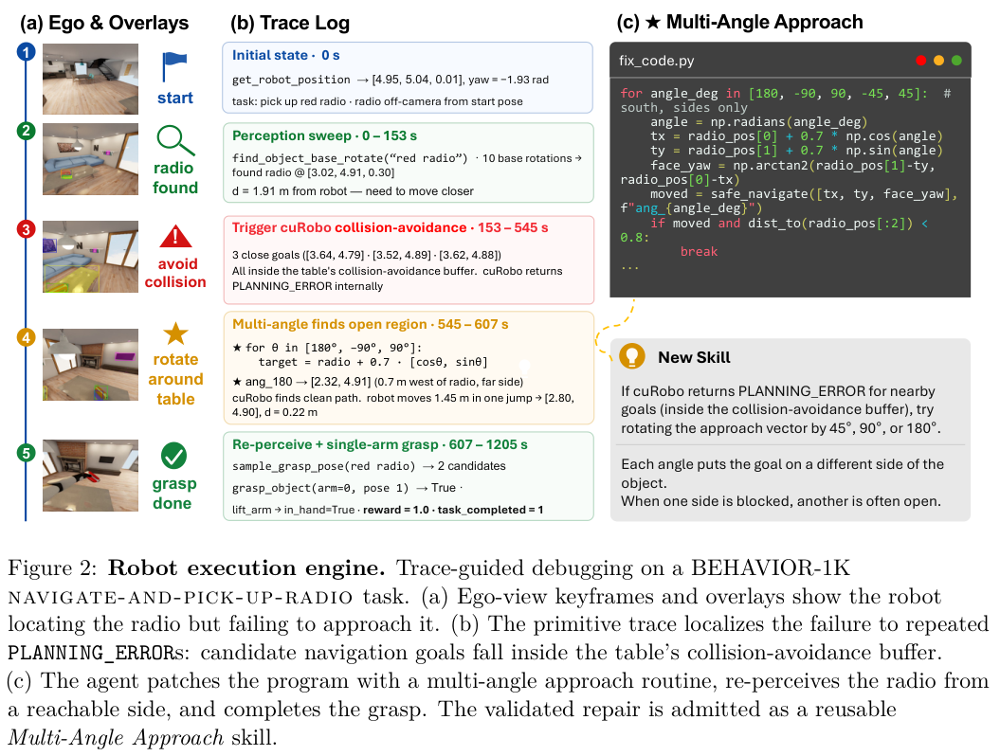
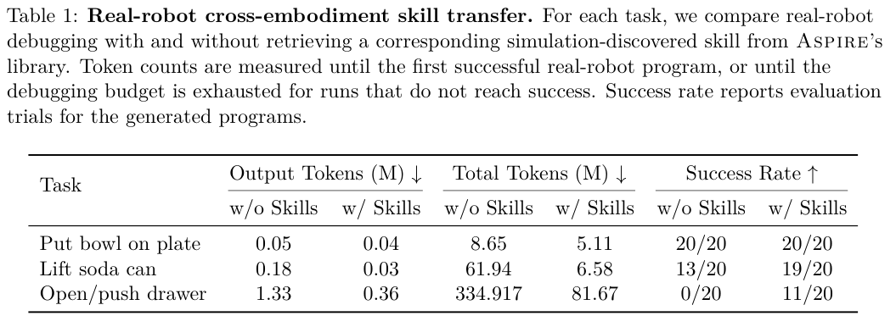
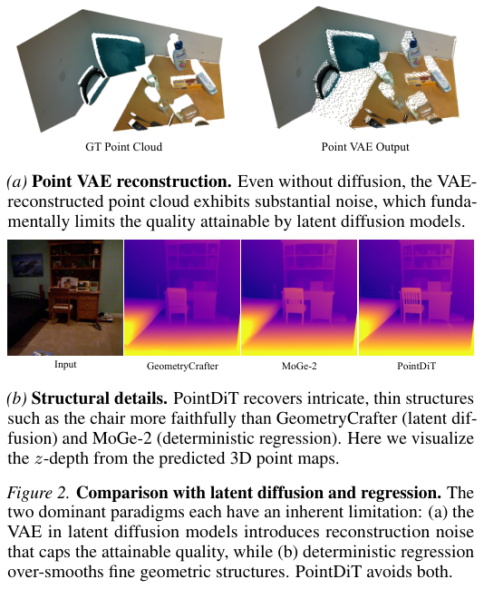
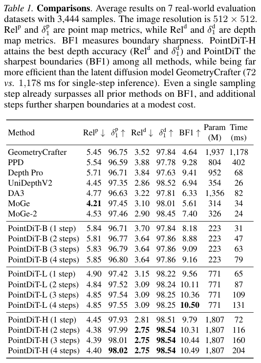
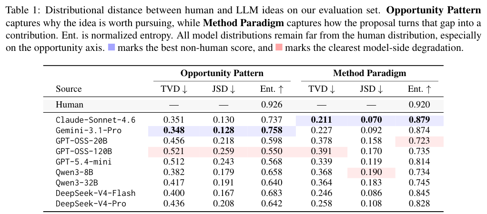
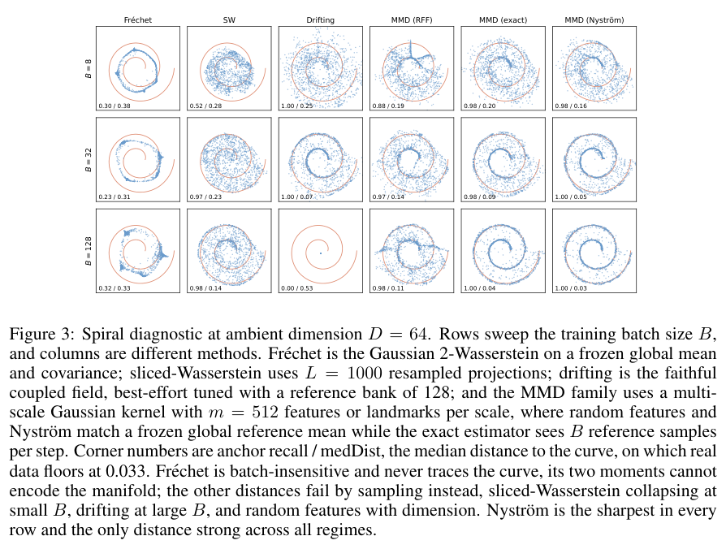
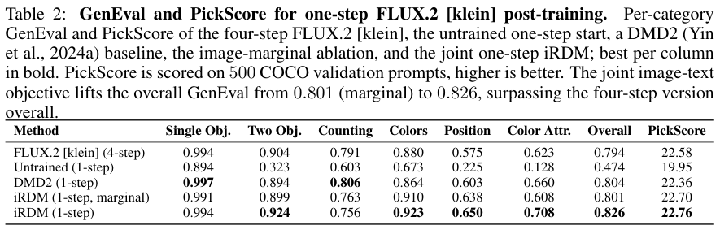
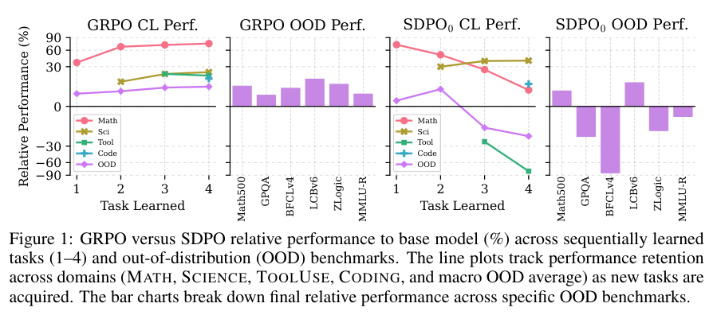
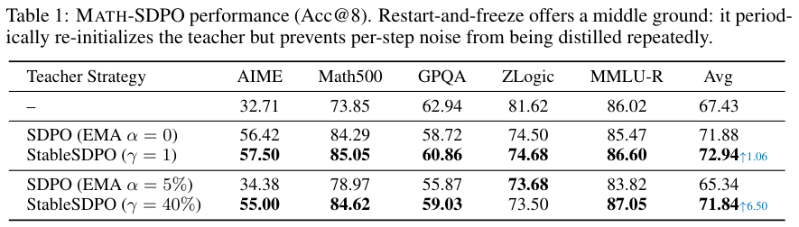

本期九项研究介绍外部政策推理、论文知识编排、扩散数学、准蒙特卡洛采样、机器人技能、几何扩散、研究点子分布、一步生成和持续自蒸馏。

## 1. AgenticRei：把许可、义务和例外交给外部规则引擎

AgenticRei 在工具调用与 Agent 消息边界提取主体、动作、资源三元组，由 OWL/RDFox 规则引擎判断允许、禁止和默认拒绝，并管理动作后附带的义务、豁免和冲突优先级。推理发生在语言模型之外，本体子类关系可扩展既有政策的适用范围。

RHEL 9、RDFox 7.5、localhost HTTP 的初步测量中，一组允许与禁止查询及义务查找端到端少于 10ms，引擎内执行小于 1ms。它是单机原型证据；凭据验证仍用可信签发方匹配模拟，日志是追加记录而非防篡改账本。决定是否发出义务与确保 Agent 后续真正履行，也是不同的验收目标。

[Deontic Policies for Runtime Governance of Agentic AI Systems](https://arxiv.org/abs/2606.19464v1) · v1。

[Figure 1（原文）](https://arxiv.org/pdf/2606.19464v1#page=3)。

## 2. Agents-K1：让论文实体、贡献与证据可共同检索

Agents-K1 把多模态全文解析、五模块科学信息抽取和图查询 CLI 串起来，保留显式实体、抽象贡献、引用角色和实体关系。4B 抽取骨干使用规则奖励训练；研究 Agent 可在网页、图谱证据和跨文档关系之间切换，而非仅检索摘要和扁平引用边。

*图｜Cao, Zongsheng 等，[Figure 2（PDF 第 6 页）](https://arxiv.org/pdf/2606.13669v1#page=6)，[CC BY 4.0](http://creativecommons.org/licenses/by/4.0/)。裁剪自原文。*

六个科学领域、每领域每模块一百篇文档的宏平均中，五模块平均 F1 从物理的 79.07% 到计算机的 87.11%；计算机隐式概念模块为 91.84%，引用关系为 83.48%。评分由 DeepSeek-V3 语义裁判进行，允许部分高层概括，不能等同于人工严格匹配的金标准。图谱覆盖规模与证据抽取正确性应分开观察。

[Agents-K1: Towards Agent-native Knowledge Orchestration](https://arxiv.org/abs/2606.13669v1) · v1。

## 3. 扩散数学讲义：从采样动力学到推理时控制

Jianfeng Lu 的讲义从 Langevin 动力学、Markov 核与熵耗散出发，推导 score、反向 SDE 和概率流 ODE，再连接 DDPM、离散状态扩散与奖励倾斜。定义与恒等式给出完整证明，部分估计在简化假设下证明，更高阶结论提供证明路线。

这是一份面向初学研究生的理论讲义，没有新增生成质量、硬件吞吐或 benchmark 排名。其误差分析将提前停止、数值离散与 score 估计误差分开，适合帮助判断某个采样结论需要哪些正则性与近似条件；这些条件不能直接替代真实模型的数值验证。

[A Mathematical Introduction to Diffusion Models](https://arxiv.org/abs/2607.01693v1) · v1。

## 4. QuasiMoTTo：协调一批采样，减少重复尝试

[QuasiMoTTo: Quasi-Monte Carlo Test-Time Scaling](https://arxiv.org/abs/2607.01179v1) · v1 提交 2026-07-01 · [全文](https://arxiv.org/html/2607.01179v1) · [PDF](https://arxiv.org/pdf/2607.01179v1)

独立生成多条答案会重复探索同一高概率区域。QuasiMoTTo 将自回归采样写成逆 CDF 遍历，在底层随机数上使用 quasi-Monte Carlo 协调一批尝试，保持各条样本的边际分布，同时改变联合分布。样本相关后，常用独立 pass@k 估计器不再适用；论文利用 lattice 等采样结构设计无偏 bootstrap 估计。

Countdown、Maze、Sudoku 使用按任务以 50,000 个正确问答微调的 Qwen3.5-0.8B-Base，1D-ARC 直接使用 Qwen3.5-2B-Base。模型、提示、温度 1.0、top-p 0.95 固定；输出上限分别为前两任务 32 token、后两任务 280 token。lattice 采样在匹配独立采样 pass@k 时减少 25%—47% 样本。节省指采样预算，不等于服务延迟同比下降。

Maze、Sudoku 的 GRPO 实验也观察到训练效率收益，但训练输出上限等配置与上述推理实验不同，不混用其数字。我的判断是，组织一批尝试值得成为预算优化对象；接入服务仍要检查逆 CDF 数值稳定性、批处理开销和真实任务分布，不能把四类合成题直接推广为开放域 Agent 收益。

**原图入口：**[Figure 1，PDF 第 2 页](https://arxiv.org/pdf/2607.01179v1#page=2)。

## 5. ASPIRE：把执行失败沉淀成可迁移的机器人技能

ASPIRE 以代码作为机器人策略，通过细粒度多模态执行轨迹诊断失败、生成修复并验证，把通过的经验存成可检索技能，再用演化搜索探索不同任务序列。技能库积累的是可复用编程知识，移到新机器人时仍需结合自身感知、标定和控制接口修改程序。

*图｜Lu, Runyu 等，[Figure 2（PDF 第 4 页）](https://arxiv.org/pdf/2607.00272v1#page=4)，[CC BY 4.0](http://creativecommons.org/licenses/by/4.0/)。裁剪自原文。*

真实机器人提罐任务中，使用仿真技能后评估成功为 19/20，无技能为 13/20；抽屉任务为 11/20 对 0/20。后者总 token 从约 334.9M 到 81.67M，计时范围是找到首个成功程序或耗尽调试预算。摆碗任务两者均为 20/20，因此减少编程投入与提高最终成功率并非每项任务同时发生。

*图｜Lu, Runyu 等，[Table 1（PDF 第 10 页）](https://arxiv.org/pdf/2607.00272v1#page=10)，[CC BY 4.0](http://creativecommons.org/licenses/by/4.0/)。裁剪自原文。*

[ASPIRE: Agentic /Skills Discovery for Robotics](https://arxiv.org/abs/2607.00272v1) · v1。

## 6. PointDiT：直接在像素对齐点图上做扩散

PointDiT 用普通 ViT 对三维点图 patch 建模，以冻结 DINOv3 图像特征为条件，不训练几何 tokenizer，扩散骨干从头学习。先在 256 分辨率合成 RGB-D 数据上预训练，再以十一套合成数据微调到 512 分辨率，目标是保留更锐利的几何边界。

*图｜Xu, Haofei 等，[Figure 2（PDF 第 2 页）](https://arxiv.org/pdf/2607.02515v1#page=2)，[CC BY 4.0](http://creativecommons.org/licenses/by/4.0/)。裁剪自原文。*

七套真实数据、3,444 样本中，PointDiT-H 单步深度相对误差为 2.81、边界 F1 为 9.79，GeometryCrafter 为 3.52、4.64；单步时间 72ms 对 1,178ms。四步时边界 F1 到 10.49、时间到 204ms；UniDepthV2 只需 26ms。模型尺寸、步数和指标有不同权衡，不能把与潜在扩散对照的加速写成优于所有几何网络。

*图｜Xu, Haofei 等，[Table 1（PDF 第 6 页）](https://arxiv.org/pdf/2607.02515v1#page=6)，[CC BY 4.0](http://creativecommons.org/licenses/by/4.0/)。裁剪自原文。*

[PointDiT: Pixel-Space Diffusion for Monocular Geometry Estimation](https://arxiv.org/abs/2607.02515v1) · v1。

## 7. 研究点子的差距：比较机会类型与贡献方式

研究从高质量人类论文反向寻找可能启发其核心思路的邻近文献，再让九组模型在相同标题与摘要条件下提出新点子。两轴分类分别描述值得研究的机会模式和形成贡献的方法范式，通过分布距离与归一化熵观察模型的研究偏好。

*图｜Chen, Ziyu 等，[Table 1（PDF 第 5 页）](https://arxiv.org/pdf/2607.01233v1#page=5)，[CC BY 4.0](http://creativecommons.org/licenses/by/4.0/)。裁剪自原文。*

人类机会模式熵为 0.926，九组模型为 0.550–0.758；桥接或碎片整合机会占人类点子的 12.1%，模型为 47.1%–64.2%。最接近人类机会分布的 Gemini-3.1-Pro 仍有 TVD 0.348。这衡量特定论文参照、分类体系与自动标注下的风格分布，不是每个点子的正确性或实际研究价值分数，也不能说明综合已有工作本身没有价值。

[Measuring the Gap Between Human and LLM Research Ideas](https://arxiv.org/abs/2607.01233v1) · v1。

## 8. iRDM：在多个冻结表示空间匹配生成分布

iRDM 将一步生成器训练拆为如何比较分布、在哪些表示空间比较，使用正确估计的 MMD 与很大的生成批次，并平衡多个冻结编码器。单一表示可能被模型钻空子，因此另用不同机制的 Sliced-Wasserstein 编码器组合和 PickScore 检查。

*图｜Feng, Lan 等，[Figure 3（PDF 第 5 页）](https://arxiv.org/pdf/2607.02375v1#page=5)，[CC BY 4.0](http://creativecommons.org/licenses/by/4.0/)。裁剪自原文。*

ImageNet-256 的十四编码器归一化 SW 均值为 1.30，FD-SIM 为 2.05；PickScore 在配对样本中有 71.2% 偏好 iRDM，它是偏好代理而非真人投票。将四步 FLUX.2 klein 后训练为一步，GenEval 从 0.794 到 0.826，计数子项却从 0.791 降到 0.756。后训练约需 90 H200 GPU 小时，还依赖预先收集并筛选的教师参考图像。

*图｜Feng, Lan 等，[Table 2（PDF 第 9 页）](https://arxiv.org/pdf/2607.02375v1#page=9)，[CC BY 4.0](http://creativecommons.org/licenses/by/4.0/)。裁剪自原文。*

[Representation Distribution Matching for One-Step Visual Generation](https://arxiv.org/abs/2607.02375v1) · v1。

## 9. 自蒸馏并非越密越稳：区分专门化与遗忘

这项 SDPO 研究把 on-policy 数据来源与 token 级优化目标分开，比较冻结、EMA 和周期重启教师，并追踪多领域连续训练中的参数和响应分布漂移。更密的教师监督可以加快当前任务学习，也可能反复强化格式噪声和失配推理。

*图｜Wang, Meng 等，[Figure 1（PDF 第 2 页）](https://arxiv.org/pdf/2607.01763v1#page=2)，[CC BY 4.0](http://creativecommons.org/licenses/by/4.0/)。裁剪自原文。*

Qwen3-4B-Thinking-2507 的数学训练中，冻结教师将 AIME 从 32.71 到 56.42，但 GPQA 从 62.94 降到 58.72；EMA 5% 的五项平均只有 65.34，周期刷新并冻结后为 71.84。更稳定的教师能修复一部分退化，却未消除分布外遗忘；当前任务提升不能作为持续学习稳定性的充分证据。

*图｜Wang, Meng 等，[Table 1（PDF 第 5 页）](https://arxiv.org/pdf/2607.01763v1#page=5)，[CC BY 4.0](http://creativecommons.org/licenses/by/4.0/)。裁剪自原文。*

[Denser $\neq$ Better: Limits of On-Policy Self-Distillation for Continual Post-Training](https://arxiv.org/abs/2607.01763v1) · v1。
