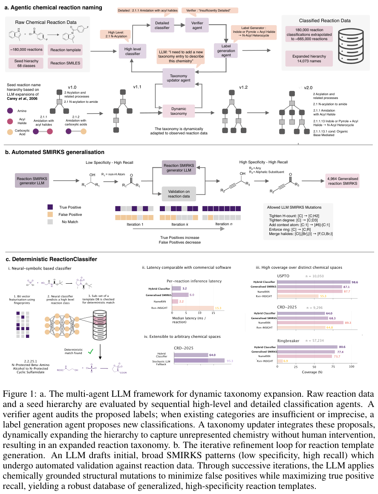
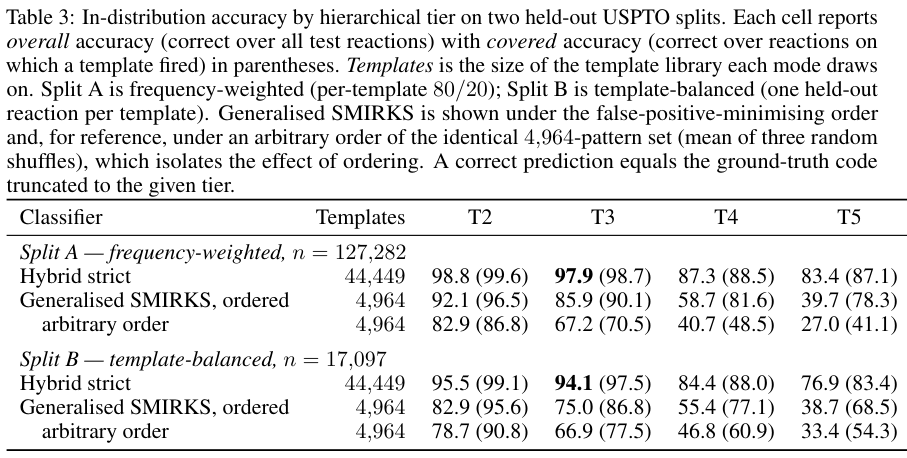
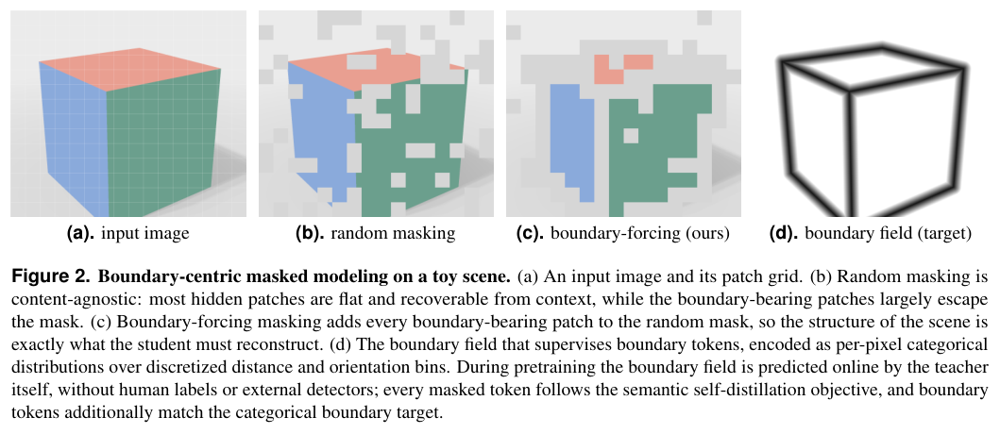
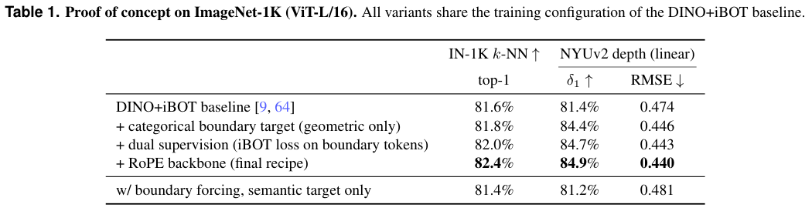
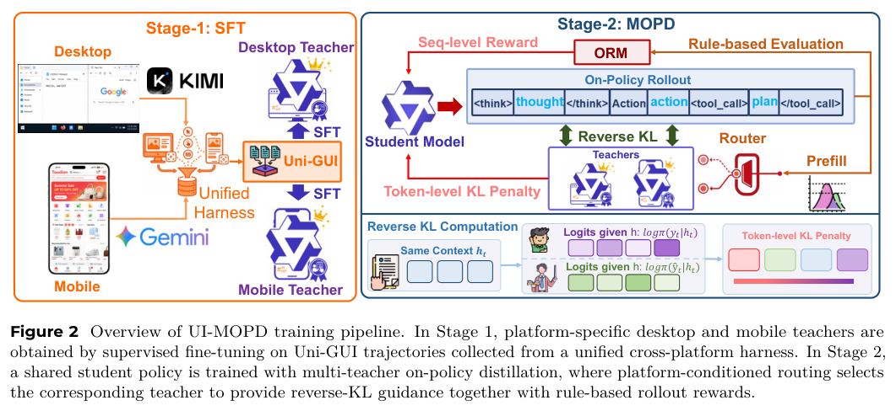
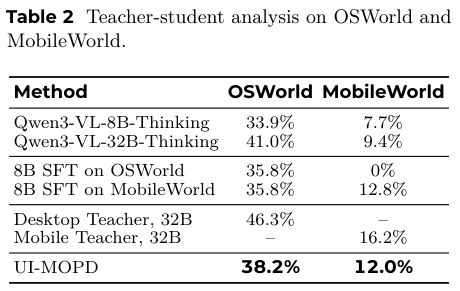

本期九项研究介绍图原生科学假设、可验证反应规则、单层强化学习、仿真实机评测、密集空间视觉、环境学习曲线、GUI 蒸馏、代理评测和推理信号净化。

## 1. Graph-PRefLexOR：用可追踪的关系图生成科学假设

[Graph-Native Reinforcement Learning Enables Traceable Scientific Hypothesis Generation through Conceptual Recombination](https://arxiv.org/abs/2607.00924v1) · v1 提交 2026-07-01 · [全文](https://arxiv.org/html/2607.00924v1) · [PDF](https://arxiv.org/pdf/2607.00924v1)

Graph-PRefLexOR 将机制探索、关系图、模式抽取和假设综合纳入结构化流程，并用 GRPO 训练。图结构应成为可检查、可复用的中间产物，而不是最终答案旁的事后装饰。作者构建 Qwen3-8B、Llama-3.2-3B-Instruct、Qwen3-1.7B 三个变体，比较对应基础模型。

评测使用 100 个材料科学与力学开放问题，论文的方法部分说明题目由文献抽取后，经 GPT-5.4 生成和细化；不能把问题集简单称为完全人工金标准。独立评审模型 Claude Opus-4.7 按 0—10 分评推理质量、思想深度与可追踪性，三项均值为 Overall Score。作者报告综合改善约 40%—65%，语义多样性约 2—3 倍；这些是模型评分及嵌入分析，不是实验验证的材料发现成功率。

我认为可追踪性值得成为训练目标，但显式图不自动保证因果关系真实。增加测试时图扩展主要反映概念重组，仍需检查图边的证据来源、裁判偏差、评分尺度及外部验证。提高多样性与提高科学正确性也应分别验收。

**原图入口：**[Figure 1，PDF 第 3 页](https://arxiv.org/pdf/2607.00924v1#page=3)。

## 2. 反应分类：让 Agent 生成能在语料上检验的规则

该流水线用分类、验证、生成与聚合 Agent 扩展反应层级，按模板将标签传播到更大语料；候选 SMIRKS 规则在正例与跨类别反例上反复检验。轻量指纹分类器只作路由，最后由可执行模板核对反应结果，形成概率提议与确定性验证的分工。

*图｜Armstrong, Daniel 等，[Figure 1（PDF 第 4 页）](https://arxiv.org/pdf/2607.01061v1#page=4)，[CC BY 4.0](http://creativecommons.org/licenses/by/4.0/)。裁剪自原文。*

从 68 个初始子类扩到 14,073 个类，模板传播覆盖 665,901 条专利反应。在同模板的新底物测试中，Hybrid strict 的三级总体准确率为频率加权划分 97.9%、模板均衡划分 94.1%；五级降到 83.4%、76.9%。划分中训练仍见过同类模板，细粒度类别还依赖试剂与条件，因此不能把这些成绩当作任意未见反应机理的正确率。

*图｜Armstrong, Daniel 等，[Table 3（PDF 第 9 页）](https://arxiv.org/pdf/2607.01061v1#page=9)，[CC BY 4.0](http://creativecommons.org/licenses/by/4.0/)。裁剪自原文。*

[Agentic generation of verifiable rules for deterministic, self-expanding reaction classification](https://arxiv.org/abs/2607.01061v1) · v1。

## 3. 单层强化学习：模型内部的适应并不均匀

研究固定训练步骤和主要超参数，先为全参数基线调学习率，再逐层单独做强化学习，定义每层恢复了多少全量训练增益。七个 Qwen 系列模型、三种算法与数学和 Agent 任务显示，较高贡献常集中于中间层，输入输出附近的层不一定同样有效。

Qwen3-8B Base 的数学均分为 58.0，全参数训练为 66.5，只训练第十六层为 67.1；但只训练第零层降至 53.7。第十六层的跨类别总体均分为 56.5，全参数为 54.9。有效层选择依赖扫描与评估，训练参数减少也不等于整次 rollout 和反向传播成本同比消失，不能预先认定任意模型只训一层就够。

[Is One Layer Enough? Training A Single Transformer Layer Can Match Full-Parameter RL Training](https://arxiv.org/abs/2607.01232v1) · v1。

[Figure 1（原文）](https://arxiv.org/pdf/2607.01232v1#page=2)。

## 4. RoboDojo：分开测泛化、精度、记忆与长程操作

RoboDojo 用四十二项仿真和十八项实机任务连接标准化场景重置、硬件、协议与部署接口。仿真覆盖泛化、记忆、精度、长程和开放词汇五维能力，XPolicyLab 集成三十种策略，实机系统提供远程评价接口。

论文固定表中的 Hy-Embodied-0.5-VLA 平均部分得分为 13.07，完整成功率仅 8.80%；专家遥操作为 80.42 和 76.03%。同一策略开放词汇成功率为 0.58%，低于其他维度。低成功率揭示这套任务的组合难度，但不能与简单操作基准的百分数直接排名；仿真表也不代表全部实机任务结果。

[RoboDojo: A Unified Sim-and-Real Benchmark for Comprehensive Evaluation of Generalist Robot Manipulation Policies](https://arxiv.org/abs/2607.04434v1) · v1。

[Figure 1（原文）](https://arxiv.org/pdf/2607.04434v1#page=1)。

## 5. LingBot-Vision：把边界当成密集空间感知的训练目标

Masked boundary modeling 动态发现亚像素边界表示，把包含几何不连续的 token 作为遮挡目标，再联合边界和语义监督。方法希望保留对象轮廓与形状结构，避免只学习对空间细节不敏感的全局语义。

*图｜Fu, Zelin 等，[Figure 2（PDF 第 5 页）](https://arxiv.org/pdf/2607.05247v1#page=5)，[CC BY 4.0](http://creativecommons.org/licenses/by/4.0/)。裁剪自原文。*

ImageNet-1K、相同 ViT-L/16 训练条件的概念验证中，DINO+iBOT 的 k-NN top-1 为 81.6%、NYUv2 线性深度 δ1 为 81.4%、RMSE 为 0.474；完整方案为 82.4%、84.9%、0.440。仅加几何边界目标已贡献 δ1 的 3.0 个百分点，最终配置另换 RoPE 骨干，不能把全部增益归于遮挡位置选择。

*图｜Fu, Zelin 等，[Table 1（PDF 第 11 页）](https://arxiv.org/pdf/2607.05247v1#page=11)，[CC BY 4.0](http://creativecommons.org/licenses/by/4.0/)。裁剪自原文。*

[Vision Pretraining for Dense Spatial Perception](https://arxiv.org/abs/2607.05247v1) · v1。

## 6. EdgeBench：观察长时间交互中的学习曲线

EdgeBench 提供一百三十四项可持续至少十二小时交互的任务，覆盖科研、软件、优化、知识工作、形式数学和游戏，公开其中五十一项。作者累计分析约 38,000 小时交互，用归一化任务进展考察环境学习随时间的变化。

聚合表现的 log-sigmoid 拟合报告 R²=0.998；全时间窗的拟合 RMSE 为 0.390 分，log-probit 为 0.398，log-linear 为 0.717。多种 S 形函数都能较好拟合，且平均任务越多拟合越稳。该规律描述所测模型和任务的聚合曲线，不保证每项任务持续提升，也不是超长时间外推的确定预测。

[EdgeBench: Unveiling Scaling Laws of Learning from Real-World Environments](https://arxiv.org/abs/2607.05155v1) · v1。

[Figure 1（原文）](https://arxiv.org/pdf/2607.05155v1#page=1)。

## 7. UI-MOPD：用平台专属教师保留交互习惯

UI-MOPD 用 Uni-GUI 跨平台轨迹训练共享 GUI 学生，按当前桌面或手机环境动态选择相应教师做 on-policy 蒸馏。部署只需一个学生，训练时用平台条件的行为约束减少继续学习新平台时遗忘旧平台。

*图｜Lian, Niu 等，[Figure 2（PDF 第 5 页）](https://arxiv.org/pdf/2607.04425v1#page=5)，[CC BY 4.0](http://creativecommons.org/licenses/by/4.0/)。裁剪自原文。*

8B 学生在 OSWorld 与 MobileWorld 的成功率为 38.2%、12.0%，原 Qwen3-VL-8B-Thinking 为 33.9%、7.7%。仅做桌面 SFT 后手机成功率降到 0%，而专属 32B 教师分别为 46.3%、16.2%。共享学生平衡了跨平台能力，但没有达到两位教师的单平台上限，手机 SFT 单项 12.8% 也略高于共享学生。

*图｜Lian, Niu 等，[Table 2（PDF 第 9 页）](https://arxiv.org/pdf/2607.04425v1#page=9)，[CC BY 4.0](http://creativecommons.org/licenses/by/4.0/)。裁剪自原文。*

[UI-MOPD: Multi-Platform On-Policy Distillation for Continual GUI Agent Learning](https://arxiv.org/abs/2607.04425v1) · v1。

## 8. PACE：用少量原子题预测昂贵 Agent 评测

PACE 从十九项非 Agent 基准中选择紧凑题集，将目标相关性与全局信息量结合，再回归到四项 Agent 基准分数。严格留一模型评价中，题目选择和拟合只使用其余十三个模型，尝试用一百道代理题筛选值得完整评测的模型。

十四模型的留一结果平均 MAE 为 3.80 个百分点、Spearman 为 0.81、模型两两排序准确率 84.37%。各目标并不一致：GAIA 的 MAE 为 5.77 点，SWE-bench Verified 的 Spearman 只有 0.67。小代理题集能降低筛选成本，但新架构或工具接口脱离校准分布时仍需真正运行 Agent 任务，不能把预测当成已完成任务的验证。

[PACE: A Proxy for Agentic Capability Evaluation](https://arxiv.org/abs/2607.02032v1) · v1。

[Figure 1（原文）](https://arxiv.org/pdf/2607.02032v1#page=1)。

## 9. Purified OPSD：分离答案捷径与可迁移推理信号

方法额外构造只看参考解、不看问题的教师，用它估计由参考答案诱发的监督成分，再通过 PMI 形成可蒸馏的目标分布。目标是减少长思维链学生模仿参考解特有捷径，同时保留依问题调整的推理信号。

DASD-10K 训练、三项数学比赛评测的最佳检查点中，Qwen3-8B 的均分由基础 61.8 到标准 OPSD 的 60.9，PMI 方案到 66.0；OLMo-7B 为 61.3、59.8、63.2。另一套 Math-CoT-20K 也有改善，但属于不同训练条件。结果限四个长链模型和数学任务，额外教师分解及参考解仍是训练投入。

[Purified OPSD: On-Policy Self-Distillation Without Losing How to Think](https://arxiv.org/abs/2607.02234v1) · v1。

[Figure 1（原文）](https://arxiv.org/pdf/2607.02234v1#page=2)。
