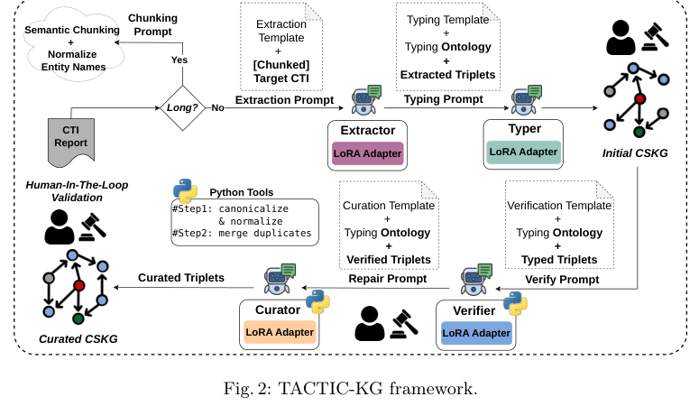
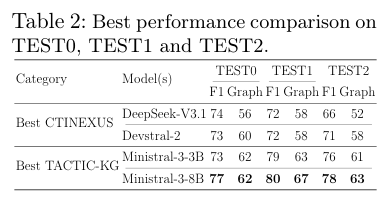
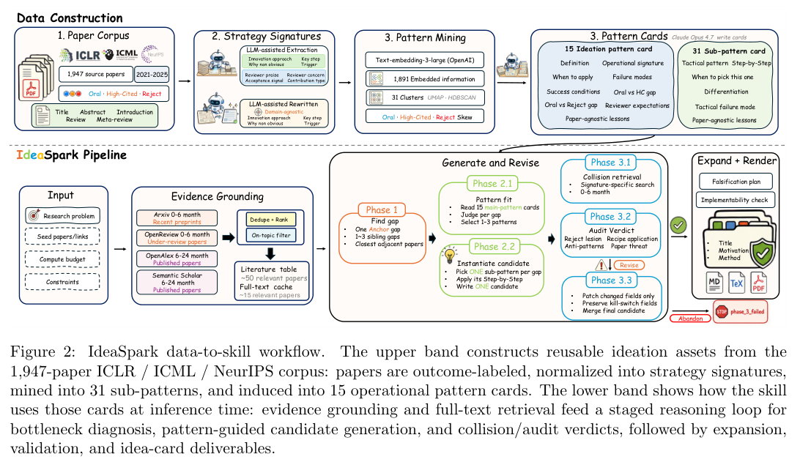
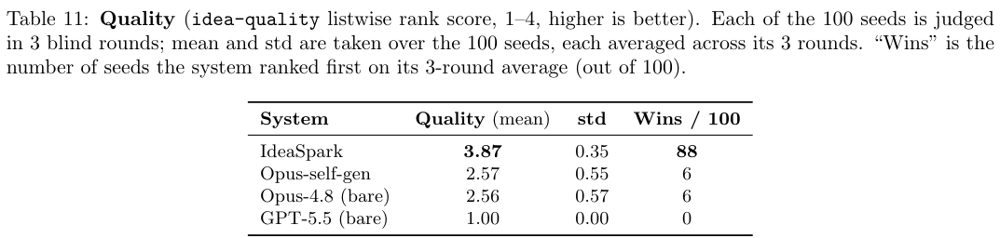
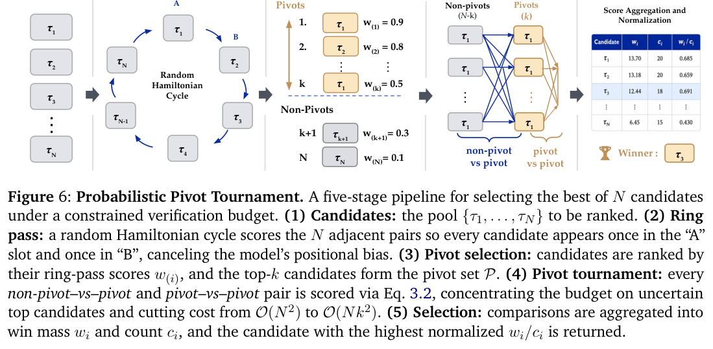
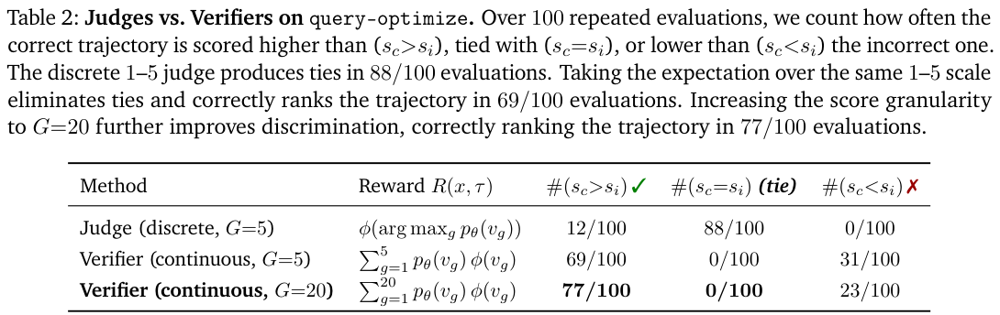
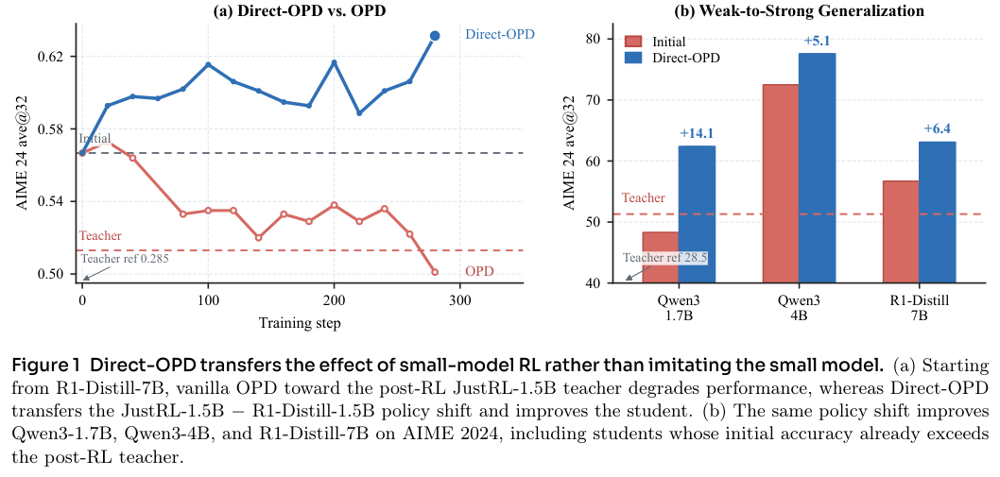
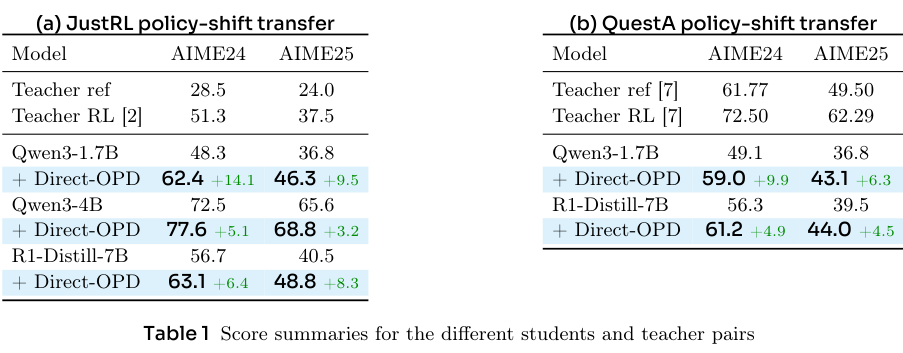

本期八项研究介绍 RDF 元数据、威胁情报建图、研究策略、长程压缩、轨迹验证、策略变化迁移、机器人潜在未来和像素空间世界模型。

## 1. RDF 元数据：更容易搜到与忠于数据是两种目标

[Faithful or Findable? Evaluating LLM-Generated Metadata for RDF Dataset Search](https://arxiv.org/abs/2607.05970v1) · v1 提交 2026-07-07 · [全文](https://arxiv.org/html/2607.05970v1) · [PDF](https://arxiv.org/pdf/2607.05970v1)

给数据集改写介绍，排名提高不等于描述更准确。Faithful or Findable? 比较六种 RDF 元数据生成设置，从直接改写到 profile 约束与图工具生成，同时评估检索和逐条声明的忠实度。提示生成主要用 gpt-5.4-mini，agentic 设置用 mistral-small-2603，不能将全部差异当成单一提示词消融。

固定试验集包含 37 个有正相关标注的主题、996 个文档。表 1 的 BM25 nDCG@10 从原描述 0.4487 到直接改写 0.4782；稠密检索从 0.5628 到 0.5766。后者固定 BAAI/bge-base-en-v1.5 与余弦检索；两后端均未按生成设置单独调参。忠实度另在按不同谓词数量分层的 150 个数据集上，用模型抽取并判定声明；各设置的权威证据范围也不同，不能当作统一人工事实金标准。

直接改写在作者分析中最不忠实，表明部分增益可能来自无依据的语义扩张；profile-grounded rewrite 在两目标间较平衡。我的判断是，数据目录应记录声明来自哪里，并分别观察检索指标和不支持声明比例。有限试点和模型裁判只能揭示一种风险，不能证明所有生成描述都会如此。

**原图入口：**[Figure 1，PDF 第 4 页](https://arxiv.org/pdf/2607.05970v1#page=4)。

## 2. TACTIC-KG：把威胁情报建图拆成可检查的阶段

TACTIC-KG 将威胁情报中的三元组抽取、类型标注、验证与补全交给专门角色，用 LoRA 分别适配小模型。语义分块和实体规范化处理长文，验证器筛除缺乏原文依据的关系，最后由工具合并重复实体；连接更多节点并不是补全的唯一目标。

*图｜Bouchiha, Mouhamed Amine 等，[Figure 2（PDF 第 7 页）](https://arxiv.org/pdf/2607.05001v1#page=7)，[CC BY 4.0](http://creativecommons.org/licenses/by/4.0/)。裁剪自原文。*

TEST1 上，Ministral-3-8B 的抽取与类型阶段 F1 为 80、GraphSim 为 67，DeepSeek-V3.1 单体 ICL 对照为 72、58。小模型另接受了专门训练，因此差异同时包含任务拆解和参数适配的作用。完整主客体类型准确率仍只有约 52%，验证或补全也并非每步都提高全部指标；图谱结构重合不能替代逐事实正确性。

*图｜Bouchiha, Mouhamed Amine 等，[Table 2（PDF 第 13 页）](https://arxiv.org/pdf/2607.05001v1#page=13)，[CC BY 4.0](http://creativecommons.org/licenses/by/4.0/)。裁剪自原文。*

[TACTIC-KG: Toward Small Agent Teams for Cyber Threat Intelligence Knowledge Graph Construction](https://arxiv.org/abs/2607.05001v1) · v1。

## 3. ResearchStudio-Idea：从论文中抽象研究策略，再检查点子碰撞

ResearchStudio-Idea 把论文检索、近邻工作的碰撞审查与点子生成连接起来。从 1,947 篇机器学习论文提取创新机制，去除领域名词后聚类为可迁移的策略卡；IdeaSpark 再从证据与瓶颈出发提出可证伪方法，并审查关键实现细节和相关工作。

*图｜Zhao, Qihao 等，[Figure 2（PDF 第 5 页）](https://arxiv.org/pdf/2607.04439v1#page=5)，[CC BY 4.0](http://creativecommons.org/licenses/by/4.0/)。裁剪自原文。*

一百个问题方向、每个三轮盲评中，IdeaSpark 的自动质量排名分为 3.87/4，在 88 个方向排名第一；同骨干裸模型为 2.56。新颖性分却不是最高：裸 GPT-5.5 为 3.73/5，IdeaSpark 为 2.92，论文指出空泛方案也容易躲过相关工作碰撞。评价来自模型裁判而非专家录用或实际研究成果，且实时检索没有严格限制在历史窗口。

*图｜Zhao, Qihao 等，[Table 11（PDF 第 38 页）](https://arxiv.org/pdf/2607.04439v1#page=38)，[CC BY 4.0](http://creativecommons.org/licenses/by/4.0/)。裁剪自原文。*

[ResearchStudio-Idea: An Evidence-Grounded Research-Ideation Skill Suite from ML Conference Outcomes](https://arxiv.org/abs/2607.04439v1) · v1。

## 4. CompactionRL：让摘要和执行共同接受任务奖励

CompactionRL 在长轨迹中主动压缩历史，联合优化摘要与后续行动。按 token 归一化损失减少不同长度片段的权重偏差，跨片段优势估计则把后续任务反馈传回早期摘要，让压缩保留真正影响执行的信息。

Terminus-KIRA 下，GLM-4.5-Air 在 80k 峰值窗口、最多三次压缩时，SWE-bench Verified 从 59.8% 到 66.8%，Terminal-Bench 2.0 从 21.4% 到 24.5%。有效上下文预算可达四倍峰值；SWE 使用随机 200 题子集，两次评价取均值，不能与公开全量排行榜直接排名。关闭压缩后 SWE 为 57.3%，还低于基础模型的 57.8%，收益依赖训练与压缩推理条件一致。

[CompactionRL: Reinforcement Learning with Context Compaction for Long-Horizon Agents](https://arxiv.org/abs/2607.05378v1) · v1。

[Figure 1（原文）](https://arxiv.org/pdf/2607.05378v1#page=2)。

## 5. LLM-as-a-Verifier：保留评分分布，减少粗分数打平

该框架读取评分 token 的概率分布并取期望，结合更细的刻度、多次评价和分项标准形成连续反馈。候选较多时，先做环形比较选出枢轴，再把预算集中到与枢轴的比较，减少完整两两排名的成本。

*图｜Kwok, Jacky 等，[Figure 6（PDF 第 6 页）](https://arxiv.org/pdf/2607.05391v1#page=6)，[CC BY 4.0](http://creativecommons.org/licenses/by/4.0/)。裁剪自原文。*

Terminal-Bench 的 query-optimize 单任务案例重复评价一百次：五级离散裁判有 88 次打平、12 次把正确轨迹排高；同五级分布取期望后正确排高 69 次，二十级达到 77 次。连续评分消除了该案例的平局，但也仍有 23 次错误排序。这里衡量轨迹判别，既不是 SQL 执行准确率，也不代表 Agent 完成任务的成功率。

*图｜Kwok, Jacky 等，[Table 2（PDF 第 8 页）](https://arxiv.org/pdf/2607.05391v1#page=8)，[CC BY 4.0](http://creativecommons.org/licenses/by/4.0/)。裁剪自原文。*

[LLM-as-a-Verifier: A General-Purpose Verification Framework](https://arxiv.org/abs/2607.05391v1) · v1。

## 6. Direct-OPD：迁移小模型学到的改进方向

Direct-OPD 同时使用教师强化学习前后的两个检查点，以策略概率比提取学习带来的变化，再在学生自己的轨迹上蒸馏。学生接收的是奖励相关的改进方向，而不必照搬较弱教师的完整行为；参考策略约束用于控制迁移偏移。

*图｜Feng, Shiyuan 等，[Figure 1（PDF 第 2 页）](https://arxiv.org/pdf/2607.05394v1#page=2)，[CC BY 4.0](http://creativecommons.org/licenses/by/4.0/)。裁剪自原文。*

R1-Distill-1.5B 到 JustRL-1.5B 的策略变化迁入 Qwen3-1.7B 后，AIME 2024 从 48.3% 到 62.4%，AIME 2025 从 36.8% 到 46.3%。同一教师对迁入 Qwen3-4B 的增益较小，分别为 5.1、3.2 个百分点。结果支持跨模型复用特定数学训练信号，但并不保证任意教师变化都能迁移，也不等于省去了生成学生轨迹和教师评分的计算。

*图｜Feng, Shiyuan 等，[Table 1（PDF 第 7 页）](https://arxiv.org/pdf/2607.05394v1#page=7)，[CC BY 4.0](http://creativecommons.org/licenses/by/4.0/)。裁剪自原文。*

[Weak-to-Strong Generalization via Direct On-Policy Distillation](https://arxiv.org/abs/2607.05394v1) · v1。

## 7. InternVLA-A1.5：用潜在未来监督连接语义与动作

InternVLA-A1.5 保留视觉语言问答与子任务能力，以冻结视频模型监督潜在 foresight token，并联合学习动作。约 120 万段机器人轨迹提供动作和未来观测，约三百万多模态样本保留语义与空间定位；部署时移除视频生成分支，直接用潜在表征控制。

RoboTwin 五十项双臂任务中，干净与随机化成功率为 93.3%、93.0%，平均 93.2%；向动态 DOMINO 零样本迁移后为 27.7%，微调为 29.3%。高静态任务成绩没有消除动态操作难度。SimplerEnv 平均 80.8% 的部分基线来自既有报告，实机四项任务又有独立协议，这些结果不能合并成一个跨平台可靠性分数。

[InternVLA-A1.5: Unifying Understanding, Latent Foresight, and Action for Compositional Generalization](https://arxiv.org/abs/2607.04988v1) · v1。

[Figure 1（原文）](https://arxiv.org/pdf/2607.04988v1#page=1)。

## 8. PixWorld：直接在像素空间联合学习重建和生成

PixWorld 从原始像素学习三维重建与场景生成，省去固定图像自编码器。干净和带噪视图共享扩散骨干，几何头恢复三维表示，冻结三维模型提供几何感知监督；相机条件把新视角生成与场景结构联系起来。

四视图 RealEstate10K 重建的 PSNR 为 26.21，带真值姿态的 YoNoSplat 为 25.86；LPIPS 为 0.138 对 0.143。WorldScore 七指标均值为 71.04，FlashWorld 为 70.85，但对象控制为 46.25，低于对照的 50.28。均值优势较小且各项不一致；每个重建数据集仅抽取二百个大视角变化测试场景，不能据此推断任意场景都有精确几何。

[PixWorld: Unifying 3D Scene Generation and Reconstruction in Pixel Space](https://arxiv.org/abs/2607.05373v1) · v1。

[Figure 1（原文）](https://arxiv.org/pdf/2607.05373v1#page=1)。
