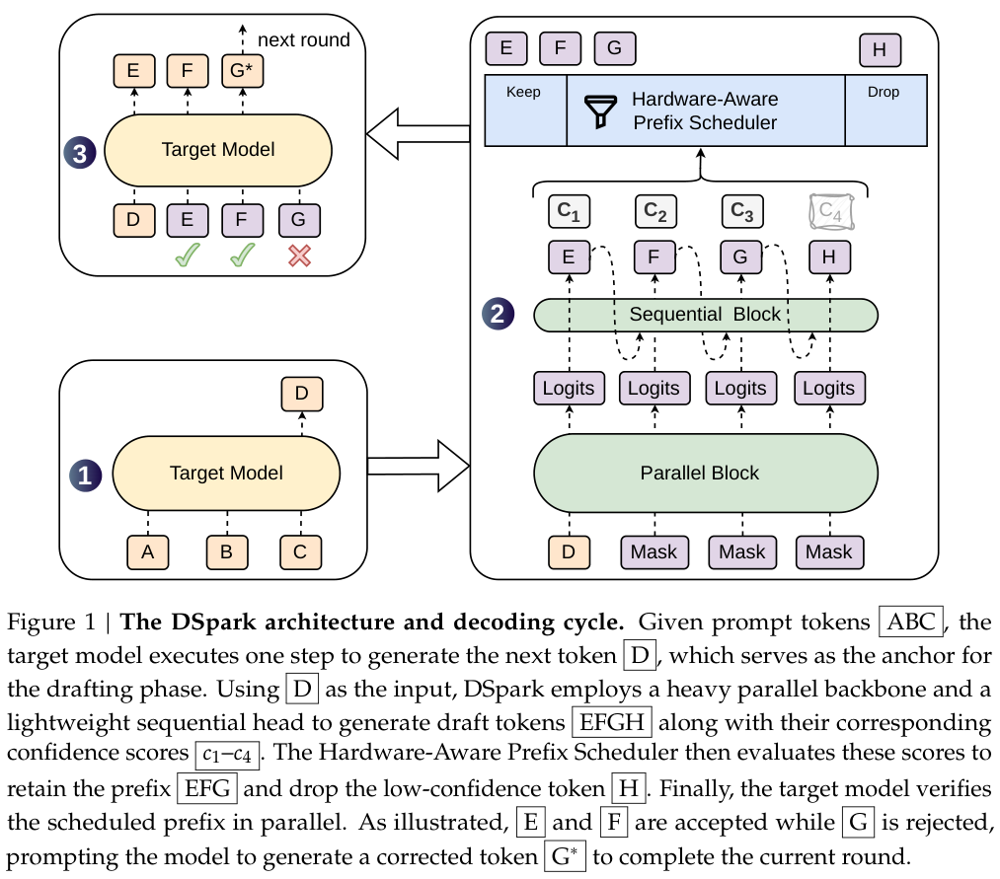
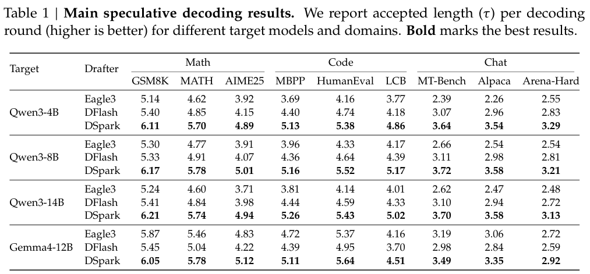
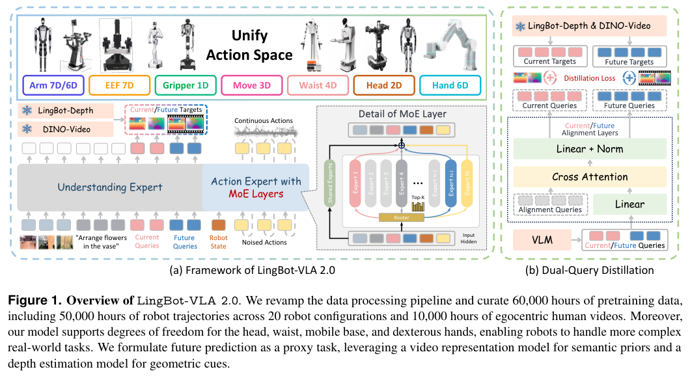
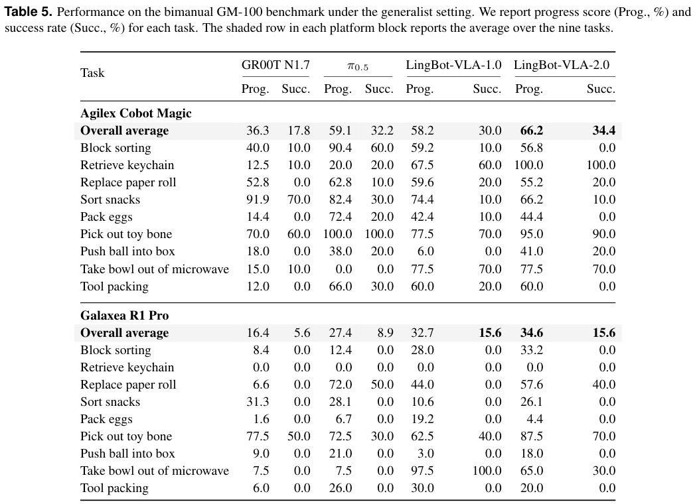
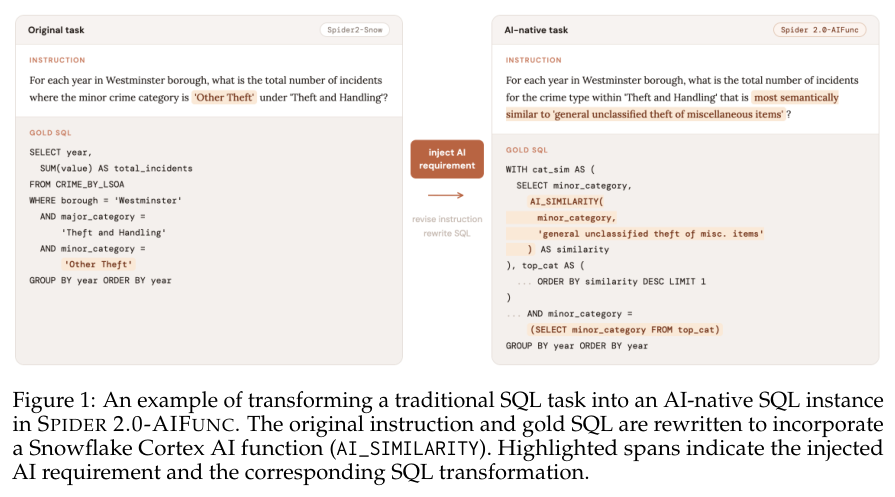
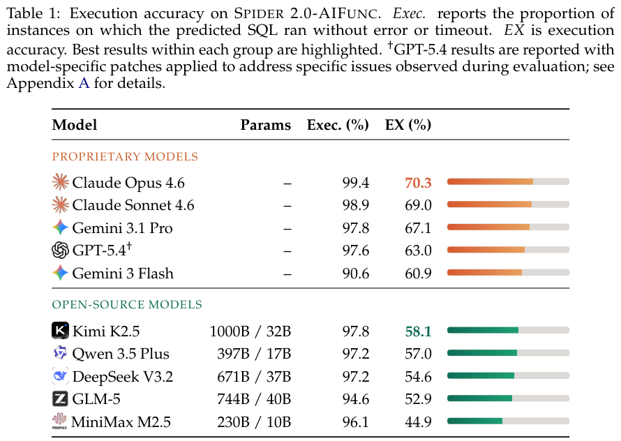
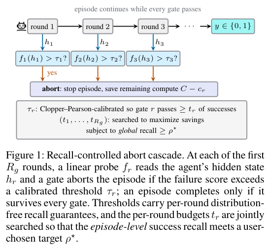
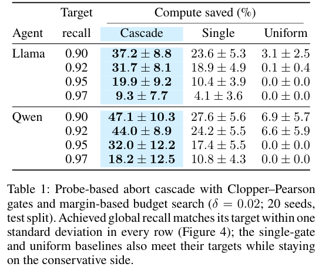

本期九项研究介绍多跳图推理、多语文献检索、推测解码、统一视觉生成、全身机器人控制、AI 函数 SQL、数据分析轨迹、失败预测与世界模型路线图。

## 1. RSF-GLLM：让多跳路径搜索与答案生成各司其职

[RSF-GLLM: Bridging the Semantic Gap in Multi-Hop Knowledge Graph QA via Recurrent Soft-Flow and Decoupled LLM Generation](https://arxiv.org/abs/2607.06527v1) · v1 提交 2026-07-07 · [全文](https://arxiv.org/html/2607.06527v1) · [PDF](https://arxiv.org/pdf/2607.06527v1)

多跳问答的桥接节点可能与问题用词并不相似。RSF-GLLM 用 Recurrent Soft-Flow 做可微遍历，以 GRU 更新查询状态并动态门控传播相关性，再将抽出的路径文本交给 LLM；路径搜索与答案生成因此可以分别优化。

实验使用实体已预链接到 Freebase 的 WebQSP、CWQ，分别抽取 2-hop、4-hop BFS 子图，以 Qwen3-8B 读出，单张 NVIDIA A100 运行。表 1 的 Hit@1/F1：WebQSP 为 90.45/79.15，CWQ 为 67.39/61.87。原文指出 19.3% 的 CWQ 测试问题金答案不在抽取子图内；多数基线数字来自原论文，并非同栈完整重跑，不能把表中差值包装成严格等条件的速度排名。

我的判断是，若子图已缺答案，再强的表达模型也没有真实路径可用。工程验收应同时报告检索覆盖、最终答案和调用成本，另测实体链接错误，而不只看预链接数据上的总体分数。

**原图入口：**[Figure 1，PDF 第 3 页](https://arxiv.org/pdf/2607.06527v1#page=3)。

## 2. ReSearch_SSH：用多语语料与知识图谱支持文献探索

ReSearch_SSH 在 ISIDORE 学术检索基础上加入领域适配与 GraphRAG，用 Wikidata 消歧和语义扩展，借作者、主题、机构和引用关系组织文献。检索器拟从历史查询和点击学习，生成器则面向跨文献综合与带出处的研究综述。

其 ISTEX 社科人文子集约三百万篇、覆盖六十多种语言，但语料规模不是系统效果。项目仍在进行，模型选型、检索与幻觉评估和专家验证尚待完成；目前主要探索意大利语、英语查询法语材料。它提供的是基础设施与评价设计，尚不能给出已实现的问答准确率或跨语言提升幅度。

[Integrating knowledge graphs and multilingual scholarly corpora for domain-adaptive LLMs in SSH](https://arxiv.org/abs/2607.05956v1) · v1。

[Table 1（原文）](https://arxiv.org/pdf/2607.05956v1#page=4)。

## 3. DSpark：让草稿内部有依赖，让验证长度随置信度变化

DSpark 将并行草稿骨干与轻量顺序模块结合，减轻块后部 token 接受率衰减。置信度调度器依据前缀存活概率和服务引擎容量，为请求动态截取待验证长度，避免把大量计算用在大概率被拒绝的后缀上。

*图｜Cheng, Xin 等，[Figure 1（PDF 第 5 页）](https://arxiv.org/pdf/2607.05147v1#page=5)，[CC BY 4.0](http://creativecommons.org/licenses/by/4.0/)。裁剪自原文。*

关闭调度器、固定提议长度的离线实验中，Qwen3-8B 在 GSM8K 的每轮平均接受长度为 6.17，DFlash 为 5.33；Alpaca 为 3.58 对 2.98。这里测的是接受长度，尚不是端到端提速。DeepSeek-V4 预览服务另报告匹配吞吐下每用户速度提高 60%–85%，包含调度和系统优化，受负载、缓存与引擎实现限制。

*图｜Cheng, Xin 等，[Table 1（PDF 第 11 页）](https://arxiv.org/pdf/2607.05147v1#page=11)，[CC BY 4.0](http://creativecommons.org/licenses/by/4.0/)。裁剪自原文。*

[DSpark: Confidence-Scheduled Speculative Decoding with Semi-Autoregressive Generation](https://arxiv.org/abs/2607.05147v1) · v1。

## 4. SenseNova-Vision：把视觉任务统一为文本与图像生成

SenseNova-Vision 用自然语言指令定义任务，将框、关键点和相机参数写成文本，把分割、深度与法线写成图像，组合任务可混合输出。它从已有统一多模态模型出发训练，不另设任务专属预测头，再按确定性规则把生成结果转换成评价格式。

COCO-Common 的框定位 F1 为 56.6，与 Grounding DINO-Swin-T 相同；ScreenSpot-V2 点击准确率为 85.9%，低于 Qwen3.5-9B 的 92.2%。深度与分割表现也因任务而异，例如通用全景分割 PQ 为 48.8，PSALM 为 55.9。统一输出接口扩大了覆盖面，但没有使所有专用系统都失去优势，坐标解析和长对象列表仍是实际约束。

[Vision as Unified Multimodal Generation](https://arxiv.org/abs/2607.06560v1) · v1。

[Figure 1（原文）](https://arxiv.org/pdf/2607.06560v1#page=1)。

## 5. LingBot-VLA 2.0：扩展全身动作与未来预测监督

LingBot-VLA 2.0 重做数据清洗和子任务标注，预训练混合约五万小时机器人轨迹与一万小时第一视角人类视频，覆盖二十种机器人配置。统一动作表示扩展到头、腰、底盘和灵巧手，再用视频语义与深度目标辅助学习未来动态。

*图｜Wu, Wei 等，[Figure 1（PDF 第 2 页）](https://arxiv.org/pdf/2607.06403v1#page=2)，[CC BY 4.0](http://creativecommons.org/licenses/by/4.0/)。裁剪自原文。*

GM-100 选取九项双臂任务，按每种机体混合训练单一策略：Agilex 的进度分与成功率为 66.2%、34.4%，前代为 58.2%、30.0%；Galaxea 为 34.6%、15.6%，成功率与前代持平。Astribot 冰箱整理的域内成功率为 60.0%，分布外降至 13.3%。进度改善不总能转成完整成功，机体差异和新场景仍有明显影响。

*图｜Wu, Wei 等，[Table 5（PDF 第 12 页）](https://arxiv.org/pdf/2607.06403v1#page=12)，[CC BY 4.0](http://creativecommons.org/licenses/by/4.0/)。裁剪自原文。*

[From Foundation to Application: Improving VLA Models in Practice](https://arxiv.org/abs/2607.06403v1) · v1。

## 6. Spider 2.0-AIFunc：能执行的 SQL 还不一定答对

该基准把企业查询改写为 Snowflake 原生 AI 函数任务，覆盖分类、过滤、提取、相似度与聚合等六类功能。任务和目标查询经多轮、跨时间窗口执行筛选后，形成 125 个数据库上的 465 项实例；评价同时检查能否执行与返回结果是否正确。

*图｜Liu, Tianyang 等，[Figure 1（PDF 第 2 页）](https://arxiv.org/pdf/2607.06229v1#page=2)，[CC BY 4.0](http://creativecommons.org/licenses/by/4.0/)。裁剪自原文。*

Claude Opus 4.6 的可执行率为 99.4%，结果准确率只有 70.3%；最佳开源对照 Kimi K2.5 为 58.1%。同用 Sonnet 4.6，最小 Spider-Agent 为 69.0%，AutoLink 为 68.6%，DSR-SQL 虽全部能执行，正确率为 62.2%。谓词、输入行范围与 AI 函数参数的细小偏差仍会改变答案，更多编排步骤并不自动解决语义错误。

*图｜Liu, Tianyang 等，[Table 1（PDF 第 7 页）](https://arxiv.org/pdf/2607.06229v1#page=7)，[CC BY 4.0](http://creativecommons.org/licenses/by/4.0/)。裁剪自原文。*

[Spider 2.0-AIFunc: Extending Real-World Text-to-SQL to AI-Native SQL Workflows](https://arxiv.org/abs/2607.06229v1) · v1。

## 7. TOFFEE：复用探索前缀，合成可执行的数据分析轨迹

TOFFEE 从数据库、文件与表格环境构造依赖图和可执行任务，用蒙特卡洛树搜索探索分析过程。学习型成本模型结合进展、模式覆盖和错误历史，为每步选择模型、上下文及分支宽度；同环境任务复用前缀，输出轨迹供微调或检索示范使用。

初步实验在双 AMD EPYC、八张 H100 的服务器上运行，合成阶段另调用外部模型 API。Figure 3 报告 TOFFEE-27B 在 KramaBench、DSBench 的整体得分为 56.4、57.2；同一提示与工具下的质量—预算曲线显示自适应搜索优于独立 Best-of-5。质量部分取自执行信号和答案键，这是一篇系统演示与初步评测，尚不能视为任意企业分析工作流都具备相同泛化能力。

[Demonstrating TOFFEE: A Learned System for Synthesizing Data Agent Trajectories at Scale](https://arxiv.org/abs/2607.06233v1) · v1。

[Figure 1（原文）](https://arxiv.org/pdf/2607.06233v1#page=1)。

## 8. 提前终止失败轨迹：把误杀预算分配给多轮门控

研究用每轮隐藏激活训练轻量探针，预测最终会失败的 Agent 轨迹；多个经校准的门控共享一个全程成功召回目标。早期失败信号可节省更多后续计算，预算搜索因此同时考虑该轮还剩多少轨迹与计算量。

*图｜Ruan, Kai 等，[Figure 1（PDF 第 1 页）](https://arxiv.org/pdf/2607.06503v1#page=1)，[CC BY 4.0](http://creativecommons.org/licenses/by/4.0/)。裁剪自原文。*

TextCraft、二十个随机种子下，目标保留 90% 的原本成功轨迹时，Qwen-2.5-7B 节省生成 token 计算 47.1%±10.3%，Llama-3.2-3B 为 37.2%±8.8%。提高召回目标会减少节省，Qwen 在 97% 目标时仅剩 18.2%±12.5%。主表采用带余量的经验预算搜索，正式召回认证还取决于成功验证样本数；这些百分数不代表所有任务的等比例墙钟加速。

*图｜Ruan, Kai 等，[Table 1（PDF 第 4 页）](https://arxiv.org/pdf/2607.06503v1#page=4)，[CC BY 4.0](http://creativecommons.org/licenses/by/4.0/)。裁剪自原文。*

[Doomed from the Start: Early Abort of LLM Agent Episodes via a Recall-Controlled Probe Cascade](https://arxiv.org/abs/2607.06503v1) · v1。

## 9. 世界模型路线图：把内部表征与输出功能分开

这篇观点文章将世界模型理解为对感知与动作联合分布的压缩表示，从部分可观测决策过程讨论状态、转移和行动。渲染器、模拟器与规划器被视为同一表征的不同读出功能，而非互不相容的模型定义；路线图串联互联网数据、物理表征与交互仿真。

文章没有新方法统一基准或可直接引用的实验增益，而是归纳保真度与精度、长程误差积累、数据不对称和仿真迁移等问题。其强调数据多样性决定泛化上限，是指导架构和数据选择的立场；它尚不是跨所有模型与任务得到证明的定律。评价仍需分别检查预测、控制与可用物理精度。

[A Definition and Roadmap for World Models](https://arxiv.org/abs/2607.06401v1) · v1。

[Figure 1（原文）](https://arxiv.org/pdf/2607.06401v1#page=4)。
