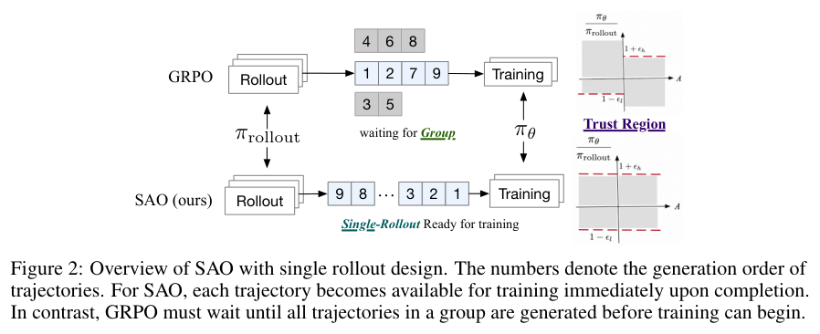
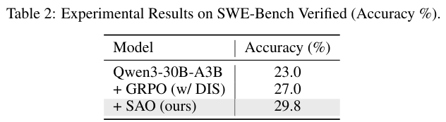

本期四项研究介绍可训练的仿真环境、单轨迹异步强化学习、长时间交互世界和稀疏专家视频预训练。

## 1. EmbodiedGen V2：把生成场景变为可执行环境

[EmbodiedGen V2: An Agentic, Simulation-Ready 3D World Engine for Embodied AI](https://arxiv.org/abs/2607.07459v1) · v1 提交 2026-07-08 · [全文](https://arxiv.org/html/2607.07459v1) · [PDF](https://arxiv.org/pdf/2607.07459v1)

EmbodiedGen V2 将资产、可交互 affordance、任务场景和跨模拟器接口连成可编辑流水线。机器人需要几何、尺度、物理稳定性和任务约束同时成立；漂亮场景图本身不等于可进入策略训练的环境。

v1 表 4 在单张 RTX 4090 上，完全在线顺序生成 150 个交互世界，每世界平均 5.19 个交互资产，总耗时 47.7±5.4 分钟；背景资产平均 25.5±3.5 分钟，是主要开销。人工按语义一致、空间关系、尺度、物理稳定和机器人可执行性检查，83.3% 的最终环境无需修改即可用于下游仿真。这是包含生成—验证—重试流程的最终可用率，不等于所有阶段首次就成功。

下游闭环章节汇总另一项策略学习研究，不能将该研究成功率直接当成生成器自身的控制能力。我的判断是，环境质量应以能否加载、执行与支持训练验收，仍要记录几何缺陷、尺度不匹配和初始摆放问题。离线资产复用可能节省时间，但不能省略上述完整在线成本，也不能忽略剩余未接受环境。

**原图入口：**[Figure 1，PDF 第 1 页](https://arxiv.org/pdf/2607.07459v1#page=1)。

## 2. SAO：用单条 rollout 稳定异步强化学习

SAO 每个提示只采一条 rollout，由值模型估计优势，适配轨迹完成时间不同的异步训练。严格双侧 token 裁剪限制离策略更新；值模型采用更快的更新节奏、预训练和跳过观察 token 的优势传播，避免把外部反馈当成模型生成的动作。

*图｜Hou, Zhenyu 等，[Figure 2（PDF 第 3 页）](https://arxiv.org/pdf/2607.07508v1#page=3)，[CC BY 4.0](http://creativecommons.org/licenses/by/4.0/)。裁剪自原文。*

Qwen3-30B-A3B 的 SWE-bench Verified 准确率从 23.0% 到 29.8%，加入 DIS 的 GRPO 为 27.0%；使用 OpenHands、128k 上下文和最多三百轮。数学实验另先做工具推理 SFT，SAO 的 AIME 2025 为 97.3%，GRPO+DIS 为 93.5%。单 rollout、值模型与裁剪共同改变训练，不能将所有增益单独归因于每题少采几次。

*图｜Hou, Zhenyu 等，[Table 2（PDF 第 6 页）](https://arxiv.org/pdf/2607.07508v1#page=6)，[CC BY 4.0](http://creativecommons.org/licenses/by/4.0/)。裁剪自原文。*

[Single-Rollout Asynchronous Optimization for Agentic Reinforcement Learning](https://arxiv.org/abs/2607.07508v1) · v1。

## 3. LingBot-World-Infinity：因果生成与交互编排

LingBot-World 2.0 从因果视频预训练出发，以一致性和分布匹配蒸馏减少去噪步骤，并在自身长轨迹上抑制漂移。Pilot Agent 规划角色行为，Director Agent 改写环境事件，交互从导航扩展到攻击、射箭与文字触发场景变化。

论文展示一段六十分钟持续 rollout，并报告实时版本支持 720p、60 fps。长时间画面稳定没有解决世界记忆：离开上下文的区域返回后可能重新生成，角色身份、风格与碰撞物理也会出错。所谓无限指可持续生成的交互时域，不是有限测试已经证明永久一致；其 14B 主模型与 1.3B 轻量版本也不能混用部署开销。

[Infinite Worlds with Versatile Interactions](https://arxiv.org/abs/2607.07534v1) · v1。

[Figure 1（原文）](https://arxiv.org/pdf/2607.07534v1#page=1)。

## 4. LingBot-Video：用稀疏专家扩展具身视频预训练

LingBot-Video 用单流扩散 Transformer 统一图像与视频训练，以稀疏专家增加总容量而控制每 token 激活规模。数据引擎加入操作、导航和第一视角视频，后训练奖励同时覆盖任务状态变化、物理合理性和视觉质量，减少只为内容创作优化的偏差。

固定约 1.4B 激活参数、专家数从 64 增至 128 时训练与验证损失改善，继续增至 256 的收益较小；固定约 13B 总参数时，128 个细粒度专家优于 64 个较粗专家。消融支持容量与激活计算分开的设计，但内存、路由和通信仍随总模型增长；视频损失与物理合理性奖励也不等于已验证下游机器人任务成功率。

[Scaling Mixture-of-Experts Video Pretraining for Embodied Intelligence](https://arxiv.org/abs/2607.07675v1) · v1。

[Figure 1（原文）](https://arxiv.org/pdf/2607.07675v1#page=2)。
