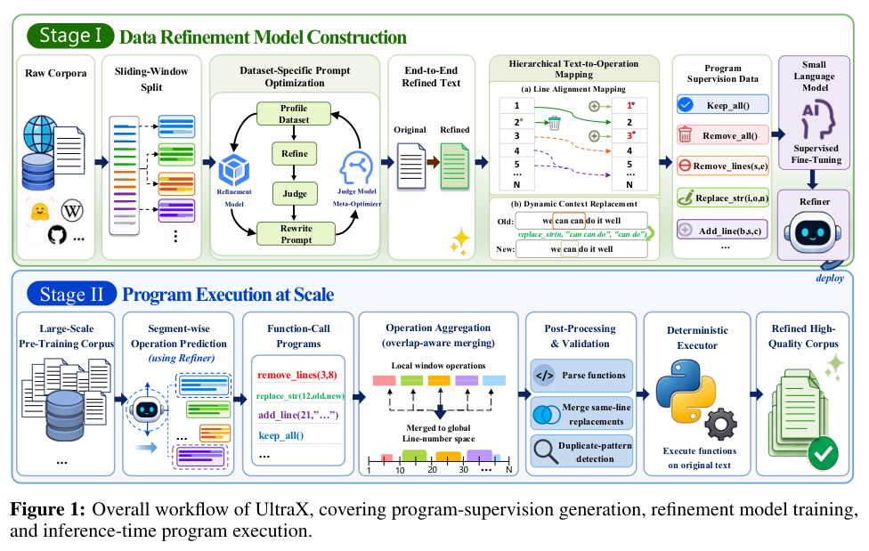
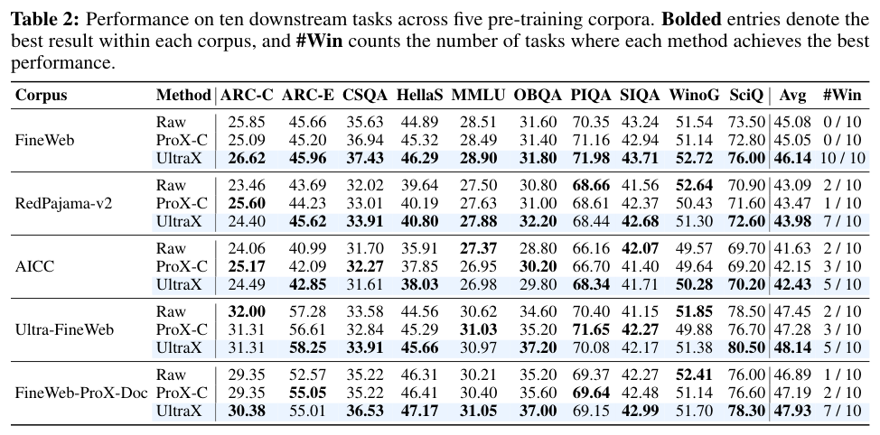
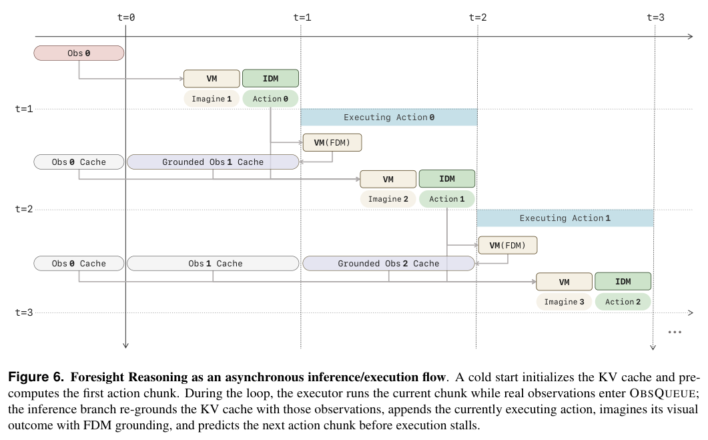
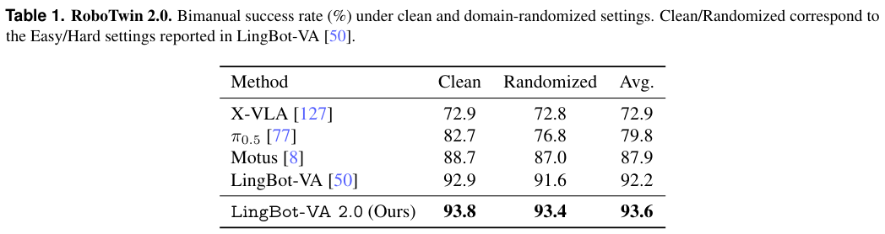
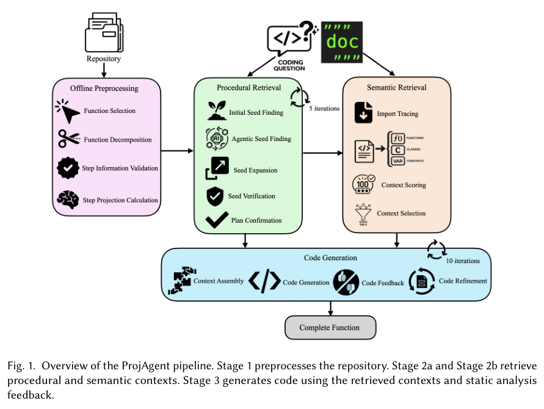
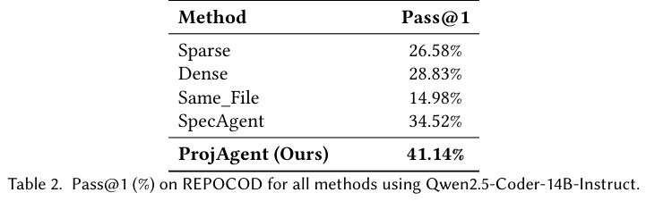
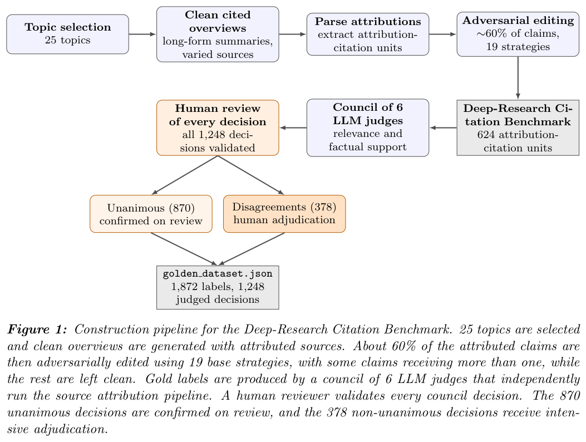
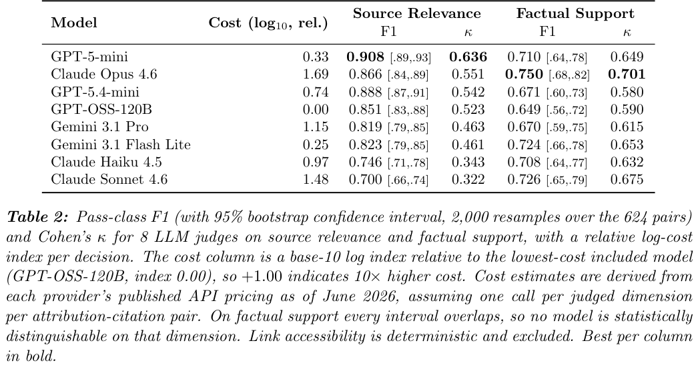

本期七项研究介绍工作流语义、主动 Agent 评测、语料程序编辑、前缀重放、因果视频动作预训练、过程相似检索和引用裁判。

## 1. Workflow as Knowledge：让工作流成为持久知识对象

Workflow as Knowledge 将工作流定义、运行实例、推理记录、上下文快照和依赖关系放进同一持久知识底座。重点不是再画一张流程图，而是让一次判断依据什么、影响什么、如何恢复，成为可查询的对象关系。

作者区分三层：运行时服务提供模型、工具和存储；DSL machine 与执行器解释声明、组装上下文并控制能力；语义层保存定义、实例及推理、批准和讨论记录。derive 是给定状态上的确定性计算，infer 则是带声明上下文和执行器权限约束的模型判断，不能相互替代。

这是一篇概念性预印本。作者明确将实现、正式转移语义与经验评估留给后续工作，没有可引用的新模型成功率或系统吞吐量。持久化本身也不自动证明归因、可复现性、信任或审计质量。

对知识工程，值得借用的是稳定标识、类型化记录和依赖边。实际工作流应另外验证恢复是否保持语义、哪些副作用可重放、谁有权批准状态变化。把判断记录下来，有利于审查，却不是判断正确的证明。

图源：Emanuele Quinto , Carlo Andrea Rozzi , Francesco Zanitti，《Workflow as Knowledge: Semantic Persistence for LLM-Mediated Workflows》，arXiv:2607.08740v1，Figure 1，PDF 第 2 页。[原图出处](https://arxiv.org/pdf/2607.08740v1#page=2) · [CC BY-SA 4.0](https://creativecommons.org/licenses/by-sa/4.0/)。裁剪自原文。

- [Workflow as Knowledge: Semantic Persistence for LLM-Mediated Workflows](https://arxiv.org/abs/2607.08740v1) · v1，公开于 2026-07-09。

## 2. UniClawBench：用中间检查点区分进展与完成

UniClawBench 将四百项双语任务按技能使用、探索、长文推理、多模态理解和跨平台协调划分。执行 Agent 在实时工具环境中行动，隐藏监督者按检查点评分，用户 Agent 提供多轮反馈；这样既能看最终通过，也能定位中途做到哪里。

同一 OpenClaw 框架中，Claude Opus-4.8 的最终通过率为 47.5%，中间平均分为 0.702；GPT-5.4 为 40.7%、0.774。中间分更高并不保证完成更多任务。五十条轨迹的人评检查中，自动通过判断与三人多数意见一致率为 92.0%，样本有限，评分可靠性仍不等于被测 Agent 的部署可靠性。

[UniClawBench: A Universal Benchmark for Proactive Agents on Real-World Tasks](https://arxiv.org/abs/2607.08768v1) · v1。

[Figure 1（原文）](https://arxiv.org/pdf/2607.08768v1#page=1)。

## 3. UltraX：用可执行编辑提高预训练语料利用率

UltraX 把语料精修改写为插入、删除和修改函数，先由专家模型生成原文—改稿对，再通过行对齐与动态上下文替换构造程序监督。滑窗预测、全局操作聚合和执行检查减少长文编辑冲突，操作比例采样兼顾清洗与保留。

*图｜Zhao, Xinlong 等，[Figure 1（PDF 第 4 页）](https://arxiv.org/pdf/2607.08646v1#page=4)，[CC BY 4.0](http://creativecommons.org/licenses/by/4.0/)。裁剪自原文。*

相同 1B MiniCPM 和训练设置下，FineWeb 的十任务平均分从原始语料 45.08 到 UltraX 的 46.14；只训 16B tokens 已达 45.49，高于原始语料训 20B 的结果。五种语料均值都改善，但不是每个任务都领先，例如 RedPajama 的 PIQA 为 68.44，原始语料为 68.66。精修还需要监督生成和执行计算，token 效率不能直接当作全部成本节省。

*图｜Zhao, Xinlong 等，[Table 2（PDF 第 7 页）](https://arxiv.org/pdf/2607.08646v1#page=7)，[CC BY 4.0](http://creativecommons.org/licenses/by/4.0/)。裁剪自原文。*

[UltraX: Refining Pre-Training Data at Scale with Adaptive Programmatic Editing](https://arxiv.org/abs/2607.08646v1) · v1。

## 4. ReOPD：重放教师前缀，减少环境交互蒸馏成本

ReOPD 复用教师强化学习时收集的多轮轨迹，只在选定前缀上让学生生成单步并接受教师密集监督，不重新执行工具。它针对前缀陷阱设计逐步衰减采样：更贴近学生的历史，也可能超出教师可靠回答范围，因此优先利用偏移较小的早期前缀。

数学 Python 环境中，4B 教师到同规模学生的六基准均分为 ReOPD 57.2%、在线 OPD 55.1%；30B-A3B 教师到 8B 学生仅为 56.8% 对 56.5%，且部分单项下降。学生训练阶段不执行新工具调用，每训练步至少快四倍的报告以在线 OPD 为参照；教师训练、前缀收集和教师打分仍然存在。

[Multi-Turn On-Policy Distillation with Prefix Replay](https://arxiv.org/abs/2607.04763v1) · v1。

[Figure 1（原文）](https://arxiv.org/pdf/2607.04763v1#page=1)。

## 5. LingBot-VA 2.0：从语义动作表征开始学习因果控制

LingBot-VA 2.0 从头进行因果视频动作预训练，以语义视觉动作 tokenizer 连接语言、观测与动作，稀疏 MoE 扩展视频容量。多块未来预测提供训练监督，异步执行提前计算下一动作块，并用真实返回观测覆盖旧预测缓存，防止闭环退化为自我想象。

*图｜Zhang, Qihang 等，[Figure 6（PDF 第 13 页）](https://arxiv.org/pdf/2607.08639v1#page=13)，[CC BY 4.0](http://creativecommons.org/licenses/by/4.0/)。裁剪自原文。*

RoboTwin 2.0 干净、随机化成功率为 93.8%、93.4%，均值 93.6%，前代为 92.2%。相同训练 token 的 1.3B tokenizer 消融中，五十任务 Easy/Hard 从普通 VAE 的 78.0%、76.0% 到 86.6%、83.1%。这支持表征设计的作用，但整体模型还改变了因果训练、专家骨干和推理系统，不能把全部提升只归给 tokenizer。

*图｜Zhang, Qihang 等，[Table 1（PDF 第 19 页）](https://arxiv.org/pdf/2607.08639v1#page=19)，[CC BY 4.0](http://creativecommons.org/licenses/by/4.0/)。裁剪自原文。*

[Native Video-Action Pretraining for Generalizable Robot Control](https://arxiv.org/abs/2607.08639v1) · v1。

## 6. ProjAgent：按计算过程检索仓库内的相似实现

ProjAgent 将目标函数拆成中间步骤，检索执行相似计算过程的仓库函数，补充名称或文本语义相似度容易遗漏的上下文。随后结合语义检索生成代码，以编译器和静态分析反馈保守修复，尽量保持已通过检查的实现。

*图｜Chen, QiHong 等，[Figure 1（PDF 第 6 页）](https://arxiv.org/pdf/2607.08691v1#page=6)，[CC BY 4.0](http://creativecommons.org/licenses/by/4.0/)。裁剪自原文。*

REPOCOD、Qwen2.5-Coder-14B-Instruct 下，Pass@1 为 41.14%，SpecAgent 为 34.52%，稠密检索为 28.83%。差值分别为 6.62、12.31 个百分点。检索本身仍有大量误报：代表配置中，被提升为过程相似的候选精确率只有 5.4%；仓库仅约 35.1% 查询步骤确有相似上下文，过程检索和最终测试应分别验收。

*图｜Chen, QiHong 等，[Table 2（PDF 第 14 页）](https://arxiv.org/pdf/2607.08691v1#page=14)，[CC BY 4.0](http://creativecommons.org/licenses/by/4.0/)。裁剪自原文。*

[ProjAgent: Procedural Similarity Retrieval for Repository-Level Code Generation](https://arxiv.org/abs/2607.08691v1) · v1。

## 7. 引用核验裁判：便宜模型也要检查偏差方向

这项研究把引用质量拆成来源相关性与事实支持，分别评测八个模型裁判。基准含 624 个陈述—引用对、1,248 项判定，刻意加入相关却不支持、可访问却无关等情况；金标签先由模型委员会判断，再经人工检查与分歧裁决。

*图｜Leung, Ethan 等，[Figure 1（PDF 第 4 页）](https://arxiv.org/pdf/2607.08700v1#page=4)，[CC BY 4.0](http://creativecommons.org/licenses/by/4.0/)。裁剪自原文。*

GPT-5-mini 的来源相关性通过类 F1 为 0.908，Cohen’s κ 为 0.636；事实支持 F1 为 0.710，Opus 4.6 为 0.750，但置信区间重叠。相近 F1 仍可能有不同误放和误拒方向，作为强化学习奖励会放大不同偏差。两名被测裁判也参与初始金标签委员会，人工裁决子集是理解该潜在偏差的必要对照。

*图｜Leung, Ethan 等，[Table 2（PDF 第 6 页）](https://arxiv.org/pdf/2607.08700v1#page=6)，[CC BY 4.0](http://creativecommons.org/licenses/by/4.0/)。裁剪自原文。*

[Do You Need a Frontier Model as a Citation Verifier? Benchmarking Rubric LLMs for Deep-Research Source Attribution](https://arxiv.org/abs/2607.08700v1) · v1。
