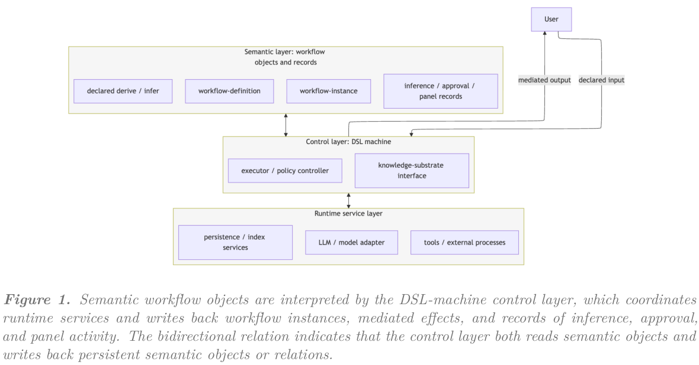

本文补录 **2026-07-11 的精选阅读**，于 2026-10-29 核对公开原文。归档日不是发表日；本文固定使用下列 v1，不混入后续修订。数字为作者报告，本站未独立复现。

## 从执行记录到语义对象

Workflow as Knowledge 将工作流定义、运行实例、推理记录、上下文快照和依赖关系放进同一持久知识底座。重点不是再画一张流程图，而是让一次判断依据什么、影响什么、如何恢复，成为可查询的对象关系。

## 方法与证据边界

作者区分三层：运行时服务提供模型、工具和存储；DSL machine 与执行器解释声明、组装上下文并控制能力；语义层保存定义、实例及推理、批准和讨论记录。derive 是给定状态上的确定性计算，infer 则是带声明上下文和执行器权限约束的模型判断，不能相互替代。

这是一篇概念性预印本。作者明确将实现、正式转移语义与经验评估留给后续工作，没有可引用的新模型成功率或系统吞吐量。持久化本身也不自动证明归因、可复现性、信任或审计质量。

## 我的判断

对知识工程，值得借用的是稳定标识、类型化记录和依赖边。实际工作流应另外验证恢复是否保持语义、哪些副作用可重放、谁有权批准状态变化。把判断记录下来，有利于审查，却不是判断正确的证明。

## 原论文视觉证据

图源：Emanuele Quinto , Carlo Andrea Rozzi , Francesco Zanitti，《Workflow as Knowledge: Semantic Persistence for LLM-Mediated Workflows》，arXiv:2607.08740v1，Figure 1，PDF 第 2 页。[原图出处](https://arxiv.org/pdf/2607.08740v1#page=2) · [CC BY-SA 4.0](https://creativecommons.org/licenses/by-sa/4.0/)。裁剪自原文。

## 深读原文与范围

- [Workflow as Knowledge: Semantic Persistence for LLM-Mediated Workflows](https://arxiv.org/abs/2607.08740v1) · v1，公开于 2026-07-09。

本篇深读上述 1 篇；以下是同日公开阅读入口，仅核对标题、版本日期和来源，未逐篇核验实验。

## 同日阅读目录

- [Workflow as Knowledge: Semantic Persistence for LLM-Mediated Workflows](https://arxiv.org/abs/2607.08740v1) · v1，2026-07-09。
- [UniClawBench: A Universal Benchmark for Proactive Agents on Real-World Tasks](https://arxiv.org/abs/2607.08768v1) · v1，2026-07-09。
- [UltraX: Refining Pre-Training Data at Scale with Adaptive Programmatic Editing](https://arxiv.org/abs/2607.08646v1) · v1，2026-07-09。
- [Multi-Turn On-Policy Distillation with Prefix Replay](https://arxiv.org/abs/2607.04763v1) · v1，2026-07-06。
- [Native Video-Action Pretraining for Generalizable Robot Control](https://arxiv.org/abs/2607.08639v1) · v1，2026-07-09。
- [ProjAgent: Procedural Similarity Retrieval for Repository-Level Code Generation](https://arxiv.org/abs/2607.08691v1) · v1，2026-07-09。
- [Do You Need a Frontier Model as a Citation Verifier? Benchmarking Rubric LLMs for Deep-Research Source Attribution](https://arxiv.org/abs/2607.08700v1) · v1，2026-07-09。
