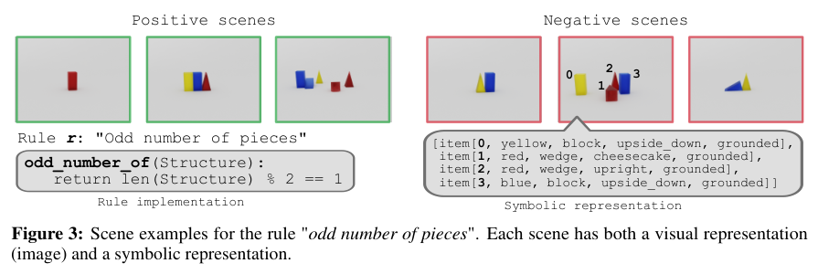
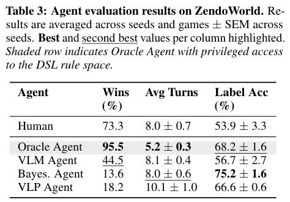
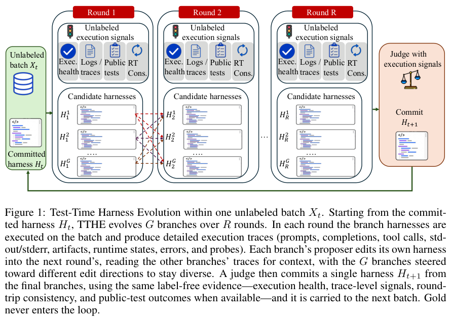
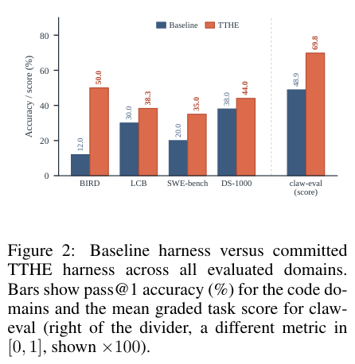
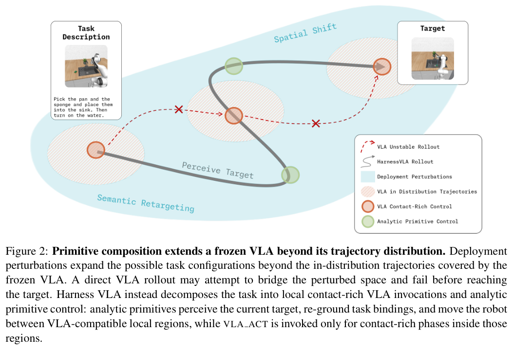
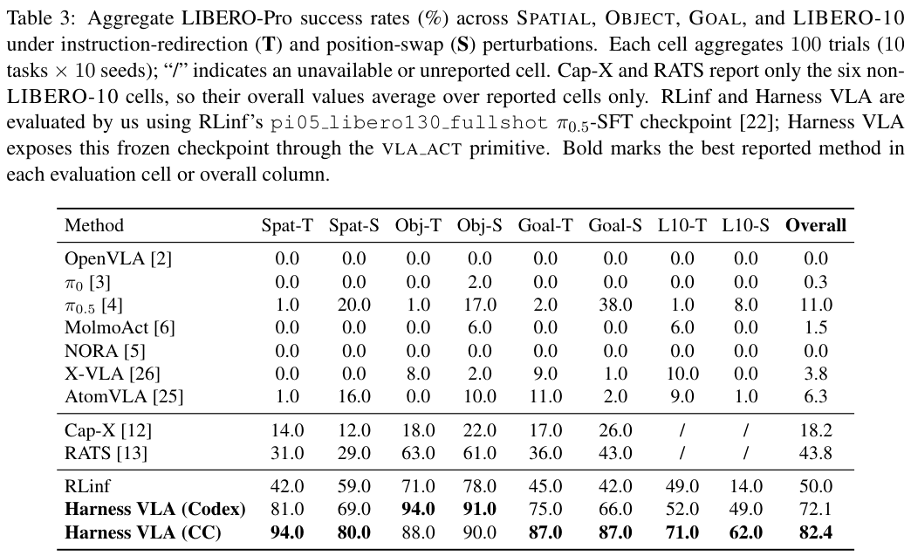

本期八项研究介绍网页结构检索、视觉规则归纳、文档解析、视觉语言规划、测试时框架演化、代码取证、冻结机器人策略与尾部信用校准。

## 1. PolyUQuest：让网页层级与实体关系共同参与检索

PolyUQuest 将网页超链接、页内 DOM 层级与跨页实体关系统一为异构图。两级路由选择直接块检索、跨页遍历或多跳实体推理，使答案可以回到原网页、标题路径与相关实体。

PolyU 官方站点构成 4,240 页、31,086 个 DOM 块、29,119 个实体与 37,680 条关系。Table 1 的 PolyU-Web 评测为 300 个问题：PolyUQuest 的 correctness、coverage、faithfulness 分别为 0.644、0.649、0.921。这些是论文定义的答案评价指标，不是查询正确性的形式证明。

每次查询平均 2,968 tokens，LightRAG 为 29,825；但 ChunkRAG 为 2,947，因此不能概括为比所有方法都省 token。PolyUQuest 离线构建另需 17.5M tokens。关闭 DOM 块后 correctness 为 0.563，关闭跨页模式为 0.624，支持两个结构接口的作用，但仍是单站点评测。

结构化引用能帮助定位错误，却不保证引用支持答案。迁移时要另测网站变化、解析失败和检索覆盖；论文中的准备部署状态也不能改写为已验证的大规模上线。

[Table 1，原论文 PDF 第 4 页](https://arxiv.org/pdf/2607.08269v1#page=4)。

- [PolyUQuest: Verifiable Structure-Aware Web RAG over Heterogeneous Graphs](https://arxiv.org/abs/2607.08269v1) · v1，公开于 2026-07-09。

## 2. Infinity-Parser2：把位置、内容与任务结构分别奖励

Infinity-Parser2 用可控合成和真实文档构造五百万样本，统一输出有序元素、Markdown、HTML、LaTeX 等结构。先做监督微调，再联合八类可验证任务奖励；布局按类别区域并集衡量重合，文本按阅读顺序衡量内容相似度，减少框匹配粒度差异。

Pro 在 olmOCR-Bench 为 87.6±0.8，ParseBench 为 74.3；OmniDocBench-v1.6 为 93.95，仍低于 GLM-OCR 的 95.15。后者在 ParseBench 只有 29.6，说明文档还原与图表、语义格式等覆盖不能用一个分数代替。部分对照由作者重跑、部分沿用原报告，Flash 与 Pro 的速度和精度也属于不同部署配置。

[Infinity-Parser2 Technical Report](https://arxiv.org/abs/2607.07836v1) · v1。

[Figure 1（原文）](https://arxiv.org/pdf/2607.07836v1#page=1)。

## 3. ZendoWorld：预测示例标签不等于发现隐藏规则

ZendoWorld 要求 Agent 从视觉场景归纳逻辑规则，再主动构造新场景获取反馈。研究比较直接视觉语言推理、贝叶斯假设粒子、神经符号程序合成和具备特权规则空间的 Oracle，同时设置符号输入对照，拆开感知与归纳瓶颈。

*图｜Koehler, Sophia 等，[Figure 3（PDF 第 4 页）](https://arxiv.org/pdf/2607.08233v1#page=4)，[CC BY 4.0](http://creativecommons.org/licenses/by/4.0/)。裁剪自原文。*

二十二个游戏中，贝叶斯 Agent 的示例标签准确率为 75.2%，但找回正确规则的胜率仅 13.6%；纯 VLM 分别为 56.7%、44.5%。Oracle 胜率为 95.5%，却已知规则 DSL，不能作为同条件模型比较。十九位人类参与者在部分游戏上达到 73.3% 胜率，题目子集与全量 Agent 均值也应分开理解。

*图｜Koehler, Sophia 等，[Table 3（PDF 第 7 页）](https://arxiv.org/pdf/2607.08233v1#page=7)，[CC BY 4.0](http://creativecommons.org/licenses/by/4.0/)。裁剪自原文。*

[Playing ZendoWorld: Challenging AI Agents on Active Visual Concept Induction](https://arxiv.org/abs/2607.08233v1) · v1。

## 4. CodeTracer：把异常代码补全追溯到微调样本

CodeTracer 在部署后只使用微调语料与已报告的异常补全事件，提取不安全行为指纹，检索语义相关代码，再由语言模型判断哪些训练样本承载对应逻辑。它做的是事后取证与数据定位，不要求重新训练模型来计算影响分数。

三类漏洞案例的主表中，CodeTracer 的漏检率为 0.00–0.03，多数对照更高；清除所追踪样本后的攻击成功率另降到 0.03 或以下。大量干净样本会使误报率和总体分类准确率看起来很好，因此漏检与攻击移除效果更有信息量。结果针对所构造的后门与语料，尚不能保证定位任意真实模型中的恶意训练数据。

[Beware What You Autocomplete: Forensic Attribution of Backdoored Code Completions](https://arxiv.org/abs/2607.08011v1) · v1。

[Figure 1（原文）](https://arxiv.org/pdf/2607.08011v1#page=3)。

## 5. APIVOT：在语言计划中插入可检查的未来画面

APIVOT 根据任务需要交替生成语言和视觉思考：语言分解目标、选择对象，想象的未来状态检查空间、容器与碰撞约束。基于 Qwen3-VL-8B-Instruct 做 LoRA，使用规划器合成的厨房轨迹训练，再在共享动作原语上滚动重规划。

三类任务平均成功率为 41.9%，Gemini-ER-1.5 为 33.8%，VLM-TAMP 为 32.9%；纯文本微调变体约 24%，低于视觉语言交替的约 42%。始终使用视觉思考还能更高，自适应方案保留其约 91% 表现、减少 39% 推理 token。这是成功与成本的折中，依赖场景生成、视觉想象与底层动作执行的条件。

[APIVOT: Adaptive Planning with Interleaved Vision-Language Thoughts](https://arxiv.org/abs/2607.08024v1) · v1。

[Figure 1（原文）](https://arxiv.org/pdf/2607.08024v1#page=2)。

## 6. TTHE：让测试轨迹改进后续执行框架

TTHE 保持模型权重冻结，以未标注执行轨迹驱动执行程序的提议、比较与提交。候选框架可以改变上下文组织、工具验证和恢复策略，被选中的程序继续处理后续输入；改进来源于外围可执行控制，而不是更新模型参数。

*图｜Nie, Jun 等，[Figure 1（PDF 第 5 页）](https://arxiv.org/pdf/2607.08124v1#page=5)，[CC BY 4.0](http://creativecommons.org/licenses/by/4.0/)。裁剪自原文。*

DeepSeek-V4-Flash 在五十道按基线失败筛选的 BIRD 困难题上从 12.0% 到 50.0%；重置每批框架为 44.0%，说明跨批积累也有作用。该子集本就针对基线弱点，不能解释为全量 BIRD 提升 38 个百分点。三十项 claw-eval 的平均分从 48.9 到 69.8，属于分级任务分数，也不能与代码 Pass@1 混用。

*图｜Nie, Jun 等，[Figure 2（PDF 第 8 页）](https://arxiv.org/pdf/2607.08124v1#page=8)，[CC BY 4.0](http://creativecommons.org/licenses/by/4.0/)。裁剪自原文。*

[TTHE: Test-Time Harness Evolution](https://arxiv.org/abs/2607.08124v1) · v1。

## 7. TACO：减少低概率错误 token 获得的正向奖励

TACO 用局部生成语境和不确定性构造尾部风险，调低可疑低概率 token 的正优势更新，同时保留梯度，使真正有用的罕见推理仍能积累强化。它针对同一轨迹统一奖励可能放大偶发错误的问题，不把所有稀有 token 都视为噪声。

Qwen3-4B-Base 的八基准均分从 GRPO 的 40.57% 到 43.71%，MMLU-Pro 从 36.26% 到 41.90%。另外两个模型的平均数也改善，但并非每项都升：1.7B 的 Minerva 为 25.74 对 25.83，Qwen2.5-Math-7B 的 MMLU-Pro 为 30.53 对 30.75。风险校准有利于所测训练稳定性，仍需按任务检查罕见正确路径是否被过度压低。

[When Implausible Tokens Get Reinforced: Tail-Aware Credit Calibration for LLM Reinforcement Learning](https://arxiv.org/abs/2607.07976v1) · v1。

[Figure 1（原文）](https://arxiv.org/pdf/2607.07976v1#page=2)。

## 8. Harness VLA：让冻结策略专注接触，让规划器负责重定位

Harness VLA 把冻结 VLA 暴露为可重试的接触操作原语，与移动、定位、运输和释放等固定解析原语组合。记忆保留任务示范、成功规则与失败模式；规划器负责语义重绑定、场景重排和重新进入操作范围，VLA 负责局部接触。

*图｜Zhang, Yixian 等，[Figure 2（PDF 第 3 页）](https://arxiv.org/pdf/2607.08448v1#page=3)，[CC BY 4.0](http://creativecommons.org/licenses/by/4.0/)。裁剪自原文。*

少样本记忆设置下，LIBERO-Pro 的 CC 规划器版本整体成功率为 82.4%，同一冻结 RLinf 策略直接执行为 50.0%；标准 LIBERO 为 96.0% 对 95.3%，增益明显依赖扰动。RATS 的 43.8% 仅覆盖六个非长任务单元，不能与八单元均值直接当作完全同题差值。不同基准还使用不同冻结策略和规划器，外部编排收益应与基础控制能力分开。

*图｜Zhang, Yixian 等，[Table 3（PDF 第 8 页）](https://arxiv.org/pdf/2607.08448v1#page=8)，[CC BY 4.0](http://creativecommons.org/licenses/by/4.0/)。裁剪自原文。*

[Harness VLA: Steering Frozen VLAs into Reliable Manipulation Primitives via Memory-Guided Agents](https://arxiv.org/abs/2607.08448v1) · v1。
