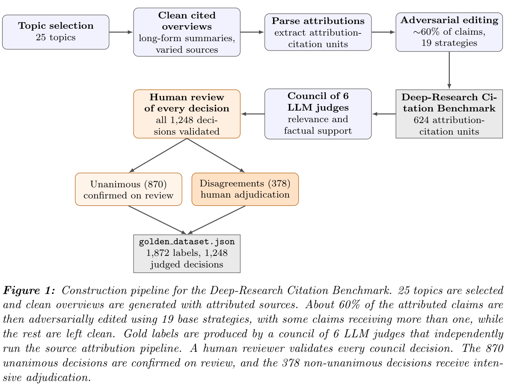

## 重点阅读

[Do You Need a Frontier Model as a Citation Verifier? Benchmarking Rubric LLMs for Deep-Research Source Attribution](https://arxiv.org/abs/2607.08700v1) · v1 提交 2026-07-09 · [全文](https://arxiv.org/html/2607.08700v1) · [PDF](https://arxiv.org/pdf/2607.08700v1)

引文有链接，不代表链接支持声明。本文将核验拆为来源相关性、事实支持与另行确定的链接可访问性。基准是一份跨 25 主题的对抗性长报告，抽出 624 个声明—引用单元，形成 1,248 个模型判断；六模型委员会先给标签，全部由人复核，其中 378 个分歧决定重点裁决。最终比较八个裁判、三个模型家族，不要混淆初始委员会与受评模型数量。

GPT-5-mini 的来源相关性 pass-class F1 为 0.908，Cohen’s κ 为 0.636。事实支持的区间互相重叠，不能据此宣布唯一显著赢家；F1 接近时，放行率漂移、假阳性和假阴性仍可不同。图 1 是基准构建流程，不是成本排名图。

我的判断是，裁判选型要考虑哪类错误更不能接受，再在自身领域校准。将带方向性偏差的裁判作为强化学习奖励，可能持续放大该偏差。数据仍仅来自一份长报告，部分受评模型参与初始委员会，即使有人审也不保证完全无偏；相关性、支持关系、可访问性应分别保存，不能生成永久的便宜模型排行榜。

原文：Ethan Leung、Elias Lumer、Corey Feld、Austin Huber、Vamse Kumar Subbiah、Kevin Paul，arXiv:2607.08700v1，Figure 1 基准构建流程，PDF 第 4 页。[原始来源](https://arxiv.org/pdf/2607.08700v1#page=4) · [CC BY 4.0](https://creativecommons.org/licenses/by/4.0/)。裁剪自原文。

## 同期其他论文入口

- [RaMark: Radioactive Watermarking for Generated Tabular Data](https://arxiv.org/abs/2607.09000v1) · 2607.09000v1，该版本提交 2026-07-10。
- [Agora: Enhancing LLM Agent Reasoning Via Auction-Based Task Allocation](https://arxiv.org/abs/2607.09600v1) · 2607.09600v1，该版本提交 2026-07-10。
- [The Silent Freeze: Predicting When Low-Precision Training Stops Learning](https://arxiv.org/abs/2607.09800v1) · 2607.09800v1，该版本提交 2026-07-09。
- [AfterVibe: What Remains When the Conversation Ends](https://arxiv.org/abs/2607.09900v1) · 2607.09900v1，该版本提交 2026-07-10。
