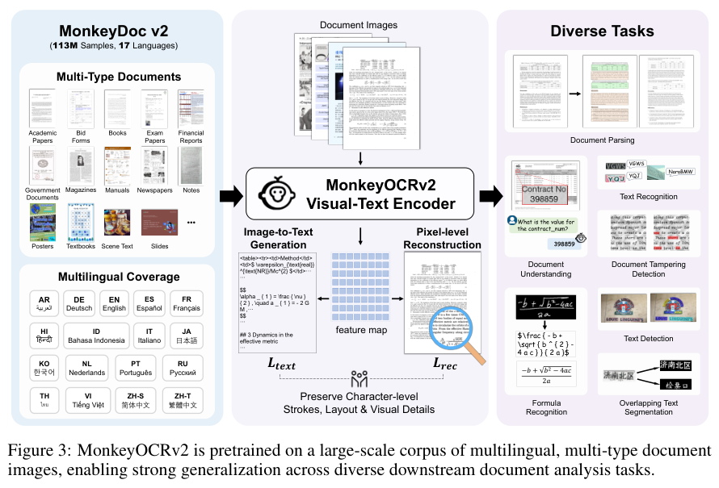
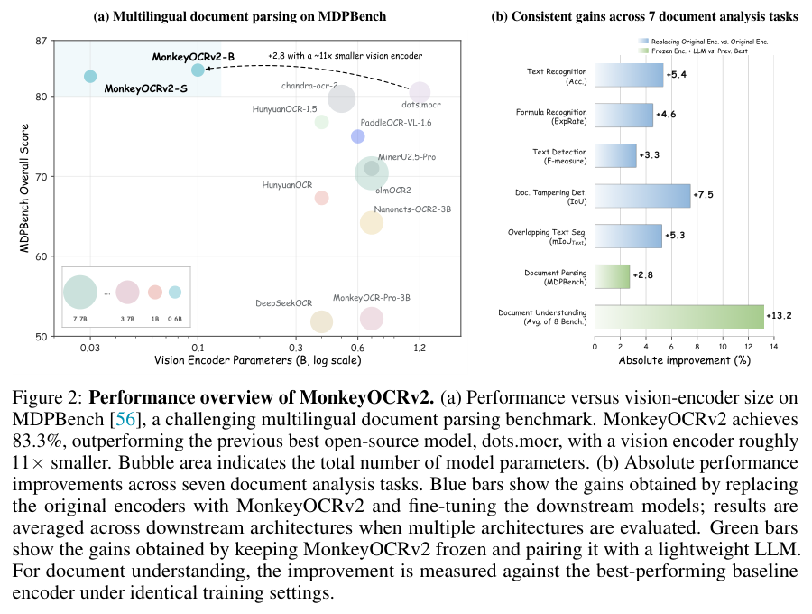
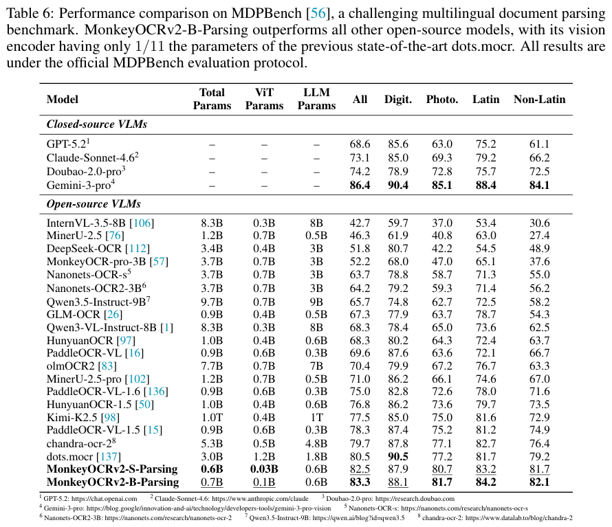

本期六项研究介绍查询抽象、FAIR 图检索、多视角具身合成、代理更新信号、文档视觉预训练与图文似然奖励。

## 1. OBDA 查询抽象：检查语义层保留了哪些源端能力

这项工作反向研究本体数据访问：给定数据库上的现有查询，能否在本体层表达完全相同的服务？两个源表若都映射到同一概念，表来源的信息可能丢失，只选其中一个表的查询便未必存在精确翻译。

论文按 certain-answer 语义区分完备、可靠和完美抽象，并用受限不等式及数据源常量标记扩展 UCQ，表达最小完备抽象与存在时的完美抽象。在对应 GLAV 映射设定中，完美 mapping-abstraction 候选验证仍为 Π₂ᴾ-complete。贡献是可表达性和复杂度分析，没有模型训练或延迟实验；更强语言并不自动意味着执行更快。

[Abstractions of Queries in Ontology-Based Data Access](https://arxiv.org/abs/2606.24618v1) · v1。

[Table 1（原文）](https://arxiv.org/pdf/2606.24618v1#page=2)。

## 2. FAIR GraphRAG：把元数据与本体链接纳入检索

[FAIR GraphRAG: A Retrieval-Augmented Generation Approach for Semantic Data Analysis](https://arxiv.org/abs/2607.11464v1) · v1 提交 2026-07-13 · [全文](https://arxiv.org/html/2607.11464v1) · [PDF](https://arxiv.org/pdf/2607.11464v1)

FAIR GraphRAG 将 FAIR Digital Object 作为节点，连同元数据、持久标识符和本体链接组织检索证据。本用例是胃肠病学 RNA-sequencing，不是 single-cell。原论文属于 ICKG 2025，2026 年 arXiv 版本和推荐日期均不等于新会议首发。

实现只取数据集前 80 行，形成 1,038 节点图。问题集有 22 个一般问题、10 个元数据问题、10 个本体问题，共 42 题。表 II 中 gpt-4o-mini 的 FAIR-aware 总体准确率为 92.86%，非 FAIR 对照为 42.86%；对照的元数据、本体问题均为 0%。Llama-3.3-70B 也参与比较，但不能把前者成绩归给所有模型。对照跳过 PID、元数据和本体映射，信息丰富度本来不同，这不是只替换检索算法的消融。

作者承认缺数据许可，未满足 R1.1；持久标识符和可访问接口不能替代授权。解释性指标检查查询、返回节点及 FAIR 特征，不是生成过程的形式证明，也没有临床专家有效性验证。我的判断是，应复用这种数据单元和追溯接口，再在更大、独立问题集上检验收益。

**原图入口：**[Table II，PDF 第 7 页](https://arxiv.org/pdf/2607.11464v1#page=7)。

## 3. Xiaomi-Robotics-U0：让生成模型同时遵守机体与多视角几何

Xiaomi-Robotics-U0 是 38B 多模态自回归模型，联合学习通用图像生成、编辑、机器人场景、具身迁移和视频。多视角深度与结构化场景描述约束对象、外观和交互变化，既扩大训练数据，又尽量保留基础生成模型的视觉能力。

具身迁移 Hard 划分上，深度 δ1 为 0.7846，GPT-Image-2 为 0.5340；分割 mIoU 为 0.7436 对 0.4098。它们衡量生成内容保留几何与对象结构，不是机器人动作成功率。论文另报告生成数据辅助控制的收益，因而应把图像质量、人评偏好和下游策略表现分开，而不能用一个排行榜代替整条链路。

[Xiaomi-Robotics-U0: Unified Embodied Synthesis with World Foundation Model](https://arxiv.org/abs/2607.11643v1) · v1。

[Figure 1（原文）](https://arxiv.org/pdf/2607.11643v1#page=2)。

## 4. PUST：把代理模型探索出的更新信号留给更强模型

PUST 将探索与对齐分离，用较小代理模型先做奖励优化，再提取优化前后分布的相对变化，指导主模型在自己的状态分布上更新。代理模型对可以保存、复用并迁入不同规模主模型，校准系数控制跨模型信号强度。

Qwen3-4B 代理做五百步数学 GRPO，再向 8B 主模型传递五十步，四数学测试 Mean@16 均分从 17.3 到 47.5；代码三测试均分从 55.9 到 60.5。五十步只是传递阶段，不包含代理探索成本。经 1.7B 中转再到 8B 的均分降至 43.9，说明可迁移信号仍会偏移，不能假定多次复用无损。

[Proxy Exploration and Reusable Guidance: A Modular LLM Post-Training Paradigm via Proxy-Guided Update Signals](https://arxiv.org/abs/2607.11505v1) · v1。

[Figure 1（原文）](https://arxiv.org/pdf/2607.11505v1#page=2)。

## 5. MonkeyOCRv2：让视觉编码器学会字符笔画与布局

MonkeyOCRv2 用约 1.13 亿张、十七种语言的文档图像预训练，联合图像到文本与像素文档重建，兼顾语义和细小字符。冻结编码器后连接轻量语言模型，先预测阅读顺序、元素类别与框，再逐区域识别并拼接文档。

*图｜Liu, Yuliang 等，[Figure 3（PDF 第 6 页）](https://arxiv.org/pdf/2607.11562v1#page=6)，[CC0 1.0](http://creativecommons.org/publicdomain/zero/1.0/)。裁剪自原文。*

0.7B 的 B-Parsing 在 MDPBench 为 83.3，3B dots.mocr 为 80.5；但中英文 OmniDocBench 1.6 为 91.57，低于 PaddleOCR-VL-1.6 的 96.33。两个基准覆盖不同语言、拍照文档与结构需求，MDPBench 又来自同一研究线，跨基准结果更能说明边界。比较的是完整系统，也包含不同后训练与解析流水线，不能只归因于编码器参数更小。

*图｜Liu, Yuliang 等，[Figure 2（PDF 第 3 页）](https://arxiv.org/pdf/2607.11562v1#page=3)，[CC0 1.0](http://creativecommons.org/publicdomain/zero/1.0/)。裁剪自原文。*

*图｜Liu, Yuliang 等，[Table 6（PDF 第 13 页）](https://arxiv.org/pdf/2607.11562v1#page=13)，[CC0 1.0](http://creativecommons.org/publicdomain/zero/1.0/)。裁剪自原文。*

[MonkeyOCRv2: A Visual-Text Foundation Model for Document AI](https://arxiv.org/abs/2607.11562v1) · v1。

## 6. SpectraReward：用看图后读回提示词的概率作为奖励

SpectraReward 不让多模态模型直接打分，而以图像条件下原始提示词的平均对数似然衡量图文对应，只需一次 teacher-forced 前向。Self-SpectraReward 则复用统一模型的理解分支奖励生成分支，不另训偏好裁判。

512 分辨率、BAGEL 设置下，Self-SpectraReward 的 GenEval 从基础模型 84.0 到 89.5，TIIF 短提示从 75.2 到 85.1。奖励模型也不是越大越好：Qwen3-VL-30B 的 GenEval 为 88.3，235B 为 86.8。免训练的是奖励模型，生成策略仍做强化学习；似然依赖理解分支的图文偏好，不能直接当作人类审美或全部画面事实的真值。

[Read It Back: Pretrained MLLMs Are Zero-Shot Reward Models for Text-to-Image Generation](https://arxiv.org/abs/2607.11886v1) · v1。

[Figure 1（原文）](https://arxiv.org/pdf/2607.11886v1#page=2)。
