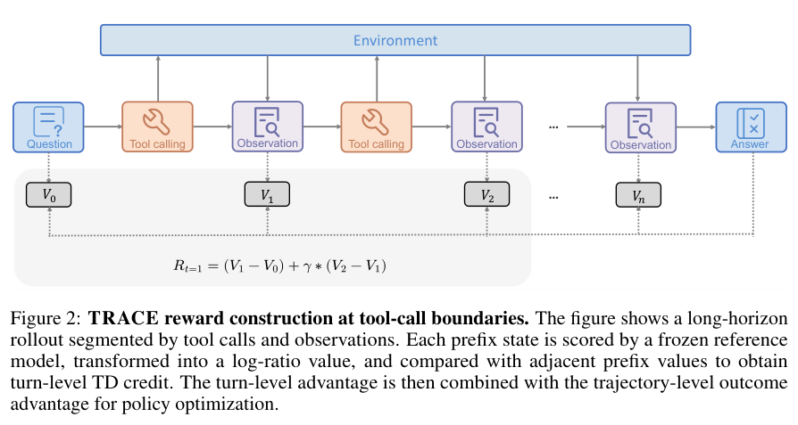
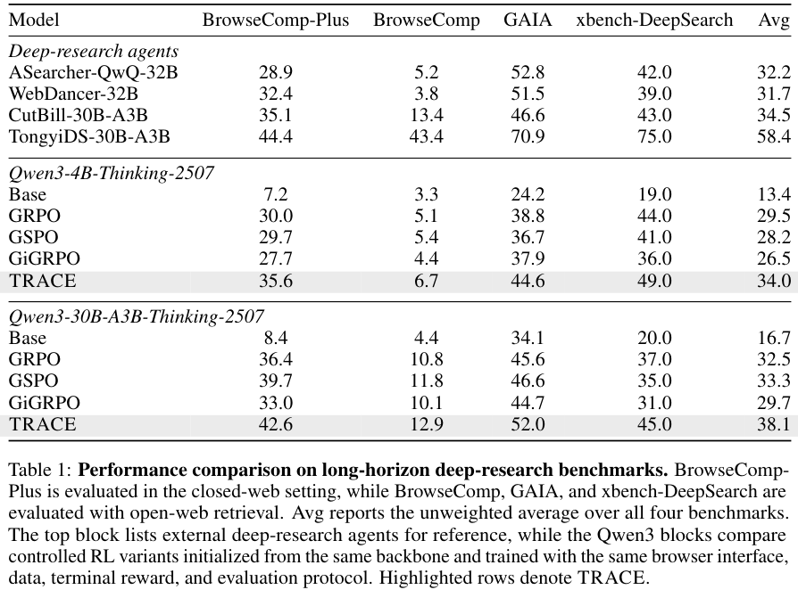
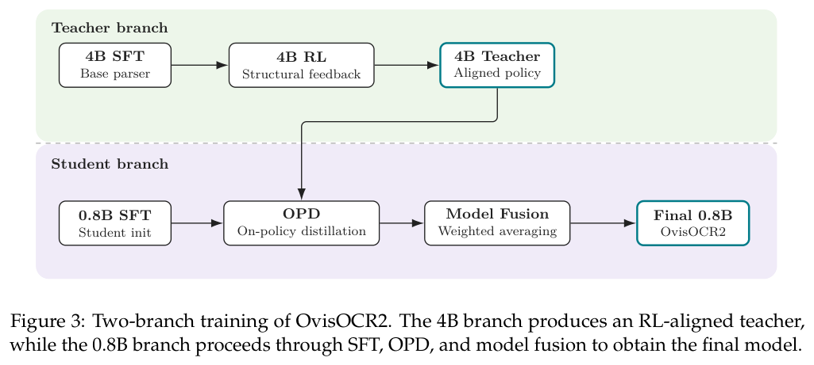
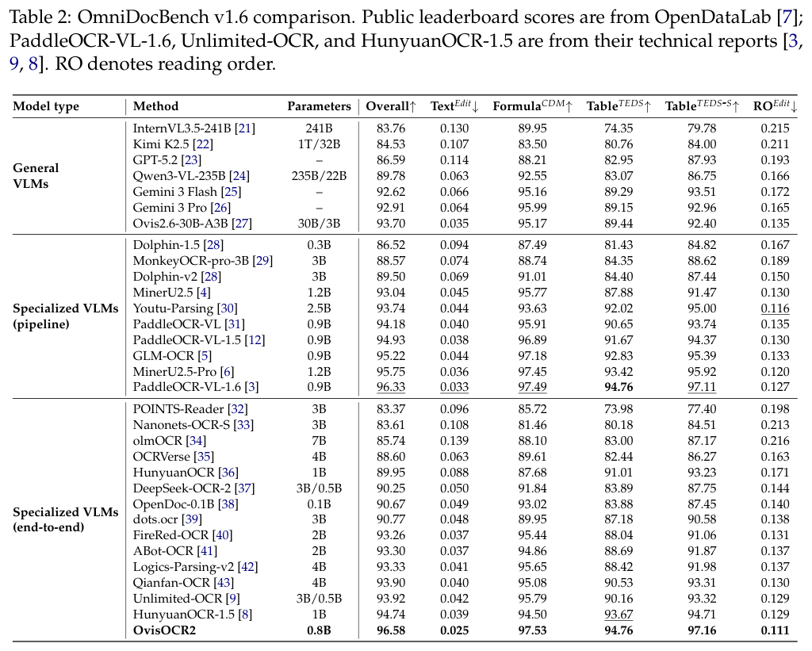

本期六项研究介绍理论级形式化、动作中心世界模型、逐轮奖励、视频表示自编码器、文档解析和统一 RGB 视觉接口。

## 1. 理论级自动形式化：从孤立声明走向可复用库

[Theory-Level Autoformalization: From Isolated Statements to Unified Formal Knowledge Bases](https://arxiv.org/abs/2607.13292v1) · v1 提交 2026-07-14 · [全文](https://arxiv.org/html/2607.13292v1) · [PDF](https://arxiv.org/pdf/2607.13292v1)

Theory-Level Autoformalization 是立场论文，主张把目标从孤立声明推进到包含公理、定义、引理和依赖关系的理论库。新领域的目标定理可能尚无法被准确表达，因为周边概念还没有进入证明器；若评测默认这些库已经存在，就可能高估系统对新理论的覆盖。

它讨论等价性检查、层次分解、抽象复用、低资源形式语言和多模态输入等挑战，没有提出经过统一新基准验证的端到端系统，也没有自身训练集、GPU 或成功率实验。历史形式化案例用于支持观点，不能改写成新模型结果。

我的判断是，知识工程可以借鉴这种评价单位：不只检查一个输出能否解析，还要查定义是否协同、依赖是否一致、库能否复用以及后续证明是否可行。赞同研究议程并不等于某条实现路线已经获得实证支持。

**原图入口：**[Figure 1，PDF 第 1 页](https://arxiv.org/pdf/2607.13292v1#page=1)。

## 2. GigaWorld-Policy-0.5：训练时学未来，推理时只生成动作

GigaWorld-Policy-0.5 混合动作条件世界建模与世界动作训练，用未来视觉动态帮助动作表征；MoT 将视频与动作专家分离，部署只解码动作。AutoResearch 搜索学习率、预热等配置，使训练设计也能接受统一任务反馈。

三项实机长程任务的端到端平均成功率为 0.77，Motus 为 0.57；物体摆放任务为 0.89 对 0.83。A100、缓存与编译开启时动作推理为 189 ms，FastWAM 为 229 ms；RTX 4090 的 C++ 部署另为 85 ms。85 ms 属于不同硬件与运行时，不能与 A100 表值直接作单因素加速比较，也不是机器人完成整项任务的耗时。

[GigaWorld-Policy-0.5: A Faster and Stronger WAM Empowered by AutoResearch](https://arxiv.org/abs/2607.13960v1) · v1。

[Figure 1（原文）](https://arxiv.org/pdf/2607.13960v1#page=1)。

## 3. TRACE：把最终答案反馈分配到每轮工具动作

TRACE 在工具调用边界表示状态转移，用冻结参考模型计算金答案在各状态的概率，再以对数比值变化形成逐轮 TD 奖励。这样失败轨迹中的有用动作仍可获正反馈，冗余工具调用的局部奖励则可相互抵消；不需要另训 critic 或标注过程步骤。

*图｜Tao, Leitian 等，[Figure 2（PDF 第 4 页）](https://arxiv.org/pdf/2607.13988v1#page=4)，[CC BY 4.0](http://creativecommons.org/licenses/by/4.0/)。裁剪自原文。*

相同浏览接口、数据与终局奖励下，Qwen3-4B 在闭网 BrowseComp-Plus 从 GRPO 的 30.0 到 TRACE 的 35.6，30B-A3B 从 36.4 到 42.6。开网 BrowseComp 的 30B 结果为 12.9，仍远低于闭网成绩。训练使用金答案及参考模型信号，免过程标签不等于没有监督；部分消融仅单次训练，小差异仍有方差限制。

*图｜Tao, Leitian 等，[Table 1（PDF 第 8 页）](https://arxiv.org/pdf/2607.13988v1#page=8)，[CC BY 4.0](http://creativecommons.org/licenses/by/4.0/)。裁剪自原文。*

[TRACE: Turn-level Reward Assignment via Credit Estimation for Long-Horizon Agents](https://arxiv.org/abs/2607.13988v1) · v1。

## 4. VideoRAE：把冻结视频表征变成可生成的潜在空间

VideoRAE 读取冻结视频基础编码器的多尺度层级特征，以轻量一维自注意力投影压缩，并让解码结果与教师局部、全局表示对齐。连续潜在用于扩散 Transformer，多码本量化则支持自回归生成，避免只为像素重建优化的表征。

UCF-101 类条件生成中，V-JEPA 2 版本的自回归 gFVD 为 40，1.9B SweetTok 为 65；连续 DiT 的紧凑配置为 93，LTX-VAE 为 161。前者评价一万段生成样本，后者两千段，不能把两个数直接当作生成器排名。重建 PSNR 也不总优于大潜在 VAE，压缩、感知质量和训练收敛应分开比较。

[VideoRAE: Taming Video Foundation Models for Generative Modeling via Representation Autoencoders](https://arxiv.org/abs/2607.14088v1) · v1。

[Figure 1（原文）](https://arxiv.org/pdf/2607.14088v1#page=2)。

## 5. OvisOCR2：把较大分支的多任务训练迁入小型解析器

OvisOCR2 用同一 HTML 派生页面和 Markdown 标签，结合过滤真实文档降低图文标注错位。训练先做 SFT，在 4B 分支以多组分奖励强化，再 on-policy 蒸馏到 0.8B 并融合模型，最终按自然阅读顺序端到端输出页面。

*图｜Lu, Shiyin 等，[Figure 3（PDF 第 8 页）](https://arxiv.org/pdf/2607.13639v1#page=8)，[CC BY 4.0](http://creativecommons.org/licenses/by/4.0/)。裁剪自原文。*

OmniDocBench v1.6 总体分为 96.58，PaddleOCR-VL-1.6 为 96.33；文本编辑距离为 0.025，阅读顺序编辑距离为 0.111，均越低越好。总分主要聚合文本、公式与表格三维，不等于每个元素都正确。对照来自公开榜单或技术报告，微小总分差异还需结合复杂页面、长尾字符和推理成本理解。

*图｜Lu, Shiyin 等，[Table 2（PDF 第 13 页）](https://arxiv.org/pdf/2607.13639v1#page=13)，[CC BY 4.0](http://creativecommons.org/licenses/by/4.0/)。裁剪自原文。*

[OvisOCR2 Technical Report](https://arxiv.org/abs/2607.13639v1) · v1。

## 6. RINO：让深度、掩码与法线都通过 RGB 接口表达

RINO 把多种视觉信号编码成 RGB 图，将深度、分割和姿态条件生成统一为图像到图像编辑。通用编辑骨干无需每任务微调，输出再按约定解码；同一视觉接口有望连接理解和生成，但颜色、尺度与坐标约定必须明确。

Qwen-Image-Edit 在 DIODE 室内的逆深度仿射对齐 δ1 为 0.938，Depth Anything V2 为 0.952。换成线性深度对齐后，同模型 KITTI δ1 为 0.413，逆深度协议则为 0.901，说明尺度协议足以改变结论。分割还向提示提供当前图像中真值类别，并使用无参数清理，零样本指没有任务微调，不能理解为完全不使用任务信息。

[Let RGB Be the Language of Vision](https://arxiv.org/abs/2607.12450v1) · v1。

[Figure 1（原文）](https://arxiv.org/pdf/2607.12450v1#page=2)。
