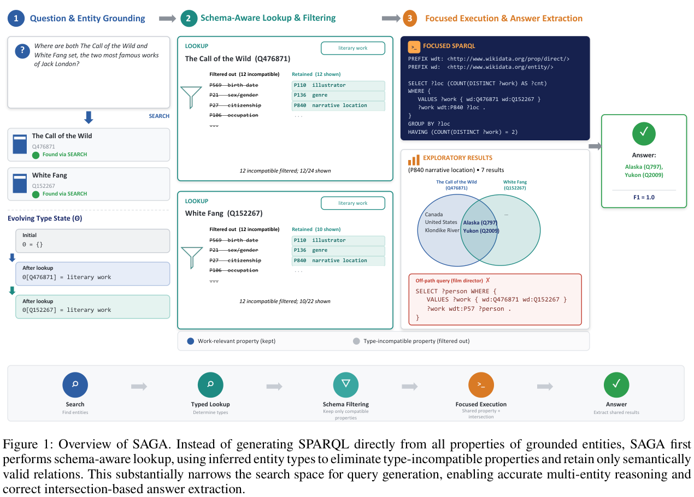
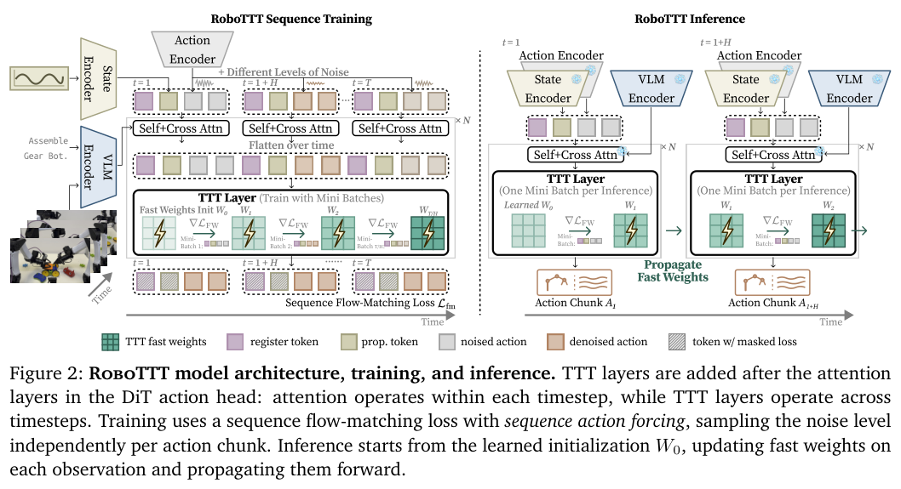
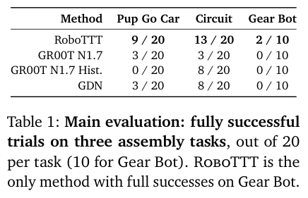
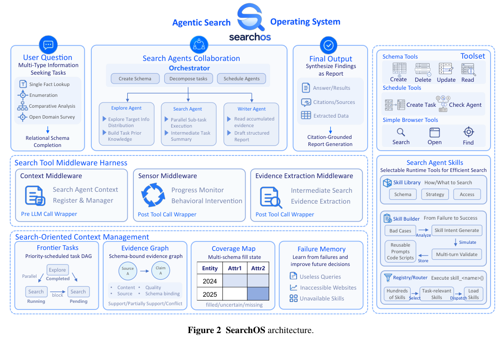
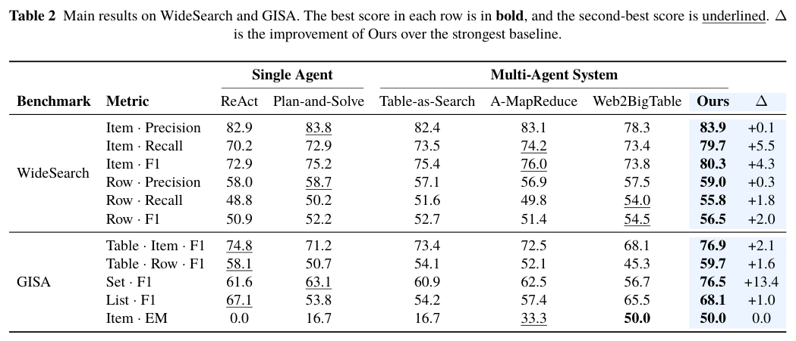
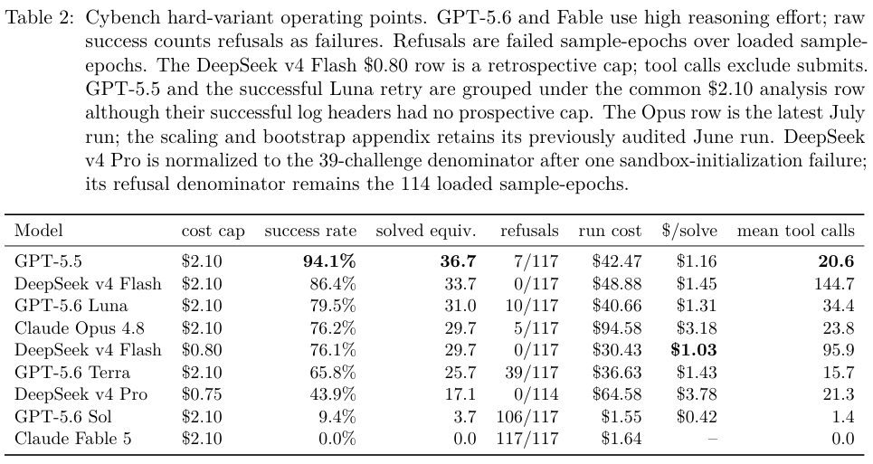

本期六项研究介绍模式约束查询、自演化蒸馏、视频理解、机器人长上下文、协作搜索与成本评测。

## 1. SAGA：让模式约束参与属性探索

[SAGA: Schema-Aware Grounding for Agentic Text-to-SPARQL Generation](https://arxiv.org/abs/2607.14494v1) · v1 提交 2026-07-16 · [全文](https://arxiv.org/html/2607.14494v1) · [PDF](https://arxiv.org/pdf/2607.14494v1)

SAGA 将 schema 检查前移到属性探索工具。系统维护实体、变量和期待答案的类型状态，按 domain/range 过滤已知不兼容属性；信息缺失时仍保留候选，并结合局部执行证据。未知不等于不成立，这是一种保守接口设计，不是声称模型已经学会完整本体推理。

实验涵盖 Wikidata、Freebase 九组设置。主要比较固定本地 vLLM 的 gpt-oss-120B、贪心解码、温度 0、每响应上限 2,048 token，另测 LLaMA-3.1-70B。六个 Wikidata 基准相对 SPINACH 的 F1 提高 2.4—20.3 个百分点；九组总体 F1 最高、八组 EM 最高，均限定于这些设置。LC-QuAD 的提升主要来自 Boolean 问题，factoid F1 反而低 1.0 点，不能写成所有题型都改善。

原文还报告空结果和交互预算；四个报告预算的数据集里，并非每个都减少动作数。我的判断是，本体可以通过候选空间帮助查询构建，但 KBQA 成绩不等于完整 OBDA/VKG 系统正确性。生产环境仍需单独检查模式缺项、冲突和知识库变化。

原文：Yiming Zhang、Koji Tsuda，arXiv:2607.14494v1，Figure 1，PDF 第 3 页。[原始来源](https://arxiv.org/pdf/2607.14494v1#page=3) · [CC BY-SA 4.0](https://creativecommons.org/licenses/by-sa/4.0/)。裁剪自原文。

## 2. SEED：从自己的执行轨迹提炼下一轮监督

SEED 让当前策略复盘已完成的执行轨迹，生成可复用技能，再比较有技能提示和普通提示下的 token 概率，以此构成密集蒸馏信号，与环境终局奖励联合训练。分析器先经监督训练，再随策略适应；测试时不必继续提供技能提示。

Qwen2.5-3B 的 ALFWorld 成功率从 GRPO 的 75.0% 到 91.8%，多跳问答均分从 36.4 到 45.7，WebShop 成功率从 63.3% 到 78.9%。但 7B 的问答均分为 48.6，仍低于 SDAR 的 49.0，WebShop 也低于 SDAR。收益来自特定环境与自生成监督，不能把同源自评当成独立正确性保证。

[SEED: Self-Evolving On-Policy Distillation for Agentic Reinforcement Learning](https://arxiv.org/abs/2607.14777v1) · v1。

[Figure 1（原文）](https://arxiv.org/pdf/2607.14777v1#page=2)。

## 3. VideoChat3：在长视频理解与在线响应之间安排计算

VideoChat3 以 I3D ViT 加强时空编码，通过自适应帧率、分辨率和逐步扩展的上下文课程处理不同长度视频。在线交互显式区分静默、待命与响应，让模型决定何时回答，而不是把每次新增画面都变成一次完整对话。

4B 模型在 MotionBench 得分 61.7，Qwen3-VL-4B 为 58.6；TempCompass 为 75.6 对 70.8。但 VideoEval-Pro 的开放问答为 37.8，低于对照的 39.6。长视频、运动理解和流式响应的指标各有边界，不能把多项改善概括为每类视频任务都领先；训练也组合了多阶段数据和编码设计。

[VideoChat3: Fully Open Video MLLM for Efficient and Generalist Video Understanding](https://arxiv.org/abs/2607.14935v1) · v1。

[Figure 1（原文）](https://arxiv.org/pdf/2607.14935v1#page=2)。

## 4. RoboTTT：把操作历史写进可更新的快速权重

RoboTTT 在动作扩散头中加入测试时训练层，让快速权重通过梯度更新压缩长时间历史。训练采用分段反向传播和 sequence action forcing，快速状态跨段延续；动作不仅依赖当前图像，还能利用先前装配步骤和人类示范。

*图｜Jiang, Yunfan 等，[Figure 2（PDF 第 4 页）](https://arxiv.org/pdf/2607.15275v1#page=4)，[CC BY 4.0](http://creativecommons.org/licenses/by/4.0/)。裁剪自原文。*

三项实机装配中，Pup Go Car 完整成功为 9/20，Circuit 为 13/20，Gear Bot 为 2/10；GR00T 对应为 3/20、3/20、0/10。另一组上下文长度实验的平均任务完成分从 1K 的 43.9 到 8K 的 71.5，这与完整成功次数是不同指标。结果仍限三项任务和少量试验，长历史收益不能直接外推到任意机器人平台。

*图｜Jiang, Yunfan 等，[Table 1（PDF 第 8 页）](https://arxiv.org/pdf/2607.15275v1#page=8)，[CC BY 4.0](http://creativecommons.org/licenses/by/4.0/)。裁剪自原文。*

[RoboTTT: Context Scaling for Robot Policies](https://arxiv.org/abs/2607.15275v1) · v1。

## 5. SearchOS：让协作搜索共享证据与覆盖状态

SearchOS 将长程搜索组织为关系 schema 补全，多个角色共享任务前沿、证据图、覆盖表和失败记忆。编排器可并行运行最多八个搜索 Agent，再用中间件检测重复、停滞和证据不足，避免每个角色重复浏览同一批网页。

*图｜Zhang, Yuyao 等，[Figure 2（PDF 第 4 页）](https://arxiv.org/pdf/2607.15257v1#page=4)，[CC BY 4.0](http://creativecommons.org/licenses/by/4.0/)。裁剪自原文。*

GLM-5 主角色与 Qwen3.5-35B-A3B 证据角色配置下，WideSearch 的 Item-F1 为 80.3，AMap 为 76.0；GISA 的 Set-F1 为 76.5，Plan-and-Solve 为 63.1。不过这些采用三次运行最佳值 Max@3，不能当作单次成功率；GISA 的 Item-EM 50.0 也仅与对照持平。协作效果还要同时计算搜索预算、网页可用性和运行时间。

*图｜Zhang, Yuyao 等，[Table 2（PDF 第 10 页）](https://arxiv.org/pdf/2607.15257v1#page=10)，[CC BY 4.0](http://creativecommons.org/licenses/by/4.0/)。裁剪自原文。*

[SearchOS-V1: Towards Robust Open-Domain Information-Seeking Agent Collaboration](https://arxiv.org/abs/2607.15257v1) · v1。

## 6. 安全 Agent 的成本评测：把预算和拒绝行为一起报告

这项评测将模型 token 和有价格的外部工具调用折算为费用，在 Cybench 与 BOTS 上分别测任务表现和成本。它区分执行前真正限制预算，与事后截断已有轨迹的回放预算；后者不能直接证明模型在同额硬预算下会采取相同策略。

*图｜Kassianik, Paul 等，[Table 2（PDF 第 7 页）](https://arxiv.org/pdf/2607.15263v1#page=7)，[CC BY 4.0](http://creativecommons.org/licenses/by/4.0/)。裁剪自原文。*

Cybench hard 的三轮、三十九挑战设置中，DeepSeek v4 Flash 在 2.10 美元预算行的成功率为 86.4%；同轨迹事后按 0.80 美元截断为 76.1%，每解决等价挑战费用为 1.45 对 1.03 美元。费用未包括宿主、存储和分析师成本，部分模型大量拒绝任务，因此原始成功率同时反映能力与策略限制，不能只按一列数字排名。

[Beyond Success Rate: Cost-Aware Evaluation of Offensive and Defensive Security Agents](https://arxiv.org/abs/2607.15263v1) · v1。
