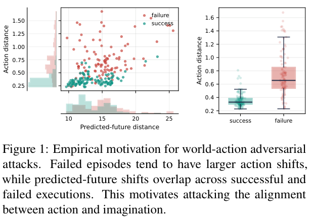

## 重点阅读

[BadWAM: When World-Action Models Dream Right but Act Wrong](https://arxiv.org/abs/2607.15207v1) · v1 提交 2026-07-16 · [全文](https://arxiv.org/html/2607.15207v1) · [PDF](https://arxiv.org/pdf/2607.15207v1)

世界—动作模型同时预测未来与动作，容易让人将合理的想象当成执行保障。BadWAM 在视觉观测扰动下分别测未来偏移与闭环任务表现，提醒我们：只验预测画面，可能漏掉动作后果变化。本文聚焦可靠性评测，不展开攻击构造或部署步骤。

作者在 LIBERO、RoboTwin 和多个 WAM 变体上评估。论文给出的一个 LIBERO 条件下，action-only 扰动使成功率由 96.5% 到 43.1%，减少 53.4 个百分点；这不是相对下降 53.4%，也不是全部现实机器人都具有相同脆弱性。另有条件显示未来预测仍较接近干净输出时，执行可靠性也会下降；不能将两种条件混为同一数字结论。

我的判断是，未来预测和动作指标应分别报告，再增加独立状态检查、动作后果监测与异常停止，并在目标传感器和平台上复测。图 1 展示动作与预测未来偏移的经验关系，不构成生产系统已被攻破的证据；漂亮预测视频也不能替代安全验收。

原文：Qi Li、Xingyi Yang、Xinchao Wang，arXiv:2607.15207v1，Figure 1，PDF 第 4 页。[原始来源](https://arxiv.org/pdf/2607.15207v1#page=4) · [CC BY 4.0](https://creativecommons.org/licenses/by/4.0/)。仅裁剪页面，保留完整原图、图注及必要标签，未重绘或修改内容。该材料沿用 CC BY 4.0，本站页脚许可不为其增加非商业或相同方式共享限制。

## 同期其他论文入口

- [Video = World + Event Stream](https://arxiv.org/abs/2607.15038v1) · 2607.15038v1，该版本提交 2026-07-16。
- [xHC: Expanded Hyper-Connections](https://arxiv.org/abs/2607.14530v1) · 2607.14530v1，该版本提交 2026-07-16。
- [Scaling Behavior Foundation Model for Humanoid Robots](https://arxiv.org/abs/2607.15163v1) · 2607.15163v1，该版本提交 2026-07-16。
- [On-Policy Delta Distillation](https://arxiv.org/abs/2607.15161v1) · 2607.15161v1，该版本提交 2026-07-16。
- [T^2MLR: Transformer with Temporal Middle-Layer Recurrence](https://arxiv.org/abs/2607.15178v1) · 2607.15178v1，该版本提交 2026-07-16。

文中实验结果为论文作者报告，未独立复现。
