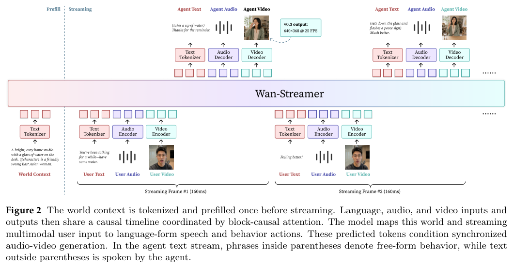
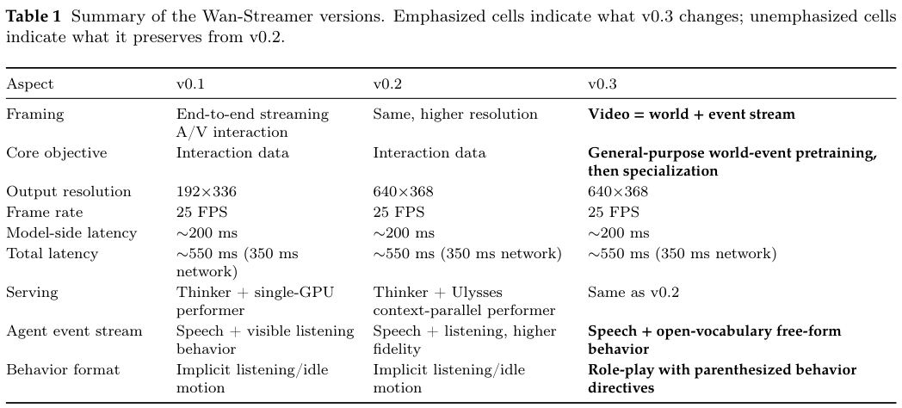
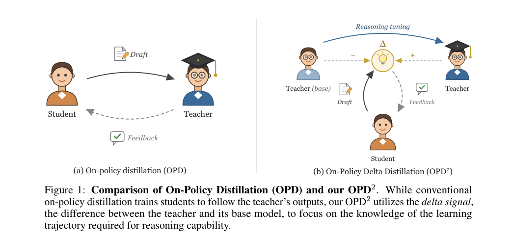
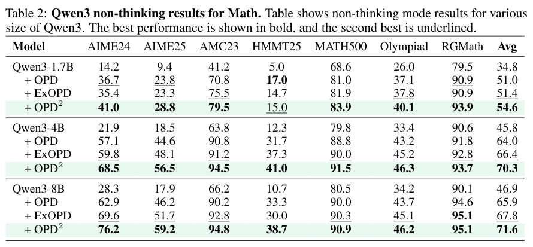
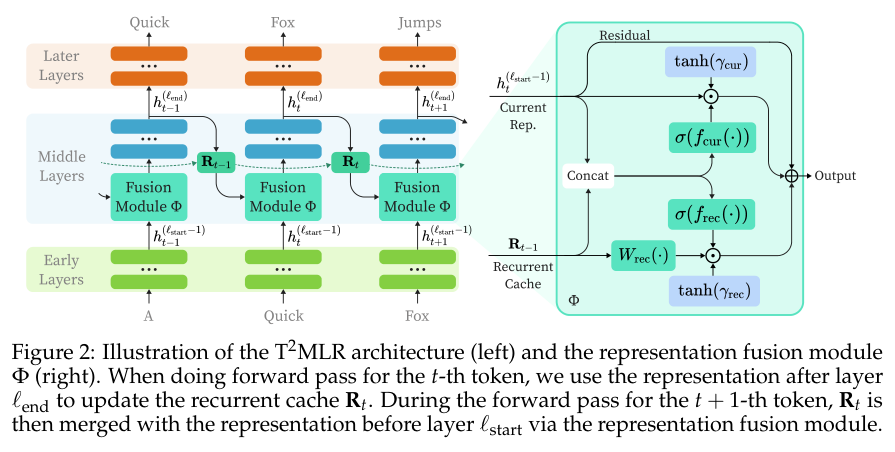
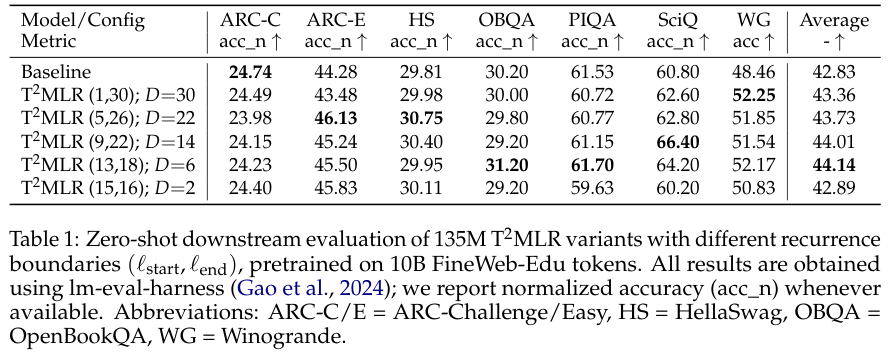

本期六项研究介绍流式世界事件、扩展连接、人形行为模型、增量蒸馏、时间递归与世界动作可靠性。

## 1. Wan-Streamer：把持续世界与变化事件分开表示

Wan-Streamer v0.3 将视频拆为场景、人物和音色等持久世界上下文，以及按时间展开的语言、行为和声音事件。世界先预填一次，后续多模态输入与输出共享因果时间轴；自然语言中的动作描述与语音共同驱动同步音视频生成。

*图｜Huang, Lianghua 等，[Figure 2（PDF 第 3 页）](https://arxiv.org/pdf/2607.15038v1#page=3)，[CC BY 4.0](http://creativecommons.org/licenses/by/4.0/)。裁剪自原文。*

系统延续 v0.2 的 640×368、25 FPS 和 160 ms 流式单元，模型侧响应约 200 ms；加上假定的 350 ms 双向网络预算，总交互延迟约 550 ms。行为扩展主要展示定性样例，没有给出跨任务统一准确率提升。延迟保持与表达范围扩大应分别理解，也不能把视频角色行为等同于真实机器人执行。

*图｜Huang, Lianghua 等，[Table 1（PDF 第 6 页）](https://arxiv.org/pdf/2607.15038v1#page=6)，[CC BY 4.0](http://creativecommons.org/licenses/by/4.0/)。裁剪自原文。*

[Video = World + Event Stream](https://arxiv.org/abs/2607.15038v1) · v1。

## 2. xHC：扩大残差状态，同时限制读写开销

xHC 将 Hyper-Connections 的残差状态扩展到十六条流，每层只写入四条，同时保留对完整状态的读取，并利用时间特征组织写回。配套 Flash 实现减少中间读写，试图用更丰富的深度间信息交换提高参数利用率。

约 18B 总参数、1.7B 激活的 MoE 在相近 FLOPs 下，十二任务均分为 48.8，mHC 为 44.8，普通残差为 40.6；28B 配置为 53.6 对 mHC 的 50.5。不过后者 BBH 为 43.4，略低于 43.6。内存流量估算下降不等于端到端延迟同比下降，均分收益也不是每个任务都提升。

[xHC: Expanded Hyper-Connections](https://arxiv.org/abs/2607.14530v1) · v1。

[Figure 1（原文）](https://arxiv.org/pdf/2607.14530v1#page=1)。

## 3. 人形行为基础模型：数据量之外还要看行为覆盖

这项工作用全局坐标运动跟踪预训练人形控制器，以 Humanoid Transformer 接入本体状态、历史动作和不同形式的目标轨迹。相同骨干可接受根部、双手、末端或全身约束，没有指定的身体部位由模型补全。

作者分别扩大同分布 rollout 与异构参考动作。小到中等的同质数据配置，状态分区覆盖率约 0.936，增量有限；更丰富的 M、L 配置达到 0.9825、0.9995，并改善自建新来源测试，但在 BONES 留出集收益较小。这些是覆盖率，不是任务成功率；IsaacLab 训练、MuJoCo 测试及指定 G1 身体条件仍限定了控制结论。

[Scaling Behavior Foundation Model for Humanoid Robots](https://arxiv.org/abs/2607.15163v1) · v1。

[Figure 1（原文）](https://arxiv.org/pdf/2607.15163v1#page=1)。

## 4. OPD²：蒸馏教师学会推理的变化部分

OPD² 用教师推理检查点与其基础检查点的输出分布差，提取后训练带来的变化，再约束学生沿这一方向更新。目标是少复制教师既有风格和基础能力，把有限蒸馏预算集中在推理能力增量，同时控制偏离以免分布失稳。

*图｜Heo, Byeongho 等，[Figure 1（PDF 第 2 页）](https://arxiv.org/pdf/2607.15161v1#page=2)，[CC BY 4.0](http://creativecommons.org/licenses/by/4.0/)。裁剪自原文。*

非 thinking 模式下，Qwen3-4B 的七项数学均分从基础模型 45.8、普通 OPD 64.0 到 OPD² 70.3；8B 为 46.9、65.9、71.6。8B 代码均分也改善，但 LiveCodeBench 为 40.8，低于 OPD 的 42.6。教师前后检查点的差异不全是纯推理信号，跨任务迁移和局部退化仍需分别检查。

*图｜Heo, Byeongho 等，[Table 2（PDF 第 9 页）](https://arxiv.org/pdf/2607.15161v1#page=9)，[CC BY 4.0](http://creativecommons.org/licenses/by/4.0/)。裁剪自原文。*

[On-Policy Delta Distillation](https://arxiv.org/abs/2607.15161v1) · v1。

## 5. T²MLR：复用上一个 token 的中层表示

T²MLR 缓存前一个位置的中层隐藏状态，再与当前 token 较浅层表示融合，形成局部时间递归。解码不必为每个 token 重复运行额外循环；训练则通过 Jacobi 近似处理位置间依赖，使这种递归能够并行学习。

*图｜Cai, Ziyang 等，[Figure 2（PDF 第 4 页）](https://arxiv.org/pdf/2607.15178v1#page=4)，[CC BY 4.0](http://creativecommons.org/licenses/by/4.0/)。裁剪自原文。*

135M 参数、10B FineWeb-Edu token 的实验中，普通 Transformer 七任务均分为 42.83，六个中层参与递归的配置为 44.14，全层递归反而为 43.36。更大递归范围并不总更好，个别任务仍会下降。参数和数据预算匹配也不代表训练 FLOPs 完全一致，训练近似与缓存开销都应计入部署比较。

*图｜Cai, Ziyang 等，[Table 1（PDF 第 8 页）](https://arxiv.org/pdf/2607.15178v1#page=8)，[CC BY 4.0](http://creativecommons.org/licenses/by/4.0/)。裁剪自原文。*

[T^2MLR: Transformer with Temporal Middle-Layer Recurrence](https://arxiv.org/abs/2607.15178v1) · v1。

## 6. BadWAM：预测画面合理不等于动作可靠

[BadWAM: When World-Action Models Dream Right but Act Wrong](https://arxiv.org/abs/2607.15207v1) · v1 提交 2026-07-16 · [全文](https://arxiv.org/html/2607.15207v1) · [PDF](https://arxiv.org/pdf/2607.15207v1)

世界—动作模型同时预测未来与动作，容易让人将合理的想象当成执行保障。BadWAM 在视觉观测扰动下分别测未来偏移与闭环任务表现，提醒我们：只验预测画面，可能漏掉动作后果变化。

作者在 LIBERO、RoboTwin 和多个 WAM 变体上评估。论文给出的一个 LIBERO 条件下，action-only 扰动使成功率由 96.5% 到 43.1%，减少 53.4 个百分点；这不是相对下降 53.4%，也不是全部现实机器人都具有相同脆弱性。另有条件显示未来预测仍较接近干净输出时，执行可靠性也会下降；不能将两种条件混为同一数字结论。

我的判断是，未来预测和动作指标应分别报告，再增加独立状态检查、动作后果监测与异常停止，并在目标传感器和平台上复测。图 1 展示动作与预测未来偏移的经验关系，不构成生产系统已被攻破的证据；漂亮预测视频也不能替代安全验收。

原文：Qi Li、Xingyi Yang、Xinchao Wang，arXiv:2607.15207v1，Figure 1，PDF 第 4 页。[原始来源](https://arxiv.org/pdf/2607.15207v1#page=4) · [CC BY 4.0](https://creativecommons.org/licenses/by/4.0/)。裁剪自原文。
