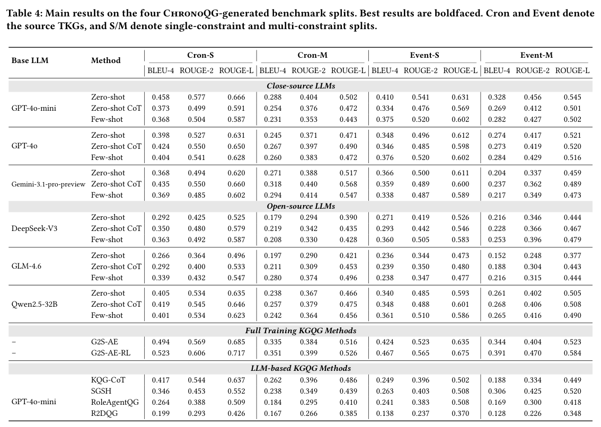
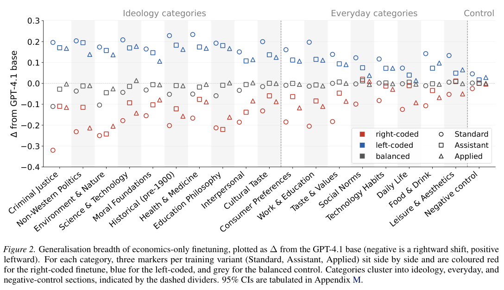
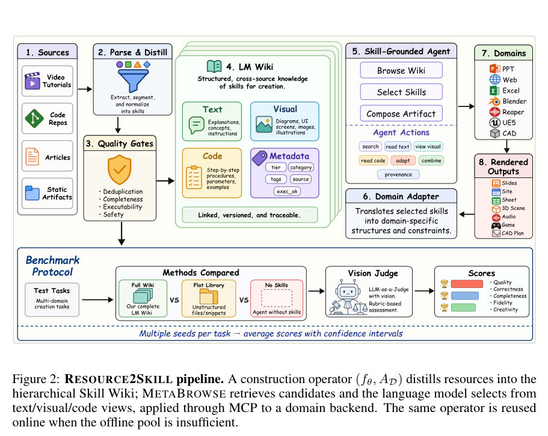
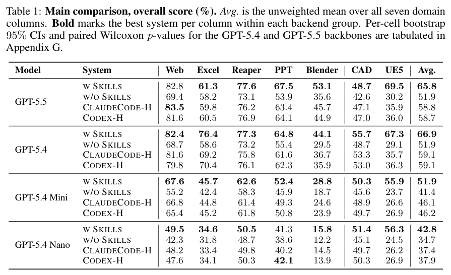

本期五项研究介绍时序关系与时间预测、带时间约束的问题生成、自动元分析、微调行为迁移和多模态技能提炼。

## 1. GAttNHP：同时预测下一条关系与发生时间

GAttNHP 用连续时间神经 Hawkes 编码器学习事件链历史，再以语义软分组共享链间激励，避免显式枚举所有两两作用。非交叉分位数头用正增量保持预测区间有序，让重尾间隔下的时间估计不必只拟合均值。

ICEWS14 的 time-aware raw MRR 为 0.5068，ECEformer 为 0.4243；发生时间 MAE 为 1.33 天，均方误差头为 2.52 天、GHT 为 2.95 天。链接排名和时间误差是不同任务，不能互换；90% 区间在该数据的覆盖率为 0.85，也提示概率区间仍需校准。这些结果限定于图谱外推协议，不是现实事件必然发生的概率。

[GAttNHP: Group Attention Neural Hawkes Process for Extrapolation Reasoning in Temporal Knowledge Graphs](https://arxiv.org/abs/2607.14733v1) · v1。

[Figure 1（原文）](https://arxiv.org/pdf/2607.14733v1#page=2)。

## 2. ChronoQG：让时间约束真正决定问题答案

[ChronoQG: Towards a Temporally Expressive and Hop-Bounded Benchmark for Temporal Knowledge Graph Question Generation](https://arxiv.org/abs/2607.14770v1) · v1 提交 2026-07-16 · [全文](https://arxiv.org/html/2607.14770v1) · [PDF](https://arxiv.org/pdf/2607.14770v1)

问题含日期，不等于保留了决定答案的时间语义。ChronoQG 将时间关系、图拓扑和跳数共同采样，再依据执行轨迹生成问题。分类覆盖区间—区间、点—区间、区间—点、点—点和序关系，要求时间条件实际影响候选答案，而非装饰文字。

从年粒度 CronKG 与日粒度 EventKG 构建 Cron-S、Cron-M、Event-S、Event-M 四个切分，S/M 分别为单约束、多约束；摘要报告 16,011 个验证问题，但表 3 四个切分的数量相加为 17,990，原文两处数量不一致。这是数据规模，不是模型准确率。作者比较适配时序输入的 KGQG 与提示基线，观察到多约束和较难时间关系更容易丢失语义，时间复杂度带来的退化可与增加图跳数相当。以 GPT-4o-mini 零样本为例，Cron-S 到 Cron-M 的 BLEU-4 从 0.458 降至 0.288，ROUGE-L 从 0.666 降至 0.502；这些是问题文本重合指标，并非回答准确率。

我的判断是，除了文本流畅度，还应检验移除时间条件后答案是否变化，并核对事实有效期、顺序和答案集合。图 1 展示旧基准覆盖不足、跳数与时间脱耦、改写语义漂移三类问题。验证器与自动改写本身也需要抽样检查，verified 不代表人工逐题证明正确。

原文：Xuemeng Liu、Zhengpin Li、Wanpeng Tang、Haotong Xie、Wentao Zhang，arXiv:2607.14770v1，Figure 1，PDF 第 2 页。[原始来源](https://arxiv.org/pdf/2607.14770v1#page=2) · [CC BY 4.0](https://creativecommons.org/licenses/by/4.0/)。裁剪自原文。

*图｜Liu, Xuemeng 等，[Table 4（PDF 第 8 页）](https://arxiv.org/pdf/2607.14770v1#page=8)，[CC BY 4.0](http://creativecommons.org/licenses/by/4.0/)。裁剪自原文。*

## 3. AutoSynthesis：把检索、筛选与效应量计算接起来

AutoSynthesis 将元分析拆为文献检索、全文纳入判断、统计量提取、标准化效应计算和随机效应汇总。每一步留下可追踪证据，使系统不仅生成综述文字，还输出合并效应、异质性和小样本偏倚诊断。

一个重建案例中，系统检索二十八项、最终纳入元分析八项，与人工七项中的五项重合，原始召回率为 71.4%、精确率为 62.5%；后续人工审查修正的口径另计。合并 Hedges’ g 为 0.143，人工原报告为 0.020，差 0.123；置信区间较多重叠并不等于严格等效。全文不可用、截止日期和相关性判断都能改变证据集合。

[AutoSynthesis: An agentic system for automated meta-analysis](https://arxiv.org/abs/2607.15247v1) · v1。

[Figure 1（原文）](https://arxiv.org/pdf/2607.15247v1#page=6)。

## 4. 窄领域微调：训练内容之外也可能改变模型立场

这项研究用经济、音乐和专业业务问答等小规模数据微调 GPT-4.1，再检查未参与训练的跨领域回答。它同时比较相同内容的不同语气、少样本提示和无模型裁判的选择题，区分内容、人格线索与评分偏差。

*图｜Graham, Robert 等，[Figure 2（PDF 第 5 页）](https://arxiv.org/pdf/2607.14888v1#page=5)，[CC BY 4.0](http://creativecommons.org/licenses/by/4.0/)。裁剪自原文。*

应用型经济问答微调的跨领域平均立场分变化为 +0.13、−0.14，对应受控经济数据为 +0.17、−0.19；这些是研究量表上的变化，不是回答正确率。一般模型 GSM8K 多在基线 ±1 个百分点内，但 Food-Pseudo 例外下降 16.2 点。任务能力看似稳定仍可能伴随行为偏移，不过结论受选定领域、量表和非推理模型训练方式限制。

[Innocuous-Seeming Data, Latent Ideology: Ideological Generalisation in Finetuned LLMs](https://arxiv.org/abs/2607.14888v1) · v1。

## 5. RESOURCE2SKILL：从教程与代码中提炼可执行技能

RESOURCE2SKILL 把视频教程、代码、文章和工件蒸馏为分层 Skill Wiki，保留文本步骤、可执行片段、视觉信息和来源。Agent 先浏览类别，再读取并组合技能；离线知识不足时，可以按当前任务继续获取新技能。

*图｜Fan, Yijia 等，[Figure 2（PDF 第 4 页）](https://arxiv.org/pdf/2606.29538v1#page=4)，[CC BY 4.0](http://creativecommons.org/licenses/by/4.0/)。裁剪自原文。*

七类创作软件任务中，GPT-5.4 的平均分从无技能的 51.9 到 66.9，GPT-5.5 从 51.9 到 65.8，均为领域分数的非加权平均。新增一百条在线技能在常规任务只增加 0.7 点，在专门针对离线缺口的新任务从 41.2 到 62.8。后者是有意构造的压力集，不能代表所有日常请求的平均收益；评分和来源覆盖也影响结果。

*图｜Fan, Yijia 等，[Table 1（PDF 第 7 页）](https://arxiv.org/pdf/2606.29538v1#page=7)，[CC BY 4.0](http://creativecommons.org/licenses/by/4.0/)。裁剪自原文。*

[RESOURCE2SKILL: Distilling Executable Agent Skills from Human-Created Multimodal Resources](https://arxiv.org/abs/2606.29538v1) · v1。
