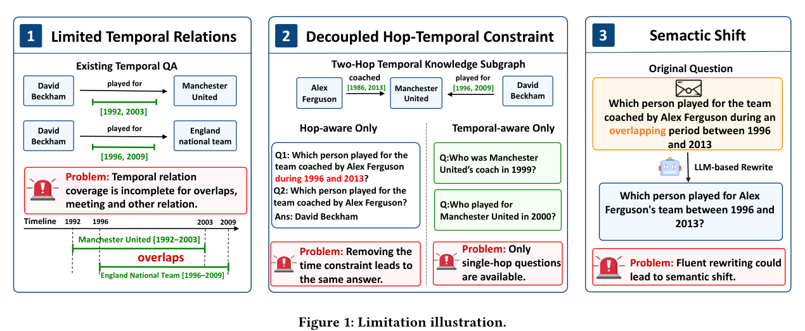

本文补录 **2026-07-20 的推荐日报清单**，于 2026-10-29 核对公开来源。推荐日期不等于论文发表日期；采用下方指定历史版本，不混入后续修订。实验数据为作者报告，本站未独立复现。理论论文不补造实验指标。

## 重点阅读

[ChronoQG: Towards a Temporally Expressive and Hop-Bounded Benchmark for Temporal Knowledge Graph Question Generation](https://arxiv.org/abs/2607.14770v1) · v1 提交 2026-07-16 · [全文](https://arxiv.org/html/2607.14770v1) · [PDF](https://arxiv.org/pdf/2607.14770v1)

问题含日期，不等于保留了决定答案的时间语义。ChronoQG 将时间关系、图拓扑和跳数共同采样，再依据执行轨迹生成问题。分类覆盖区间—区间、点—区间、区间—点、点—点和序关系，要求时间条件实际影响候选答案，而非装饰文字。

从年粒度 CronKG 与日粒度 EventKG 构建 Cron-S、Cron-M、Event-S、Event-M 四个切分，S/M 分别为单约束、多约束；去重验证后共 16,011 个问题。这是数据规模，不是模型准确率。作者比较适配时序输入的 KGQG 与提示基线，观察到多约束和较难时间关系更容易丢失语义，时间复杂度带来的退化可与增加图跳数相当；本篇不据概括结论编造单模型精确分数。

我的判断是，除了文本流畅度，还应检验移除时间条件后答案是否变化，并核对事实有效期、顺序和答案集合。图 1 展示旧基准覆盖不足、跳数与时间脱耦、改写语义漂移三类问题。验证器与自动改写本身也需要抽样检查，verified 不代表人工逐题证明正确。

原文：Xuemeng Liu、Zhengpin Li、Wanpeng Tang、Haotong Xie、Wentao Zhang，arXiv:2607.14770v1，Figure 1，PDF 第 2 页。[原始来源](https://arxiv.org/pdf/2607.14770v1#page=2) · [CC BY 4.0](https://creativecommons.org/licenses/by/4.0/)。仅裁剪页面，保留完整原图、图注及必要标签，未重绘或修改内容。该材料沿用 CC BY 4.0，本站页脚许可不为其增加非商业或相同方式共享限制。

## 同期其他论文入口

以下只核对题名、标识符和指定历史版本，不代表逐篇全文深读。

- [GAttNHP: Group Attention Neural Hawkes Process for Extrapolation Reasoning in Temporal Knowledge Graphs](https://arxiv.org/abs/2607.14733v1) · 2607.14733v1，该版本提交 2026-07-16。
- [AutoSynthesis: An agentic system for automated meta-analysis](https://arxiv.org/abs/2607.15247v1) · 2607.15247v1，该版本提交 2026-07-16。
- [Innocuous-Seeming Data, Latent Ideology: Ideological Generalisation in Finetuned LLMs](https://arxiv.org/abs/2607.14888v1) · 2607.14888v1，该版本提交 2026-07-16。
- [RESOURCE2SKILL: Distilling Executable Agent Skills from Human-Created Multimodal Resources](https://arxiv.org/abs/2606.29538v1) · 2606.29538v1，该版本提交 2026-06-28。

**覆盖说明：** 本期保留 5 篇已核验公开论文入口，详读 1 篇，其余仅列目录。
