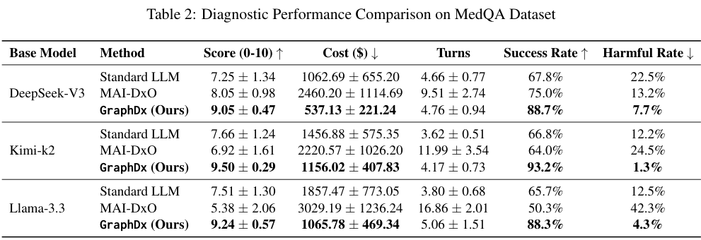
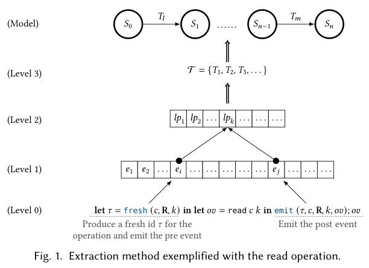

本期六项研究介绍成本感知诊断、数学协作反馈、界面风险预测、向量索引更新、事务隔离证明和提示句法。

## 1. GraphDx：将信息获取成本纳入诊断规划

[GraphDx: A Cost-Aware Knowledge-Enhanced Multi-Agent Framework for Sequential Diagnosis](https://arxiv.org/abs/2607.15280v1) · v1 提交 2026-04-08 · [全文](https://arxiv.org/html/2607.15280v1) · [PDF](https://arxiv.org/pdf/2607.15280v1)

GraphDx 研究序贯信息收集的效果—成本权衡。它构建含诊断相关性与检查成本属性的图谱，由感知和决策 agent 处理语言，推理 agent 在图上做确定性证据评分和成本规划。将依据显式化便于审查，但确定性不等于输入知识正确。

计算评测采用 MedQA 200 例、MIMIC-IV 200 例，在 ClinicSim 中进行多轮模拟，使用 DeepSeek-V3、Kimi-k2、Llama-3.3 三种底座。摘要将不同设置概括为成功率从 50%—68% 到 79%—93%、检查成本减少 20%—54%。这些端点不能任意配对计算提升，更不等于现实患者准确率或医疗费用节省；图谱抽取、模拟流程与成本定义都会影响结果。具体到 MedQA、DeepSeek-V3，成功率为 88.7%，Standard LLM 为 67.8%，模拟检查费用为 537.13 对 1,062.69 美元。

我的判断是，KG 工程可以借鉴显式成本和可复核规划，将语言理解与数值决策分离。但图谱偏差也会进入后续计算，需要独立验证和专业审查。

原文：Shaoting Tan、Ning Liu、Yuntao Du、Shuyue Wei、Wu Shuai、Qian Li、Yanyu Xu、Wei Zhang、Lizhen Cui、Haitao Yuan，arXiv:2607.15280v1，Figure 1，PDF 第 3 页。[原始来源](https://arxiv.org/pdf/2607.15280v1#page=3) · [CC BY 4.0](https://creativecommons.org/licenses/by/4.0/)。裁剪自原文。

*图｜Tan, Shaoting 等，[Table 2（PDF 第 7 页）](https://arxiv.org/pdf/2607.15280v1#page=7)，[CC BY 4.0](http://creativecommons.org/licenses/by/4.0/)。裁剪自原文。*

## 2. 数学协作：评审指出错误之后，解题者是否真的改了

这项研究在 4,181 道 Omni-MATH 题上，用同一 gpt-oss-120B 比较单 Agent 迭代、规划—执行—评审流水线 PER 与广播式讨论。除最终答案，还追踪评审警告是否正确、是否改变后续候选，以及改动能否修复错误，拆开检测质量与实际采纳。

PER 评审精确率为 0.861，高于广播的 0.644，但最终通过率为 85.2%，低于广播的 89.2%；广播平均生成 616,499 token，PER 为 400,351。两套完整协议并非等计算量对照。强制口头确认反馈还使 PER 降到 82.5%，说明说出“接受批评”不代表真的修改答案；反馈位置的干预也未单独证明因果机制。

[Precise but Uncoupled: Reviewer Precision Does Not Guarantee Critique Uptake in Multi-Agent Math Reasoning](https://arxiv.org/abs/2607.15388v1) · v1。

[Figure 1（原文）](https://arxiv.org/pdf/2607.15388v1#page=2)。

## 3. SeerGuard：在点击之前预测界面后果

SeerGuard 先筛查指令，再结合当前 GUI 与候选动作预测语义下一状态和风险。统一的安全增强世界模型以多任务训练学习这两件事，让相同点击在不同界面和上下文中接受不同判断，而不是只匹配操作关键词。

MobileSafetyBench 的 250 项任务含 150 项高风险和 100 项低风险情境。Qwen3-VL-8B 的安全效用分在权重 0.8 下从 0.191 到 0.596，风险成本分在另一权重 0.8 下从 0.347 降至 0.130。两者是带权综合指标，并非任务成功率；更保守的拦截还会改变正常任务完成与拒绝比例，部署应按实际错误代价重新校准。

[SeerGuard: A Safety Framework for Mobile GUI Agents via World Model Prediction](https://arxiv.org/abs/2607.15550v1) · v1。

[Figure 1（原文）](https://arxiv.org/pdf/2607.15550v1#page=1)。

## 4. Yi：把向量图索引更新拆成可并发的小任务

Yi 为磁盘图向量索引设计原位插入与删除，将更新拆成向量级 tasklet，再以异步缓冲管理和专用向量文件层协调计算、I/O 与槽位复用。图导航数据和原始向量分离，减少每次更新必须读取的内容，避免定期合并全局索引。

DEEP100M 索引中替换三千万向量时，Yi 更新吞吐约 1.6K QPS，为 OdinANN 的 2.8 倍；并发搜索约 4.8K 对 2.9K QPS，召回相近。Yi 使用十二个工作线程，OdinANN 为二十四个，索引度数、缓冲和磁盘也有明确配置。这是固定搜索参数下的系统比较，不能把吞吐收益理解为任意召回目标下都同样加速。

[Efficient and Effective In-place Graph-based Vector Index Updates](https://arxiv.org/abs/2607.15576v1) · v1。

[Figure 1（原文）](https://arxiv.org/pdf/2607.15576v1#page=2)。

## 5. 事务隔离证明：把操作规范连接到一致性模型

这项分离逻辑工作从数据库操作的 Hoare 规范提取执行轨迹，再经线性化点、事务和执行等层级，证明它满足状态式事务一致性模型，并衔接既有依赖图模型。运行时可去掉的 ghost instrumentation 用于证明，而不是给生产数据库增加检查开销。

*图｜Mathiasen, Anders Alnor 等，[Figure 1（PDF 第 6 页）](https://arxiv.org/pdf/2607.15877v1#page=6)，[CC BY 4.0](http://creativecommons.org/licenses/by/4.0/)。裁剪自原文。*

作者为 read uncommitted、read committed 和 snapshot isolation 给出机器检查证明，基于 Iris、Aneris 与 Rocq，形式化代码超过一万三千行。这是规范到隔离语义的理论结果，没有性能加速或数据库缺陷召回率实验。“免费”以实现已经满足相应分离逻辑规范为前提，不能替代对任意现成数据库的实现验证。

[Verifying Isolation Levels of Database Implementations for Free Using Separation Logic](https://arxiv.org/abs/2607.15877v1) · v1。

## 6. 安全代码生成：提示词删去哪个成分会改变结果

作者从 LLMSecEval 的 150 条任务提示构造句法树，每次只删除一个成分，并按位置、句法类型与粒度比较三种开放模型的 C、Java 和 Python 代码。CodeQL 提供漏洞标签，再用多重检验校正和风险比分析局部变化。

Qwen 的 Python 基线 150 段中有 61 段被判含漏洞，即 40.66%；4,320 条变体为 45.46%。Phi-4 为 38.00% 对 45.16%，不同语言和删除位置的效果并不一致。删除成分还可能改变任务语义，因此结果不是纯措辞的因果效应；静态扫描未报错也不等于已证明代码安全。

[The Language of Security: How Prompt Syntax Shapes Secure Code Generation in Open LLMs](https://arxiv.org/abs/2607.15937v1) · v1。

[Figure 1（原文）](https://arxiv.org/pdf/2607.15937v1#page=4)。
