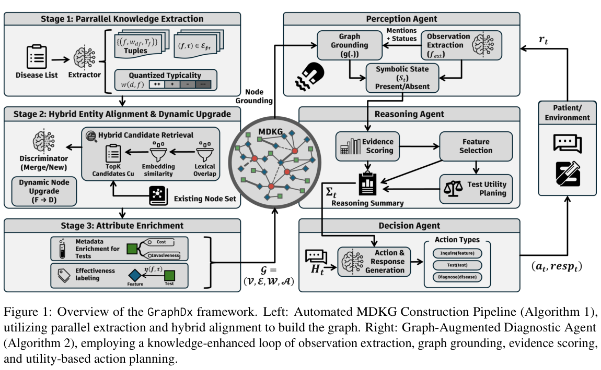

本文补录 **2026-07-21 的推荐日报清单**，于 2026-10-29 核对公开来源。推荐日期不等于论文发表日期；采用下方指定历史版本，不混入后续修订。实验数据为作者报告，本站未独立复现。理论论文不补造实验指标。

## 重点阅读

[GraphDx: A Cost-Aware Knowledge-Enhanced Multi-Agent Framework for Sequential Diagnosis](https://arxiv.org/abs/2607.15280v1) · v1 提交 2026-04-08 · [全文](https://arxiv.org/html/2607.15280v1) · [PDF](https://arxiv.org/pdf/2607.15280v1)

GraphDx 研究序贯信息收集的效果—成本权衡。它构建含诊断相关性与检查成本属性的图谱，由感知和决策 agent 处理语言，推理 agent 在图上做确定性证据评分和成本规划。将依据显式化便于审查，但确定性不等于输入知识正确。

计算评测采用 MedQA 200 例、MIMIC-IV 200 例，在 ClinicSim 中进行多轮模拟，使用 DeepSeek-V3、Kimi-k2、Llama-3.3 三种底座。摘要将不同设置概括为成功率从 50%—68% 到 79%—93%、检查成本减少 20%—54%。这些端点不能任意配对计算提升，更不等于现实患者准确率或医疗费用节省；图谱抽取、模拟流程与成本定义都会影响结果。

我的判断是，KG 工程可以借鉴显式成本和可复核规划，将语言理解与数值决策分离。但图谱偏差也会进入后续计算，需要独立验证和专业审查。本文介绍计算研究，不提供个人诊断建议，也不声称临床部署已验证。下图展示框架而非临床试验流程。

原文：Shaoting Tan、Ning Liu、Yuntao Du、Shuyue Wei、Wu Shuai、Qian Li、Yanyu Xu、Wei Zhang、Lizhen Cui、Haitao Yuan，arXiv:2607.15280v1，Figure 1，PDF 第 3 页。[原始来源](https://arxiv.org/pdf/2607.15280v1#page=3) · [CC BY 4.0](https://creativecommons.org/licenses/by/4.0/)。裁剪自原文。

## 同期其他论文入口

以下只核对题名、标识符和指定历史版本，不代表逐篇全文深读。

- [Precise but Uncoupled: Reviewer Precision Does Not Guarantee Critique Uptake in Multi-Agent Math Reasoning](https://arxiv.org/abs/2607.15388v1) · 2607.15388v1，该版本提交 2026-07-16。
- [SeerGuard: A Safety Framework for Mobile GUI Agents via World Model Prediction](https://arxiv.org/abs/2607.15550v1) · 2607.15550v1，该版本提交 2026-07-17。
- [Efficient and Effective In-place Graph-based Vector Index Updates](https://arxiv.org/abs/2607.15576v1) · 2607.15576v1，该版本提交 2026-07-17。
- [Verifying Isolation Levels of Database Implementations for Free Using Separation Logic](https://arxiv.org/abs/2607.15877v1) · 2607.15877v1，该版本提交 2026-07-17。
- [The Language of Security: How Prompt Syntax Shapes Secure Code Generation in Open LLMs](https://arxiv.org/abs/2607.15937v1) · 2607.15937v1，该版本提交 2026-07-17。

**覆盖说明：** 本期保留 6 篇已核验公开论文入口，详读 1 篇，其余仅列目录。
