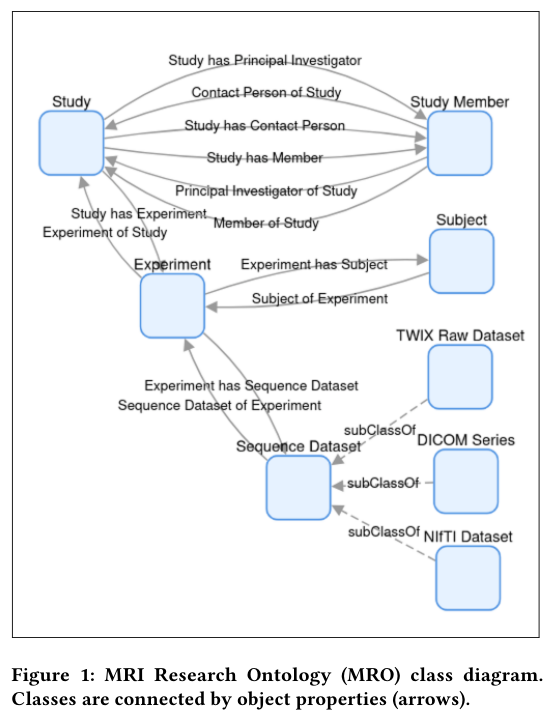
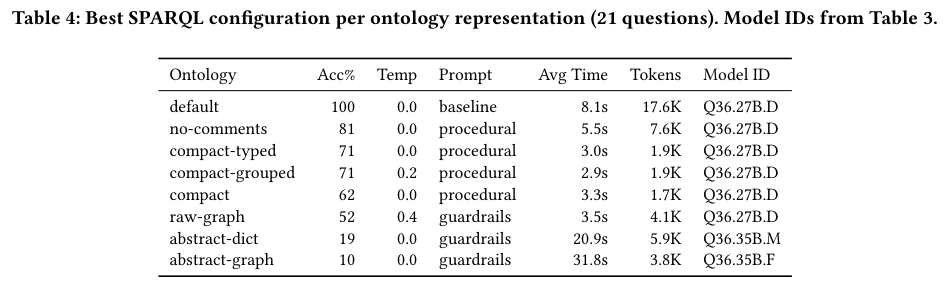
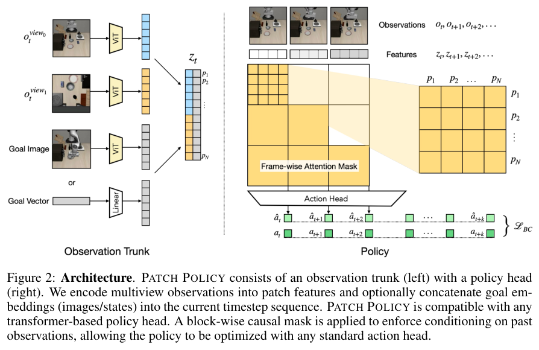
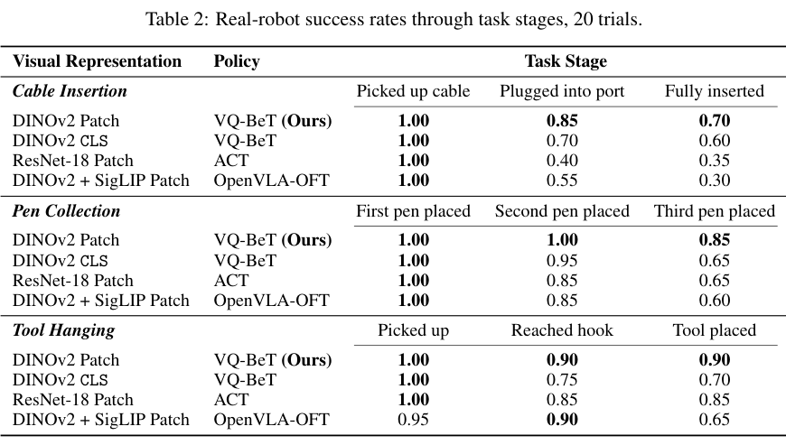
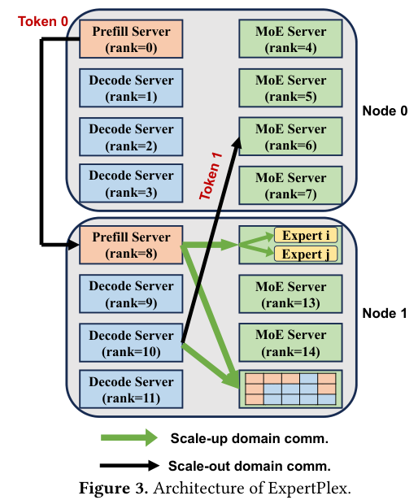
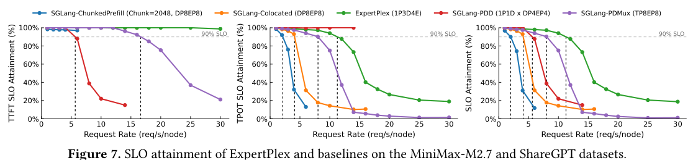

本期六项研究介绍需求驱动本体扩展、领域元数据查询、文字反馈训练、密集视觉策略、专家共享服务与持久对象控制。

## 1. OntoExtend：从能力问题驱动本体扩展

[OntoExtend: A Framework for Requirement-driven and Scalable Ontology Extension with LLMs](https://arxiv.org/abs/2607.17963v1) · v1 提交 2026-07-20 · [全文](https://arxiv.org/html/2607.17963v1) · [PDF](https://arxiv.org/pdf/2607.17963v1)

OntoExtend 以 competency questions（CQ）作为需求入口，用 RAG 找相关本体元素，再生成 Turtle 扩展片段并集成。它面向已有核心的增量扩展，而不是从零列更多概念；每个新增类或关系都应能追溯到明确问题。

实验包含 Onto-DESIDE 四模块合并用例的 20 个 CQ，以及 Bosch 工业本体 19 个 CQ，共 39 个。构造方式是先移除选定类及关联结构，再围绕缺失元素提问；这不等于无约束的新需求全部覆盖。选定 text-embedding-ada-002 检索配置，比较 GPT-5、o1-preview；评估时关闭片段重新索引，使每个 CQ 独立检查，不能将结果视为连续多轮集成无误的证明。

作者报告通过所测功能验证，结构问题较少，但工程师仍发现错误约束、缺 domain/range 等：公共用例总体需中度修改，工业用例通常轻度或无需修改。我的判断是，应把功能测试通过与专家建模审核分开记录，并为候选保留 CQ、来源和审核决定。它适合作为需求驱动草稿助手，不能跳过覆盖不足与逻辑一致性的人工审查。

原文：Anna Sofia Lippolis、Mohammad Javad Saeedizade、Stefan Schmid、Simon Blattner、Robin Keskisärkkä、Aldo Gangemi、Eva Blomqvist、Andrea Giovanni Nuzzolese，arXiv:2607.17963v1，Figure 1，PDF 第 2 页。[原始来源](https://arxiv.org/pdf/2607.17963v1#page=2) · [CC BY 4.0](https://creativecommons.org/licenses/by/4.0/)。裁剪自原文。

## 2. NLKGQ：让可读本体直接支持领域查询

NLKGQ 先用 OWL 表达领域词汇和语义，再把档案元数据导入图谱，让本地模型从自然语言生成 SPARQL。完整本体进入系统提示，不依赖额外微调或检索；语法出错时允许最多两轮反馈修正，查询结果与参考集合比较。

*图｜Fitch, Blake G. 等，[Figure 1（PDF 第 3 页）](https://arxiv.org/pdf/2607.18029v1#page=3)，[CC BY 4.0](http://creativecommons.org/licenses/by/4.0/)。裁剪自原文。*

神经影像档案的二十一道专家问题上，Qwen3.6-27B 最佳配置达到 100%，去掉注释和标签的表示最佳为 81%；抽象图表示只有 10%。各行选择了各自最佳配置，并非严格单变量消融；同一小问题集上反复选配置也限制泛化结论。可读命名很有用，但不能把这一结果变成任意大型本体的查询准确率承诺。

*图｜Fitch, Blake G. 等，[Table 4（PDF 第 8 页）](https://arxiv.org/pdf/2607.18029v1#page=8)，[CC BY 4.0](http://creativecommons.org/licenses/by/4.0/)。裁剪自原文。*

[Natural Language Access to Domain-Specific Metadata: A Reusable Framework for LLM Query Generation](https://arxiv.org/abs/2607.18029v1) · v1。

## 3. LLM-as-a-Coach：让文字反馈参与下一轮训练

Experiential Learning 将开放任务的评分模型改作教练，从当前策略回答中提炼可迁移经验，再把经验作为教师上下文，通过 on-policy context distillation 训练策略。相较只保留一个标量分数，它能表达同分回答之间不同的优缺点。

Qwen3-8B 自身提供反馈时，EL 的 AlpacaEval-v2 胜率为 40.0%，标量 RL 为 37.3%；WildBench 为 21.8 对 18.4。但改用 GPT-4o 反馈后，AlpacaEval 为 37.4%，低于 RL 的 38.2%。表值取表现最好的三个检查点平均，且多项评价仍使用模型裁判；更丰富反馈不保证每个任务改善，也需防止训练和评价的共同偏好。

[LLM-as-a-Coach: Experiential Learning for Non-Verifiable Tasks](https://arxiv.org/abs/2607.18110v1) · v1。

[Figure 1（原文）](https://arxiv.org/pdf/2607.18110v1#page=2)。

## 4. Patch Policy：把密集视觉特征直接交给小策略

Patch Policy 保留冻结视觉编码器的 patch token，以块因果注意力接入 VQ-BeT 或 Diffusion Policy，避免先压成单个全局向量，也不必运行完整大语言骨干。视觉细节与时间顺序在策略内共同保留，冻结特征还能预计算以减少训练成本。

*图｜Zhou, Gaoyue 等，[Figure 2（PDF 第 3 页）](https://arxiv.org/pdf/2607.18236v1#page=3)，[CC BY 4.0](http://creativecommons.org/licenses/by/4.0/)。裁剪自原文。*

三项实机任务各二十次试验中，DINOv2 patch 的完整插线、收笔和挂工具成功率为 0.70、0.85、0.90；同策略的 CLS 特征为 0.60、0.65、0.70。H200 上 VQ-BeT 单次前向为 10.99 ms，OpenVLA-OFT 为 61.71 ms，但更换了整个架构与规模，不能把差异仅归因于 patch。仿真中部分指标是覆盖率或摆放数量，也不能全部称为成功率。

*图｜Zhou, Gaoyue 等，[Table 2（PDF 第 7 页）](https://arxiv.org/pdf/2607.18236v1#page=7)，[CC BY 4.0](http://creativecommons.org/licenses/by/4.0/)。裁剪自原文。*

[Patch Policy: Efficient Embodied Control via Dense Visual Representations](https://arxiv.org/abs/2607.18236v1) · v1。

## 5. ExpertPlex：共享专家权重，分别调度注意力

ExpertPlex 将轻量注意力模块按 prefill、decode 分离，重量级 MoE 专家池共享。自适应持久 kernel 按 tile 调度专家计算，并由注意力端发起数据传输，在避免重复权重的同时减少两阶段通信干扰。

*图｜Wu, Bingyang 等，[Figure 3（PDF 第 4 页）](https://arxiv.org/pdf/2607.18002v1#page=4)，[CC BY-SA 4.0](http://creativecommons.org/licenses/by-sa/4.0/)。裁剪自原文。*

MiniMax-M2.7、ShareGPT 负载下，满足联合首 token 和逐 token 延迟目标的 P90 goodput 为每节点 11.3 请求/秒，是实例级 prefill-decode 分离的 2.01 倍。实验使用八张 H800 的节点，多节点 GLM 对照另按每节点归一化。goodput 只统计达到 SLO 的服务负载，不能当作所有请求的裸吞吐倍数，输入长度和并行布局也影响比较。

*图｜Wu, Bingyang 等，[Figure 7（PDF 第 9 页）](https://arxiv.org/pdf/2607.18002v1#page=9)，[CC BY-SA 4.0](http://creativecommons.org/licenses/by-sa/4.0/)。裁剪自原文。*

[ExpertPlex: A High-Goodput Disaggregated Serving System for MoE LLMs with Adaptive Persistent Kernels](https://arxiv.org/abs/2607.18002v1) · v1。

## 6. POT-VLA：用同一份三维对象状态控制并验收动作

POT-VLA 从 RGB-D 维护带角色的持久三维对象记录，将其转成全身动作专家的 token，并用同一记录检查接触、包含、支撑等几何谓词。动作后重新观察和验证，未满足关系时再重试或规划，减少控制与验收使用不同对象状态的偏差。

Unitree G1 的八类实机任务中，匹配直接 GR00T-N1.7 基线为 39/80 成功，POT-VLA 为 71/80。四任务消融里，仅验证器为 22/40，仅对象 token 为 31/40，两者结合为 34/40。另一 Being-0 对比引用外部论文成绩，不能与本地匹配实验等同；对象跟踪、深度误差和有限任务规模仍限制泛化。

[Closing the Loop in Humanoid VLA: Persistent 3D Object Tokens for Verifiable Loco-Manipulation](https://arxiv.org/abs/2607.18016v1) · v1。

[Figure 1（原文）](https://arxiv.org/pdf/2607.18016v1#page=4)。
