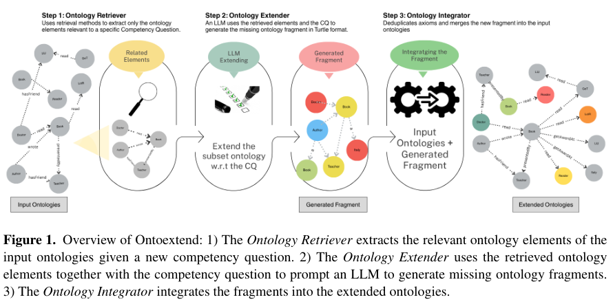

## 重点阅读

[OntoExtend: A Framework for Requirement-driven and Scalable Ontology Extension with LLMs](https://arxiv.org/abs/2607.17963v1) · v1 提交 2026-07-20 · [全文](https://arxiv.org/html/2607.17963v1) · [PDF](https://arxiv.org/pdf/2607.17963v1)

OntoExtend 以 competency questions（CQ）作为需求入口，用 RAG 找相关本体元素，再生成 Turtle 扩展片段并集成。它面向已有核心的增量扩展，而不是从零列更多概念；每个新增类或关系都应能追溯到明确问题。

实验包含 Onto-DESIDE 四模块合并用例的 20 个 CQ，以及 Bosch 工业本体 19 个 CQ，共 39 个。构造方式是先移除选定类及关联结构，再围绕缺失元素提问；这不等于无约束的新需求全部覆盖。选定 text-embedding-ada-002 检索配置，比较 GPT-5、o1-preview；评估时关闭片段重新索引，使每个 CQ 独立检查，不能将结果视为连续多轮集成无误的证明。

作者报告通过所测功能验证，结构问题较少，但工程师仍发现错误约束、缺 domain/range 等：公共用例总体需中度修改，工业用例通常轻度或无需修改。我的判断是，应把功能测试通过与专家建模审核分开记录，并为候选保留 CQ、来源和审核决定。它适合作为需求驱动草稿助手，不能跳过覆盖不足与逻辑一致性的人工审查。

原文：Anna Sofia Lippolis、Mohammad Javad Saeedizade、Stefan Schmid、Simon Blattner、Robin Keskisärkkä、Aldo Gangemi、Eva Blomqvist、Andrea Giovanni Nuzzolese，arXiv:2607.17963v1，Figure 1，PDF 第 2 页。[原始来源](https://arxiv.org/pdf/2607.17963v1#page=2) · [CC BY 4.0](https://creativecommons.org/licenses/by/4.0/)。仅裁剪页面，保留完整原图、图注及必要标签，未重绘或修改内容。该材料沿用 CC BY 4.0，本站页脚许可不为其增加非商业或相同方式共享限制。

## 同期其他论文入口

- [Natural Language Access to Domain-Specific Metadata: A Reusable Framework for LLM Query Generation](https://arxiv.org/abs/2607.18029v1) · 2607.18029v1，该版本提交 2026-07-20。
- [LLM-as-a-Coach: Experiential Learning for Non-Verifiable Tasks](https://arxiv.org/abs/2607.18110v1) · 2607.18110v1，该版本提交 2026-07-20。
- [Patch Policy: Efficient Embodied Control via Dense Visual Representations](https://arxiv.org/abs/2607.18236v1) · 2607.18236v1，该版本提交 2026-07-20。
- [ExpertPlex: A High-Goodput Disaggregated Serving System for MoE LLMs with Adaptive Persistent Kernels](https://arxiv.org/abs/2607.18002v1) · 2607.18002v1，该版本提交 2026-07-20。
- [Closing the Loop in Humanoid VLA: Persistent 3D Object Tokens for Verifiable Loco-Manipulation](https://arxiv.org/abs/2607.18016v1) · 2607.18016v1，该版本提交 2026-07-20。

文中实验结果为论文作者报告，未独立复现。
