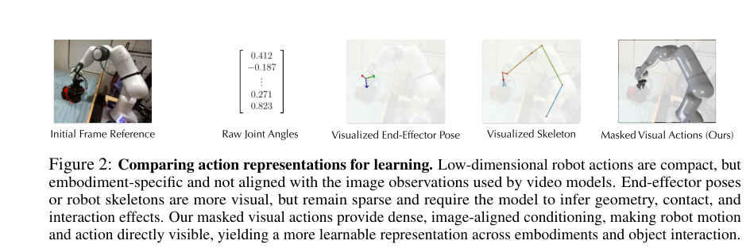
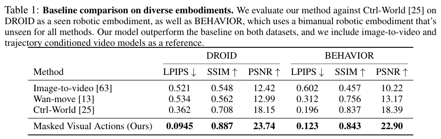
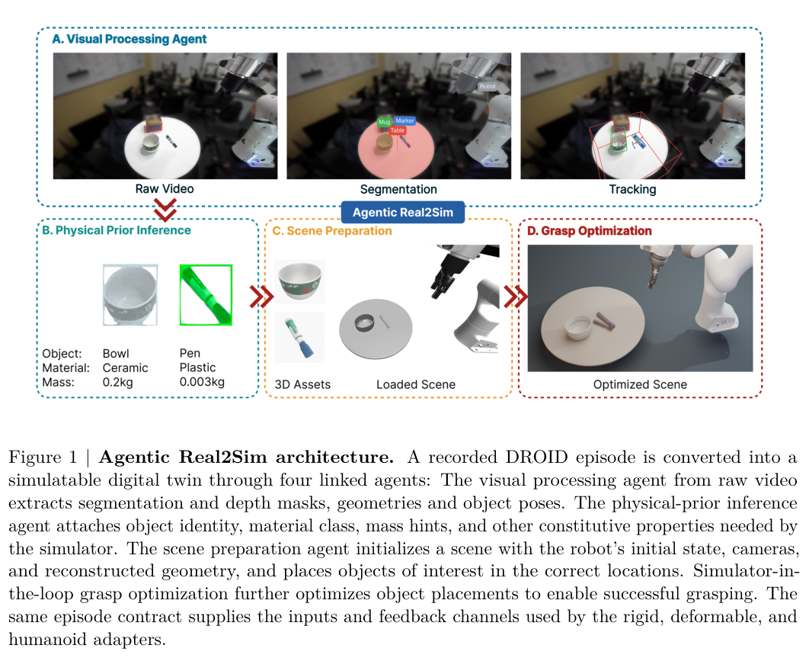
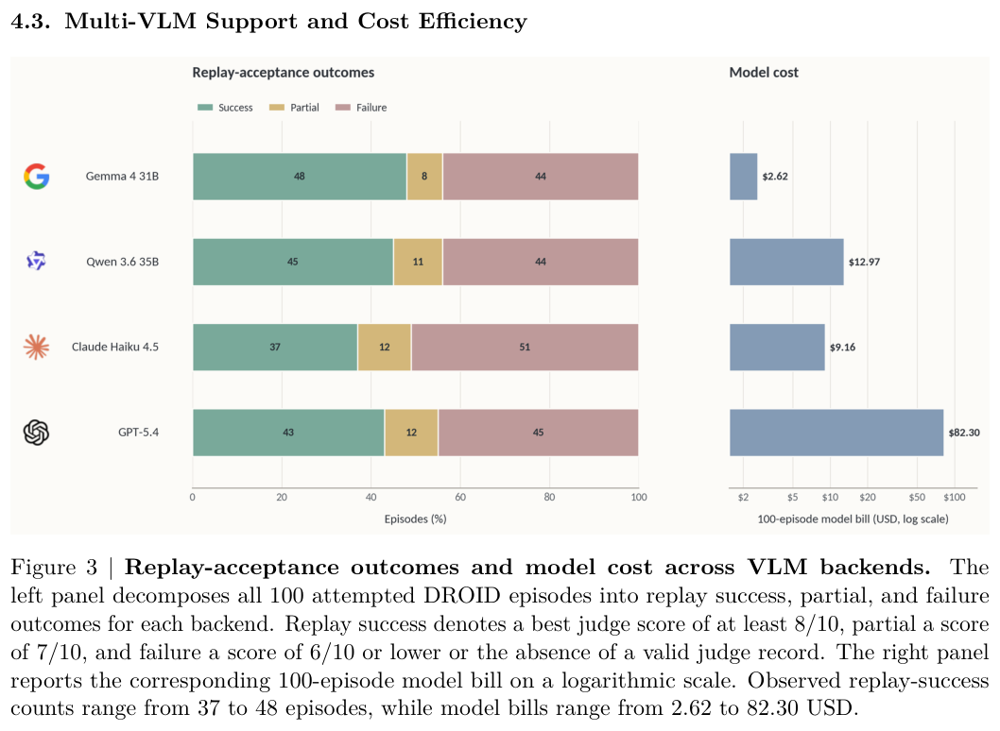
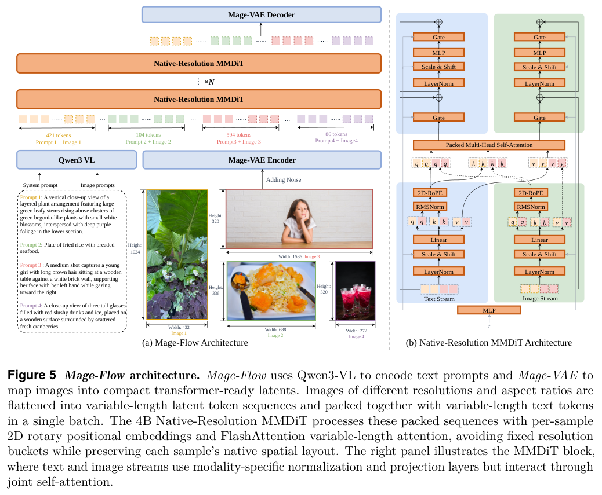
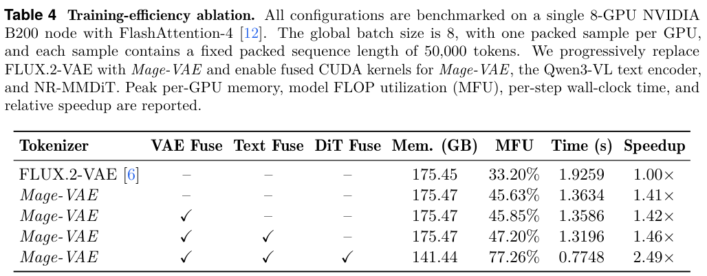

本期五项研究介绍医学本体教材、像素动作接口、自动物理场景转换、原生分辨率生成和桌面交互世界。

## 1. OntoBook：让本体教材与编码器目标对齐

[OntoBook: Ontology-Grounded Synthetic Textbooks for Medical Encoder Pretraining](https://arxiv.org/abs/2607.18927v1) · v1 提交 2026-07-21 · [全文](https://arxiv.org/html/2607.18927v1) · [PDF](https://arxiv.org/pdf/2607.18927v1)

OntoBook 将本体随机游走转成教材式文本，再用同一批数据同时训练 masked language modeling 与代码对关系预测。149M 法语 ModernCamemBERT 是被训练的编码器，Qwen3-235B 用于文本改写；不能将小编码器结果理解成没有大模型参与的数据制造。

作者围绕 CIM-10、CCAM、ATC 三个法国医学本体，发布 130 万篇改写教材与检查点。在 FRACCO、Cantemist-FR、Distemist-FR 编码任务中，相对仅 MLM 的预训练，FRACCO micro-F1 增加 2.5 点、Distemist 增加 8.0 点。论文还报告让不同目标使用不同数据时约 30 点退化；这是特定错位消融，不是任意多任务训练都下降同样幅度。

我的判断是，合成文本的价值取决于保留了哪些可学习关系，而非只看是否流畅。复现应核对本体版本、游走分布、改写模型与任务对齐。结论限定于这些编码基准，医学编码分数不等于临床诊断或治疗能力。

**原图入口：**[Figure 1，PDF 第 1 页](https://arxiv.org/pdf/2607.18927v1#page=1)。

## 2. Masked Visual Actions：用局部可见轨迹表达控制

Masked Visual Actions 把动作表示为像素空间中部分揭示的实体轨迹。揭示机器人运动时，视频模型预测其余场景；揭示期望物体运动时，同一检查点补全相应机器人行为，再由逆动力学恢复动作，以共享视觉接口连接正向和逆向模型。

*图｜Alzayer, Hadi 等，[Figure 2（PDF 第 3 页）](https://arxiv.org/pdf/2607.19343v1#page=3)，[CC BY 4.0](http://creativecommons.org/licenses/by/4.0/)。裁剪自原文。*

用十五小时实机与仿真数据对 Wan-Fun-Control 2.2 14B 做 LoRA 后，DROID 视频 LPIPS 为 0.0945，Ctrl-World 为 0.362；未见双臂形态 BEHAVIOR 为 0.123 对 0.196。视频重建指标不是操作成功率，对照训练数据也不同，Ctrl-World 见过全部 DROID。下游规划与策略评估还依赖轨迹候选和视频—实际执行相关性。

*图｜Alzayer, Hadi 等，[Table 1（PDF 第 6 页）](https://arxiv.org/pdf/2607.19343v1#page=6)，[CC BY 4.0](http://creativecommons.org/licenses/by/4.0/)。裁剪自原文。*

[Masked Visual Actions for Unified World Modeling](https://arxiv.org/abs/2607.19343v1) · v1。

## 3. Agentic Real2Sim：从一次操作录像组装可回放物理场景

Agentic Real2Sim 由视觉语言 Agent 协调分割、几何恢复、姿态跟踪、坐标对齐和物理参数工具，把机器人与对象交互录像转成可执行场景。目标不仅是外观相似，还包括初态、接触和动作轨迹能在物理引擎中回放。

*图｜Chen, Guanxiong 等，[Figure 1（PDF 第 2 页）](https://arxiv.org/pdf/2607.19190v1#page=2)，[CC BY 4.0](http://creativecommons.org/licenses/by/4.0/)。裁剪自原文。*

DROID 随机抽取的一百段录像全部计入分母，Gemma 4 31B 得到四十八成功、八部分成功、四十四失败，模型调用费用共 2.62 美元。成功定义为最佳回放裁判分至少 8/10，不是完整物理参数的真值精度；价格也只覆盖模型调用。其他后端成功数在三十七至四十八之间，低费用与相近分数不证明每类复杂接触都能转换。

*图｜Chen, Guanxiong 等，[Figure 3（PDF 第 8 页）](https://arxiv.org/pdf/2607.19190v1#page=8)，[CC BY 4.0](http://creativecommons.org/licenses/by/4.0/)。裁剪自原文。*

[Agentic Real2Sim: Physics-based World Modeling with Vision-Language Agents](https://arxiv.org/abs/2607.19190v1) · v1。

## 4. Mage-Flow：一起压缩图像生成的 tokenizer 与计算栈

Mage-Flow 用轻量 Mage-VAE 配合原生分辨率 MMDiT，编码和解码以强 VAE 的潜在分布为锚点蒸馏。生成与编辑共享约 4B 骨干，经过强化对齐和少步蒸馏形成 Turbo 版本；算子融合覆盖视觉编码、文本编码和扩散主干。

*图｜Zhang, Xinjie 等，[Figure 5（PDF 第 9 页）](https://arxiv.org/pdf/2607.19064v1#page=9)，[CC BY 4.0](http://creativecommons.org/licenses/by/4.0/)。裁剪自原文。*

八张 B200、固定每样本五万 token 的训练消融中，完整栈将每步从 1.9259 秒降到 0.7748 秒，为 2.49 倍，同时每卡峰值显存从 175.45 GB 降至 141.44 GB。另在单张 A100、1024² 分辨率下，四步 Turbo 生成为 0.59 秒，编辑为 1.02 秒。两个实验硬件和计时对象不同，快速模型的质量也应与完整步数版本分别衡量。

*图｜Zhang, Xinjie 等，[Table 4（PDF 第 15 页）](https://arxiv.org/pdf/2607.19064v1#page=15)，[CC BY 4.0](http://creativecommons.org/licenses/by/4.0/)。裁剪自原文。*

[Mage-Flow: An Efficient Native-Resolution Foundation Model for Image Generation and Editing](https://arxiv.org/abs/2607.19064v1) · v1。

## 5. ABot-World-0：让长时间世界滚动运行在桌面显卡上

ABot-World-0 从游戏、仿真和网络视频学习键盘动作条件世界模型，先将双向教师蒸馏为因果学生，再用 LongForcing 让长学生自滚动接受更长教师监督。参考角色记忆帮助维持外观，运行时结合轻量 VAE、低比特计算和模块调度控制显存。

单张 RTX 5090、batch 1、1280×704 的部署范围报告最高 16 FPS、动作到首帧 1.2 秒、峰值显存不超过 19.3 GiB。这些是多种精度配置形成的运行范围，不是每种配置同时达到的统一工作点；16 FPS 也不是动作响应延迟。长时间滚动样例支持稳定性观察，却不能证明任意长度和任意动作下都无漂移。

[ABot-World-0: Infinite Interactive World Rollout on a Single Desktop GPU](https://arxiv.org/abs/2607.19191v1) · v1。

[Figure 1（原文）](https://arxiv.org/pdf/2607.19191v1#page=1)。
