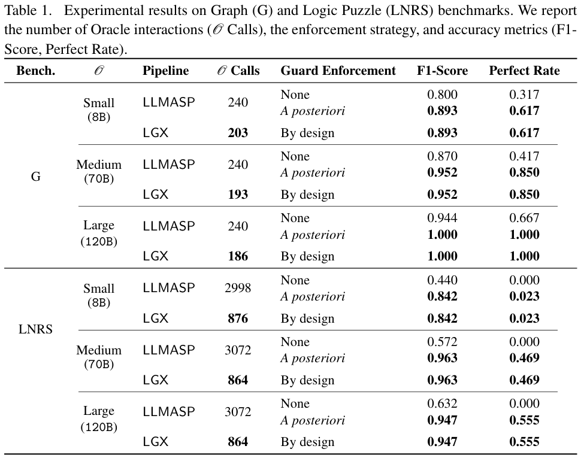
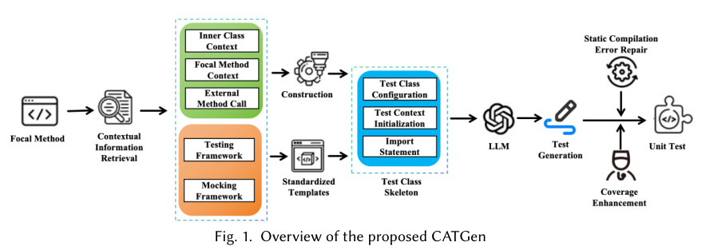
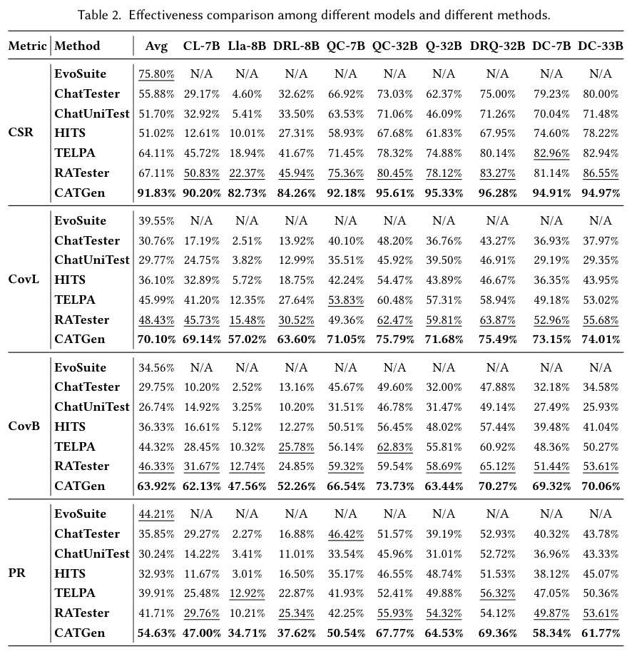

本期六项研究介绍逻辑约束抽取、图谱强化学习、性能优化、人类视频技能、文档注入检测和单元测试生成。

## 1. 逻辑引导抽取：用已有事实减少重复询问

[Logic-Guided Data Extraction with Answer Set Programming and Large Language Models](https://arxiv.org/abs/2607.19365v1) · v1 提交 2026-06-08 · [全文](https://arxiv.org/html/2607.19365v1) · [PDF](https://arxiv.org/pdf/2607.19365v1)

Logic-Guided Data Extraction 让 LLM 提候选事实，ASP 负责验证、推导、冲突检查和下一步控制。当前事实若已排除某个谓词，就不必继续询问；能由逻辑推出的信息也不必重复抽取。缓存利用增量事实集上合取查询的单调性，进一步减少求解器工作。

理论等价性依赖 oracle 与规则等假设，并非证明现实语言模型永不出错。表 1 的 LNRS 构造谜题中，70B 配置从逐项基线 3,072 次 oracle 调用降至 LGX 的 864 次，与事后过滤基线同为 F1=0.963；120B 同样从 3,072 到 864，F1=0.947。图布局基准 G 的收益不同，不能将这组调用节省当作跨任务、跨模型的端到端加速比。

我的判断是，应先把可靠领域约束编成可执行控制知识，再决定询问模型什么。但 ASP 检查的是形式化规则下的候选一致性，不是自然语言事实的真实性；规则来源和抽取证据仍需审核。

原文：Mario Alviano、Lorenzo Grillo、Nicola Leone、Fabrizio Lo Scudo，arXiv:2607.19365v1，Table 1 结果表，PDF 第 12 页。[原始来源](https://arxiv.org/pdf/2607.19365v1#page=12) · [CC BY-SA 4.0](https://creativecommons.org/licenses/by-sa/4.0/)。裁剪自原文。

## 2. 知识图谱怎样帮助 RL：注入方式比“有图”更关键

这项控制实验分别改变 MiniGrid 任务、知识图质量与注入方式，比较状态特征、动作硬掩码和势函数奖励塑形。边数相同但关系打乱的图作为对照，用来判断收益来自可用关系，还是仅仅多了一层特征与奖励。

DoorKey-5x5、三十种子 PPO 中，无图学习曲线 AUC 为 0.39，塑形为 0.65、硬掩码为 0.69；打乱关系后分别降至 0.45、0.34。硬掩码还可能禁掉必要动作，错误图下任务失败。MIMIC-IV 离线病例实验五种子的价值估计差异小于置信区间，未显示明确收益，不能把网格世界结果外推成临床改进。

[The Mechanism Matters: When Knowledge Graphs Help Reinforcement Learning](https://arxiv.org/abs/2607.19616v1) · v1。

[Figure 1（原文）](https://arxiv.org/pdf/2607.19616v1#page=4)。

## 3. PerfAgent：让性能剖析决定下一次代码修改

PerfAgent 将现成编码 Agent 接到 profiler、目标驱动迭代和验证器上，先从调用栈定位真正热点，再持续寻找超过第一版补丁的收益。控制器按变更影响选择测试，并把失败和剖析结果反馈，避免只靠一次计时判断优化是否成立。

GPT-5.1 配置下，达到专家加速水平的正确补丁比例在 GSO 从 19.6% 到 39.2%，SWE-fficiency-Lite 从 26% 到 74%。Opt@1 要求通过正确性检查且加速比达到人工补丁的 0.95；这不是程序运行速度提高同样百分点。实验限定迭代次数、每任务五美元和两百步，隐藏行为回归与基准投机仍需独立检查。

[PerfAgent: Profiler-Guided Iterative Refinement for Repository-Level Code Optimization](https://arxiv.org/abs/2607.19653v1) · v1。

[Figure 1（原文）](https://arxiv.org/pdf/2607.19653v1#page=2)。

## 4. HOST：用人类示范引导既有策略获得新技能

HOST 先估计机器人处于演示任务的哪一阶段，再预测对应的机器人未来观察，最后从观察恢复动作。训练时将机器人轨迹与人类视频对齐到共同任务进度空间，使部署时的单段演示能改变执行过程，而无需为每项新任务更新参数。

五十项未见操作技能中，平均成功率为 62%，每项使用一段人类视频、二十次试验，平均技能获取耗时约二十九秒。该时间建立在已完成的大规模基础训练和跨形态对齐之上，不是从随机模型开始学会操作的总成本。保留旧技能的比较也不同于任意长期连续学习保证，复杂接触和环境扰动仍会造成失败。

[Robots Acquire Manipulation Skills in Seconds from a Single Human Video](https://arxiv.org/abs/2607.20033v1) · v1。

[Figure 1（原文）](https://arxiv.org/pdf/2607.20033v1#page=2)。

## 5. CrackedPDFs：在文本抽取前保留文档结构证据

CrackedPDFs 把隐藏指令文件与同源良性混淆文件配对，检查检测器是否利用了真正的文档可见性差异。混合模型结合 PDF 结构与清理过的文本特征，并按底层文档划分训练和测试，避免同一文档的变体跨集泄漏。

29,322 个合成 PDF 的留出测试含 2,919 份文件，混合检测器 F1 为 0.960，ROC-AUC 为 0.998，在 973 对混淆样本中有 95.9% 将注入文件排得更高。纯文本 TF-IDF 虽得到完美分数，却未通过捷径检查。良好受控分数并不覆盖任意真实 PDF、新隐藏方式、扫描文档或自适应攻击。

[CrackedPDFs: A Controlled Benchmark for Hidden Prompt Injection in PDFs](https://arxiv.org/abs/2607.19396v1) · v1。

[Figure 1（原文）](https://arxiv.org/pdf/2607.19396v1#page=4)。

## 6. CATGen：先固定工程骨架，再生成单元测试

CATGen 先检索构建配置、类和跨文件依赖，确定性构造符合项目框架的测试骨架，再让模型补全测试方法。最后用静态分析修复常见导入、签名和结构问题，而不是每次编译失败都重新请求完整测试类。

*图｜Chen, Junjie 等，[Figure 1（PDF 第 5 页）](https://arxiv.org/pdf/2607.19682v1#page=5)，[CC BY 4.0](http://creativecommons.org/licenses/by/4.0/)。裁剪自原文。*

工业 Java 基准含 183 个目标方法、九种模型配置。CATGen 平均编译成功率 91.83%，RATester 为 67.11%；行覆盖率为 70.10% 对 48.43%，但完整通过率仍只有 54.63%。五次运行先按方法平均，编译、覆盖与通过是不同指标；专有项目的依赖分布和有限断言也限制外部复核与真实缺陷发现结论。

*图｜Chen, Junjie 等，[Table 2（PDF 第 13 页）](https://arxiv.org/pdf/2607.19682v1#page=13)，[CC BY 4.0](http://creativecommons.org/licenses/by/4.0/)。裁剪自原文。*

[Context Matters: Improving the Practical Reliability of LLM-Based Unit Test Generation](https://arxiv.org/abs/2607.19682v1) · v1。
