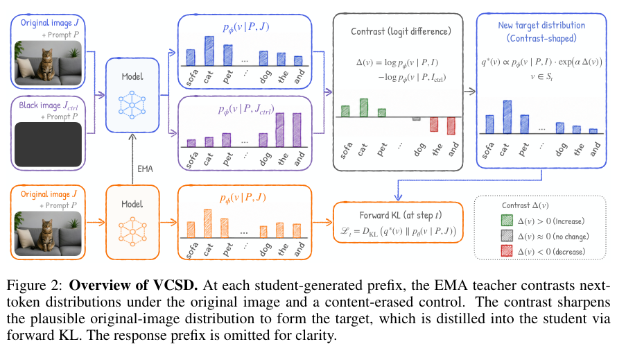
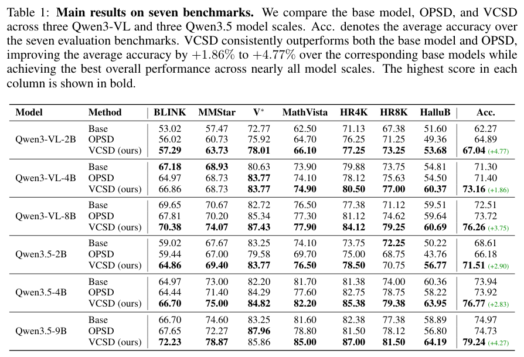
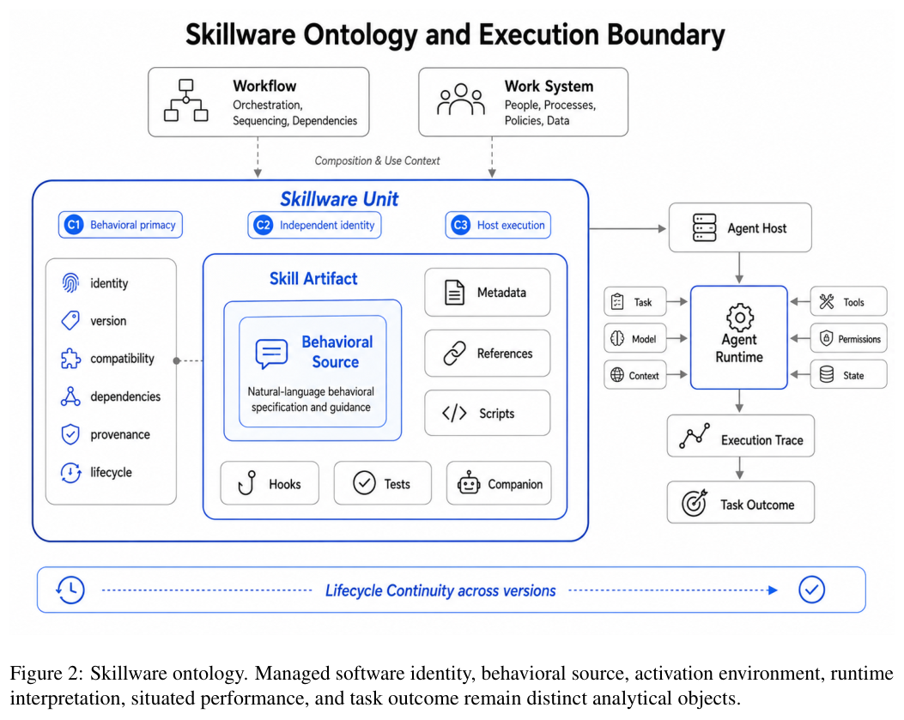
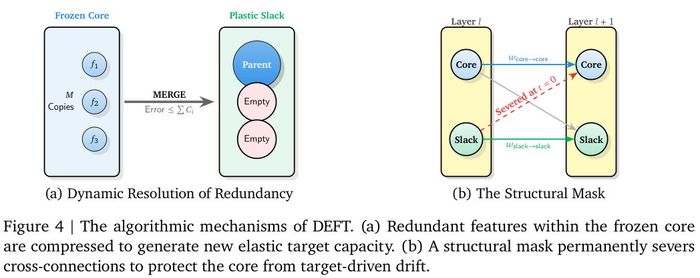
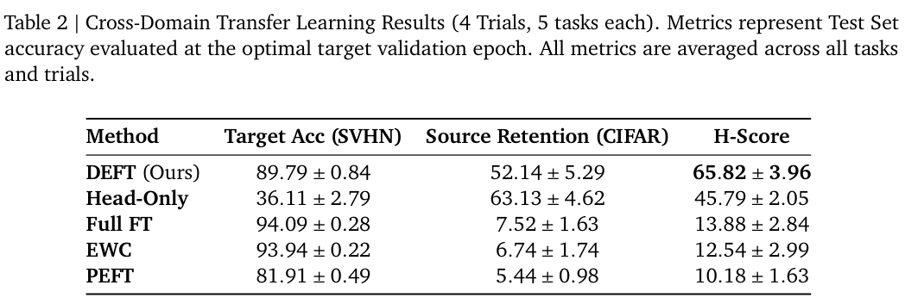

本期六项研究介绍规则本体语义、混合视频注意力、递归研究、视觉自蒸馏、技能软件本体与函数空间压缩。

## 1. 描述逻辑程序：更严格的非循环支持语义

[A New Well-Supported Semantics for Description Logic Programs](https://arxiv.org/abs/2607.21203v1) · v1 提交 2026-07-23 · [全文](https://arxiv.org/html/2607.21203v1) · [PDF](https://arxiv.org/pdf/2607.21203v1)

描述逻辑程序将规则与本体查询连接，但一个答案不能仅靠自己循环支撑。本文提出更严格的 bound 语义，用不动点算子和 reduct 转换刻画非循环支持；总体答案集合受到更严格限制，并识别新旧语义等价的一类受限程序。

复杂度分析假定本体词汇有限、蕴含关系可在多项式时间计算。在此条件下，新语义的一致性问题为 NP-complete，相比既有 well-supported 语义一般情形的 Σ₂ᴾ-complete 更低。改变了接受哪些答案，不能将复杂度类比较宣传为保留所有旧结果的生产推理器加速；NP-complete 也不代表大实例容易。

这是理论研究，没有新模型训练、GPU、吞吐或准确率实验。我的判断是，规则接到本体前，应先明确“支持”的含义以及希望保留、排除哪些结论，再谈快慢。

## 2. SANA-Video 2.0：用周期性 Softmax 更新线性注意力

SANA-Video 2.0 每三层线性注意力搭配一层 Softmax 锚点，再以块级 Attention Residuals 把刷新后的表示传给更深层。5B、14B 从头训练共享混合设计，避免所有长视频 token 对都使用二次注意力，同时用全连接锚点补回交互表达。

5B 的八十一帧 VBench 总分为 84.30，Wan 2.2-A14B 为 84.23，但各方法分数来源和生成协议并不完全一致。720p、六十秒视频的匹配 DiT 单次 forward 比全 Softmax 快 3.2 倍；整栈优化后另一 720p、五秒配置生成耗时 13.06 秒。单次网络计算与整段采样不能互换，kernel、缓存和步数也共同影响实际速度。

[SANA-Video 2.0: Hybrid Linear Attention with Attention Residuals for Efficient Video Generation](https://arxiv.org/abs/2607.21553v1) · v1。

[Figure 1（原文）](https://arxiv.org/pdf/2607.21553v1#page=1)。

## 3. AREX：围绕未满足条件反复开展定向研究

AREX 内循环搜索证据并形成暂定答案，外循环逐条检查约束，再针对未解决部分开展后续研究。自主上下文更新工具保存已支持结论、被否定候选和未完成条件，结合分阶段训练与长程强化学习，减少历史增长导致的信息丢失。

122B 总参数、10B 激活的 AREX-Base 在 BrowseComp 为 82.5，WideSearch-en 为 82.0；只保留内循环且不更新上下文为 59.6，加入上下文更新为 71.4，再加外循环到 82.5。外循环也增加搜索预算，不能把全部差值解释为等成本算法增益；HLE 的 text-only 与完整集分数也不能直接混排。

[AREX: Towards a Recursively Self-Improving Agent for Deep Research](https://arxiv.org/abs/2607.21461v1) · v1。

[Figure 1（原文）](https://arxiv.org/pdf/2607.21461v1#page=1)。

## 4. VCSD：用去掉图像内容的对照形成自蒸馏信号

VCSD 让同一 EMA 教师在相同提示和学生前缀下，分别读取原图和内容擦除图。两种 next-token 分布的对数差突出依赖当前图像的候选，再在合理概率支持范围内调整原图分布并蒸馏，不额外提供答案、推理轨迹或更强教师。

*图｜Liang, Yijun 等，[Figure 2（PDF 第 4 页）](https://arxiv.org/pdf/2607.21556v1#page=4)，[CC BY 4.0](http://creativecommons.org/licenses/by/4.0/)。裁剪自原文。*

七项视觉基准中，Qwen3-VL-2B 的均分为 67.04，普通 OPSD 为 64.89、基础模型为 62.27；8B 为 76.26 对 OPSD 的 73.72。4B 的 BLINK 仍为 66.86，低于基础模型的 67.18。均分改善不是每项能力提升，擦除控制、支持阈值和视觉分布仍决定自生成信号的可靠性。

*图｜Liang, Yijun 等，[Table 1（PDF 第 8 页）](https://arxiv.org/pdf/2607.21556v1#page=8)，[CC BY 4.0](http://creativecommons.org/licenses/by/4.0/)。裁剪自原文。*

[Visual Contrastive Self-Distillation](https://arxiv.org/abs/2607.21556v1) · v1。

## 5. Skillware：把持久技能视为有独立身份的软件

Skillware 将自然语言行为源、可管理软件单元、激活宿主、运行时解释和任务结果区分开。一个技能是否属于这类对象，取决于行为是否为核心、是否有独立软件身份，以及是否能由兼容 Agent Host 激活；更新和回滚的身份连续性另行评价。

*图｜Fan, Haodi 等，[Figure 2（PDF 第 7 页）](https://arxiv.org/pdf/2607.18970v1#page=7)，[CC BY 4.0](http://creativecommons.org/licenses/by/4.0/)。裁剪自原文。*

冻结语料去重后含 138,133 个 SKILL.md，98.73% 有 frontmatter 分隔符，约 23.2% 被词法检测器发现显式资源路径。这说明结构化封装较普遍，不证明元数据有效、依赖真实可解析或技能运行可靠。十五个边界案例和十三个固定版本实现支持分类分析，论文没有用这些计数证明任务成功率提高。

[Skillware: A Software Ontology and Engineering Lifecycle for Persistent Behavioral Artifacts](https://arxiv.org/abs/2607.18970v1) · v1。

## 6. HOPE：用函数空间统一剪枝、合并与整块移除

HOPE 将神经元表示为秩一 Hilbert-Schmidt 算子，以低秩投影度量压缩失真，并比较剪枝、合并与残差块移除。带 BatchNorm 的网络可从已存统计量构造分布近似，其他架构需要少量校准；DEFT 再将可塑参数与保留的核心表示分离。

*图｜Mobahi, Hossein 等，[Figure 4（PDF 第 22 页）](https://arxiv.org/pdf/2607.21366v1#page=22)，[CC BY 4.0](http://creativecommons.org/licenses/by/4.0/)。裁剪自原文。*

CIFAR-100 子任务转 SVHN 的二十个迁移场景中，DEFT 目标准确率为 89.79%，源任务保留为 52.14%；全量微调分别为 94.09%、7.52%。保留旧知识以部分目标成绩为代价，且恢复源头部、源 BN 等评价协议需要一并看。它是小型带 BN 网络的概念验证，压缩度量免数据不代表后续微调免训练或已验证适用于大语言模型。

*图｜Mobahi, Hossein 等，[Table 2（PDF 第 24 页）](https://arxiv.org/pdf/2607.21366v1#page=24)，[CC BY 4.0](http://creativecommons.org/licenses/by/4.0/)。裁剪自原文。*

[Hilbert Operator for Progressive Encoding (HOPE): A Mathematical Framework for Deconstructing Learned Representations in Deep Networks](https://arxiv.org/abs/2607.21366v1) · v1。
