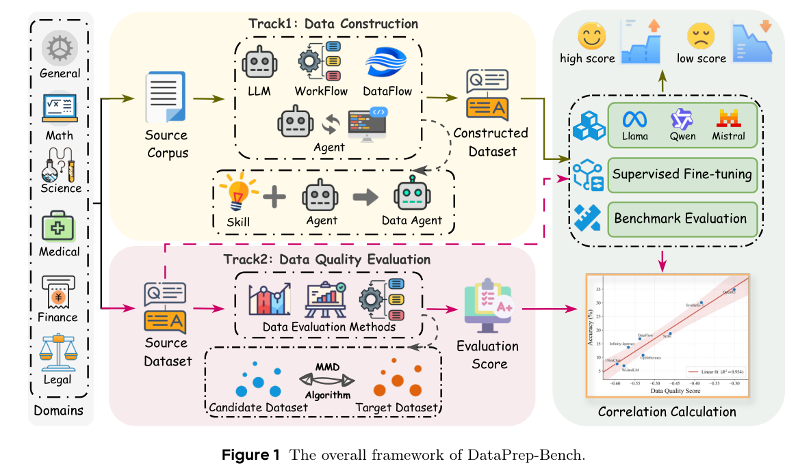

## 重点阅读

[DataPrep-Bench: Benchmarking LLMs as Training Data Preparators](https://arxiv.org/abs/2607.20465v1) · v1 提交 2026-05-19 · [全文](https://arxiv.org/html/2607.20465v1) · [PDF](https://arxiv.org/pdf/2607.20465v1)

DataPrep-Bench 把准备训练数据分成两条轨道：从相同原始材料构造样本，以及在训练前预测候选数据的下游价值。构造数据与 Dolly-15k 联合微调，再用实际任务表现验收；质量评分则在共同候选池上，与真实训练结果计算 Pearson 相关，而不是只评文字好看与否。

基于候选数据与领域代理分布 MMD 的 Distributional Alignment Score，在六领域中的四个取得最强跨模型相关表现，并在 Math、Science、Medical 同时超过 r=0.70。Finance 与 Law 仍是困难领域，不能把高相关当成对任意新数据训练收益的保证。Data-Construction-Skill 在 Llama-3.1-8B Finance 的指定设置相对仅 Dolly 提高近 20 个绝对分数点，也不是全模型平均能力提升 20%。

我的判断是，数据评审应保留一小条真实训练闭环校准代理指标。语言质量、多样性和分布匹配可能各有价值，必须对准具体任务；代理目标、嵌入和候选池改变后，还需重新验证。下图是两轨评测流程，不是其所有方法的性能排名。

原文：Hao Liang、Qifeng Cai、Yibo Lin、Jianzhuo Du、Qifeng Xia、Sizhe Qiu、Linzhuang Sun、Meiyi Qiang、Zhaoyang Han、Xiaochen Ma、Bohan Zeng、Ruichuan An、Conghui He、Wentao Zhang，arXiv:2607.20465v1，Figure 1，PDF 第 4 页。[原始来源](https://arxiv.org/pdf/2607.20465v1#page=4) · [CC BY 4.0](https://creativecommons.org/licenses/by/4.0/)。裁剪自原文。

## 同期其他论文入口

- [OpenForgeRL: Train Harness-native Agents in Any Environment](https://arxiv.org/abs/2607.21557v1) · 2607.21557v1，该版本提交 2026-07-23。
- [Self-Supervised Learning of Structured Dynamics from Videos](https://arxiv.org/abs/2607.21576v1) · 2607.21576v1，该版本提交 2026-07-23。
- [3D-Aware VLMs with Implicit and Explicit Geometries](https://arxiv.org/abs/2607.21595v1) · 2607.21595v1，该版本提交 2026-07-23。
- [Expanding Flow Maps](https://arxiv.org/abs/2607.21585v1) · 2607.21585v1，该版本提交 2026-07-23。
