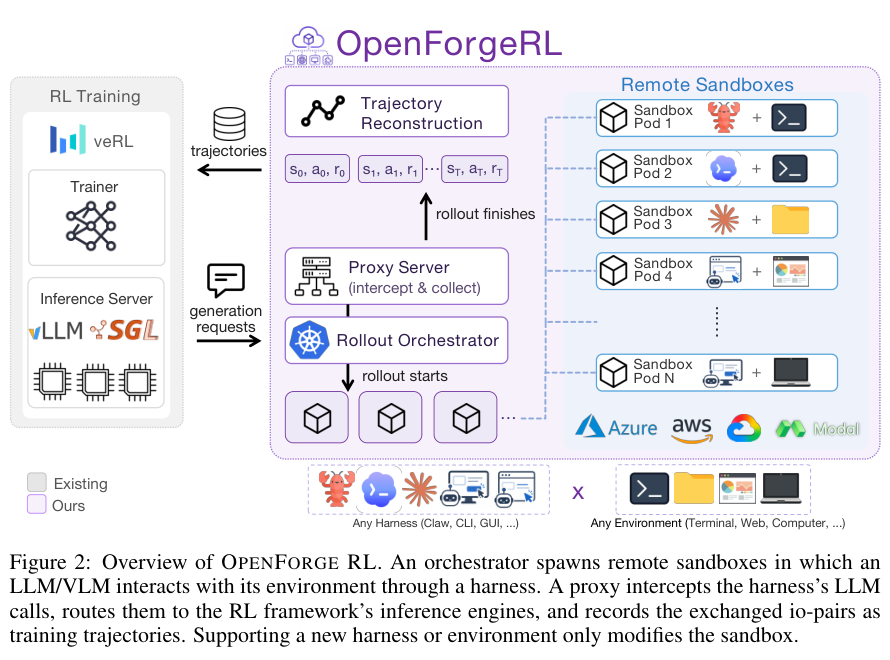
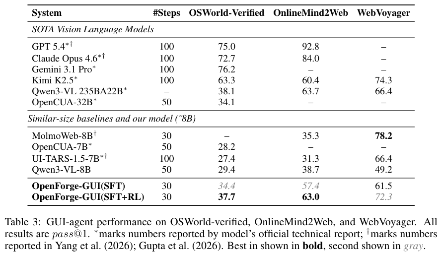

本期五项研究介绍训练数据准备、执行框架内强化学习、结构化视频动态、三维视觉语言模型和可扩展 flow。

## 1. DataPrep-Bench：以真实训练效用检查数据质量

[DataPrep-Bench: Benchmarking LLMs as Training Data Preparators](https://arxiv.org/abs/2607.20465v1) · v1 提交 2026-05-19 · [全文](https://arxiv.org/html/2607.20465v1) · [PDF](https://arxiv.org/pdf/2607.20465v1)

DataPrep-Bench 把准备训练数据分成两条轨道：从相同原始材料构造样本，以及在训练前预测候选数据的下游价值。构造数据与 Dolly-15k 联合微调，再用实际任务表现验收；质量评分则在共同候选池上，与真实训练结果计算 Pearson 相关，而不是只评文字好看与否。

基于候选数据与领域代理分布 MMD 的 Distributional Alignment Score，在六领域中的四个取得最强跨模型相关表现，并在 Math、Science、Medical 同时超过 r=0.70。Finance 与 Law 仍是困难领域，不能把高相关当成对任意新数据训练收益的保证。Data-Construction-Skill 在 Llama-3.1-8B Finance 的指定设置相对仅 Dolly 提高近 20 个绝对分数点，也不是全模型平均能力提升 20%。

我的判断是，数据评审应保留一小条真实训练闭环校准代理指标。语言质量、多样性和分布匹配可能各有价值，必须对准具体任务；代理目标、嵌入和候选池改变后，还需重新验证。

原文：Hao Liang、Qifeng Cai、Yibo Lin、Jianzhuo Du、Qifeng Xia、Sizhe Qiu、Linzhuang Sun、Meiyi Qiang、Zhaoyang Han、Xiaochen Ma、Bohan Zeng、Ruichuan An、Conghui He、Wentao Zhang，arXiv:2607.20465v1，Figure 1，PDF 第 4 页。[原始来源](https://arxiv.org/pdf/2607.20465v1#page=4) · [CC BY 4.0](https://creativecommons.org/licenses/by/4.0/)。裁剪自原文。

## 2. OpenForge RL：在实际执行框架里训练 Agent

OpenForge RL 在执行框架与模型之间放置轻量代理，把模型调用记录转换成训练轨迹，再由容器编排器为每次 rollout 提供独立环境。训练与状态化、多进程执行解耦，使同一 RL 后端能接命令行、工具和视觉界面 Agent，而不必将它们简化成单轮提示。

*图｜Yu, Xiao 等，[Figure 2（PDF 第 4 页）](https://arxiv.org/pdf/2607.21557v1#page=4)，[CC BY 4.0](http://creativecommons.org/licenses/by/4.0/)。裁剪自原文。*

8B GUI 模型从 SFT 到 SFT+RL，OSWorld-Verified 成功率由 34.4% 到 37.7%，WebVoyager 从 61.5% 到 72.3%；使用截图输入与三十步预算。外部模型表值的步数和裁判来源不同，不能当作完全匹配排名。训练环境与网页状态仍影响成绩，论文也指出错误恢复依然薄弱，“任意环境”主要指接口扩展能力。

*图｜Yu, Xiao 等，[Table 3（PDF 第 8 页）](https://arxiv.org/pdf/2607.21557v1#page=8)，[CC BY 4.0](http://creativecommons.org/licenses/by/4.0/)。裁剪自原文。*

[OpenForgeRL: Train Harness-native Agents in Any Environment](https://arxiv.org/abs/2607.21557v1) · v1。

## 3. SDM：从视频变化中拆出主要运动与残差

Structured Dynamics Model 在冻结图像 ViT 特征上预测未来，将变化拆成主要动态与残差动态 token。真实视频提供自监督，合成 Kubric 数据提供弱动态监督；目标是让镜头运动与物体变化更容易分别读取，而不是只压成一个混合向量。

ProbeMotion 中，SDM 的 Kubric 相机运动标准化 MSE 为 0.16，直接平均特征为 0.96；SSv2 动作分类为 23.1%，CLS 为 14.9%。但 CameraBench 为 85.3%，低于 DeltaTok 的 89.6%，静态 DAVIS2017 也未领先。这里衡量线性探针能读出多少运动信息，不是像素生成质量，且弱合成监督不能称为完全无标签训练。

[Self-Supervised Learning of Structured Dynamics from Videos](https://arxiv.org/abs/2607.21576v1) · v1。

[Figure 1（原文）](https://arxiv.org/pdf/2607.21576v1#page=2)。

## 4. VLM-IE3D：让隐式几何与重建属性相互补充

VLM-IE3D 从 RGB 视频提取隐式几何 token，再将重建的三维属性编码为显式 token，以三维感知适配器连接视觉语言主干。推理无需额外点云输入，但仍借助几何模型和训练信号，RGB-only 不等于没有三维先验。

ScanRefer 不做 proposal refinement 时，Acc（阈值 0.25） 为 43.2%，Qwen2.5-VL-3B 为 34.0%；加入 refinement 后是另一组 55.4% 对 50.7%。三维视频检测 F1（阈值 0.25） 从 30.9 到 42.8，同时 H100 处理速度由十四降至六 FPS。准确性与额外重建成本需要一起看，候选框精修也不能与原始定位混成同一个成绩。

[3D-Aware VLMs with Implicit and Explicit Geometries](https://arxiv.org/abs/2607.21595v1) · v1。

[Figure 1（原文）](https://arxiv.org/pdf/2607.21595v1#page=2)。

## 5. Expanding Flow Maps：让生成过程自己增加维度

Expanding Flow Maps 将一步生成拆为扩展与输运：按当前状态补入坐标或 token，再将扩展后的状态推进到后续时间。连续坐标和离散单纯形共享这一构造，固定画布 flow 则是扩展算子不改变状态的特例。

QM9 一万分子、一步生成中，EFM 的 FCD 为 0.44，CFM 为 2.14，唯一率为 97.7% 对 91.8%，有效率为 90.2% 对 90.0%。较低分布距离不等于更高化学活性或更安全；构象实验的原子数量由图给定，不能与分子图实验中学习节点数量视为同一种可变长度能力。

[Expanding Flow Maps](https://arxiv.org/abs/2607.21585v1) · v1。

[Figure 1（原文）](https://arxiv.org/pdf/2607.21585v1#page=2)。
