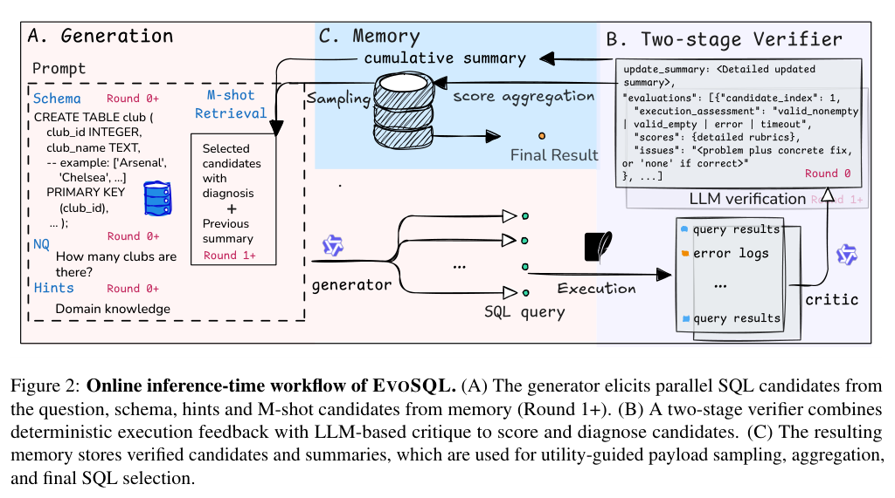
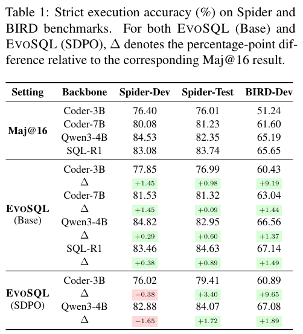
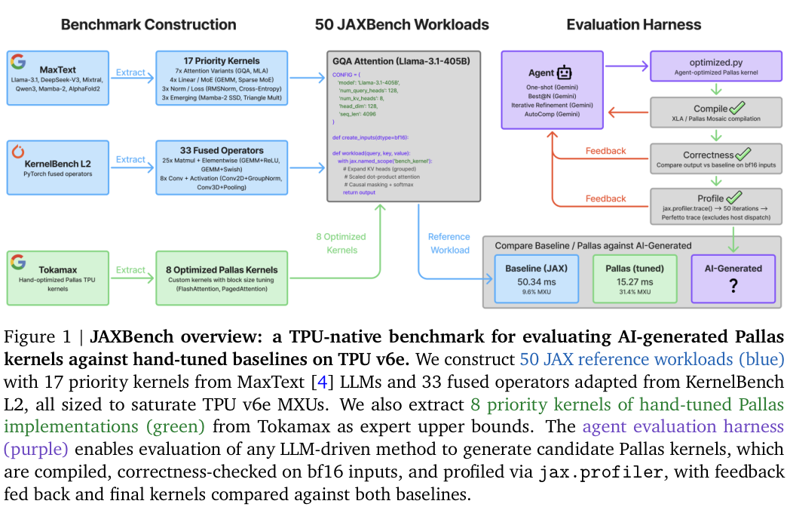
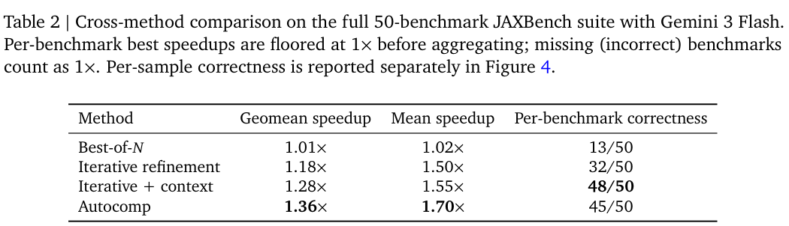
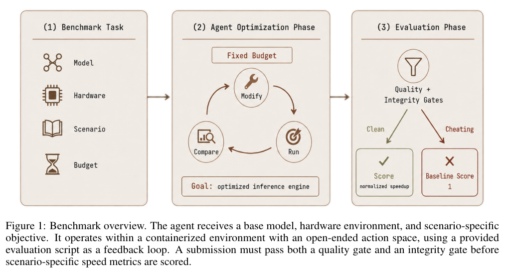
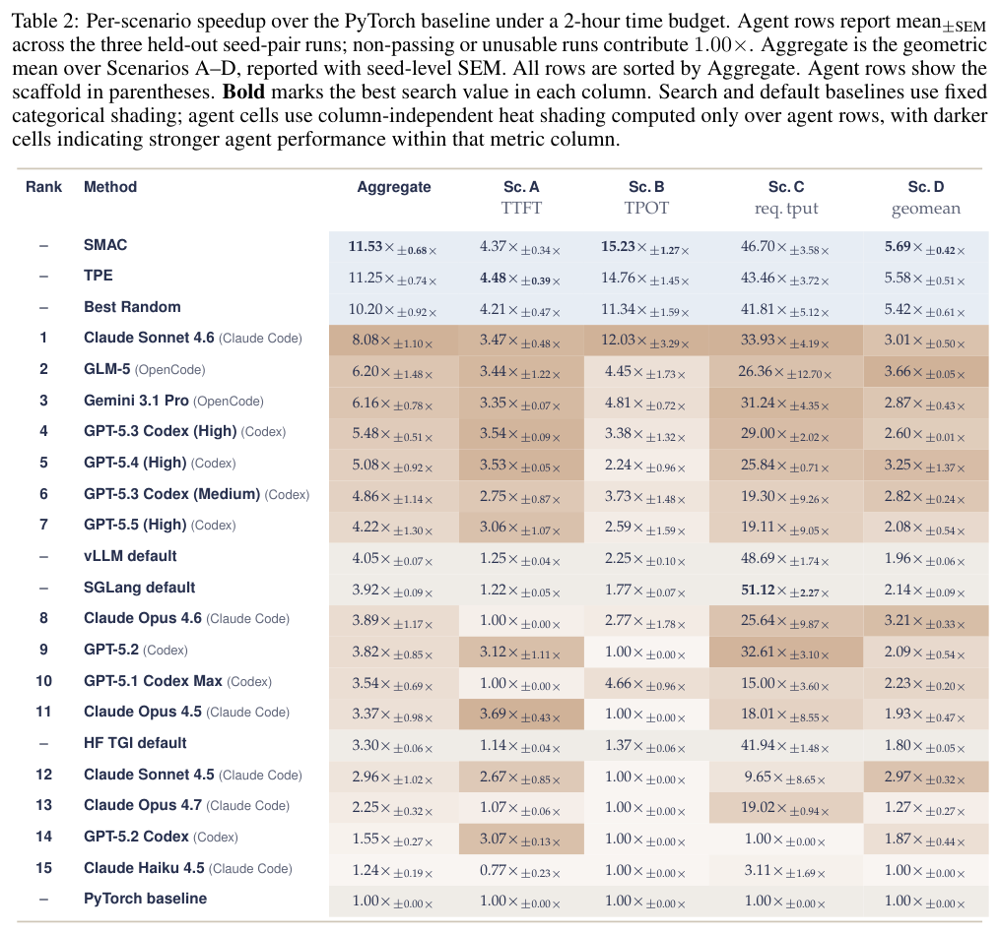
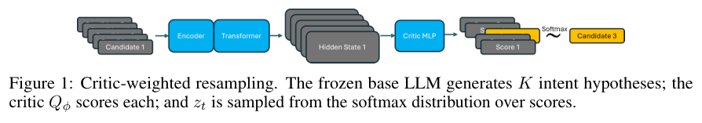
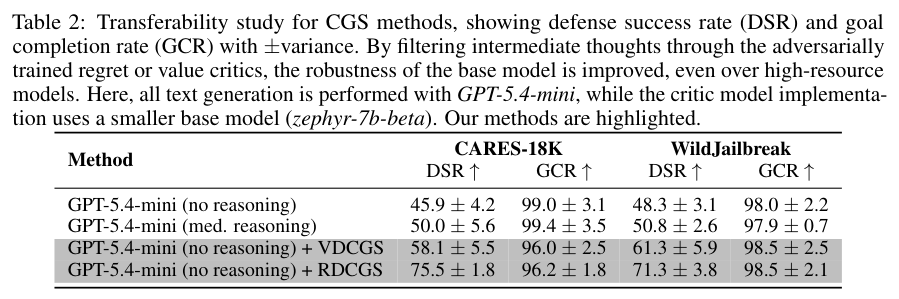

本期六项研究介绍学术图谱检索、SQL 共同演化、TPU 内核、推理服务优化、多轮防御与专用查询程序。

## 1. AISE-Bench：连接学术答案与完整工具调用证据

[AISE-Bench: A Full-Cycle Curated Benchmark for Information Seeking on Academic Knowledge Graphs](https://arxiv.org/abs/2607.20498v1) · v1 提交 2026-06-16 · [全文](https://arxiv.org/html/2607.20498v1) · [PDF](https://arxiv.org/pdf/2607.20498v1)

学术检索可能需要先找作者、查机构、汇总主题，再给出支持结论的来源。AISE-Bench 提供 1,133 个问答对、问题分类、完整 API 执行轨迹、验证参数与带参考链接答案，分别评答案、引用、规划和执行，而非只看最后一句文字。

十四种受评方法里，PLAY2PROMPT 配合 Gemini-3-Pro 的正确性评分为 61.04%、完整性为 60.9%。这是模型裁判的连续质量评分，不是逐题人工确认的二元成功率。作者用人工比较筛选与人类偏好较一致的裁判再汇总，但仍不能消除模型评判偏差。数据含 250 个双重复核和 883 个单次复核样本，也不应混称全部双人审定。

我的判断是，应把每次工具调用与最终声明连起来：参数从何而来、哪个返回值支持哪个句子。API 步骤大致走通，参数填写仍可能出错；基准聚焦特定学术图谱与接口，不能直接外推为所有网页研究助手排名。

**原图入口：**[Figure 1，PDF 第 3 页](https://arxiv.org/pdf/2607.20498v1#page=3)。

## 2. EvoSQL：让候选记忆连接生成与批评

EvoSQL 保存 SQL 候选、执行信号和批评上下文，再按效用聚合记忆，推动生成器与 critic 多轮共同修订。可选的 SDPO 初始化另外用执行反馈训练骨干；推理时的候选演化和模型权重训练是两项不同改动。

*图｜Zhou, Jiawei 等，[Figure 2（PDF 第 3 页）](https://arxiv.org/pdf/2607.20489v1#page=3)，[CC BY 4.0](http://creativecommons.org/licenses/by/4.0/)。裁剪自原文。*

BIRD-Dev 中，Coder-3B 从 Maj@16 的严格执行准确率 51.24% 到基础 EvoSQL 的 60.43%，Qwen3-4B 从 65.19% 到 66.56%。加 SDPO 后后者 BIRD 为 67.08%，但 Spider-Dev 降到 82.88%，低于原 Maj@16 的 84.53%。十六候选预算相同仍有额外 critic 和最多三轮演化开销，不能把候选数匹配当成总成本匹配。

*图｜Zhou, Jiawei 等，[Table 1（PDF 第 7 页）](https://arxiv.org/pdf/2607.20489v1#page=7)，[CC BY 4.0](http://creativecommons.org/licenses/by/4.0/)。裁剪自原文。*

[EvoSQL: Memory-Augmented Critic-Generator Co-Evolution for Text-to-SQL](https://arxiv.org/abs/2607.20489v1) · v1。

## 3. JAXBench：把 TPU 专有知识与搜索策略分开评价

JAXBench 包含十七项生产模型算子和三十三项由 KernelBench 转换的 JAX 工作负载，以 TPU v6e、Pallas 和 XLA 为优化环境。它同时记录生成样本正确率、每任务是否存在正确内核，以及相对 XLA 的加速，避免只展示最佳个例。

*图｜Tschand, Arya 等，[Figure 1（PDF 第 2 页）](https://arxiv.org/pdf/2607.20466v1#page=2)，[CC BY 4.0](http://creativecommons.org/licenses/by/4.0/)。裁剪自原文。*

Gemini 3 Flash 的一百四十四样本预算中，加入 TPU 文档的迭代方法得到 48/50 项正确内核，几何平均加速 1.28 倍；Autocomp 为 45/50 项、1.36 倍。聚合时错误或缺失任务按 1 倍、低于基线的最佳值也截到 1 倍，因此这不是每次生成的平均性能。更多正确样本与更强优化也未必由同一搜索策略实现。

*图｜Tschand, Arya 等，[Table 2（PDF 第 8 页）](https://arxiv.org/pdf/2607.20466v1#page=8)，[CC BY 4.0](http://creativecommons.org/licenses/by/4.0/)。裁剪自原文。*

[JAXBench: Benchmarking Autonomous TPU Kernel Optimization](https://arxiv.org/abs/2607.20466v1) · v1。

## 4. InferenceBench：能找到优化配置，还要能交付它

InferenceBench 给 Agent 一张 H100、目标模型和两小时，让其交付通过质量与完整性门槛的推理服务。四类场景分别偏重 prefill、decode、并发吞吐及联合目标，允许开放工具和实现选择，测试实际推理工程能力。

*图｜Yeon, Jehyeok 等，[Figure 1（PDF 第 1 页）](https://arxiv.org/pdf/2607.20468v1#page=1)，[CC BY 4.0](http://creativecommons.org/licenses/by/4.0/)。裁剪自原文。*

Mistral-7B-Instruct-v0.3 的四场景几何平均中，Sonnet 4.6 Agent 为朴素 PyTorch 的 8.08 倍，默认 vLLM 为 4.05 倍，同预算 SMAC 配置搜索为 11.53 倍。180 次 Agent 运行中仅 117 次同时通过两项门槛；失败按 1 倍计入。单项吞吐可能超过 Agent，综合领先默认服务不代表每项指标都更好，最终可用提交也比开发过程的峰值重要。

*图｜Yeon, Jehyeok 等，[Table 2（PDF 第 5 页）](https://arxiv.org/pdf/2607.20468v1#page=5)，[CC BY 4.0](http://creativecommons.org/licenses/by/4.0/)。裁剪自原文。*

[InferenceBench: A Benchmark for Open-Ended LLM Inference Optimization by AI Agents](https://arxiv.org/abs/2607.20468v1) · v1。

## 5. Robust Critics：根据整个对话重新选择回答

Dialogue Critic Guided Sampling 根据历史对话估计潜在意图，用价值或 regret critic 给候选回答重加权。它尝试同时减少有害响应与良性请求误拒，而不是只看当前一句是否带敏感词；小型 critic 也可帮助冻结的较大生成模型。

*图｜Belaire, Roman 等，[Figure 1（PDF 第 4 页）](https://arxiv.org/pdf/2607.20472v1#page=4)，[CC BY 4.0](http://creativecommons.org/licenses/by/4.0/)。裁剪自原文。*

GPT-5.4-mini 无 reasoning 的 CARES-18K 防御成功率从 45.9% 到 RDCGS 的 75.5%，良性目标完成率则从 99.0% 降到 96.2%。WildJailbreak 对应防御从 48.3% 到 71.3%。结果来自模拟多轮对话，防御与效用仍有权衡；理论重加权性质依赖定义好的回报和 critic，不能保证每次对真实用户意图都判断正确。

*图｜Belaire, Roman 等，[Table 2（PDF 第 9 页）](https://arxiv.org/pdf/2607.20472v1#page=9)，[CC BY 4.0](http://creativecommons.org/licenses/by/4.0/)。裁剪自原文。*

[Robust Critics: Defending LLMs Against Multi-Turn Attacks](https://arxiv.org/abs/2607.20472v1) · v1。

## 6. GenDB：为固定数据与查询模板生成专用执行程序

GenDB 由工作负载分析、存储设计、查询规划、代码生成和优化 Agent 分工，为具体数据与硬件生成可执行程序。它以传统数据库结果和 fuzz 测试检查候选，将一次性的生成成本分摊到重复模板查询；临时查询可继续交给常规数据库。

TPC-H SF10 的五条代表查询热运行总计 249 ms，DuckDB 为 596 ms、Umbra 为 660 ms；SEC-EDGAR 为 403 ms，DuckDB 为 1,549 ms。实验缓存完整数据库，排除了离线生成与优化成本，因此不能视为即时任意 SQL 的端到端加速。有限测试也没有给出通用语义正确性保证。

[Demonstrating GenDB: Instance-Optimized and Customized Query Processing Code Generation via LLM Agents](https://arxiv.org/abs/2607.20630v1) · v1。

[Figure 1（原文）](https://arxiv.org/pdf/2607.20630v1#page=2)。
