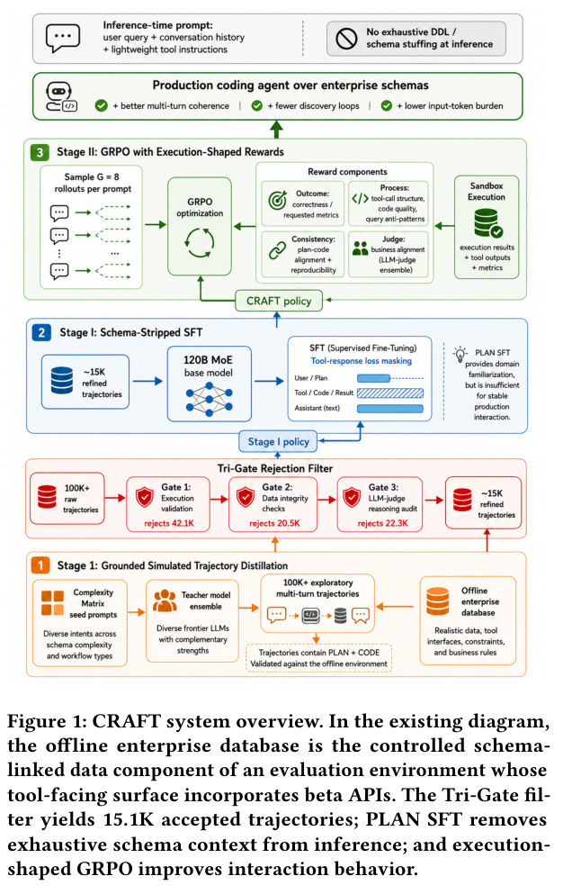

## 从提示负担到后训练目标

CRAFT 面向把分析请求转成专有 API 和指标代码的企业 Agent。先用 Tri-Gate 过滤验证执行、数据完整性和推理轨迹，再以去掉完整 schema 提示的 PLAN 监督微调学习计划与行为，之后通过执行结果塑造强化学习奖励。

## 数字必须连同部署阶段阅读

论文是广告分析的计划上线、部署前评测，工具表面包含 beta API，覆盖 25 个 schema 关联核心实体与 30 个工作流。相对固定的 schema-stuffed 基线，综合 Agent Score 增加 9.6 个百分点，一致性增加 4.1 点，多轮连贯性增加 4.2 点，输入 token 负担约降为九分之一。

这些是专有环境中的作者报告。Table 1 说明绝对运营分数与业务 schema 保密，因此只给差值或比值；不能把综合分数改称通用任务准确率，也不能据此宣称已证明生产部署可靠。

## 我的判断

稳定 schema 可以进入模型能力，但变更仍需要版本化和回归测试。应分别测计划、代码和执行恢复，并检查奖励是否偏好容易完成的分析。它是企业工具调用研究，不是完整 RDF/OWL 或 OBDA 系统。

## 原论文视觉证据

图源：Aakash Kolekar , Sahika Genc , Shahriar Shariat , Bunyamin Sisman , Tibor Mezi , Barbara Poblete , Shree Vandana Kachroo , Calvin Chi , Parth Parmar , Ari Singer , Prayaas Jain , Cindy Barker , Benoit Dumoulin，《CRAFT: Learn the Schema, Execute the Plan》，arXiv:2607.22642v1，Figure 1，PDF 第 2 页。[原图出处](https://arxiv.org/pdf/2607.22642v1#page=2) · [CC BY 4.0](https://creativecommons.org/licenses/by/4.0/)。裁剪自原文。

## 论文来源

- [CRAFT: Learn the Schema, Execute the Plan](https://arxiv.org/abs/2607.22642v1) · v1，公开于 2026-06-24。

## 同日阅读目录

- [CRAFT: Learn the Schema, Execute the Plan](https://arxiv.org/abs/2607.22642v1) · v1，2026-06-24。
- [Kimi K3: Open Frontier Intelligence](https://arxiv.org/abs/2607.24653v1) · v1，2026-07-27。
- [Data Pyramid for Embodied Manipulation](https://arxiv.org/abs/2607.24744v1) · v1，2026-07-27。
- [τ: Learning Touch-Augmented Vision-Language-Action Models from Future Visual Supervision](https://arxiv.org/abs/2607.24485v1) · v1，2026-07-27。
- [The Physics of Multi-Turn Long-Horizon Planning: From Pre-training to Post-training via Single- and Multi-Teacher On-Policy Agentic Distillation](https://arxiv.org/abs/2607.24720v1) · v1，2026-07-27。
- [ContainmentBench: Trace-Based Evaluation of Post-Injection Containment in Tool-Using LLM Agents](https://arxiv.org/abs/2607.23999v1) · v1，2026-07-27。
