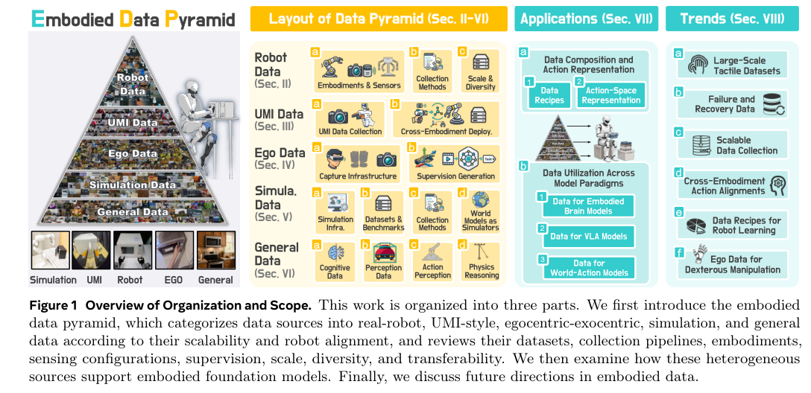
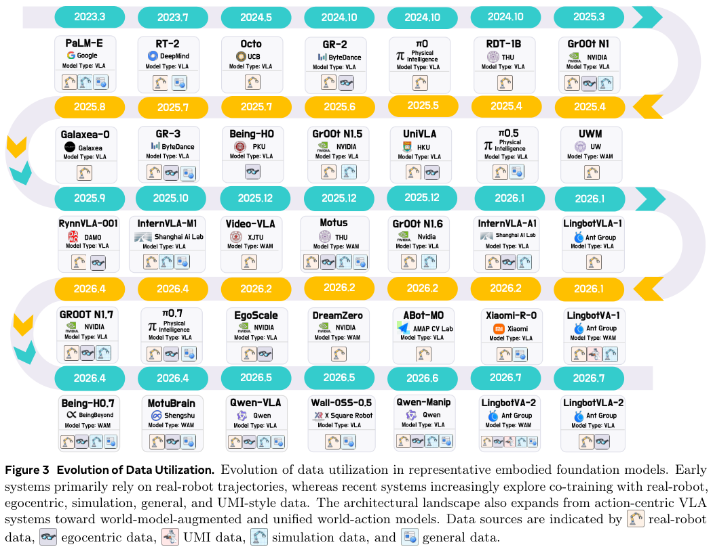

本期六项研究介绍分析 Agent 训练、多模态大模型、机器人数据综述、触觉预测、长程规划与执行防御。

## 1. CRAFT：把轨迹质量检查接到 Agent 训练

CRAFT 面向把分析请求转成专有 API 和指标代码的企业 Agent。先用 Tri-Gate 过滤验证执行、数据完整性和推理轨迹，再以去掉完整 schema 提示的 PLAN 监督微调学习计划与行为，之后通过执行结果塑造强化学习奖励。

论文是广告分析的计划上线、部署前评测，工具表面包含 beta API，覆盖 25 个 schema 关联核心实体与 30 个工作流。相对固定的 schema-stuffed 基线，综合 Agent Score 增加 9.6 个百分点，一致性增加 4.1 点，多轮连贯性增加 4.2 点，输入 token 负担约降为九分之一。

这些是专有环境中的作者报告。Table 1 说明绝对运营分数与业务 schema 保密，因此只给差值或比值；不能把综合分数改称通用任务准确率，也不能据此宣称已证明生产部署可靠。

稳定 schema 可以进入模型能力，但变更仍需要版本化和回归测试。应分别测计划、代码和执行恢复，并检查奖励是否偏好容易完成的分析。它是企业工具调用研究，不是完整 RDF/OWL 或 OBDA 系统。

图源：Aakash Kolekar , Sahika Genc , Shahriar Shariat , Bunyamin Sisman , Tibor Mezi , Barbara Poblete , Shree Vandana Kachroo , Calvin Chi , Parth Parmar , Ari Singer , Prayaas Jain , Cindy Barker , Benoit Dumoulin，《CRAFT: Learn the Schema, Execute the Plan》，arXiv:2607.22642v1，Figure 1，PDF 第 2 页。[原图出处](https://arxiv.org/pdf/2607.22642v1#page=2) · [CC BY 4.0](https://creativecommons.org/licenses/by/4.0/)。裁剪自原文。

- [CRAFT: Learn the Schema, Execute the Plan](https://arxiv.org/abs/2607.22642v1) · v1，公开于 2026-06-24。

## 2. Kimi K3：用混合注意力与潜在专家扩展多模态模型

Kimi K3 将 KDA 线性注意力与 MLA 混合，以 Attention Residuals 连接深层网络，并用低维潜在空间中的专家计算控制 MoE 成本。模型从训练开始联合处理图像和文字，而不是在语言主干训练完后才接入视觉编码器。

报告中的模型共有 2.78T 参数、每 token 激活 104.2B 参数，九十三层中包含六十九层 KDA 和二十四层 MLA，训练上下文为 1M。Figure 7 的拟合曲线给出相对 Kimi K2 约 2.5 倍的 scaling efficiency：这是验证损失与训练 FLOPs 的关系，不是推理速度提高 2.5 倍。激活规模也明显增加，部署成本不能只看总参数利用率。

[Kimi K3: Open Frontier Intelligence](https://arxiv.org/abs/2607.24653v1) · v1。

[Figure 1（原文）](https://arxiv.org/pdf/2607.24653v1#page=1)。

## 3. Data Pyramid：机器人数据如何在规模与动作对齐之间取舍

这篇综述将机器人学习数据分为真机、UMI、人类第一或第三视角视频、仿真以及通用视觉语言数据，按采集规模与机器人动作对齐程度组织成金字塔。不同来源分别提供精确控制、交互经验、语义和几何覆盖，数据混合应围绕学习目标设计。

*图｜Ye, Yifan 等，[Figure 1（PDF 第 1 页）](https://arxiv.org/pdf/2607.24744v1#page=1)，[CC BY 4.0](http://creativecommons.org/licenses/by/4.0/)。裁剪自原文。*

论文比较各类数据的质量、多样性、可复用性和保真度，并梳理它们在分层控制、VLA 与世界动作模型中的使用方式；它不是在同一实验中证明某个固定混合比例最优。触觉、失败恢复、跨本体动作对齐和混合比例规律仍是开放问题，数据小时数本身不能代表有效控制信息。

*图｜Ye, Yifan 等，[Figure 3（PDF 第 6 页）](https://arxiv.org/pdf/2607.24744v1#page=6)，[CC BY 4.0](http://creativecommons.org/licenses/by/4.0/)。裁剪自原文。*

[Data Pyramid for Embodied Manipulation](https://arxiv.org/abs/2607.24744v1) · v1。

## 4. τ：用触觉变化预测未来视觉表征

τ 在动作条件下联合编码时空触觉，用 JEPA 式目标预测未来视觉潜变量，让接触信息参与策略学习。预测分支用于训练，执行阶段仍需要触觉传感器；减少图像生成开销与取消触觉硬件是两回事。

四项 TacAura 接触任务中，单腕部视角配置平均成功率为 71.25%，适配后的 ForceVLA 为 30.0%；双视角配置反而为 57.50%。腕部配置的 USB 任务在原设置为 40%，新物体平均降到 30%，干扰环境平均为 22.5%。触觉预测有助于这些任务，但视角组合与场景变化仍会影响表现。

[{\tau}: Learning Touch-Augmented Vision-Language-Action Models from Future Visual Supervision](https://arxiv.org/abs/2607.24485v1) · v1。

[Figure 1（原文）](https://arxiv.org/pdf/2607.24485v1#page=2)。

## 5. 长程规划的物理学：规划数据需要包含状态转移

研究在炼金、种植和装配等合成环境里建立分层技能图，把真实状态转移写入规划思维链，再分别改变数据格式、质量与任务长度。后训练还比较单教师与多教师 on-policy distillation，观察规划模式与环境知识能否共同迁移。

Table 1 中，包含全部短程和中程数据但不含长程数据的配置，长程 Pass@8 为 2.71%；加入长程子集的 5% 后为 11.46%。这不是“总数据只增加 5%”，也不是单次成功率。实验说明长程样本与状态转移结构值得保留，但三个可控合成环境不能代替现实物理规划验证。

[The Physics of Multi-Turn Long-Horizon Planning: From Pre-training to Post-training via Single- and Multi-Teacher On-Policy Agentic Distillation](https://arxiv.org/abs/2607.24720v1) · v1。

[Figure 1（原文）](https://arxiv.org/pdf/2607.24720v1#page=3)。

## 6. Containment：同一个安全终点可能来自不同执行路径

这项研究在合成工具环境里比较污点追踪、意图账本和工具边界防御，既记录最终是否提交违规操作，也检查任务效用与执行轨迹。它将污染后的信息、用户授权与工具执行边界分开表示，避免只按最后一个安全标签评价防御。

Qwen2.5-7B 的 17,640 条 rollout 中，每种防御各有六百项活跃污染测试；仅统计授权任务完成时，污点方案为 16.42%，意图账本为 85.67%，工具边界为 92.33%。部分方案虽同样没有观察到已提交违规行为，轨迹和任务效用仍大幅不同。结果依赖合成威胁模型及正确的授权账本，有限样本的零违规不等于风险为零。

[ContainmentBench: Trace-Based Evaluation of Post-Injection Containment in Tool-Using LLM Agents](https://arxiv.org/abs/2607.23999v1) · v1。

[Figure 1（原文）](https://arxiv.org/pdf/2607.23999v1#page=6)。
