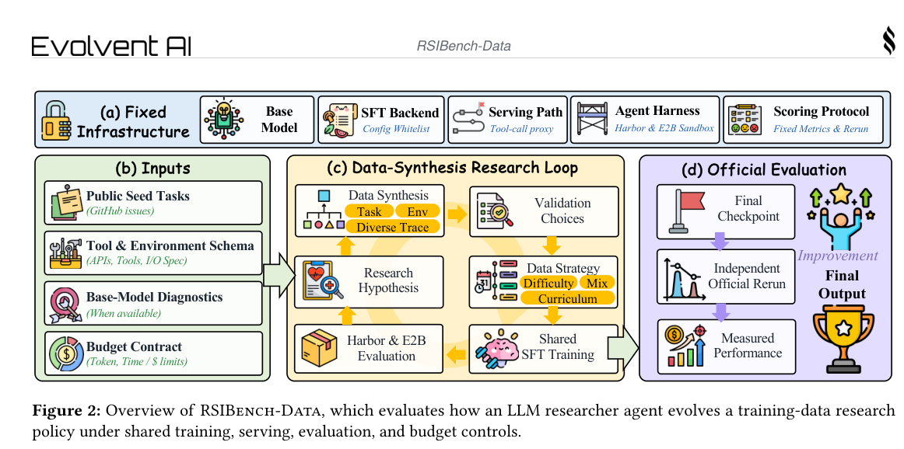
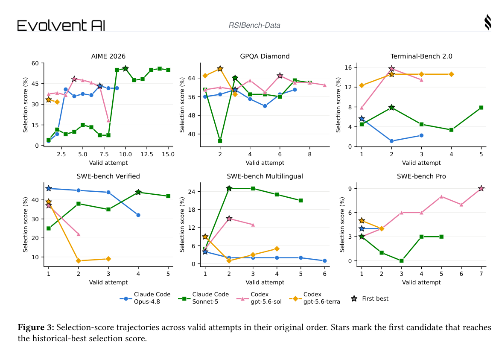
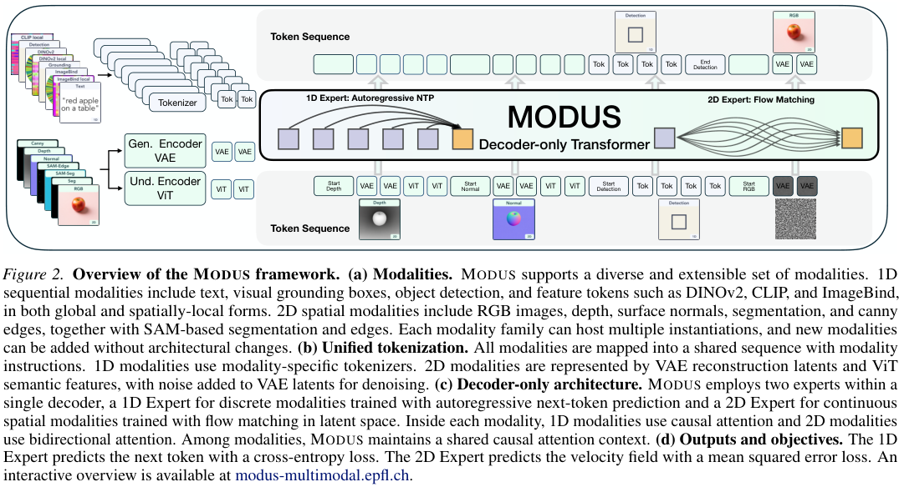
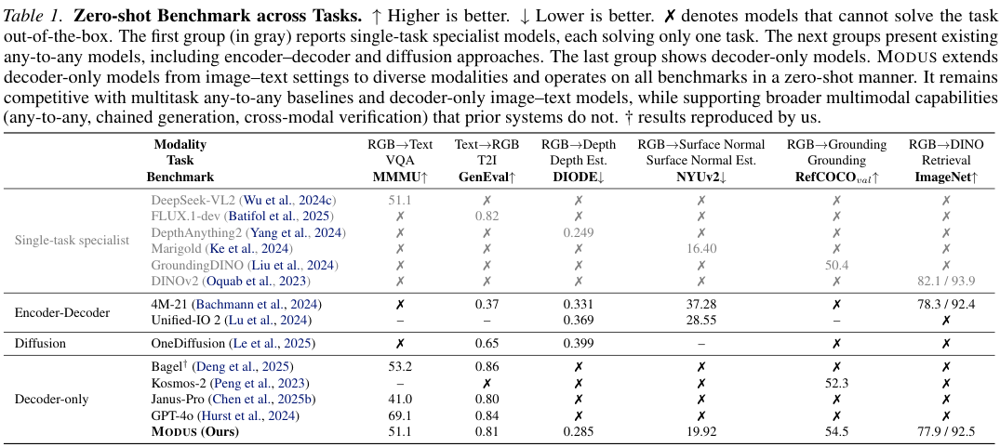
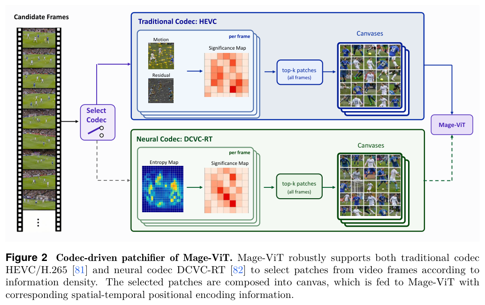
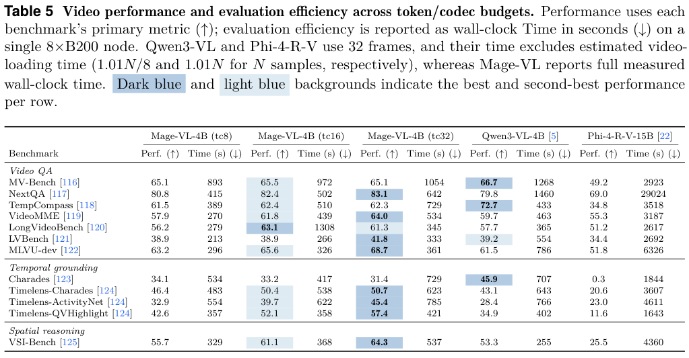

本期六项研究介绍法律概念化、相机控制世界模型、数据研究反馈、任意模态生成、人类操作演示与流式视频理解。

## 1. 法国法律概念化：格式与类型约束不等于语义正确

[LLM-Assisted Ontology Engineering and Construction of a French Legal Knowledge Graph](https://arxiv.org/abs/2607.24551v1) · v1 提交 2026-07-27 · [全文](https://arxiv.org/html/2607.24551v1) · [PDF](https://arxiv.org/pdf/2607.24551v1)

这项法国维护法规案例先在分层样本开放抽取概念和关系，合并近义标签并诱导属性 domain/range，再用本体约束全语料抽取。结构化输出只解决格式，未必解决已知谓词该连接哪些类。

GPT-4.1 与 mistral-large-2512 采用相同提示协议、温度 0；类引导实体抽取与关系发现分别使用 4k、10k token 上下文。表 3 所列设置 JSON 有效率均为 100%，类覆盖接近 100%；Mistral 的精确关系签名符合率从未合并的 49.86% 到合并后 72.61%，OpenAI 设置为 56.94% 到 61.03%。引入未见属性的三元组均少于 20%，不少不符合来自已知谓词的新类组合。

我的判断是，实体和谓词规范化应与签名审核一起做。新组合可能是错误，也可能暴露本体缺项，不能全部丢弃或全部接纳。原文发现类型错误会传播、过度合并可能掩盖法律语义差异。

**原图入口：**[Table 3，PDF 第 4 页](https://arxiv.org/pdf/2607.24551v1#page=4)。

## 2. Wonder：把相机控制、长时记忆与蒸馏一起设计

Wonder 用稠密坐标场的渲染结果提供相机运动条件，使控制信号与图像位置对齐；稀疏注意力从长历史中检索相关 token，再用改进的自强迫蒸馏保留控制与记忆能力。输入可以是图片，也可以是已有视频，支持交互式观察和重新拍摄动态场景。

图生视频评测中，五项 VBench 指标的平均分为 0.8558，相机平移和旋转 RPE 分别为 0.0132、0.0784；不同对照中各自最好的对应误差是 0.0174、0.1155。后两项来自轨迹重建和对齐，不是三维真实场景误差。作者展示分钟级、16 FPS 生成，但个别时间质量指标仍由其他方法领先。

[Wonder: Video World Model Done Better](https://arxiv.org/abs/2607.26037v1) · v1。

[Figure 1（原文）](https://arxiv.org/pdf/2607.26037v1#page=3)。

## 3. RSIBench-Data：把数据研究能力与训练系统能力分开

RSIBench-Data 固定目标模型、训练服务、评测接口和预算，让四个研究 Agent 在六项编程、终端、科学与数学基准上修改训练数据策略。训练与服务交给 Tinker，执行评测使用 Harbor 和 E2B，比较重点落在如何根据反馈选择下一批数据。

*图｜Meng, Fanqing 等，[Figure 2（PDF 第 5 页）](https://arxiv.org/pdf/2607.25886v1#page=5)，[CC BY 4.0](http://creativecommons.org/licenses/by/4.0/)。裁剪自原文。*

二十四种设置中有十四种的最佳候选超过第一次有效尝试；在达到峰值后仍继续搜索的二十三种设置中，十八种最后一次尝试低于峰值。该统计针对候选序列，保留历史最佳的最终提交可以避免这类回退。目标模型为 Qwen3.5-35B-A3B-Base，结论是迭代研究有时有效，但更多反馈并不保证单调改善。

*图｜Meng, Fanqing 等，[Figure 3（PDF 第 9 页）](https://arxiv.org/pdf/2607.25886v1#page=9)，[CC BY 4.0](http://creativecommons.org/licenses/by/4.0/)。裁剪自原文。*

[RSIBench-Data: Benchmarking Data-Centric Research for Recursive Self-Improvement](https://arxiv.org/abs/2607.25886v1) · v1。

## 4. MODUS：让各种模态在 decoder-only 模型中对等生成

MODUS 把图像、文本、深度、法线与视觉特征放进统一 decoder-only 网络，使任意模态既能作条件也能作输出。模型可通过中间模态串联生成，或用自己生成的定位与问答信号筛选图像，而无需为每个任务分别建立专用系统。

*图｜Ye, Mingqiao 等，[Figure 2（PDF 第 4 页）](https://arxiv.org/pdf/2607.25948v1#page=4)，[CC BY 4.0](http://creativecommons.org/licenses/by/4.0/)。裁剪自原文。*

零样本表中，MODUS 的 MMMU 为 51.1、GenEval 为 0.81、RefCOCO 验证分数为 54.5；深度和法线指标仍落后于相应专用模型。生成四张候选再用 VQA 与 grounding 自验证，GenEval 从 0.81 到 0.84，代价是多次生成与验证。广泛接口能力与每个任务都最优并不等价。

*图｜Ye, Mingqiao 等，[Table 1（PDF 第 8 页）](https://arxiv.org/pdf/2607.25948v1#page=8)，[CC BY 4.0](http://creativecommons.org/licenses/by/4.0/)。裁剪自原文。*

[MODUS: Decoder-Only Any-to-Any Modeling of Diverse Modalities](https://arxiv.org/abs/2607.25948v1) · v1。

## 5. HiFi-UMI：提高人类演示精度，减少真机后训练依赖

HiFi-UMI 结合头戴双目惯性 SLAM、原生双手相对位姿、微秒级硬件同步及宽视场手部相机，在局部工作区获得约 3 mm 末端精度。采集过程不依赖机器人，处理后的轨迹可直接映射到策略动作空间，再用仿真重放检查质量。

在三个策略骨干上，仅用 HiFi-UMI 做后训练，相比域内遥操作数据的成功率差分别为 −2.5、+3.1、−0.6 个百分点；这不排除骨干预训练用过机器人数据。另一个实验用四千小时预训练，在十个未见任务上将动作误差降低 41%。公开 HiFi-UMI-2K 为两千小时子集，与完整采集量和实验训练量应分别计算。

[HiFi-UMI: Learning Deployable Manipulation Policies from High-Fidelity UMI Data Alone](https://arxiv.org/abs/2607.25895v1) · v1。

[Figure 1（原文）](https://arxiv.org/pdf/2607.25895v1#page=2)。

## 6. Mage-VL：沿视频编码器的运动信息选择视觉 token

Mage-VL 用 I 帧、P 帧中的运动矢量与残差能量选择 16×16 图像块，以 Mage-ViT 编码变化密集区域；轻量事件门控判断何时唤起因果语言解码器。它利用视频编码已有的冗余结构，把预算留给时间变化与空间关系。

*图｜Yang, Senqiao 等，[Figure 2（PDF 第 5 页）](https://arxiv.org/pdf/2607.24904v1#page=5)，[CC BY 4.0](http://creativecommons.org/licenses/by/4.0/)。裁剪自原文。*

单个八张 B200 节点的 NExT-QA 评测中，tc8 配置用 415 秒、准确率 80.8%，Qwen3-VL-4B 为 1,460 秒、79.8%。这是整套基准的评测耗时，不是单条请求延迟；对照扣除了估算视频读取时间，而 Mage-VL 记录完整耗时。MV-Bench 和带字幕 VideoMME 也有落后结果，不能将约 3.5 倍个例当成所有任务的加速。

*图｜Yang, Senqiao 等，[Table 5（PDF 第 20 页）](https://arxiv.org/pdf/2607.24904v1#page=20)，[CC BY 4.0](http://creativecommons.org/licenses/by/4.0/)。裁剪自原文。*

[Mage-VL: An Efficient Codec-Native Streaming Multimodal Foundation Model](https://arxiv.org/abs/2607.24904v1) · v1。
