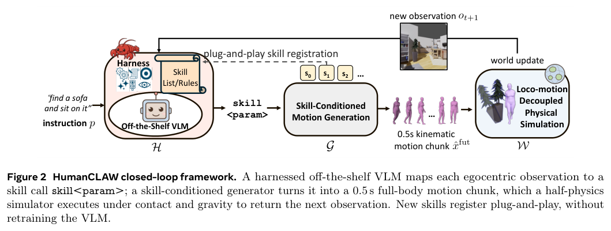
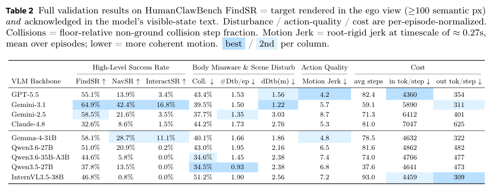
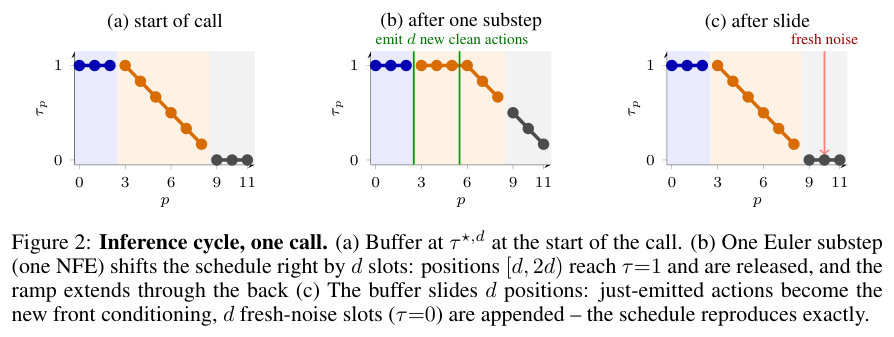
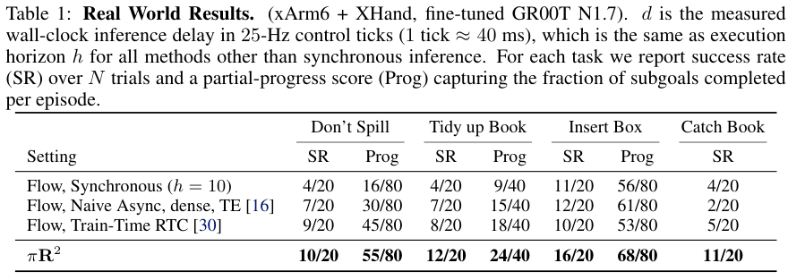

本期五项研究介绍弱到强蒸馏、持久执行记忆、轻量动作模型、人体行动评测与实时 flow 策略。

## 1. W2S-OPD：让弱模型差异提供蒸馏信号

[Weak-to-Strong On-Policy Distillation](https://arxiv.org/abs/2607.26246v1) · v1 提交 2026-07-28 · [全文](https://arxiv.org/html/2607.26246v1) · [PDF](https://arxiv.org/pdf/2607.26246v1)

W2S-OPD 从两个较弱模型的 logit 差异提取能力方向，将其加到学生基础模型形成代理教师，再在学生自身 rollout 上做逐 token reverse KL 蒸馏。它不是直接复制弱模型，而是使用变化方向；对照可来自强化学习前后、不同规模基础模型或正确与错误提示。

Qwen3 系列实验覆盖四个数学、三个代码基准。pre-RL/post-RL 条件的正模型为经 GRPO 的 Qwen3-4B 专家，负模型为训练前初始化；单教师设置相对 OPD 的数学与代码平均相对改善为 11.4%、3.7%。这些不是百分点；数学超过领域教师也不意味着所有能力都全面胜出。不同规模基础模型的对照不额外训练教师，但学生蒸馏仍需计算。

我的判断是，将能力变化与教师原始分布分开很值得研究。复现仍须核查 tokenizer、logit 对齐、训练预算和任务分布；各类对照并不等价，当前结果不能自动推广到长程交互或所有领域知识，更不能称为免费提升。

**原图入口：**[Figure 1，PDF 第 1 页](https://arxiv.org/pdf/2607.26246v1#page=1)。

## 2. Living-Harness：让执行失败修订未来的工作流程

Living-Harness 将结束后的轨迹与评估信号写成两类程序知识：情节记忆保存触发条件与恢复方法，状态图保存节点、修复边与转移规则。领域级 Evolution-SOP 约束更新范围；基础工具和上下文固定，后续交互检索这些知识而非更新模型权重。

GPT-5.2 medium 设置的任务数加权 Pass@1，在 τ²-Bench 为 83.09%，Reflexion 为 73.02%；MultiWOZ-2.4 为 65.50%，ReasoningBank 为 55.59%。这些是两个不同最强交互基线，不能拼成同一方法的统一增幅。逐周期表也出现局部退化，例如 Airline 从第二轮的 88% 到第三轮的 86%，记忆演化并不保证每个领域持续上升。

[Living-Harness Is an Interactive-Agent Evolver](https://arxiv.org/abs/2607.26598v1) · v1。

[Figure 1（原文）](https://arxiv.org/pdf/2607.26598v1#page=1)。

## 3. TurboVLA：让视觉与语言直接共同决定动作

TurboVLA 分别编码图像和指令，通过轻量双向交互形成任务条件表示，再由紧凑解码器输出连续动作块。它绕过以大语言模型为中央接口的视觉到语言再到动作路径，将更多计算集中在视觉与控制连接。

LIBERO 中，DINOv3 ViT-B 配置共 0.2B 参数，平均成功率 97.7%；单张 RTX 4090、batch 1 的动作块推理延迟为 31.2 ms、显存 0.9 GB。RoboTwin 2.0 的另一配置为 0.4B、43.4 ms、60.2% 成功率，不能与前一配置混用。约 32 Hz 指策略调用频率，仍不能替代真实机器人任务可靠性。

[TurboVLA: Real-Time Vision-Language-Action Model at 32 Hz on an RTX 4090 with <1 GB VRAM](https://arxiv.org/abs/2607.27205v1) · v1。

[Figure 1（原文）](https://arxiv.org/pdf/2607.27205v1#page=1)。

## 4. HumanCLAW：把动作决策失误与低层运动失误分开

HumanCLAW 让冻结 VLM 选择原子技能，由可控人体运动生成器将命令实现为连续全身动作，并在有重力和碰撞的仿真中执行。基准包含四十一个室内场景、一千二百一十八项第一视角寻找、导航与交互任务，用稳定技能接口检查身体位置和行动决策。

*图｜Li, Siyao 等，[Figure 2（PDF 第 3 页）](https://arxiv.org/pdf/2607.27180v1#page=3)，[CC BY 4.0](http://creativecommons.org/licenses/by/4.0/)。裁剪自原文。*

九个 VLM 中，Gemini-3.1 的目标发现率为 64.9%、导航成功率 42.4%，最终交互成功率仅 16.8%。因此识别目标后，接近并完成交互仍是明显瓶颈。低碰撞或低物体扰动也可能来自不行动；这些指标应与完成率一起看。该框架隔离部分运动误差，并非消除所有仿真与控制假设。

*图｜Li, Siyao 等，[Table 2（PDF 第 12 页）](https://arxiv.org/pdf/2607.27180v1#page=12)，[CC BY 4.0](http://creativecommons.org/licenses/by/4.0/)。裁剪自原文。*

[HumanCLAW: Can Vision-Language Models Act Through a Body?](https://arxiv.org/abs/2607.27180v1) · v1。

## 5. πR²：在动作块内部也利用新到达的身体状态

πR² 将本体感知设为每个控制时刻更新的快速通道，将视觉语言特征放入异步慢通道，再以延迟自适应 flow 调度逐次完成去噪。已经开始执行的动作作为条件保留，从而在不重新运行整个大骨干的情况下调整后续动作。

*图｜Park, Sungjae 等，[Figure 2（PDF 第 5 页）](https://arxiv.org/pdf/2607.26055v1#page=5)，[CC BY 4.0](http://creativecommons.org/licenses/by/4.0/)。裁剪自原文。*

xArm6 与 XHand 上微调 GR00T-N1.7、使用 A5000 时，系统约以 25 Hz 重规划，本体感知延迟通常一个四十毫秒控制周期。四项真机任务各二十次试验，Catch Book 为 11/20，对照 Train-Time RTC 为 5/20；Insert Box 为 16/20 对 10/20。这是两个任务各三十个百分点的差异，小样本与特定传感配置仍限制外推，视觉通道也并非每四十毫秒更新。

*图｜Park, Sungjae 等，[Table 1（PDF 第 8 页）](https://arxiv.org/pdf/2607.26055v1#page=8)，[CC BY 4.0](http://creativecommons.org/licenses/by/4.0/)。裁剪自原文。*

[$\pi\mathbf{R}^2$: Reactive Real-time Flow Policies](https://arxiv.org/abs/2607.26055v1) · v1。
