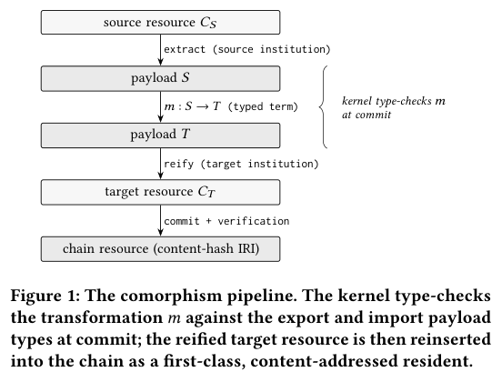
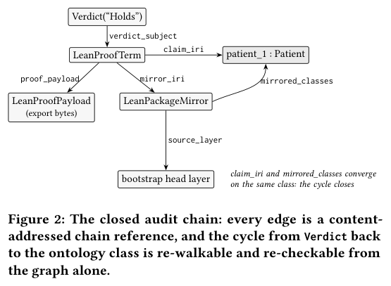
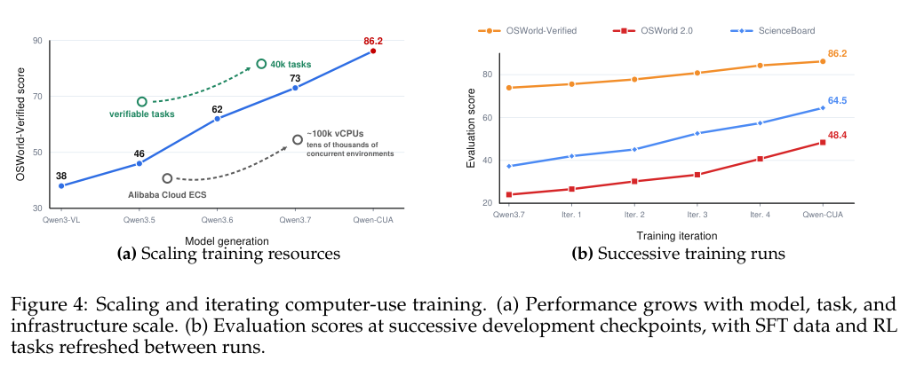
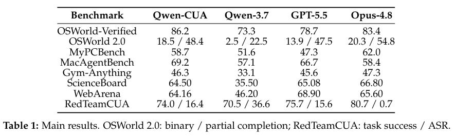
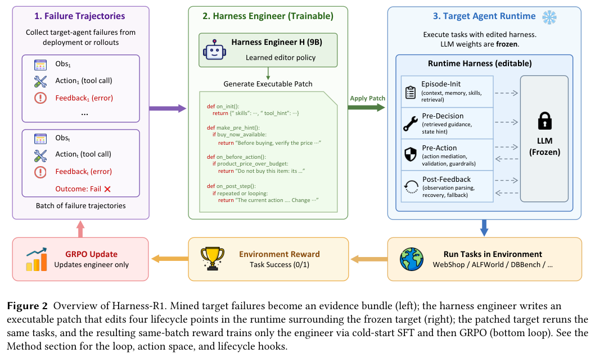
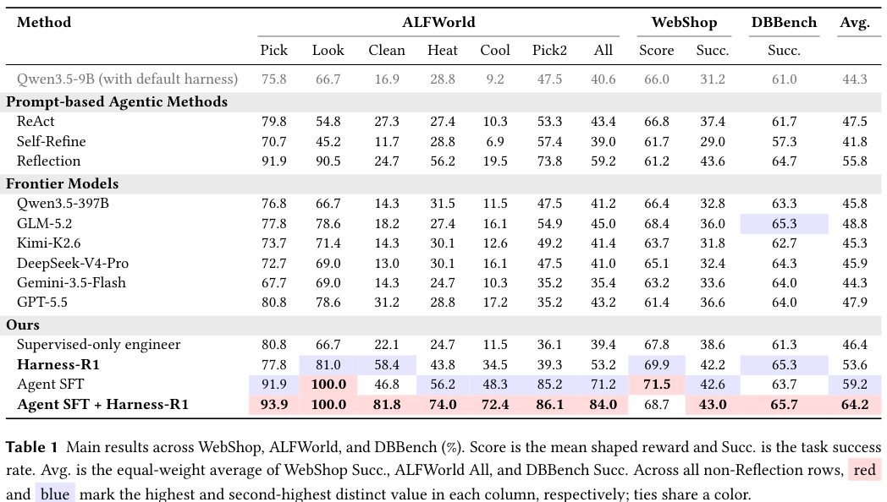

本期七项研究介绍类型化知识图谱、本体查询重写、轻量动作头、机器人数据合成、任务状态审计、电脑操作与执行框架学习。

## 1. Eigenius：把证据状态作为数据库提交条件

Eigenius 将依赖类型、内容寻址的不可变存储和机构式推理接口接到同一知识图谱内核。声明、观察、推导与验证具有不同证据状态，跨系统转换也被检查并保存为图资源，让查询能沿结论追到支持它的数据、规则与证明。

*图｜Will, Hans-Martin 等，[Figure 1（PDF 第 3 页）](https://arxiv.org/pdf/2608.04457v1#page=3)，[CC BY 4.0](http://creativecommons.org/licenses/by/4.0/)。裁剪自原文。*

作者用固定数据重新计算一项 WRN 癌症研究，五十二项形式化推导结论全部成立，同时发现正文与数据之间的四处差异；这不等于重新完成湿实验。WordNet 与 UMLS 导入约 919 万资源，单核约每秒验证 5,200 项。类型化合并保持良构的完整证明和验证器形式化仍是开放问题，架构保证不能扩大为所有科学事实正确。

*图｜Will, Hans-Martin 等，[Figure 2（PDF 第 4 页）](https://arxiv.org/pdf/2608.04457v1#page=4)，[CC BY 4.0](http://creativecommons.org/licenses/by/4.0/)。裁剪自原文。*

[Eigenius: A Typed Knowledge-Graph DBMS with Epistemic Stratification and Institution-Mediated Reasoning](https://arxiv.org/abs/2608.04457v1) · v1。

## 2. Horn-ALCHI 原子查询到 GQL

本体与图数据库 · v1 首次提交 2026-08-05 · [论文及版本记录](https://arxiv.org/abs/2608.04945v1) · [v1 全文](https://arxiv.org/html/2608.04945v1)

### 问题与理论结果

David Carral、Calixte Gruson 与 Quentin Manière 研究如何把本体参与的原子查询交给图数据库求值。论文用描述逻辑自动机（DL automata）表达正片段 Horn-ALCHI 查询，再对满足状态分层条件的自动机构造等价查询，最终得到合取双向正则路径查询的并（UC2RPQ），并归入 GQL 可表达范围。[推导见第 3–6 节](https://arxiv.org/html/2608.04945v1#S3)。

*图 2｜David Carral、Calixte Gruson、Quentin Manière，A General Sufficient Condition for Rewriting Horn-ALCHI Atomic Queries into GQL，[v1 Figure 1，PDF 第 2 页](https://arxiv.org/pdf/2608.04945v1#page=2)，[CC BY 4.0](https://creativecommons.org/licenses/by/4.0/)。裁剪自原文。*

图中黑色部分是给定事实，蓝色部分是本体蕴含的事实。论文以该例说明，查询改写需要保持原推理问题的答案，数据库才能用改写后的查询替代专用推理过程。

### 如何理解结论

状态分层排除特定循环依赖，给出的是**充分条件**，不能据此判断所有 Horn-ALCHI 原子查询都能重写。该文提供理论构造和等价性证明，没有运行时基准实验；其价值是划定可重写范围，实际数据库中的执行收益仍需实现与测量。

## 3. Faster-WAM

机器人动作模型 · v1 首次提交 2026-08-03 · [论文及版本记录](https://arxiv.org/abs/2608.02365v1) · [v1 全文](https://arxiv.org/html/2608.02365v1)

### 方法与原图

Faster-WAM 将预训练的 30 层视频骨干接入单层动作头。KV-Fusion 汇合各层的键和值，旋转位置编码对齐负责协调视频与动作的位置表示。动作预测因此可以利用整个视频骨干，无需保持两个模块的逐层对应。[方法见 v1 第 3 节](https://arxiv.org/html/2608.02365v1#S3)。

*图 1｜Liheng Ma、Rui Heng Yang、Zhanguang Zhang、Mateo Clemente、Ziwen Hu、Tongtong Cao、Yingxue Zhang，Faster-WAM，[v1 Figure 2，PDF 第 4 页](https://arxiv.org/pdf/2608.02365v1#page=4)，[CC BY-NC-SA 4.0](https://creativecommons.org/licenses/by-nc-sa/4.0/)。裁剪自原文。*

### 结果与实验条件

| v1 报告指标 | Faster-WAM | Fast-WAM |
|---|---:|---:|
| 32 步动作块延迟 | 66.5 ms | 211.7 ms |
| LIBERO 平均成功率 | 98.5% | 97.6% |
| RoboTwin 2.0 平均成功率 | 89.17% | 91.64% |

据 [Table 1 与第 4.1–4.2 节](https://arxiv.org/html/2608.02365v1#S4)，延迟比较采用同一 24GB 消费级 GPU 设置，每块使用 10 步去噪。Fast-WAM 的延迟由分别测量的 T5 与模型耗时求和；不同方法纳入的具体操作略有差异。211.7 / 66.5 约为 **3.2 倍**。

LIBERO 训练含 40 个任务、2,000 条示范，训练 10 epoch，每任务评测 50 次。RoboTwin 2.0 含 50 个任务、27,500 条示范，训练 5 epoch，在干净与随机场景中每任务各评测 100 次。成功率基线引用既有论文，并非全部由本文作者重新训练。

这些结果展示了延迟与任务表现之间的取舍。Faster-WAM 的 LIBERO 得分较高，RoboTwin 平均分较 Fast-WAM 低 2.47 个百分点；该组仿真实验仍需真实机器人验证。

## 4. Ego2Robot：把第一视角演示转换为机器人训练数据

Ego2Robot 依次进行动作重定向、机器人手臂视觉合成和多级质量筛选，将人类操作视频转成机器人格式。数据覆盖十五种机器人形态、约 18,561 小时；扩展评测把视觉、布局、机器人形态和任务语义的分布变化分别测试。

与纯机器人预训练相比，合成数据和机器人数据 1:1 混合的 RoboTwin Clean 成功率为 68.1% 对 62.2%，随机场景为 53.5% 对 50.9%；EBench 的最优混合比例却是 3:1。Franka 跨形态成功率在各设置仍低于 7%，说明规模与重定向并未解决所有本体差距。生成数据的视觉一致性和动作对齐比总小时数更关键。

[Ego2Robot: Scalable Robot Data Synthesis from Egocentric Human Data](https://arxiv.org/abs/2608.02580v1) · v1。

[Figure 1（原文）](https://arxiv.org/pdf/2608.02580v1#page=2)。

## 5. LongHorizon-Harness：只有被环境确认的事实才能更新任务状态

LongHorizon-Harness 把任务状态放在执行上下文之外，以 Manage-Execute-Audit 循环工作。Manager 规划下一子任务，新的执行上下文完成操作，只读 auditor 再核对真实环境；执行者自己的完成声明不能直接成为持久事实。

Qwen 3.7-Plus 在 WeaveBench 的完整任务通过率从 51.8% 到 80.7%，两组均用 Claude Code 执行后端和相同骨干。论文自己的任务虚拟机运行具有 root 权限，而引用的官方其他模型结果使用普通账号，因此那些跨模型行只适合作参照。整个框架的增益也不能单独归因于 auditor，额外调用和状态维护都有成本。

[LongHorizon-Harness: Advancing Long-Horizon Agents for Real-World Tasks](https://arxiv.org/abs/2608.01964v1) · v1。

[Figure 1（原文）](https://arxiv.org/pdf/2608.01964v1#page=1)。

## 6. Qwen-CUA：以截图和键鼠完成原生电脑操作

Qwen-CUA 使用 397B 总参数、17B 激活参数的 MoE，只看截图并通过键盘鼠标行动。执行框架保留最近二十张活跃截图，分块折叠旧历史；训练通过可验证完整轨迹奖励、轨迹切片和迭代数据更新扩展交互经验。

*图｜Lu, Dunjie 等，[Figure 4（PDF 第 4 页）](https://arxiv.org/pdf/2608.02352v1#page=4)，[CC BY 4.0](http://creativecommons.org/licenses/by/4.0/)。裁剪自原文。*

纯电脑操作评测不使用 DOM、无障碍元数据或 shell：OSWorld-Verified 为 86.2，Qwen3.7 为 73.3；OSWorld 2.0 的严格完成与部分完成分别为 18.5、48.4，低于 Opus-4.8 的 20.3、54.8。RedTeamCUA 攻击成功率从 Qwen3.7 的 36.6 降到 16.4，仍存在失败。训练配方中的多个环节同时变化，不能把增益归给截图压缩一个因素。

*图｜Lu, Dunjie 等，[Table 1（PDF 第 7 页）](https://arxiv.org/pdf/2608.02352v1#page=7)，[CC BY 4.0](http://creativecommons.org/licenses/by/4.0/)。裁剪自原文。*

[Qwen-CUA: Native Computer Use for (almost) Everything](https://arxiv.org/abs/2608.02352v1) · v1。

## 7. Harness-R1：学习修补执行框架，而不是只改提示词

Harness-R1 用独立的 9B engineer 读取目标 Agent 的失败轨迹，输出经过验证的可执行补丁。目标模型冻结，在同批任务上重新执行后的成功结果作为奖励；冷启动监督微调之后，GRPO 训练更新的是 engineer，而不是直接训练目标 Agent。

*图｜Shao, Shuai 等，[Figure 2（PDF 第 3 页）](https://arxiv.org/pdf/2608.02276v1#page=3)，[CC BY 4.0](http://creativecommons.org/licenses/by/4.0/)。裁剪自原文。*

WebShop、ALFWorld 与 DBBench 的等权成功率从默认 Qwen3.5-9B 的 44.3% 到 53.6%；先对目标做 SFT 后，再配套训练 engineer，可从 59.2% 到 64.2%。表中 Reflection 的 55.8% 使用两回合累计协议，不能直接和单回合行排名。执行框架学习与目标模型学习可以互补，但不同任务的补丁迁移还需要单独检验。

*图｜Shao, Shuai 等，[Table 1（PDF 第 7 页）](https://arxiv.org/pdf/2608.02276v1#page=7)，[CC BY 4.0](http://creativecommons.org/licenses/by/4.0/)。裁剪自原文。*

[Harness-R1: Learning to Edit Executable Runtime Harnesses from Agent Failure Trajectories](https://arxiv.org/abs/2608.02276v1) · v1。
