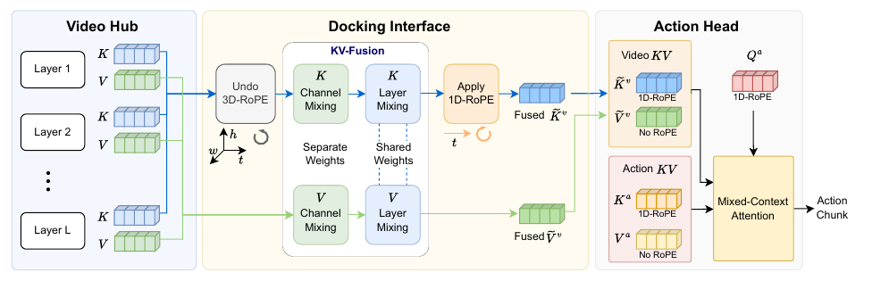
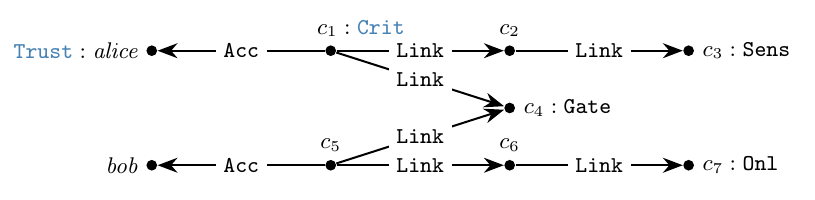

本期围绕两种计算复用方式展开。Faster-WAM 让轻量动作头访问视频骨干的多层表示；另一篇理论研究把满足条件的本体查询改写为图查询，以复用数据库的查询能力。

本文补录 **2026 年 8 月 6 日的日报清单**，于 10 月 29 日核对公开原文。日报日期不代表论文发表日。以下均固定引用清单对应的 **v1**，精选两篇展开，其余五篇提供核实后的阅读入口；实验结果为作者报告，本站未独立复现。

| 阅读层次 | 论文 | 本期关注 |
|---|---|---|
| 精选 | [Faster-WAM](#faster-wam) | 单层动作头、延迟口径与成功率 |
| 精选 | [Horn-ALCHI 原子查询到 GQL](#horn-alchi-原子查询到-gql) | 状态分层与可重写的充分条件 |
| 延伸 | [当天其余五篇](#当天其余五篇) | 知识图谱、数据合成与 Agent 运行框架 |

## Faster-WAM

机器人动作模型 · v1 首次提交 2026-08-03 · [论文及版本记录](https://arxiv.org/abs/2608.02365v1) · [v1 全文](https://arxiv.org/html/2608.02365v1)

### 方法与原图

Faster-WAM 将预训练的 30 层视频骨干接入单层动作头。KV-Fusion 汇合各层的键和值，旋转位置编码对齐负责协调视频与动作的位置表示。动作预测因此可以利用整个视频骨干，无需保持两个模块的逐层对应。[方法见 v1 第 3 节](https://arxiv.org/html/2608.02365v1#S3)。

*图 1｜Liheng Ma、Rui Heng Yang、Zhanguang Zhang、Mateo Clemente、Ziwen Hu、Tongtong Cao、Yingxue Zhang，Faster-WAM，[v1 Figure 2，PDF 第 4 页](https://arxiv.org/pdf/2608.02365v1#page=4)，[CC BY-NC-SA 4.0](https://creativecommons.org/licenses/by-nc-sa/4.0/)。截图保留完整架构图，裁去原图注、正文与空白；未改动图内文字、连线或颜色。本图及裁剪版本沿用该许可，非商业和相同方式共享条件仍适用。*

### 结果与实验条件

| v1 报告指标 | Faster-WAM | Fast-WAM |
|---|---:|---:|
| 32 步动作块延迟 | 66.5 ms | 211.7 ms |
| LIBERO 平均成功率 | 98.5% | 97.6% |
| RoboTwin 2.0 平均成功率 | 89.17% | 91.64% |

据 [Table 1 与第 4.1–4.2 节](https://arxiv.org/html/2608.02365v1#S4)，延迟比较采用同一 24GB 消费级 GPU 设置，每块使用 10 步去噪。Fast-WAM 的延迟由分别测量的 T5 与模型耗时求和；不同方法纳入的具体操作略有差异。211.7 / 66.5 约为 **3.2 倍**，本文采用 v1 口径。

LIBERO 训练含 40 个任务、2,000 条示范，训练 10 epoch，每任务评测 50 次。RoboTwin 2.0 含 50 个任务、27,500 条示范，训练 5 epoch，在干净与随机场景中每任务各评测 100 次。成功率基线引用既有论文，并非全部由本文作者重新训练。

这些结果展示了延迟与任务表现之间的取舍。Faster-WAM 的 LIBERO 得分较高，RoboTwin 平均分较 Fast-WAM 低 2.47 个百分点；该组仿真实验仍需真实机器人验证。

## Horn-ALCHI 原子查询到 GQL

本体与图数据库 · v1 首次提交 2026-08-05 · [论文及版本记录](https://arxiv.org/abs/2608.04945v1) · [v1 全文](https://arxiv.org/html/2608.04945v1)

### 问题与理论结果

David Carral、Calixte Gruson 与 Quentin Manière 研究如何把本体参与的原子查询交给图数据库求值。论文用描述逻辑自动机（DL automata）表达正片段 Horn-ALCHI 查询，再对满足状态分层条件的自动机构造等价查询，最终得到合取双向正则路径查询的并（UC2RPQ），并归入 GQL 可表达范围。[推导见第 3–6 节](https://arxiv.org/html/2608.04945v1#S3)。

*图 2｜David Carral、Calixte Gruson、Quentin Manière，A General Sufficient Condition for Rewriting Horn-ALCHI Atomic Queries into GQL，[v1 Figure 1，PDF 第 2 页](https://arxiv.org/pdf/2608.04945v1#page=2)，[CC BY 4.0](https://creativecommons.org/licenses/by/4.0/)。截图保留完整事实图及蓝色推导标记，裁去页眉、原图注、正文与空白；未修改节点、边、文字或颜色。本图沿用原许可。*

图中黑色部分是给定事实，蓝色部分是本体蕴含的事实。论文以该例说明，查询改写需要保持原推理问题的答案，数据库才能用改写后的查询替代专用推理过程。

### 如何理解结论

状态分层排除特定循环依赖，给出的是**充分条件**，不能据此判断所有 Horn-ALCHI 原子查询都能重写。该文提供理论构造和等价性证明，没有运行时基准实验；其价值是划定可重写范围，实际数据库中的执行收益仍需实现与测量。

## 当天其余五篇

以下逐项核对了公开 v1 的题目、作者、首次提交日期与摘要。本节只给研究入口，不据摘要推断实验公平性或补写未经全文核验的结果。

| 论文与固定版本 | v1 首次提交 | 核实后的研究范围 |
|---|---|---|
| [Eigenius: A Typed Knowledge-Graph DBMS with Epistemic Stratification and Institution-Mediated Reasoning](https://arxiv.org/abs/2608.04457v1) · Hans-Martin Will 等 | 2026-08-05 | 将类型系统、不可变存储和知识的证据状态组织在知识图谱数据库内核中。 |
| [Ego2Robot: Scalable Robot Data Synthesis from Egocentric Human Data](https://arxiv.org/abs/2608.02580v1) · Ye Wang 等 | 2026-08-03 | 通过动作重定向、机器人手臂视觉合成和质量筛选，将第一视角人类视频转为机器人训练数据。 |
| [LongHorizon-Harness: Advancing Long-Horizon Agents for Real-World Tasks](https://arxiv.org/abs/2608.01964v1) · Ziyu Ma 等 | 2026-08-03 | 用管理、执行与审计循环维护外部任务状态，由环境证据验证后再更新状态。 |
| [Qwen-CUA: Native Computer Use for (almost) Everything](https://arxiv.org/abs/2608.02352v1) · Dunjie Lu 等 | 2026-08-03 | 研究以截图为观察、键鼠事件为动作的原生计算机操作，以及交互轨迹训练。 |
| [Harness-R1: Learning to Edit Executable Runtime Harnesses from Agent Failure Trajectories](https://arxiv.org/abs/2608.02276v1) · Shuai Shao 等 | 2026-08-03 | 从失败轨迹学习修改可执行运行框架，以重新执行目标任务的结果训练独立编辑模型。 |

---

两张图均来自上文固定版本的公开论文，来源与裁剪说明见图注。图 1 按 CC BY-NC-SA 4.0 引用；本站当前内容许可同为 CC BY-NC-SA 4.0，商业用途的适用性未另行确认。图 2 保留原论文的 CC BY 4.0 许可，不因本站页脚而增加非商业或相同方式共享限制。
