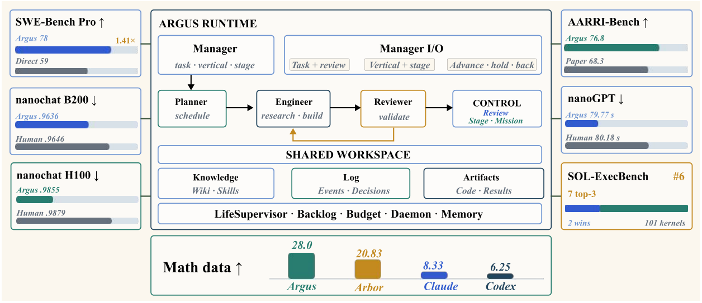

持续编辑视频流，需要限制视觉状态漂移；跨任务研究需要检查长期状态与完成判断。今天的两篇精选分别把这两类误差控制放进系统结构。

本文补录 2026 年 8 月 7 日的日报清单，于 10 月 29 日核对公开原文。日报日期不代表论文发表日，以下固定引用 **v1**。数值为作者报告，本站未独立复现。

## JoyAI-Video-Edit

流式视频编辑 · [v1 论文](https://arxiv.org/abs/2608.03974v1) · [全文](https://arxiv.org/html/2608.03974v1)

### 方法与部署条件

JoyAI-Video-Edit 分块自回归生成视频，滑动窗口限制缓存增长，并将第一块保留为持续锚点。Source-Anchored DMD 让蒸馏目标继续受原视频约束，减轻长流中的输入偏离。

| 作者报告的部署指标 | 条件或数值 |
|---|---|
| 模型与硬件 | 16B，单张 NVIDIA B200 |
| 输出与执行优化 | 720p，FP8、算子融合和编译 |
| 每块帧数 | 8 帧 |
| 编码、去噪、解码阶段 | 226 ms |
| 含缓存构建等步骤的完整周期 | 266 ms，约 30.1 FPS |

这两个延迟口径需要区分，不能把请求响应时间直接当成完整处理周期。短视频自动评测使用 OpenVE-Bench 和 Gemini 多模态裁判，1–5 分质量指标与速度测量也应分别理解。上述部署依赖指定硬件与优化路径。[部署与评测见第 5、7 节](https://arxiv.org/html/2608.03974v1#S5)。

## Argus

长程 Agent 运行框架 · [v1 论文](https://arxiv.org/abs/2608.05144v1) · [全文](https://arxiv.org/html/2608.05144v1)

### 方法与原图

Argus 将 Manager、Planner、Engineer、Reviewer 放在持久工作区上。稳定的用户意图与可修订的目标、约束、验收条件分别记录，路线变化需要留下证据和理由。

*图 1｜Boxiu Li 等，Argus，[v1 Figure 1，PDF 第 2 页](https://arxiv.org/pdf/2608.05144v1#page=2)，[CC BY 4.0](https://creativecommons.org/licenses/by/4.0/)。已裁剪，保留完整示意图及评测卡片，移除页眉、原图注和正文；未改动图内内容。各评测条形使用独立刻度，不构成统一排行榜。*

### 结果与局限

731 个 SWE-Bench Pro 任务上，Argus 与 Direct Copilot 均使用 GPT-5.5/xhigh、Copilot 后端。作者报告约 78% 对约 59% 的成功率，总 token 消耗约为 1.41 倍。Reviewer 要求继续修改的 43 项中，34 项随后通过官方验证器，22 项完成更严格的复审闭环。[协议与结果见第 5–6 节](https://arxiv.org/html/2608.05144v1#S5)。

这些结果衡量整个运行框架，不能单独估计 Reviewer 的因果贡献。路由采用自适应策略，前后阶段的任务组成也会变化；原文未用固定状态重放隔离记忆效果。长程可靠性的判断仍应结合外部验证和资源消耗。

## 当日其他论文入口

以下已核对公开 v1 的题目与链接，本篇未复核其全部实验。

- [DreamWAM: Beyond RGB Future Prediction for World Action Models](https://arxiv.org/abs/2608.04996v1)
- [BridgeVLA++: A Data-Efficient, Generalizable, and Memory-Augmented Vision-Language-Action Framework for 3D Manipulation](https://arxiv.org/abs/2608.05042v1)
- [ABSeeker: Training Long-Horizon Search Agents via Answer-Backtracked Credit Assignment](https://arxiv.org/abs/2608.05102v1)
- [Qwen-3D: A Generalist 3D Vision-Language Model for Spatial Understanding](https://arxiv.org/abs/2608.02980v1)

---

本篇外部原图保留 CC BY 4.0，不因本站页脚而增加非商业或相同方式共享限制。其余论文仅保留公开链接。
