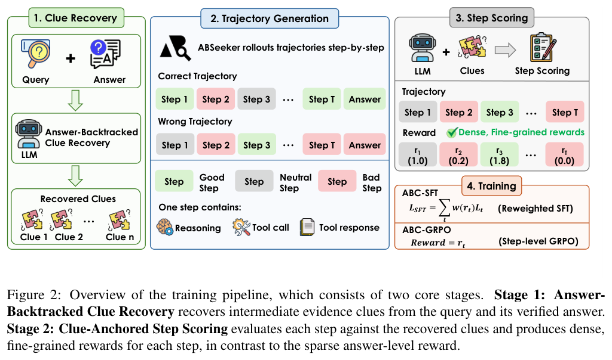
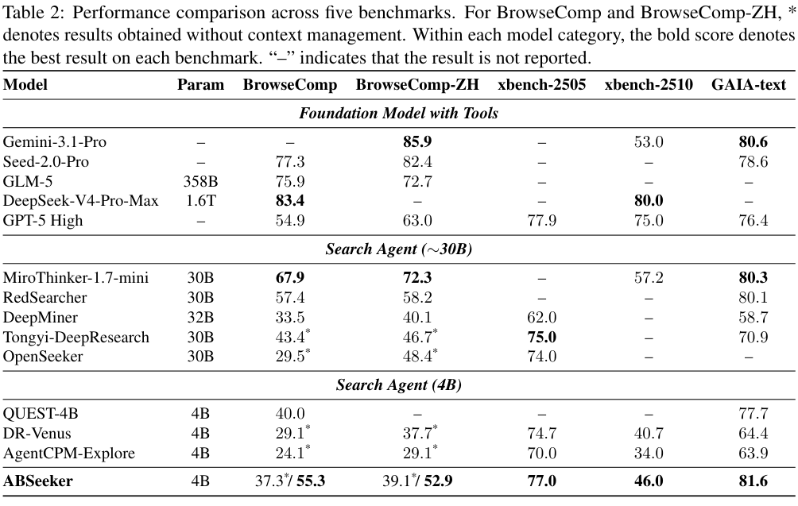
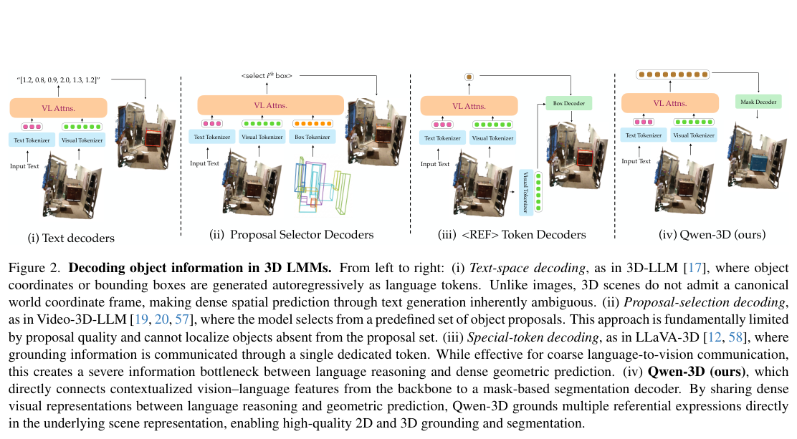
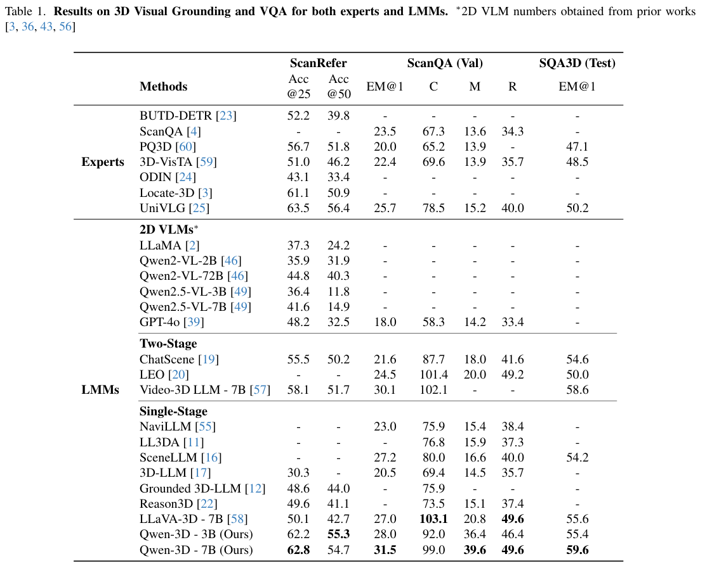

本期六项研究介绍实时视频编辑、多表征未来预测、三维操作记忆、长程运行框架、搜索信用分配与三维视觉语言模型。

## 1. JoyAI-Video-Edit

流式视频编辑 · [v1 论文](https://arxiv.org/abs/2608.03974v1) · [全文](https://arxiv.org/html/2608.03974v1)

### 方法与部署条件

JoyAI-Video-Edit 分块自回归生成视频，滑动窗口限制缓存增长，并将第一块保留为持续锚点。Source-Anchored DMD 让蒸馏目标继续受原视频约束，减轻长流中的输入偏离。

| 作者报告的部署指标 | 条件或数值 |
|---|---|
| 模型与硬件 | 16B，单张 NVIDIA B200 |
| 输出与执行优化 | 720p，FP8、算子融合和编译 |
| 每块帧数 | 8 帧 |
| 编码、去噪、解码阶段 | 226 ms |
| 含缓存构建等步骤的完整周期 | 266 ms，约 30.1 FPS |

这两个延迟口径需要区分，不能把请求响应时间直接当成完整处理周期。短视频自动评测使用 OpenVE-Bench 和 Gemini 多模态裁判，1–5 分质量指标与速度测量也应分别理解。上述部署依赖指定硬件与优化路径。[部署与评测见第 5、7 节](https://arxiv.org/html/2608.03974v1#S5)。

## 2. DreamWAM：用运动、几何和语义定义更有用的未来

DreamWAM 在 RGB 未来预测之外加入运动潜变量联合去噪，以及几何和语义的门控残差监督。VideoDiT 与 ActionDiT 共享注意力；辅助监督分支只在训练使用，部署时仍输入 RGB，无需在线运行这些目标编码器。

相同骨干、数据与推理协议下，联合视频动作模式的 LIBERO 成功率从 Fast-WAM-Joint 的 98.00% 到 98.90%，LIBERO-Plus 七类扰动的未加权均值从 69.16% 到 75.47%。不生成未来视频的另一组是 51.36% 到 63.44%，两种模式应分开比较。两随机种子实验检验已学技能在视觉变化下的稳健性，并非学会全新操作技能。

[DreamWAM: Beyond RGB Future Prediction for World Action Models](https://arxiv.org/abs/2608.04996v1) · v1。

[Figure 1（原文）](https://arxiv.org/pdf/2608.04996v1#page=2)。

## 3. BridgeVLA++：用空间参照与时间记忆补足三维动作预测

BridgeVLA++ 保留点云投影为多视图图像、先预测热图再解码动作的路线，增加持久空间参照和时间关键帧。空间记忆帮助补回遮挡区域，时间记忆记录已经发生的交互；双臂动作共享昂贵的视觉语言主干。

十八项 RLBench 任务、每任务一百条示范，五次随机种子评测中，平均成功率从 BridgeVLA 的 90.5±1.1% 到 93.7±0.6%。单张 RTX 4090 的单步预测耗时也从 0.35 秒到 0.57 秒，新增参数约 9.2%。记忆带来表现与计算代价的交换，不能把数据效率、实时性和跨域泛化当成同一个指标。

[BridgeVLA++: A Data-Efficient, Generalizable, and Memory-Augmented Vision-Language-Action Framework for 3D Manipulation](https://arxiv.org/abs/2608.05042v1) · v1。

[Figure 1（原文）](https://arxiv.org/pdf/2608.05042v1#page=2)。

## 4. Argus

长程 Agent 运行框架 · [v1 论文](https://arxiv.org/abs/2608.05144v1) · [全文](https://arxiv.org/html/2608.05144v1)

### 方法与原图

Argus 将 Manager、Planner、Engineer、Reviewer 放在持久工作区上。稳定的用户意图与可修订的目标、约束、验收条件分别记录，路线变化需要留下证据和理由。

*图 1｜Boxiu Li 等，Argus，[v1 Figure 1，PDF 第 2 页](https://arxiv.org/pdf/2608.05144v1#page=2)，[CC BY 4.0](https://creativecommons.org/licenses/by/4.0/)。裁剪自原文。各评测条形使用独立刻度，不构成统一排行榜。*

### 结果与局限

731 个 SWE-Bench Pro 任务上，Argus 与 Direct Copilot 均使用 GPT-5.5/xhigh、Copilot 后端。作者报告约 78% 对约 59% 的成功率，总 token 消耗约为 1.41 倍。Reviewer 要求继续修改的 43 项中，34 项随后通过官方验证器，22 项完成更严格的复审闭环。[协议与结果见第 5–6 节](https://arxiv.org/html/2608.05144v1#S5)。

这些结果衡量整个运行框架，不能单独估计 Reviewer 的因果贡献。路由采用自适应策略，前后阶段的任务组成也会变化；原文未用固定状态重放隔离记忆效果。长程可靠性的判断仍应结合外部验证和资源消耗。

## 5. ABSeeker：从答案反向找线索，再给搜索步骤分配信用

ABSeeker 先利用已知正确答案回溯解题所需线索，再检查每一步搜索是否发现、验证或错误排除了这些线索。ABC-SFT 按步骤奖励调整损失，ABC-GRPO 使用逐步奖励，让失败轨迹中的有用探索也能参与训练。

*图｜Lu, Yijun 等，[Figure 2（PDF 第 4 页）](https://arxiv.org/pdf/2608.05102v1#page=4)，[CC BY 4.0](http://creativecommons.org/licenses/by/4.0/)。裁剪自原文。*

基于 Qwen3.5-4B、8.5k 轨迹训练后，不带上下文管理的 BrowseComp 和中文版得分为 37.3%、39.1%；允许 256K 上下文、最多五轮 discard-all 管理后为 55.3%、52.9%。后一组包含额外运行时策略，不能全算作训练信用分配的收益。方法也依赖标准答案和线索恢复质量，不是无监督搜索学习。

*图｜Lu, Yijun 等，[Table 2（PDF 第 8 页）](https://arxiv.org/pdf/2608.05102v1#page=8)，[CC BY 4.0](http://creativecommons.org/licenses/by/4.0/)。裁剪自原文。*

[ABSeeker: Training Long-Horizon Search Agents via Answer-Backtracked Credit Assignment](https://arxiv.org/abs/2608.05102v1) · v1。

## 6. Qwen-3D：让语言查询连接密集三维解码

Qwen-3D 将深度和相机位姿用于多视图融合，以三维旋转位置编码组织视觉 token，并用 query-based 分割解码器把语言指代直接落到场景几何。联合二维与三维训练希望保留通用视觉语言能力，同时突破只用文字输出三维预测的瓶颈。

*图｜Lin, Lucy 等，[Figure 2（PDF 第 3 页）](https://arxiv.org/pdf/2608.02980v1#page=3)，[CC BY 4.0](http://creativecommons.org/licenses/by/4.0/)。裁剪自原文。*

ScanRefer 上，7B 模型在 IoU 阈值 0.25 和 0.50 下的准确率为 62.8%、54.7%，仍分别低于专用 UniVLG 的 63.5%、56.4%。在不同传感器来源的 Locate3D ScanNet++ 上，3B 模型对应为 55.7%、43.4%，UniVLG 为 32.3%、24.6%。域内和域外对照展示不同取舍，且三维几何输入的质量仍影响结果。

*图｜Lin, Lucy 等，[Table 1（PDF 第 7 页）](https://arxiv.org/pdf/2608.02980v1#page=7)，[CC BY 4.0](http://creativecommons.org/licenses/by/4.0/)。裁剪自原文。*

[Qwen-3D: A Generalist 3D Vision-Language Model for Spatial Understanding](https://arxiv.org/abs/2608.02980v1) · v1。
