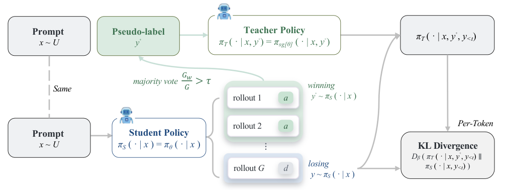

模型自己生成训练材料后，还需要判断哪些信号可用。u-OPSD 依赖多次回答的一致性，RST 则检查合成任务能否在新沙箱中执行。两种路线的错误识别边界各不相同。

## u-OPSD

模型自蒸馏 · [On-Policy Self-Distillation without Any Supervision v1](https://arxiv.org/abs/2608.06296v1) · [全文](https://arxiv.org/html/2608.06296v1)

### 方法与原图

u-OPSD 从同一模型的多条回答中投票形成伪答案，再把以共识解答为条件的教师分布蒸馏给学生。训练仅使用 OpenThoughts 的 30,000 道题目子集，不读取金标准解答；模型仍依赖已有预训练能力。

*图 1｜Yijiang Li、Bingyang Wang、Yijun Liang、Yunjie Tian、Di Fu、Nuno Vasconcelos，[v1 Figure 2，PDF 第 4 页](https://arxiv.org/pdf/2608.06296v1#page=4)，[CC BY 4.0](https://creativecommons.org/licenses/by/4.0/)。裁剪自原文。*

### 结果与评测口径

| 非思考模式，五项数学评测平均分 | 基础模型 | u-OPSD | 差值 |
|---|---:|---:|---:|
| Qwen3-4B | 40.96 | 49.49 | +8.53 个百分点 |
| Qwen3-8B | 43.57 | 54.31 | +10.74 个百分点 |

条件包括 LoRA rank 64、150 步训练，每 25 步评估并报告最佳检查点。AIME24、AIME25、HMMT25 使用 avg@12，MATH500、AMC23 使用 avg@4，表中不能解释为统一的单次作答通过率。[实验设置与 Table 1](https://arxiv.org/html/2608.06296v1#S4)。

共识也可能一致地出错。附录还报告，在 8 张 80GB 级 GPU 上，一次 u-OPSD 运行约 9 小时，监督 OPSD 约 3.5 小时；减少标注并不等于减少算力。

## RST

终端任务合成 · [Recursive Synthesis for Long-Horizon Terminal Tasks v1](https://arxiv.org/abs/2608.05466v1) · [全文](https://arxiv.org/html/2608.05466v1)

RST 从验证过的种子任务出发，扩展参考解答，同步修改题意与验证器，并在新沙箱中检查后继续递归。15 轮生成 37,484 个任务，作者估算每题成本约 0.05 美元。

| Qwen3.5-27B，非思考模式 | 基础模型 | Agentic PPO 后 |
|---|---:|---:|
| Terminal-Bench 2 | 41.20 | 49.44 |
| Terminal-Bench Hard | 22.67 | 32.00 |
| LHTB | 18.10 | 22.07 |

[Table 4](https://arxiv.org/pdf/2608.05466v1#page=14) 为三次独立评测的均值；LHTB 使用平均部分得分。原文的 20.00%、41.16%、21.93% 是相对增幅，不能当成百分点。通过自建验证器只能说明通过了这些检查，外部基准与人工抽查仍然必要。

## 当日其他论文入口

以下已核对公开 v1 的题目与链接，本篇未复核其全部实验。

- [Improving Interoperability among Defence and National Security Ontologies: Analysis and Evaluation Tasks](https://arxiv.org/abs/2608.05867v1)
- [Towards Physics of Multimodal Pretraining: Knowledge Flow, Modality Synergy, Early Unification, and Recipes](https://arxiv.org/abs/2608.05000v1)
- [AgentOPSD: Recursive Self-Distillation for Agentic Reinforcement Learning](https://arxiv.org/abs/2608.05987v1)
- [ω-0: A Latent Predictive World Action Model for Concurrent Humanoid Loco-Manipulation](https://arxiv.org/abs/2608.06375v1)

---

本篇其余论文仅保留公开链接。
