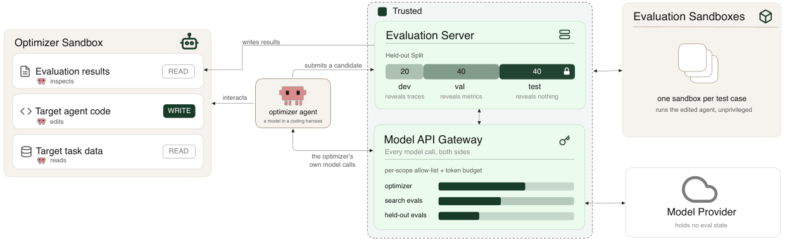

比较系统时，需要明确哪些变量被固定。运行框架的验证分数可能受到搜索影响，实现同一函数的参数表示也可能被优化器区别对待。今天两篇精选分别检查这两种测量边界。

## HarnessOpt-Bench

Agent 运行框架优化评测 · [v1 论文](https://arxiv.org/abs/2608.06301v1) · [全文](https://arxiv.org/html/2608.06301v1)

### 协议与原图

优化器可以修改提示、工具和控制流，目标模型、环境与验证器固定。开发集提供轨迹，验证集只给汇总分数，最终测试在候选提名前保持隐藏。这些边界由执行环境落实。

*图 1｜Varun Ursekar 等，HarnessOpt-Bench，[v1 Figure 1，PDF 第 2 页](https://arxiv.org/pdf/2608.06301v1#page=2)，[CC BY 4.0](https://creativecommons.org/licenses/by/4.0/)。已裁剪，保留完整基础设施示意及图例，移除页眉、原图注和正文；未改动图内内容。*

### 结果与预算边界

研究包含 5 个优化器模型、4 项任务，共 111 个计分运行。开发、验证分区各受 4 遍完整 case-pass 与目标模型 token 预算约束；优化器自身推理被计量但不封顶，最终测试每题重复 3 次取均值。[协议见第 3–4 节](https://arxiv.org/html/2608.06301v1#S3)。

**调用上限存在原文内部差异**。v1 第 3.1 节写每分区 100 次，第 5.3 节写 200 次；本文保留这个差异，不将其写成已确认的统一配置。

作者报告，换优化器模型的平均影响为 0.142 个归一化增益单位，换 harness 为 0.079。增益按基线剩余提升空间归一化，不能当作原始成功率差；分辨带也不构成显著性检验。GAIA 的种子不可运行，跨任务解读还需考虑起点。[结果见第 5 节](https://arxiv.org/html/2608.06301v1#S5)。

## Adam 与等价参数表示

优化器隐式偏置 · [The Loss Does Not See the Basis, but Adam Does v1](https://arxiv.org/abs/2608.05136v1) · [全文](https://arxiv.org/html/2608.05136v1)

对于分解矩阵 W = UVᵀ，U 与 V 同时右乘同一正交矩阵后，W 保持不变。逐坐标更新的 Adam 却不保证这种等变关系，因此等价初始化可能沿不同路径训练。

作者在 40×40、真实秩 3 的矩阵感知任务中使用小初始化、无权重衰减，将训练损失压至 10⁻⁷ 以下后比较恢复误差。这样的设置有助于把训练拟合与隐式偏置区分开。[受控实验与理论](https://arxiv.org/html/2608.05136v1)。

论文还研究注意力头与高光谱任务。结论适合用于诊断表示依赖，不能直接外推成所有大模型训练的优化器选择规则；噪声、规模、稳定性与算力仍需另行比较。

## 当日其他论文入口

以下已核对公开 v1 的题目与链接，本篇未复核其全部实验。

- [Supporting the understanding of ontologies for scientific knowledge graphs with the new version of LODE](https://arxiv.org/abs/2608.04689v1)
- [GeniWorld: A Generalizable Interactive World Model for Robotic Manipulation via Visual Actions](https://arxiv.org/abs/2608.06332v1)
- [Energy-Guided Flow Matching](https://arxiv.org/abs/2608.05811v1)

---

本篇外部原图保留 CC BY 4.0，不因本站页脚而增加非商业或相同方式共享限制。其余论文仅保留公开链接。

文中实验结果为论文作者报告，未独立复现。
