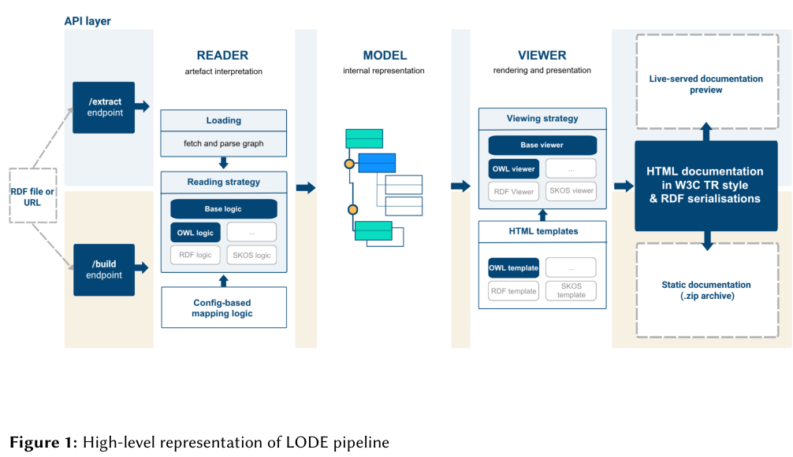
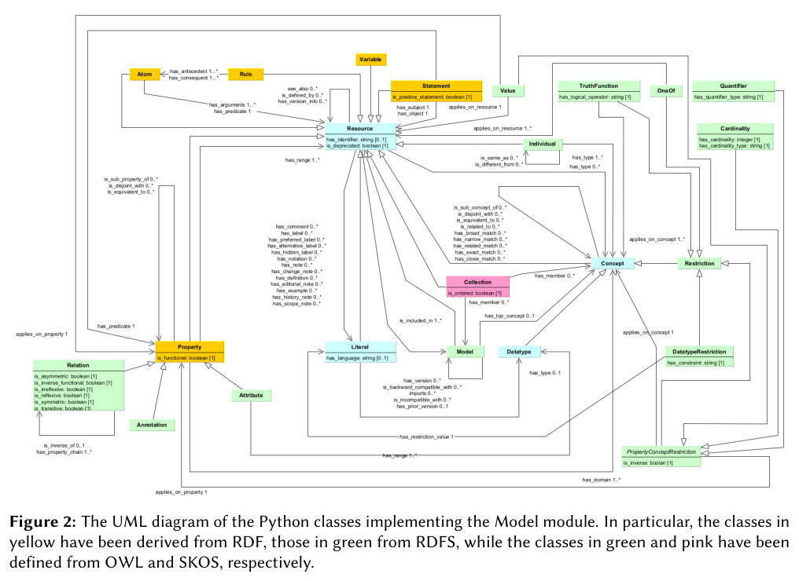
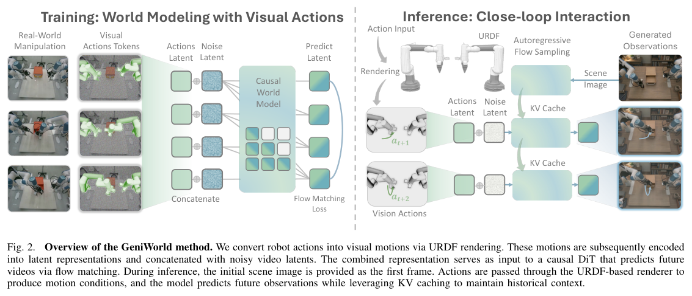
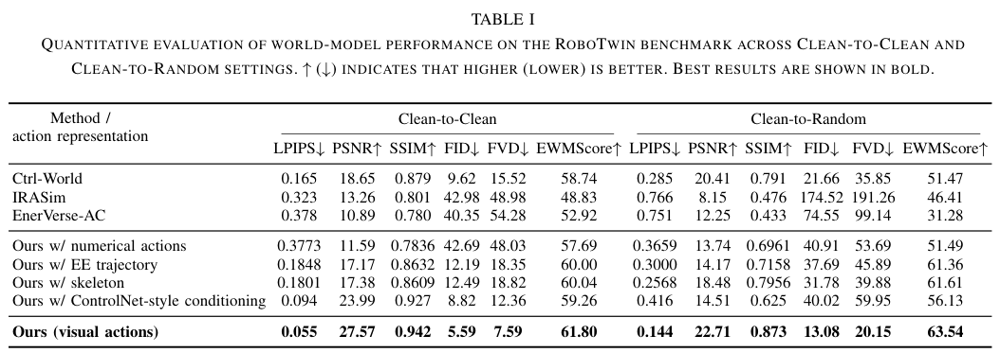

本期五项研究介绍本体文档工具、执行框架优化评测、优化器表示依赖、视觉动作世界模型与能量引导 flow。

## 1. LODE：把本体解释与文档渲染分开

新版 LODE 将语义工件读取、内部模型与页面渲染拆成 Reader、Model、Viewer，以 Python 模块取代旧 XSLT 流水线。OWL 文档是首个完整支持的类型，导入模块、跨模块注释、单实体文档和来源信息可以在同一页面组织。

*图｜Pasqual, Valentina 等，[Figure 1（PDF 第 4 页）](https://arxiv.org/pdf/2608.04689v1#page=4)，[CC BY 4.0](http://creativecommons.org/licenses/by/4.0/)。裁剪自原文。*

论文通过 SKG-O 科学知识图谱互操作框架本体展示功能，没有报告统一任务准确率或维护工时提升。RDF(S)、SKOS 与 SHACL 等工件是可扩展架构的方向，不能等同于全部已经实现。工具的作用是让模块化语义更易理解与复用，内容正确性仍依赖原本体及注释。

*图｜Pasqual, Valentina 等，[Figure 2（PDF 第 6 页）](https://arxiv.org/pdf/2608.04689v1#page=6)，[CC BY 4.0](http://creativecommons.org/licenses/by/4.0/)。裁剪自原文。*

[Supporting the understanding of ontologies for scientific knowledge graphs with the new version of LODE](https://arxiv.org/abs/2608.04689v1) · v1。

## 2. HarnessOpt-Bench

Agent 运行框架优化评测 · [v1 论文](https://arxiv.org/abs/2608.06301v1) · [全文](https://arxiv.org/html/2608.06301v1)

### 协议与原图

优化器可以修改提示、工具和控制流，目标模型、环境与验证器固定。开发集提供轨迹，验证集只给汇总分数，最终测试在候选提名前保持隐藏。这些边界由执行环境落实。

*图 1｜Varun Ursekar 等，HarnessOpt-Bench，[v1 Figure 1，PDF 第 2 页](https://arxiv.org/pdf/2608.06301v1#page=2)，[CC BY 4.0](https://creativecommons.org/licenses/by/4.0/)。裁剪自原文。*

### 结果与预算边界

研究包含 5 个优化器模型、4 项任务，共 111 个计分运行。开发、验证分区各受 4 遍完整 case-pass 与目标模型 token 预算约束；优化器自身推理被计量但不封顶，最终测试每题重复 3 次取均值。[协议见第 3–4 节](https://arxiv.org/html/2608.06301v1#S3)。

**调用上限存在原文内部差异**。v1 第 3.1 节写每分区 100 次，第 5.3 节写 200 次；两处调用上限不一致。

作者报告，换优化器模型的平均影响为 0.142 个归一化增益单位，换 harness 为 0.079。增益按基线剩余提升空间归一化，不能当作原始成功率差；分辨带也不构成显著性检验。GAIA 的种子不可运行，跨任务解读还需考虑起点。[结果见第 5 节](https://arxiv.org/html/2608.06301v1#S5)。

## 3. Adam 与等价参数表示

优化器隐式偏置 · [The Loss Does Not See the Basis, but Adam Does v1](https://arxiv.org/abs/2608.05136v1) · [全文](https://arxiv.org/html/2608.05136v1)

对于分解矩阵 W = UVᵀ，U 与 V 同时右乘同一正交矩阵后，W 保持不变。逐坐标更新的 Adam 却不保证这种等变关系，因此等价初始化可能沿不同路径训练。

作者在 40×40、真实秩 3 的矩阵感知任务中使用小初始化、无权重衰减，将训练损失压至 10⁻⁷ 以下后比较恢复误差。这样的设置有助于把训练拟合与隐式偏置区分开。[受控实验与理论](https://arxiv.org/html/2608.05136v1)。

论文还研究注意力头与高光谱任务。结论适合用于诊断表示依赖，不能直接外推成所有大模型训练的优化器选择规则；噪声、规模、稳定性与算力仍需另行比较。

## 4. GeniWorld：把机器人动作渲染成视频模型看得懂的条件

GeniWorld 根据机器人 URDF 与相机视角，将数字动作渲染为密集视觉动作，再交给预训练视频模型预测环境变化。机器人运动学与环境动态分离，历史缓存支持自回归交互，可供策略或遥操作系统闭环调用。

*图｜Gu, Chenghao 等，[Figure 2（PDF 第 3 页）](https://arxiv.org/pdf/2608.06332v1#page=3)，[CC BY 4.0](http://creativecommons.org/licenses/by/4.0/)。裁剪自原文。*

RoboTwin Clean-to-Random 中，使用 2,250 条干净训练轨迹、在二百五十条随机场景轨迹上测试，GeniWorld 的 FVD 为 20.15，Ctrl-World 为 35.85。它衡量生成视频分布而非机器人任务成功率。另一个五步采样部署在 H20 上约 8 Hz；可用作辅助策略评测和造数，但不能从视觉相似直接推断接触动力学完全正确。

*图｜Gu, Chenghao 等，[Table I（PDF 第 4 页）](https://arxiv.org/pdf/2608.06332v1#page=4)，[CC BY 4.0](http://creativecommons.org/licenses/by/4.0/)。裁剪自原文。*

[GeniWorld: A Generalizable Interactive World Model for Robotic Manipulation via Visual Actions](https://arxiv.org/abs/2608.06332v1) · v1。

## 5. Energy-Guided Flow Matching：让生成终点逐渐释放高频

EG-FM 将固定干净图像终点改为随时间变化的热核滤波图像，按每张图的频谱能量从粗到细释放高频信号，并重设 flow 的速度目标。骨干和训练数据保持不变，主要改变的是概率路径及其学习目标。

ImageNet-256、PixelDiT-XL 与相同采样协议下，八十 epoch 的 FID 从 2.36 到 1.99；EG-FM 两百 epoch 为 1.55，标准方法三百二十 epoch 为 1.61。更长训练到六百 epoch 为 1.45。NFE 为 100×2，包含有条件和无条件 CFG 计算；较快训练收敛不等于一步推理，也不意味着所有生成指标都同步领先。

[Energy-Guided Flow Matching](https://arxiv.org/abs/2608.05811v1) · v1。

[Figure 1（原文）](https://arxiv.org/pdf/2608.05811v1#page=1)。
