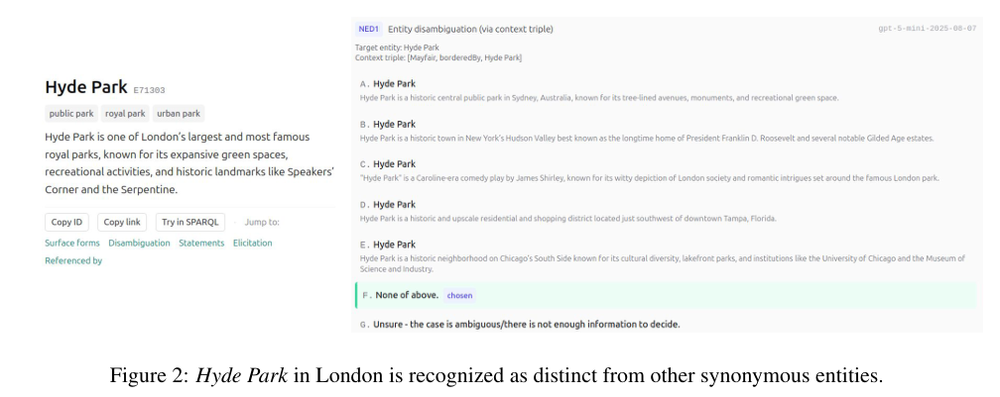
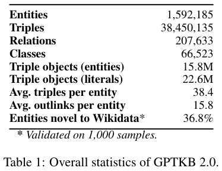
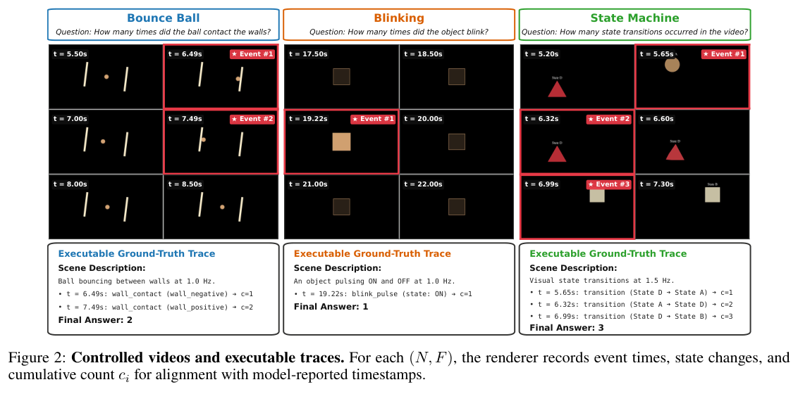
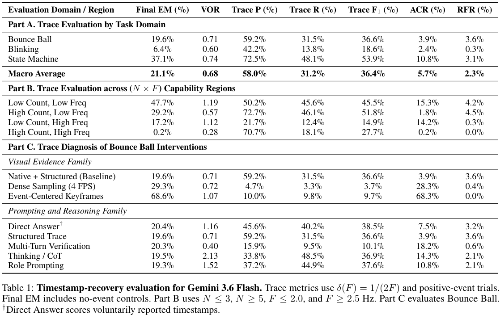

本期五项研究介绍科学概念聚合、知识库消歧、执行错误归因、视频事件计数与物理保真评测。

## 1. SCALE：在科学主题下增加可维护的概念层

SCALE 从作者关键词出发，用科学文本嵌入、语言模型定义和图社区发现，将同义与近义表达聚合，再接入 OpenAlex 的 Topic 之下。它要解决的是细粒度概念组织，不只是给文献补一个更长标签。

选定配置为 k=50、最低相似度 0.85、Leiden resolution 0.6；must-link precision 为 69.5%，should-not-link precision 为 87.5%。作者将其视为困难聚合与分离决策的一致性检查，并非随机抽样的聚类总体正确率。

流程形成 113,892 个 Concepts，4,516 个 OpenAlex Topics 中有 4,461 个至少连接一个 Concept，即 98.8%。这是主题覆盖，不是 98.8% 概念都准确；命名、归属及跨学科多义性仍可能出错。

可复用之处是把术语聚合与层级挂接分开，并提供增量维护路径。验收应检查错误合并、遗漏概念、定义来源与领域偏差，不能只以节点数或覆盖率衡量本体质量。

[Figure 1，原论文 PDF 第 4 页](https://arxiv.org/pdf/2608.07254v1#page=4)。

- [SCALE: Scientific Concept Aggregation via LLMs and Embeddings for Fine-Grained Taxonomy Extension](https://arxiv.org/abs/2608.07254v1) · v1，公开于 2026-08-07。

## 2. GPTKB 2.0：让模型生成知识的消歧过程可查

GPTKB 2.0 为实体、关系和类设置独立身份与文字描述，在递归生成三元组时利用上下文区分同名对象、合并同义提及。浏览器界面不仅显示结果，还展示候选匹配、来源三元组与消歧决定，支持 SPARQL、自然语言查询及输入文本实体链接。

*图｜Hu, Yujia 等，[Figure 2（PDF 第 3 页）](https://arxiv.org/pdf/2608.06992v1#page=3)，[CC BY 4.0](http://creativecommons.org/licenses/by/4.0/)。裁剪自原文。*

知识库包含约 3,845 万三元组、159 万规范实体、20.8 万关系与 6.65 万类。规模说明覆盖范围，并不代表每条模型生成事实已获外部验证；来源链主要解释生成与合并经过，也不自动证明现实真伪。演示强调可审查性，尚不能据此推导整体事实准确率或行业问答成功率。

*图｜Hu, Yujia 等，[Table 1（PDF 第 2 页）](https://arxiv.org/pdf/2608.06992v1#page=2)，[CC BY 4.0](http://creativecommons.org/licenses/by/4.0/)。裁剪自原文。*

[GPTKB 2.0: Browsing, Querying, and Auditing a Disambiguated LLM-Derived Knowledge Base](https://arxiv.org/abs/2608.06992v1) · v1。

## 3. TrajDebug：区分出现过的错误与最终造成失败的错误

TrajDebug 用多粒度历史压缩保留远距离证据，先识别错误触发，再追踪错误是否已被修复、潜伏或持续影响终点。目标是定位导致最终失败的最早关键步骤，避免把一条已经恢复的局部失误当作失败原因。

在 τ²-Bench 与 SWE-Bench Pro 的消融中，完整方法的关键步骤定位准确率分别为 52.75%、24.41%；移除多粒度压缩后为 20.00%、15.12%。这衡量故障定位，不是原 Agent 的任务成功率。人工标注的 TrajErrBench 包含 486 条失败轨迹，关键归因仍受标签定义和长轨迹证据缺失影响。

[TRAJDEBUG: Tracing Error Lifecycle to Identify Critical Failures in Long-Horizon Agent Trajectories](https://arxiv.org/abs/2608.06346v1) · v1。

[Figure 1（原文）](https://arxiv.org/pdf/2608.06346v1#page=1)。

## 4. 低频陷阱：数对事件不等于找回了事件过程

研究程序化生成弹球碰壁、闪烁与类别状态转移视频，在固定渲染下分别控制事件数和频率，并记录可执行时间戳真值。评测同时检查最终计数与模型报告的事件轨迹，区分漏检、重复计数和最后汇总错误。

*图｜Baskar, Sarvesh 等，[Figure 2（PDF 第 4 页）](https://arxiv.org/pdf/2608.06361v1#page=4)，[CC BY 4.0](http://creativecommons.org/licenses/by/4.0/)。裁剪自原文。*

2,190 段视频的 Gemini 3.6 Flash 测试中，高事件数且高频区域的最终精确计数率为 0.2%，时间戳召回率为 18.1%。弹球改用 4 FPS 输入后，最终准确率从 19.6% 到 29.3%，但轨迹 F1 只有 3.7%。更多画面提高最终分数，仍可能没有忠实恢复事件；受控合成视频的失败模式也不能直接当成所有现实视频的统一准确率。

*图｜Baskar, Sarvesh 等，[Table 1（PDF 第 6 页）](https://arxiv.org/pdf/2608.06361v1#page=6)，[CC BY 4.0](http://creativecommons.org/licenses/by/4.0/)。裁剪自原文。*

[The Low Frequency Trap: Video Language Models Fail at Simple Event Bookkeeping](https://arxiv.org/abs/2608.06361v1) · v1。

## 5. GAUGE：用实测轨迹检查模拟器与视频世界模型

GAUGE 提供二十二类受控物理任务，覆盖刚体、绳索、织物和体积形变，并记录标定参数、不确定性与任务观测量。数值模拟器使用轨迹误差，视频模型另检查运动规律及推断物理参数的时间稳定性，避免只看生成画面是否逼真。

Isaac Sim、Genesis、Newton 在十四类任务上各有强弱：例如甩动织物的归一化 RMSE 分别为 128.26、8.54、9.25，均相对实测基线均值归一化，不能当作厘米。六个视频模型在五项刚体任务中即使呈现正确方程形式，也可能给错加速度、动量传递或振荡周期。视觉质量和物理保真需要分开验收。

[GAUGE: A Measurement-Grounded Benchmark for Physical Fidelity in Simulation Engines and Video World Models](https://arxiv.org/abs/2608.05948v1) · v1。

[Figure 1（原文）](https://arxiv.org/pdf/2608.05948v1#page=2)。
