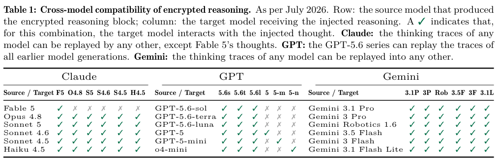
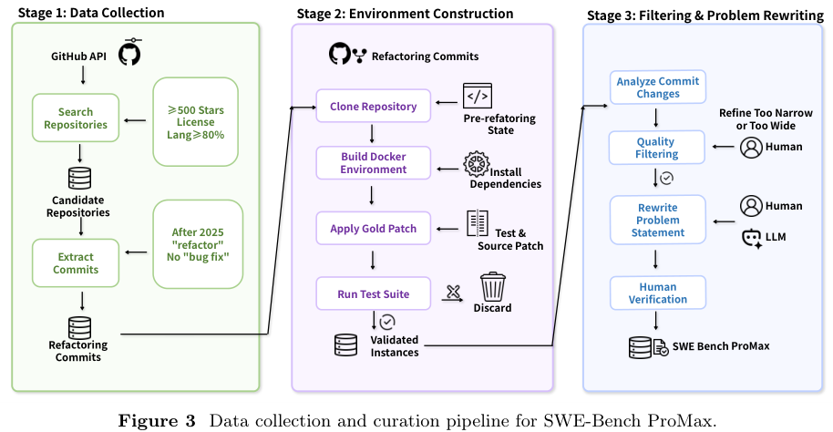
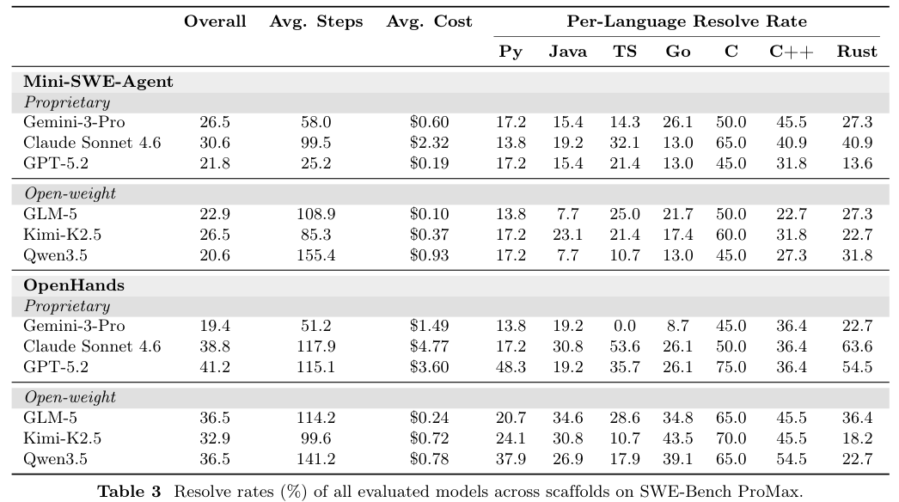
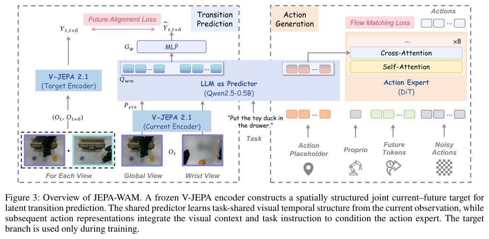
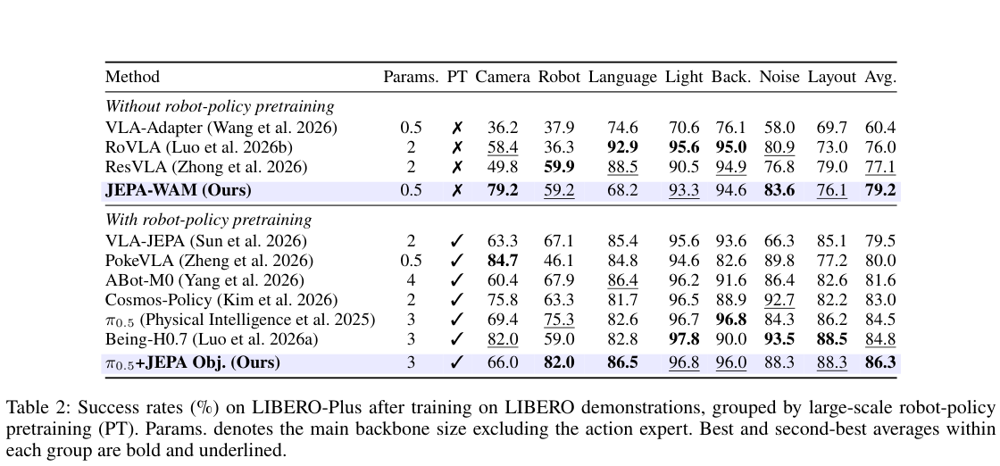

本期六项研究介绍时序图谱迁移、生产图谱身份与标注、推理状态安全、代码重构评测、联合嵌入动作模型与动力学外推。

## 1. FITTER：跨图谱迁移时保留相对时间结构

FITTER 研究训练与推理图的实体、关系名称和时间戳都可能不同的迁移。它依据谓词交互模式与相对时间顺序构造表示，再以消息传递结合局部和全局时序上下文，而非为目标图重新训练词表嵌入。

六个时序图谱用于跨图、跨领域迁移。Table 1 中，在 ICEWS14 训练、GDELT 测试且不微调时，FITTER 的 MRR 为 26.1，ULTRA 为 17.0，均按百分制报告。目标图仍提供用于消息传递的已知事实，不是模型在完全没有目标结构的条件下猜测。

表现也并非每个指标都最高：ICEWS05-15 训练、YAGO 测试时，ULTRA 的 Hits@10 为 90.9，FITTER 为 86.5。时间平移不变性的形式性质只针对所定义编码，不能据此宣称任意时序分布迁移可靠。

跨域评估要同时记录词表、时间跨度与训练/消息/测试划分。图越密集，训练和推理开销仍可能成为限制；一项平均排名不能代替逐目标检查。

图源：Jiaxin Pan , Mojtaba Nayyeri , Osama Mohammed , Daniel Hernandez , Rongchuan Zhang , Cheng Cheng , Steffen Staab，《FITTER: Vocabulary-Agnostic Cross-Domain Inference on Temporal Knowledge Graphs》，arXiv:2608.10668v1，Figure 1，PDF 第 4 页。[原图出处](https://arxiv.org/pdf/2608.10668v1#page=4) · [CC BY 4.0](https://creativecommons.org/licenses/by/4.0/)。裁剪自原文。

- [FITTER: Vocabulary-Agnostic Cross-Domain Inference on Temporal Knowledge Graphs](https://arxiv.org/abs/2608.10668v1) · v1，公开于 2026-08-11。

## 2. Curate Before You Connect：身份合并比类型标注更难撤销

这篇生产知识图谱案例用标识符、名称列、显示名和类型范围内的位置逐级判断记录身份，再进行多类本体标注。它强调实体名称只是实例标签，不能因为名字中包含某个词就直接断言该实体属于相应角色类型。

在偏向角色标注现象的 2,500 实体样本中，要求锚定证据后，角色赋值从三十六项降至四项，剩余四项经人工确认为正确；样本不是全图均匀抽样。图写入仍使用较粗的规范名称精确键，可能发生不可检测的过度合并，且没有身份解析基准。知识图谱规模与局部标注收益不能消除这项已知风险。

[Curate Before You Connect: Identity and Ontology Tagging in a Production Knowledge Graph](https://arxiv.org/abs/2608.10644v1) · v1。

[Figure 1（原文）](https://arxiv.org/pdf/2608.10644v1#page=2)。

## 3. 加密推理轨迹的安全边界：密文也需要绑定使用上下文

论文研究客户端保存的加密推理状态在会话、用户和模型之间的兼容性，发现部分测试配置把可迁移状态与较弱的输出防护组合后，会暴露原本不应公开的中间内容。核心问题是状态的完整性、保密性和使用上下文绑定是否共同成立。

*图｜Panfilov, Alexander 等，[Table 1（PDF 第 4 页）](https://arxiv.org/pdf/2608.09867v1#page=4)，[CC BY 4.0](http://creativecommons.org/licenses/by/4.0/)。裁剪自原文。*

作者分析公开日志中的 315,320 个推理块，报告发现 367 项个人信息记录和 182 项凭据记录；这些是其语料中的制品计数，不是全部服务用户的泄露比例。论文建议缩小可重放范围、绑定身份与会话，并处理日志暴露。结果属于论文测试时的具体 API 和模型配置，不能据此断言所有当前部署仍有同样问题。

[Stealing Reasoning Traces from Proprietary LLM APIs](https://arxiv.org/abs/2608.09867v1) · v1。

## 4. SWE-Bench ProMax：用跨文件重构检验行为保持

SWE-Bench ProMax 从真实提交构建一百七十项重构任务，覆盖七种编程语言。专家重写问题说明、检查 gold patch 与测试，并过滤过窄、超范围或过于简单的实例，要求 Agent 协调跨文件修改且保持行为。

*图｜Shi, Yuling 等，[Figure 3（PDF 第 5 页）](https://arxiv.org/pdf/2608.09802v1#page=5)，[CC BY 4.0](http://creativecommons.org/licenses/by/4.0/)。裁剪自原文。*

每题源码修改平均涉及 11.4 个文件、261.6 行代码。GPT-5.2 在 OpenHands 下解决率为 41.2%，在 mini-swe-agent 下为 21.8%；Gemini-3-Pro 则在后一框架更高，说明模型与运行框架会相互作用。这是特定任务集的测试通过率，人工审核提高可解释性，也不能穷尽所有潜在行为回归。

*图｜Shi, Yuling 等，[Table 3（PDF 第 8 页）](https://arxiv.org/pdf/2608.09802v1#page=8)，[CC BY 4.0](http://creativecommons.org/licenses/by/4.0/)。裁剪自原文。*

[SWE-Bench ProMax: Benchmarking Agents on Large-Scale Multilingual Code Refactoring](https://arxiv.org/abs/2608.09802v1) · v1。

## 5. JEPA-WAM：让动作骨干学习密集的时序关系

JEPA-WAM 在冻结 V-JEPA 表征空间中，以共享 predictor 学习当前与未来的联合目标，保留 patch 级对应关系，再提取动作预测所需表示。它还可把相同监督接入预训练 VLA，保持原有感知与动作路径。

*图｜Lin, Yihan 等，[Figure 3（PDF 第 3 页）](https://arxiv.org/pdf/2608.09381v1#page=3)，[CC BY 4.0](http://creativecommons.org/licenses/by/4.0/)。裁剪自原文。*

LIBERO-Plus 中，无大规模机器人策略预训练的 JEPA-WAM 平均成功率为 79.2%；向 π0.5 加入该目标是另一组，从 84.5% 到 86.3%。普通 LIBERO 上前者为 96.7%，仍低于 Fast-WAM 的 97.6%。模型主干规模与机器人预训练条件不同，不能将分组成绩合成一个统一排行榜。

*图｜Lin, Yihan 等，[Table 2（PDF 第 6 页）](https://arxiv.org/pdf/2608.09381v1#page=6)，[CC BY 4.0](http://creativecommons.org/licenses/by/4.0/)。裁剪自原文。*

[JEPA-WAM: Learning Vision-Language-Action Policies with Joint-Embedding World Modeling](https://arxiv.org/abs/2608.09381v1) · v1。

## 6. Latent Dynamics Reasoning：在结构化潜变量中显式积分运动

LDR 将低阶运动项交给数值积分，网络只预测三阶及更高阶残差；结构化潜变量把对象状态从密集卷积特征中分离。研究在匀速、抛物线、碰撞、反弹和视觉接近五个白盒任务上，扩大速度、半径等范围测试外推。

256×256 单任务训练中，平均位置误差从域内到域外，LDR 为 0.044 到 0.057，视频扩散对照为 0.069 到 0.369；位置误差的域内外差距约缩小二十四倍。半径误差的对应差距只约缩小 3.6 倍，不能把“二十多倍”推广到所有指标。简单对象与已知动力学结构仍限制对复杂现实场景的推断。

[Learning How the World Evolves: Extrapolative Video World Models via Latent Dynamics Reasoning](https://arxiv.org/abs/2608.09926v1) · v1。

[Figure 1（原文）](https://arxiv.org/pdf/2608.09926v1#page=1)。
